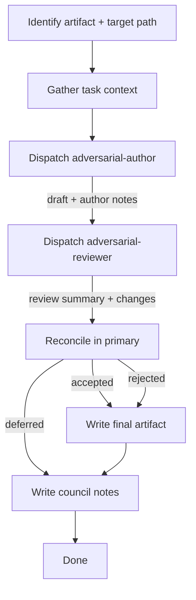

**Position in the chain:** … → `test` → **`adversarial-authoring`** → `drift` → `ship`
(per `_shared/rules/sdd-structure.md` § Phase Order). `test` must have completed
before this skill starts. No divergence: `drift`/`ship` do not start until this
skill is complete.

## Workflow



## When to Use

- A rule, user request, or instruction says "use adversarial authoring",
  "cross-model review", "model council", or "mixture of models".
- An artifact is high-stakes (blueprint, design, a `tasks.md` that will
  drive a fan-out) and a single-model draft is not enough.
- The user asks for a second perspective on a draft.

**When NOT to use:** mechanical edits (typo, rename, config change),
single-file doc updates, anything the `fast_track: trivial` class in
`.skillgrid/config.yaml` covers. The overhead is real — the author and
reviewer subagents each cost a full dispatch.

## The Two Subagents

Both roles live in `.agents/agents/` (one file per role):

- **`adversarial-author.md`** — writes the initial draft. Read-only; returns
  `## Draft` + `## Author Notes`.
- **`adversarial-reviewer.md`** — challenges the draft. Read-only; returns
  `## Review Summary` + `## Required Changes` + `## Suggested Improvements`
  + `## Risks and Open Questions`.

Both are read-only by construction. They do not run shell, do not read
the codebase, do not write files. The dispatch prompt carries their full
context; they do not inherit the session.

**Model selection.** For a genuine cross-model round, dispatch the author
and reviewer with *different* models — a cheaper tier for the author, a
more capable tier for the reviewer. A same-model round is a same-perspective
round; it still catches template violations but not the author's blind
spots. State which model each subagent ran on in the council notes.

## Required Workflow

1. **Identify the artifact.** Name the artifact being authored and its
   target output path (e.g. `.skillgrid/change-specs/YYYY-MM-DD-<topic>/design.md`).
   The council notes land beside it as `<basename>.council.md`.

2. **Gather the full task context before dispatching anything.**
   - The user's request (verbatim).
   - The artifact template, if any (cite the path; do not inline).
   - Project context (the `.skillgrid/config.yaml` `context:` field, the
     relevant `ASSUMPTIONS.md` sections, any in-force ADRs from the
     change's `adr.md` manifest).
   - Artifact-specific rules (the relevant `rules.*` keys in config, the
     `_shared/rules/` files the artifact type loads).
   - Dependency artifacts already completed (cite paths; the dispatch
     prompt names them, the subagent reads them).

3. **Dispatch the author.** A single dispatch to `adversarial-author`
   with the task context. **Require** a completed report containing the
   full draft (a launch ACK, a session ID, or a progress note is not
   completion). If the report is missing or incomplete, the round is
   incomplete — see "Fallback".

4. **Dispatch the reviewer.** A single dispatch to
   `adversarial-reviewer` with the author's full draft plus the original
   task context. Require a completed review report.

5. **Reconcile in the primary agent.** For each `Required Changes` entry:
   - **Accept** — apply the edit to the final draft.
   - **Reject** — record the rejection and why (the user's request, the
     template, or a project rule outranks the reviewer).
   For each `Suggested Improvements` entry, same accept/reject/defer
   discipline. For each `Risks and Open Questions` entry, carry it into
   the council notes' `Remaining Risks` section verbatim — the primary
   agent does not resolve a risk, it names it.

6. **Write the final artifact** to the target path. The final artifact is
   clean and canonical — no "council" metadata, no raw model dialogue, no
   hidden chain of thought.

7. **Write the council notes** beside the artifact (naming convention
   below). The council notes are the audit trail: what the author said,
   what the reviewer challenged, what was accepted / rejected / deferred,
   and what risks remain.

## Council Notes

Naming:

| Artifact | Council notes |
|---|---|
| `proposal.md` | `proposal.council.md` |
| `design.md` | `design.council.md` |
| `tasks.md` | `tasks.council.md` |
| `spec.md` | `spec.council.md` |
| `briefing.md` | `briefing.council.md` |

A nested artifact gets its council notes in the same directory. The
council notes file is a **specs-zone** file (it lives under
`.skillgrid/change-specs/` or under the artifact's directory); it
commits in the same zone as the artifact, never with code.

Shape:

```markdown
# Council Notes: <artifact-id>

**Author model:** <model id>
**Reviewer model:** <model id>
**Date:** YYYY-MM-DD

## Author Summary
<One-paragraph summary of the draft. No raw transcript.>

## Reviewer Challenges
- <Specific objection, gap, ambiguity, or risk raised>
- <...>

## Resolutions
- **Accepted:** <Change incorporated and why>
- **Rejected:** <Suggestion not incorporated and why>
- **Deferred:** <Issue left unresolved, where it is tracked>
- <...>

## Remaining Risks
- <Risk that remains after reconciliation, carried into the change's
   open questions or the next gate>
- <...>

## Fallback (if any)
<Only present when a stage was incomplete or the primary agent wrote
both the draft and the review. State which stage, why, and the
authorization.>
```

## Completion Gates

A round is complete only when **all** of:

- The author's report is present, successful, and contains the full
  `## Draft`.
- The reviewer's report is present, successful, and contains all four
  required sections.
- The primary agent has a per-finding disposition (accept / reject /
  defer) for every `Required Changes` entry.
- The final artifact is written to the target path.
- The council notes are written beside the artifact.

A **launch acknowledgement, a child/session ID, a progress note, or a
"still working" report is not success.** A background subagent that
reports "idle" is not necessarily "done" — inspect the report for the
required content before advancing. If the harness has no completion
notification, the report on disk is the evidence.

## Fallback (primary-only)

If either subagent fails, is unavailable, is blocked, or returns an
incomplete report:

1. Report the incomplete round to the user.
2. Ask whether to proceed with a **primary-only fallback** (the primary
   agent writes both the artifact and the council notes, naming the
   omitted stage).
3. Only on explicit user authorization: write the artifact and the
   council notes. In the council notes' `Fallback` section, name the
   omitted stage, why it was omitted, and the authorization.
4. **Never** claim a complete council round when a stage was skipped.
   A primary-only artifact is labelled as such; it does not count toward
   a "cross-model review" claim downstream.

## Guardrails

- Do not include raw model dialogue, hidden chain of thought, or full
  transcripts in the final artifact. The artifact is canonical; the
  council notes carry the process.
- Follow the original artifact template exactly. The template's
  headings are not negotiable by the author or the reviewer.
- Prefer **one** author round and **one** reviewer round. A second
  author revision is warranted only when the reviewer identified a
  concrete correctness issue (not a style preference). Two or more
  review rounds without a second author round is a sign the reviewer
  is over-reaching; reconcile from the first review.
- If the subagent reports conflict with a project rule, the project rule
  wins. The council notes record the conflict and the disposition.
- The council notes file is the **only** place the process lives. The
  artifact, the commit, the ledger, and the changelog all reference the
  council notes by path, never by inline content.

## Anti-Patterns

| Anti-pattern | Symptom | Fix |
|---|---|---|
| Same-model round | Author and reviewer both run on the session's default model | Dispatch with distinct `model:` values; state the models in the council notes |
| Reviewer rewrites | The reviewer's report contains "here is my edit" paragraphs | The reviewer names the defect; the primary agent makes the edit. A reviewer that rewrites is an author wearing a different hat |
| Missing council notes | The artifact exists but `<basename>.council.md` does not | The round is incomplete; write the notes before marking the artifact done |
| Primary-only without disclosure | The artifact reads as a complete council round but a stage was skipped | The `Fallback` section is mandatory when a stage was omitted |
| Round without a target path | The author returns a draft but the artifact path is ambiguous | Name the target path in step 1 before dispatching; a draft without a path is a note, not an artifact |

## References

- Role briefs: `.agents/agents/adversarial-author.md`,
  `.agents/agents/adversarial-reviewer.md`
- Template conventions: `_shared/craft/skill-anatomy.md`
- Gate format for any user-facing decision: `_shared/rules/user-gates.md`
- BDD zone rule (the council notes live in the specs zone): `skillgrid:execute` → Zone rule; `_shared/work-unit-commits/README.md` → Spec before code
