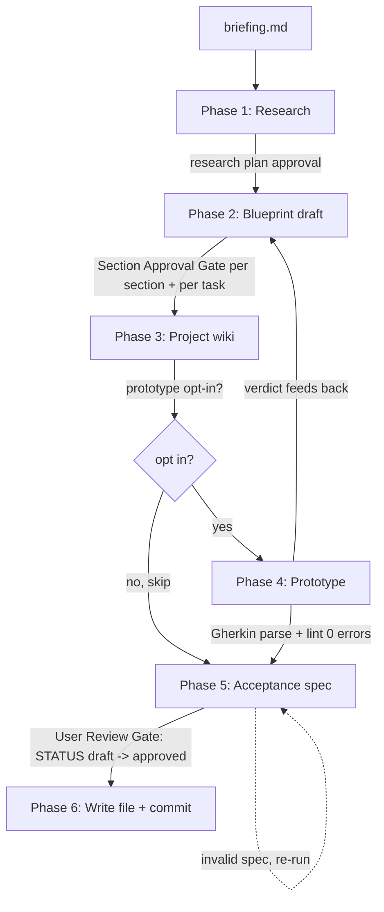

# Writing Blueprints

## Contents
- Overview / The Phase Flow
- Phase 1 Research / Phase 2 Blueprint Draft (Section Approval Gate) / Phase 3 Project Wiki / Phase 4 Prototype / Phase 5 Acceptance Spec (BDD) / Phase 6 Write File
- Multi-Phase Change Folders / File Structure / Must-Haves (Goal-Backward Verification)
- Hypothesis / Threat Matrix / Build Shape / One-Way-Door Checkpoints / Change Classification / Task Right-Sizing
- Plan header & task structure / Self-Review / Owed-Decision Gate / Ratify / Goldfish Review / Execution Handoff
- How to measure it / Common Rationalizations / Red Flags / Verification

## Overview

Turn a spec into a buildable implementation plan in six phases: delegate
external fact-finding to `skillgrid:research`, draft the blueprint section by
section with the user approving each section, persist the durable knowledge to
the project wiki, (optionally) de-risk the load-bearing technical unknowns with
a prototype, author the BDD acceptance spec from the validated blueprint, and
write the final `blueprint.md`.

The blueprint assumes the engineer has zero context for our codebase and
questionable taste. Document everything they need to know: which files to touch
for each task, code, testing, docs they might need to check, how to test it.
Give them the whole plan as bite-sized tasks. DRY. YAGNI. TDD. Frequent commits.
Assume they are a skilled developer who knows almost nothing about our toolset
or problem domain, and doesn't know good test design very well.

**Announce at start:** "I'm using the skillgrid:blueprint skill to create the
implementation plan."

**Position in the chain:** … → `prototype` → **`blueprint`** → `slicing` → …
(per `_shared/rules/sdd-structure.md` § Phase Order). `brainstorm` (including
its delegated `questioning`, `research`, and `prototype` sub-steps) must have
completed before this skill starts. This skill runs `research` inline as
Phase 1 and `prototype` inline as Phase 4 (delegated to standalone skills). No
divergence: `slicing` does not start until this skill is complete.

**Config:** Read `.skillgrid/config.yaml` before starting. Use
`conventions.specs_root` for blueprint location. If the file doesn't exist, use
the default `.skillgrid/change-specs/`. Use the terms vocabulary from
`conventions.artifacts` (default `.skillgrid/projectwiki/glossary/
01-business-terms.md` + `02-technical-terms.md`) for names and concepts.
Constrain the blueprint by the in-force decisions: read the change's ADR Review
Manifest at `.skillgrid/change-specs/YYYY-MM-DD-<topic>/adr.md` (produced by
brainstorming; in-force set from the `## LOCKED` ADR index in
`.skillgrid/projectwiki/ASSUMPTIONS.md`) and respect every in-force ADR it names
— a blueprint that contradicts an in-force ADR must either follow it or record a
new superseding ADR file.

**The blueprint is pure-technical.** It is the *how*: architecture, file layout,
tasks, tests, constraints. The product *why* — user value, personas, success
metrics — lives in the spec (`briefing.md`) and in
`.skillgrid/projectwiki/reference/00-prd.md`; the blueprint **cites** those (a
`Spec:` line, a `per .skillgrid/projectwiki/reference/00-prd.md` or `per
.skillgrid/projectwiki/decisions/NNNN-slug.md` constraint) and does not
restate them (per `_shared/craft/cite-dont-restate.md`). Operational rules are
cited as `per AGENTS.md § Rules`.

**Context:** If working in an isolated worktree, it should have been created via
`skillgrid:execute` Step 0 (isolated workspace) at execution time.

**Save plans to:** `.skillgrid/change-specs/YYYY-MM-DD-<feature-name>/blueprint.md`

<HARD-GATE>
**Spec-zone only.** Every file this skill writes lands where
`_shared/rules/sdd-structure.md` § Directory Structure says it lands —
`blueprint.md` and `acceptance.feature` in
`{specs_root}/YYYY-MM-DD-<topic>/`; research and prototype results in the
change's `findings.md`; durable knowledge in `{projectwiki}/`; prototype
artifacts in `{prototype.dir}/`. Nothing else: no `plan.md`, no `design.md`,
no `architecture.md`, no new directories, and nothing outside `.skillgrid/`
(the throwaway probe code is the one exception — it lives under
`{prototype.dir}/` and is labeled throwaway). The canonical names are
load-bearing — `skillgrid:resume` derives the phase from which of these files
exist, so a renamed or relocated file silently breaks the pipeline. If you are
about to write an artifact anywhere else, STOP: resolve the path from
`.skillgrid/config.yaml` (`conventions.specs_root`, `conventions.artifacts`)
and write it there.
</HARD-GATE>

## The Phase Flow

The blueprint runs in six phases, **internal to this skill** — distinct from
the orchestrator's `skillgrid` eight-phase delivery lifecycle (Intake →
Foundation → Architecture → Drafting → Adversarial Audit → Revision → Final
Score → Editorial). Within this skill, "Phase N" means the planning phase below;
the orchestrator's "Phase N" means the delivery phase. When both are in view,
say which (e.g. "blueprint Phase 4" vs "delivery Phase 4: Adversarial Audit").

The six phases are ordered and gated. Phases 1, 3, 4, and 5 each end in a
handoff; phase 2 is the heart of the skill.

| Phase | Name | Output | Gate |
|-------|------|--------|------|
| 1 | Research (delegated to `skillgrid:research`) | `findings.md` `## Research:` section + projectwiki `sources/`/`syntheses/`/`concepts/` pages | research plan approval (fan-out); handoff report |
| 2 | Blueprint draft | `blueprint.md` (section by section) | **Section Approval Gate** per section + per task |
| 3 | Project wiki | durable pages in `.skillgrid/projectwiki/` + `projectwiki index` | page-home confirmation; no-new-findings gate |
| 4 | Prototype (delegated to `skillgrid:prototype`, optional) | `{prototype.dir}/NNN-name/` + `findings.md` `## Prototype:` section | user opt-in; hypothesis nod; verdict report |
| 5 | Acceptance spec | `{specs_root}/YYYY-MM-DD-<topic>/acceptance.feature` (lint-clean) | Gherkin parse + lint 0 errors; **User Review Gate** — STATUS banner `draft` → `approved` (user hand-edit) |
| 6 | Write file | committed `blueprint.md` + `acceptance.feature` | commit (spec zone, before any code) |



- **Phase 1 → 2:** research findings feed the draft. A design decision that
  rests on a research fact cites `findings.md`.
- **Phase 2 → 3:** the draft's decisions and cited research sources are
  persisted to the project wiki.
- **Phase 3 → 4 (optional):** the user decides whether to de-risk the
  load-bearing technical unknowns with a prototype.
- **Phase 4 → 2 (feedback):** a prototype's verdict + liftable module +
  constraints feed back into the draft (Phase 2 re-runs the affected sections)
  and into the wiki (Phase 3). The prototype can invalidate an approach —
  that is the point.
- **Phase 4 → 5 / Phase 3 → 5:** if no prototype (or after it), the wiki is
  finalized and the BDD acceptance spec is authored from the validated
  blueprint (BDD is always on — no opt-out).
- **Phase 5 → 6:** the acceptance spec must parse (Gherkin dry-run), lint
  clean, and carry a line-3 STATUS banner of `approved` (the user's
  hand-edit at the User Review Gate — the agent never writes `approved`)
  before the blueprint file is written and committed.

The phase order is not a wall: a prototype that invalidates an approach sends
the draft back to Phase 2 for the affected sections, and the wiki (Phase 3) is
updated to match. The gates are the hard stops; the phases are the working
order.

**Prerequisite (before Phase 1):** read the change's `briefing.md`. It must
exist AND its line-3 STATUS banner must be `approved` (the user's hand-edit
at brainstorm's User Review Gate). If it is `draft` or `revised`, HALT:
tell the user to read the briefing and flip the banner themselves
(`draft` → `approved (YYYY-MM-DD)` — the agent never writes `approved`),
record `blocked(spec): briefing.md awaiting user approval` in `state.yaml`,
and stop. Confirmation = re-read line 3 from disk and quote the banner
(User approval gate per `_shared/rules/sdd-structure.md` § STATUS Banner).

## Phase 1 — Research (delegated)

External fact-finding that grounds the blueprint. Delegate to
**`skillgrid:research`** — the full protocol, both modes (single-pass and
fan-out), the epistemics, the sourcing rules, the subagent briefs, and the
synthesis contract live in the research skill.

**Run it when** the design or plan depends on a fact not in the codebase — a
library's current API, a version's behavior, a domain constraint, an
integration's real behavior, a competitor's offering. **Skip it** when the
answer is already known from the codebase or a simple local read.

- **Mode choice:** single-pass (the default, one dimension, one pass) vs
  fan-out (wide or high-stakes, or heavy reading that should run in the
  background). The user's explicit request beats the mode choice.
- **Output:** a `## Research: <question>` section in
  `{specs_root}/YYYY-MM-DD-<topic>/findings.md`, committed, every load-bearing
  claim cited inline `[n]` with confidence flagged.
- **Handoff:** report the decision, the 2–3 findings that drive it, the
  biggest caveat, and the path to `findings.md`. The draft (Phase 2) reads the
  file; it does not reprocess the web.

## Phase 2 — Blueprint Draft (Section Approval Gate)

Draft the blueprint **section by section, gated per section and per task** —
not in one pass and reviewed at the end. When `blueprint.md` is first
written, its line-3 STATUS banner is `proposed` — you write it; the user's
hand-edit at the User Review Gate sets `approved`, and you never write
`approved` yourself. Protocol:
[section-by-section.md](references/section-by-section.md).

- **Ingestion (R18):** before writing any section, read `briefing.md` in full,
  `findings.md` if present, `adr.md` if present; present a 2–3 sentence summary
  of the briefing's key decisions; the user confirms the drafting context.
- **Hypothesis validation (R26):** before the first byte of `blueprint.md`
  is written, put the plan-level hypothesis to the user — the claim you are
  about to encode (from the briefing and findings: the approach, the key
  technical assumptions, the first-wave build shape), the falsifiers (what
  observable result would prove the plan wrong), and the thinning (the
  smallest slice that would test it) — as decisions through the structured
  answer tool (per `skillgrid:questioning` frontier rounds: options with
  trade-offs, one at a time, each with your recommendation). The user
  accepts, overrides, or amends each one; the answers are the input to the
  Hypothesis section. A hypothesis the user has not seen is an unvalidated
  assumption in the plan, not a decision. In the same step, every
  validated decision that clears the ADR-sparingly test
  (`_shared/adr-records/README.md`) is written to
  `{projectwiki}/decisions/NNNN-slug.md` (monotonic number,
  frontmatter, body per the config's `adr_style` template) plus its pointer
  row in the `## LOCKED` ADR index in
  `{projectwiki}/ASSUMPTIONS.md`; a decision that contradicts an in-force
  ADR gets a new superseding ADR (`supersedes:` frontmatter, the prior
  file untouched — IRON RULE) and the prior index row flips to
  "In force: no". ADR capture is part of R26, not Phase 3 — the plan's
  durable decisions are recorded before the plan file exists.
- **Section order (R19):** the fixed drafting order — Header → Hypothesis →
  Key Decisions → Must-Haves → Validation → Threat Matrix (if applicable) →
  Failure Handling (if applicable) → File Structure → Global Constraints →
  Rollout & Rollback → Tasks 1..N → Open Questions → Self-Review → Commit.
  Each section carries its
  content contract (pointed at the SKILL.md section that defines it). The final
  document's layout follows `templates/blueprint.md`.
- **Per-section gate (R19):** after each section is written to `blueprint.md`,
  present the **Section Approval Gate** in the same turn — the visible chat
  summary precedes the single-select gate (approve-and-proceed /
  request-revisions): the section link, the section's concept in 1–2
  sentences, and each of the 2–3 key decisions presented for judgment
  (mechanism, advantages/disadvantages, when it fails) — never as bare facts.
  No empty chat bubbles. The user can revisit any earlier section at any
  point. Full protocol + paired example:
  [section-by-section.md](references/section-by-section.md) § Per-section gate.
- **Per-task gate (R20):** in the Tasks section, Task N+1 is not written until
  Task N is approved. The task template (Files / Interfaces / SATISFIES / Steps
  with code) is structurally unchanged — only the approval cadence changes.
- **Alternatives from the briefing (R23):** before writing the blueprint, read
  the briefing's `Approaches Considered` section; note rejected alternatives
  one line each (`Rejected: [approach] — [reason]`); if the section is absent,
  note `No alternatives recorded in briefing` rather than inventing them.
- **Artifact-first (R25):** **Do not dump the blueprint in chat.** Write to
  `blueprint.md` with the file tool and give the user the path; the gate
  summary (R19) carries the section link, the section's concept, and each of
  the 2–3 key decisions with mechanism / disadvantages / failure condition,
  and then asks for review. All section/task approval gates follow
  `_shared/craft/review-discipline.md` (artifact-first, zero-tool turn-yield).

**Findings citation:** every design decision that rests on a research fact
(Phase 1), a feasibility result (Phase 4), or a chosen layout (a sketch) must
cite `findings.md` (the header's **Findings** line carries the path). If no
research/prototype ran, omit that line.

**The in-flight doubt gate.** The Section Approval Gate asks the user to
approve what is written; the doubt gate asks *you* whether a load-bearing claim
in the section is actually true before you present it. When a section asserts a
fact that, if wrong, would invalidate the section — a value that came from
nowhere, an interface assumed to exist, a constraint stated without a source —
run the check in the same turn, before the gate: **CLAIM** — name the one
load-bearing fact the section rests on. **EXTRACT** — point at its source
(a `findings.md` line, an ADR, a `briefing.md` decision, or the code itself).
**DOUBT** — is there a way the fact is asserted but unsourced (no citation, a
value that matches no column/field, a constraint that no research produced)?
**RECONCILE** — if sourced, proceed to the gate; if unsourced, treat it as an
Owed-Decision (the panel fires) rather than letting it ride into the blueprint
as if decided. This runs per section, in the drafting turn, and never blocks
the user — it converts a silent assumption into a named decision before it is
approved.

**The reviewer gets the artifact, not your conclusion.** When the doubt gate
dispatches a fresh-context reviewer (a non-trivial section, a contested
Owed-Decision), hand it the section text (the artifact) plus the constraint it
must satisfy (the contract) — **never the CLAIM as framed by you**. Naming your
conclusion biases the reviewer toward agreement; the reviewer must independently
determine whether the section holds. Strip your reasoning from the dispatch, but
keep contradicting evidence in — a caller, guard, or test that conflicts with
the claim belongs in the unit.

**Doubt theater is a checkable failure.** If two or more consecutive doubt
cycles surface substantive findings and **zero** are classified as actionable
(every one dismissed as noise or trade-off without changing the section), you
are validating, not doubting — stop and escalate to the user with the dismissed
findings listed. The same signal applies at the review loop: a fresh reviewer
that keeps finding things you keep waiving is information about the artifact,
not a reason to keep looping.

**A failing test is a doubt made concrete.** When a load-bearing claim is
behavioral ("this function handles X", "this flow recovers from Y"), the
cheapest doubt is TDD's RED step: write the test that would disprove it and
run it before the implementation stands. A RED→GREEN pair satisfies the doubt
gate for that claim — no separate reviewer dispatch needed. The doubt gate and
the test suite are the same discipline at different moments: the gate checks
the claim before the code, the test checks it after.

## Phase 3 — Project Wiki

Persist the blueprint's durable knowledge to the project wiki vault at
`.skillgrid/projectwiki/` — the LLM-wiki that outlives the change. This is the
phase that turns the per-change `findings.md` into durable, cross-change
knowledge.

**What to write** (locate the home first — `projectwiki query` +
`status --json` `by_type` — before writing; one file per concept; every page
carries 2+ `[[type/slug]]` wikilinks):

- **Decisions** the blueprint locks in that are ADR-shaped → `decisions/` per
  `_shared/adr-records/README.md` (numbering, IRON RULE, LOCKED row, `adr_style`
  template selection — this skill never mints ADR numbers itself; `brainstorm`
  drives it during the interview). R26 already recorded the validated
  plan-level decisions at validation time (including any superseding ADR);
  Phase 3 records only decisions that surface later — during section
  drafting or in a prototype — so nothing is written twice and the
  sequence stays monotonic.
- **Research sources** the blueprint cites → `sources/` (one SourceSummary page
  per external source; a **summary, never a copy**; frontmatter `sources:`
  carries the `external:<name> <version>` citation + `build_fingerprint`
  staleness token via `projectwiki cite-source`).
- **Research results** the blueprint rests on → `syntheses/` (the result hub:
  question, method, findings, answer; cross-linked to every `sources/` page it
  drew on and every `concept` it spawned; `status: draft` while the change is
  open, finalized to `stable` by `reflect` at ship).
- **Reusable findings** cut from a synthesis → `concepts/` (a reusable idea or
  pattern that outlives the research result; links back to the `syntheses/`
  result and to ≥1 repo page that makes it actionable here).
- **Technical details** the blueprint pins down → `architecture/` (module map,
  data flow, boundaries) and `gotchas/` (discovered issues / non-obvious
  behavior a later build must not re-learn). A must-hold constraint →
  `invariants/` (with `claims:`). A domain term the blueprint introduces →
  `glossary/` (one page per term).

**Contradictions:** a new page never silently overwrites an existing one — it
**links** to the conflicting page and marks it `status: deprecated`, with the
deprecation reason on the deprecated page. Both pages link to each other.

**Rules** (per the `projectwiki` skill, cited not restated):

- The **same-edit rule** is non-negotiable: every page write is followed by
  `projectwiki index` — the engine refreshes the derived FTS rows and rewrites
  `index/last-update.json`. Page + reindex ship together or the change is
  incomplete.
- **Never hand-edit** derived state (`index/`, FTS, baselines, `config.json`) —
  `projectwiki index`/`reindex` rebuilds it.
- **External material** enters via `projectwiki cite-source` (stable source ID
  + section granularity) and frontmatter `sources[]`; the vault never copies raw
  source content.
- **Gate before shipping:** `projectwiki index` → `projectwiki validate`
  (pin-check) → `projectwiki lint` (health) → `projectwiki status --json`. The
  target is **no new findings**, not a zero: `--strict` fails only on
  error-severity codes (`broken_wikilink`, `missing_sources` on a grounded page,
  `ungrounded_grounded`); a warn baseline is normal on a vault that predates the
  checks. Never rewrite a page just to silence a warning — fix the cause or
  record it.
- Engine down → degrade to direct Markdown reads and declare `Degraded:
  projectwiki`; never invent a substitute retrieval path silently.

**Handoff:** report the pages written (one line each: type + slug + why), the
`projectwiki status --json` `by_type` / `orphans` / `stale` numbers, and
confirmation the gate passed. The blueprint (Phase 2/5) cites the vault pages
by `[[type/slug]]`; it does not restate them.

## Phase 4 — Prototype (delegated, optional)

A throwaway feasibility experiment that de-risks the load-bearing technical
unknowns the blueprint rests on. Delegate to **`skillgrid:prototype`** — the
full protocol (verdict states, liftable pure module, investigation trail,
forensic log layer) lives in the prototype skill.

This phase **runs only when the user opts in** at the phase 2/3 boundary.
After Phase 2 (and 3), present the opt-in:

> The draft is drafted and the durable knowledge is in the wiki. Before the
> file is written, do you want to de-risk the load-bearing technical unknowns
> with a prototype? Name the unknown(s) to probe (a library's real behavior, an
> integration's feasibility, a performance or data-shape question) — or skip to
> writing the file.

- **Opt in:** frame each unknown as a falsifiable Given/When/Then, get the nod,
  build the experiment in `{prototype.dir}/NNN-name/`, iterate, write the
  verdict (`VALIDATED` / `INVALIDATED` / `PARTIAL`) + investigation trail,
  append to `findings.md`, and report.
- **Opt out:** skip to Phase 5 (acceptance spec). Record `Prototype: skipped (user opt-out)` in
  the blueprint header so the choice is visible, not implicit.

**Feedback loop:** a prototype's verdict + liftable pure module + constraints
feed back into the draft (Phase 2 re-runs the affected sections; the
**Findings** header line now cites the `## Prototype:` section) and into the
wiki (Phase 3 updates `architecture/` / `concepts/` / `gotchas/` / `syntheses/`
to match). An `INVALIDATED` verdict kills a dead end before the real build hits
it — present **continue / pivot the approach / abandon** and wait for the
answer before proceeding.

## Phase 5 — Acceptance Spec (BDD, always on)

Derive the BDD acceptance spec (`acceptance.feature`, Gherkin) from the
**validated** blueprint, **before** implementation. BDD is always on
(non-negotiable, like TDD) — `bdd.enabled` is always `true` in
`.skillgrid/config.yaml`; there is no opt-out. The acceptance suite executes
the spec against the running application, and a green suite is the gate for
archive. Full protocol: [acceptance-phase.md](references/acceptance-phase.md).

**Prerequisite:** `blueprint.md` exists, the Goldfish review passed with the
user's approval (Phase 2's Section Approval Gate + the User Review Gate), AND
its line-3 STATUS banner is `approved` (the user's hand-edit — or
`assumed` / `accepted`, which are created only at a user decision point).
Never write `acceptance.feature` against a blueprint still `proposed` — the
spec is the contract the code satisfies, and it is committed before code
(Zone Rule, per `_shared/work-unit-commits/README.md`).

- **Source:** the spec's requirements (one `### Requirement:` per briefing
  requirement) plus the blueprint's Must-Haves truths; the Threat Matrix's
  Applicable rows each get a concrete RED-test scenario.
- **Stack:** resolve `bdd.stack:` from `.skillgrid/config.yaml` (default
  `javascript` = cucumber-js; if absent and `.skillgrid/acceptance-tests/` exists, infer
  from its contents and offer to record it; otherwise ask — never guess
  silently). Runner setup + files-to-copy:
  [references/javascript/SETUP.md](references/javascript/SETUP.md).
- **Authoring:** one `#### Scenario:` per behavior with a ` ```gherkin ` fence
  holding only Given/When/Then steps; scenario names prefixed `happy path` /
  `edge` / `failure` (every requirement has ≥1 of each); domain language from
  the glossary, observable outcomes in `Then`, falsifiable, one behavior per
  scenario. Template: [templates/acceptance.feature](templates/acceptance.feature).
  The Markdown → Gherkin mapping (headings become `Feature:`/`Rule:`/`Scenario:`,
  fences hold steps only): [references/EXTRACTION.md](references/EXTRACTION.md).
- **Syntax validation (mandatory):** after writing, run the runner in
  dry-run/parse mode (e.g. `cucumber-js --dry-run`) and gherkin-lint over the
  extracted output with `references/gherkin-lintrc.json`. Fix errors before the
  file is considered complete — invalid syntax blocks the User Review Gate.
- **STATUS banner:** when `acceptance.feature` is first written, its line-3
  STATUS banner is `draft` — you write it; the user's hand-edit at the User
  Review Gate sets `approved`, and you never write `approved` yourself (same
  contract as `briefing.md` and `blueprint.md`, per
  `_shared/rules/sdd-structure.md` § STATUS Banner). The template
  ([templates/acceptance.feature](templates/acceptance.feature)) carries the
  banner.
- **Gate — User Review Gate (STATUS banner):** after syntax validation
  passes, present the spec for review:

  > "Acceptance spec written to `<path>` (Gherkin, lint-clean, N requirements
  > × M scenarios). Please read it — the scenarios are the contract the code
  > must satisfy, and they are committed before any code. When you approve,
  > edit the STATUS line yourself: change `draft` to `approved (YYYY-MM-DD)`
  > on line 3."

  Wait for the flip. Confirm by re-reading line 3 from disk and quote the
  banner in your reply. If the user requests changes, make them, re-run
  syntax validation, and set the banner to `revised` (the user re-reads and
  re-flips). **Never proceed to Phase 6 without the banner showing
  `approved`.**

The red scenarios at propose time are the change's work list — execution
implements one pending step definition at a time (run the suite so the step
fails for the right reason, implement until it passes, then commit).

## Phase 6 — Write File

Write and commit the final `blueprint.md` and `acceptance.feature`.

- **Re-run the final Self-Review** on the complete file — the two mechanical
  checks (Spec Reconciliation per Self-Review check 1: contradictions quoted
  and listed first, additions reported when load-bearing, no silent rewrites;
  and Placeholder scan per check 2) — section-by-section drafting may have
  drifted from the spec. Quality judgments are the Goldfish pipeline's job.
- **Acceptance spec present and approved:** `acceptance.feature` exists in the
  change folder (Phase 5), lint-clean, with ≥1 `happy path` + `edge` +
  `failure` scenario per requirement, AND its line-3 STATUS banner is
  `approved` (the user's hand-edit — re-read from disk and quote the banner).
  Never commit `acceptance.feature` while the banner is `draft` or `revised`.
- **Commit** the change folder (`git add` + `git commit`) — the artifacts are a
  checkpoint alongside the code. `blueprint.md` and `acceptance.feature` are
  both spec-zone files and commit together (the `pre-commit` zone guard,
  `_shared/work-unit-commits/README.md`, blocks mixing spec-zone changes with
  code).

- **Trigger `skillgrid:projectwiki` (Maintain mode)** — the run wrote ADRs
  (R26 + Phase 3) and durable wiki pages; invoke the projectwiki skill to
  complete the vault update (same-edit rule, `log.md` lines, ADR `## Related`
  blocks, ship gate with no new findings) before the execution handoff
  ([blueprint-plan-spec.md](references/blueprint-plan-spec.md) § Execution
  Handoff).

**Role (do not rename):** `blueprint.md` is the *how* (implementation plan —
steps, files, code, verification); the companion `briefing.md` is the *what*
(requirements & intent). The header must read
`# <Topic> — Implementation Blueprint (steps, files, verification)`.
`brainstorming` and `resume` key phase state off these exact filenames — never
rename to `plan.md`/`design.md`, and never move the folder out of `specs/`.

- Copy `templates/blueprint.md` from this skill's directory and fill it in.
- (User preferences for plan location override this default)

## How to measure it

Per `_shared/craft/measurement.md`.

| | Indicator | Data source | Direction |
|---|-----------|-------------|-----------|
| Leading | Time from `briefing.md` approval to a committed, lint-clean `blueprint.md` + `acceptance.feature` | Git history (two commit timestamps) | should fall |
| Lagging | Revisions: `blueprint.md` commits dated after the first `tasks.md` commit for the same change | Git history | should fall |

## Common Rationalizations

| Rationalization | Reality |
|---|---|
| "I'll skip the Section Approval Gate — the user can review the whole file at the end" | The gate is per section and per task: a section approved in isolation is a decision the user owns; a bulk review at the end is a rubber stamp. Present each gate in the same turn as the section it covers. |
| "The section summary lists the decisions — that's enough for the user to approve" | A list of decided facts is a recommendation, not a decision point. Each key decision in the gate summary carries its mechanism, its disadvantages, and the conditions under which it fails (R19). Test: could the user approve without knowing what any decision costs? If yes, the gate is a rubber stamp. |
| "Research is overkill — I know this library" | The gate is the citation, not the confidence. If a section rests on a fact not in the codebase, Phase 1 ran or the doubt gate fires. |
| "The acceptance spec can wait — execution will write the scenarios as it goes" | BDD is always on. `acceptance.feature` is committed before code (Zone Rule); the red scenarios at propose time ARE the change's work list. |
| "I'll draft the blueprint in chat and paste it into the file later" | Artifact-first: write to `blueprint.md` with the file tool and give the user the path. Chat carries the 2–3 key decisions, never the document. |
| "The folder is small enough that a plan.md or a separate architecture.md would be clearer" | Spec-zone only: the files are `blueprint.md` (+ `acceptance.feature`, `findings.md`) in the change folder. A renamed or extra file breaks `skillgrid:resume`'s phase detection. |

## Red Flags

| Thought | Reality |
|---------|---------|
| "The briefing is thin — I'll just assume the intent" | An `approved` briefing is the contract; a gap in it is an Owed-Decision (the panel fires) or an `intent_gap` back to brainstorm — not a silent assumption in the blueprint. |
| "This section is obviously right — no need to present the gate" | The gate is the user's decision point, not my confidence. Present it anyway; "approve-and-proceed" takes one click. |
| "The prototype is optional, so I'll skip it to save time" | Optional means the user decides. If a load-bearing unknown would invalidate a section if wrong, present the opt-in — the user says no, recorded, and that is the right outcome. |
| "I'll save the plan as plan.md / architecture.md / a new file" | Spec-zone only: the file is `blueprint.md` in `{specs_root}/YYYY-MM-DD-<topic>/` (plus `acceptance.feature`, `findings.md`). A new filename or location breaks `skillgrid:resume`'s phase detection — the pipeline can no longer find the plan. |
| "The draft has drifted from the briefing — I'll patch the briefing later" | No silent rewrites. Phase 6 reconciles against the briefing: contradictions quoted and listed, additions reported when load-bearing. A briefing change after freeze is an `intent_gap` (HALT + human decision). |
| "Two blueprints can share one change folder if the topics are related" | One change folder per change; a multi-phase build gets sibling folders under `{specs_root}/` ([multi-phase.md](references/multi-phase.md)), never nested and never merged. |

## Verification

- [ ] The prerequisite held: `briefing.md` exists with line-3 STATUS `approved` (re-read from disk, banner quoted)
- [ ] Hypothesis validation (R26) ran BEFORE the first byte of `blueprint.md` — the plan's claim, falsifiers, and thinning were each put to the user through the structured answer tool and accepted, overridden, or amended — and every validated decision that cleared the ADR-sparingly test was written to `{projectwiki}/decisions/NNNN-slug.md` (contradictions as superseding ADRs per the IRON RULE, with `## LOCKED` pointer rows) in that same step, before the plan file
- [ ] Phase 2 ran section by section — every section and every task passed its Section Approval Gate in the same turn it was written
- [ ] Phase 3 gate passed: `projectwiki index` → `validate` → `lint` → `status --json` with no new findings; every page write was followed by `projectwiki index`
- [ ] If a prototype ran: verdict recorded in `findings.md`, feedback loop applied (Phase 2 sections re-run, wiki updated); if skipped: `Prototype: skipped (user opt-out)` in the blueprint header
- [ ] `acceptance.feature` exists in the change folder, parses (dry-run) and lints with 0 errors, with ≥1 `happy path` + `edge` + `failure` scenario per requirement, AND its line-3 STATUS banner is `approved` (re-read from disk, banner quoted) — committed before any code
- [ ] `blueprint.md` header reads `# <Topic> — Implementation Blueprint (steps, files, verification)`; STATUS banner handled per the contract (agent writes `proposed`, user flips `approved`)
- [ ] Phase 6 self-review ran on the complete file — two mechanical checks: Spec Reconciliation (contradictions quoted and listed first, additions reported when load-bearing) + Placeholder scan (no TBD/TODO/vague patterns per task-structure.md)
- [ ] Spec-zone only: no file written outside `{specs_root}/YYYY-MM-DD-<topic>/`, `{projectwiki}/`, or `{prototype.dir}/`; no renamed or extra artifacts
- [ ] `skillgrid:projectwiki` was triggered (Maintain mode) at the end — `projectwiki index` after every page write, `log.md` lines for each action, ADR `## Related` blocks present, and the ship gate (`index` → `validate` → `lint` → `status --json`) passed with no new findings — before the execution handoff
- [ ] Committed: `blueprint.md` + `acceptance.feature` in the spec zone, before any code (zone guard honored)

## Multi-Phase Change Folders

When a blueprint spans multiple phases of a *build* (not the planning phases
above), each phase folder is a normal change folder (`briefing.md`, not
`spec.md`). Layout and rules: [multi-phase.md](references/multi-phase.md). The
spec-folder tree is in `_shared/rules/sdd-structure.md`.

### Per-phase change folders

When a blueprint is large enough to warrant phase separation (typically 4+
phases or 20+ tasks), split it into **one change folder per phase** as siblings
under `.skillgrid/change-specs/`, plus a parent folder holding the shared
blueprint index and shared context:

- **Parent folder** (`YYYY-MM-DD-<topic>/`) — not a change. Holds `blueprint.md`
  (status, tier, goal, architecture, tech stack, spec ref, and a phases table
  linking to each phase) and `shared/context.md` (hypothesis, terms,
  must-haves, global constraints, file structure shared across all phases).
- **Phase folders** (`YYYY-MM-DD-<topic>-phase-<N>/`) — each a normal change
  folder. `briefing.md` holds the phase goal. Later artifacts (`blueprint.md`,
  `tasks.md`, `review.md`) follow `_shared/rules/sdd-structure.md`.
- **Naming:** `<parent-change-name>-phase-<N>` (e.g.
  `2026-10-01-kubedash-5.0-phase-1`).
- **Back-links:** each phase `briefing.md` links to `../<parent>/blueprint.md`
  and `../<parent>/shared/context.md`. The parent's phases table links to
  `../<parent>-phase-N/`.
- **Do not nest** phase folders inside the parent — they must be siblings at
  the `.skillgrid/change-specs/` level.
- Each phase is sliced, executed, and shipped independently.

For smaller changes, use the standard single-folder layout.

## File Structure

See `references/blueprint-plan-spec.md` for the full procedure.

## References

- [../skill-creator/references/rationalizations.md](../skill-creator/references/rationalizations.md) — the authoring rationalizations (script extraction, size, spine sections); load when you or the user push back on this skill's shape
