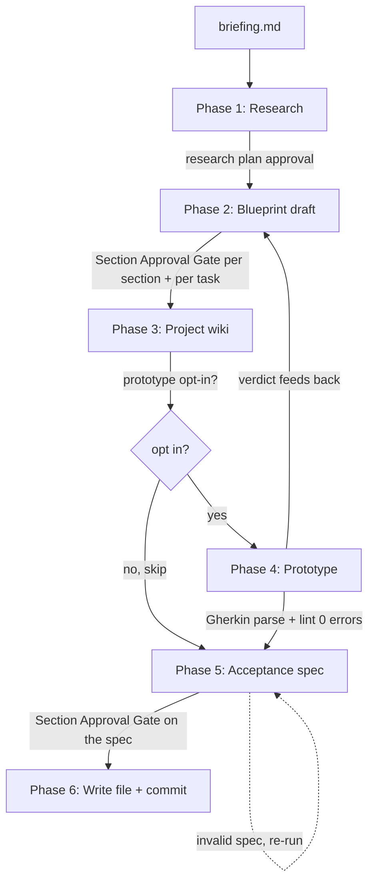

# Writing Blueprints

## Contents
- Overview / The Phase Flow
- Phase 1 Research / Phase 2 Blueprint Draft (Section Approval Gate) / Phase 3 Project Wiki / Phase 4 Prototype / Phase 5 Acceptance Spec (BDD) / Phase 6 Write File
- Multi-Phase Change Folders / File Structure / Must-Haves (Goal-Backward Verification)
- Hypothesis / Threat Matrix / Build Shape / One-Way-Door Checkpoints / Change Classification / Task Right-Sizing
- Plan header & task structure / Self-Review / Owed-Decision Gate / Ratify / Goldfish Review / Execution Handoff
- How to measure it / Common Rationalizations / Red Flags / Verification

## Overview

Turn a spec into a buildable implementation plan in six phases: research the
facts the design rests on, draft the blueprint section by section with the user
approving each section, persist the durable knowledge to the project wiki,
(optionally) de-risk the load-bearing technical unknowns with a prototype,
author the BDD acceptance spec from the validated blueprint, and write the
final `blueprint.md`.

The blueprint assumes the engineer has zero context for our codebase and
questionable taste. Document everything they need to know: which files to touch
for each task, code, testing, docs they might need to check, how to test it.
Give them the whole plan as bite-sized tasks. DRY. YAGNI. TDD. Frequent commits.
Assume they are a skilled developer who knows almost nothing about our toolset
or problem domain, and doesn't know good test design very well.

**Announce at start:** "I'm using the skillgrid:blueprint skill to create the
implementation plan."

**Config:** Read `.skillgrid/config.yaml` before starting. Use
`conventions.specs_root` for blueprint location. If the file doesn't exist, use
the default `.skillgrid/change-specs/`. Use the terms vocabulary from
`conventions.artifacts` (default `.skillgrid/projectwiki/glossary/
01-business-terms.md` + `02-technical-terms.md`) for names and concepts.
Constrain the blueprint by the in-force decisions: read the change's ADR Review
Manifest at `.skillgrid/change-specs/YYYY-MM-DD-<topic>/adr.md` (produced by
brainstorming; in-force set from the `## LOCKED` ADR index in
`.skillgrid/projectwiki/ASSUMPTIONS.md`) and respect every in-force ADR it names
— a blueprint that contradicts an in-force ADR must either follow it or record a
new superseding ADR file.

**The blueprint is pure-technical.** It is the *how*: architecture, file layout,
tasks, tests, constraints. The product *why* — user value, personas, success
metrics — lives in the spec (`briefing.md`) and in
`.skillgrid/projectwiki/reference/00-prd.md`; the blueprint **cites** those (a
`Spec:` line, a `per .skillgrid/projectwiki/reference/00-prd.md` or `per
.skillgrid/projectwiki/decisions/04-adr-NNNN-slug.md` constraint) and does not
restate them (per `_shared/craft/cite-dont-restate.md`). Operational rules are
cited as `per AGENTS.md § Rules`.

**Context:** If working in an isolated worktree, it should have been created via
`skillgrid:execute` Step 0 (isolated workspace) at execution time.

**Save plans to:** `.skillgrid/change-specs/YYYY-MM-DD-<feature-name>/blueprint.md`

## The Phase Flow

The blueprint runs in six phases, **internal to this skill** — distinct from
the orchestrator's `skillgrid` eight-phase delivery lifecycle (Intake →
Foundation → Architecture → Drafting → Adversarial Audit → Revision → Final
Score → Editorial). Within this skill, "Phase N" means the planning phase below;
the orchestrator's "Phase N" means the delivery phase. When both are in view,
say which (e.g. "blueprint Phase 4" vs "delivery Phase 4: Adversarial Audit").

The six phases are ordered and gated. Phases 1, 3, 4, and 5 each end in a
handoff; phase 2 is the heart of the skill.

| Phase | Name | Output | Gate |
|-------|------|--------|------|
| 1 | Research | `findings.md` `## Research:` section + projectwiki `sources/`/`syntheses/`/`concepts/` pages | research plan approval (fan-out); handoff report |
| 2 | Blueprint draft | `blueprint.md` (section by section) | **Section Approval Gate** per section + per task |
| 3 | Project wiki | durable pages in `.skillgrid/projectwiki/` + `projectwiki index` | page-home confirmation; no-new-findings gate |
| 4 | Prototype (optional) | `{prototype.dir}/NNN-name/` + `findings.md` `## Prototype:` section | user opt-in; hypothesis nod; verdict report |
| 5 | Acceptance spec | `{specs_root}/YYYY-MM-DD-<topic>/acceptance.feature` (lint-clean) | Gherkin parse + lint 0 errors; Section Approval Gate on the spec |
| 6 | Write file | committed `blueprint.md` + `acceptance.feature` | commit (spec zone, before any code) |



- **Phase 1 → 2:** research findings feed the draft. A design decision that
  rests on a research fact cites `findings.md`.
- **Phase 2 → 3:** the draft's decisions and cited research sources are
  persisted to the project wiki.
- **Phase 3 → 4 (optional):** the user decides whether to de-risk the
  load-bearing technical unknowns with a prototype.
- **Phase 4 → 2 (feedback):** a prototype's verdict + liftable module +
  constraints feed back into the draft (Phase 2 re-runs the affected sections)
  and into the wiki (Phase 3). The prototype can invalidate an approach —
  that is the point.
- **Phase 4 → 5 / Phase 3 → 5:** if no prototype (or after it), the wiki is
  finalized and the BDD acceptance spec is authored from the validated
  blueprint (BDD is always on — no opt-out).
- **Phase 5 → 6:** the acceptance spec must parse (Gherkin dry-run) and lint
  clean before the blueprint file is written and committed.

The phase order is not a wall: a prototype that invalidates an approach sends
the draft back to Phase 2 for the affected sections, and the wiki (Phase 3) is
updated to match. The gates are the hard stops; the phases are the working
order.

## Phase 1 — Research

External fact-finding that grounds the blueprint. Full protocol, both modes
(single-pass `research` and fan-out `code-research`), the epistemics, the
sourcing rules, the subagent briefs, and the synthesis contract:
[research-phase.md](references/research-phase.md).

**Run it when** the design or plan depends on a fact not in the codebase — a
library's current API, a version's behavior, a domain constraint, an
integration's real behavior, a competitor's offering. **Skip it** when the
answer is already known from the codebase or a simple local read.

- **Mode choice:** single-pass (the default, one dimension, one pass) vs
  fan-out (wide or high-stakes, or heavy reading that should run in the
  background). The user's explicit request beats the mode choice.
- **Output:** a `## Research: <question>` section in
  `{specs_root}/YYYY-MM-DD-<topic>/findings.md` (scaffold in
  [templates/research.md](templates/research.md)), committed, every load-bearing
  claim cited inline `[n]` with confidence flagged.
- **Handoff:** report the decision, the 2–3 findings that drive it, the
  biggest caveat, and the path to `findings.md`. The draft (Phase 2) reads the
  file; it does not reprocess the web.

## Phase 2 — Blueprint Draft (Section Approval Gate)

Draft the blueprint **section by section, gated per section and per task** —
not in one pass and reviewed at the end. Protocol:
[section-by-section.md](references/section-by-section.md).

- **Ingestion (R18):** before writing any section, read `briefing.md` in full,
  `findings.md` if present, `adr.md` if present; present a 2–3 sentence summary
  of the briefing's key decisions; the user confirms the drafting context.
- **Section order (R19):** the fixed drafting order — Header → Hypothesis →
  Must-Haves → Validation → Threat Matrix (if applicable) → File Structure →
  Global Constraints → Tasks 1..N → Self-Review → Commit. Each section carries its
  content contract (pointed at the SKILL.md section that defines it). The final
  document's layout follows `templates/blueprint.md`.
- **Per-section gate (R19):** after each section is written to `blueprint.md`,
  present the **Section Approval Gate** in the same turn — the chat summary
  (which section, the 2–3 key decisions in it, the path to `blueprint.md`)
  precedes the single-select gate (approve-and-proceed / request-revisions).
  No empty chat bubbles. The user can revisit any earlier section at any point.
- **Per-task gate (R20):** in the Tasks section, Task N+1 is not written until
  Task N is approved. The task template (Files / Interfaces / SATISFIES / Steps
  with code) is structurally unchanged — only the approval cadence changes.
- **Alternatives from the briefing (R23):** before writing the blueprint, read
  the briefing's `Approaches Considered` section; note rejected alternatives
  one line each (`Rejected: [approach] — [reason]`); if the section is absent,
  note `No alternatives recorded in briefing` rather than inventing them.
- **Artifact-first (R25):** **Do not dump the blueprint in chat.** Write to
  `blueprint.md` with the file tool and give the user the path; highlight 2–3
  key decisions in chat (one line each) and ask for review. All section/task approval gates follow `_shared/craft/review-discipline.md` (artifact-first, zero-tool turn-yield).

**Findings citation:** every design decision that rests on a research fact
(Phase 1), a feasibility result (Phase 4), or a chosen layout (a sketch) must
cite `findings.md` (the header's **Findings** line carries the path). If no
research/prototype ran, omit that line.

**The in-flight doubt gate.** The Section Approval Gate asks the user to
approve what is written; the doubt gate asks *you* whether a load-bearing claim
in the section is actually true before you present it. When a section asserts a
fact that, if wrong, would invalidate the section — a value that came from
nowhere, an interface assumed to exist, a constraint stated without a source —
run the check in the same turn, before the gate: **CLAIM** — name the one
load-bearing fact the section rests on. **EXTRACT** — point at its source
(a `findings.md` line, an ADR, a `briefing.md` decision, or the code itself).
**DOUBT** — is there a way the fact is asserted but unsourced (no citation, a
value that matches no column/field, a constraint that no research produced)?
**RECONCILE** — if sourced, proceed to the gate; if unsourced, treat it as an
Owed-Decision (the panel fires) rather than letting it ride into the blueprint
as if decided. This runs per section, in the drafting turn, and never blocks
the user — it converts a silent assumption into a named decision before it is
approved.

**The reviewer gets the artifact, not your conclusion.** When the doubt gate
dispatches a fresh-context reviewer (a non-trivial section, a contested
Owed-Decision), hand it the section text (the artifact) plus the constraint it
must satisfy (the contract) — **never the CLAIM as framed by you**. Naming your
conclusion biases the reviewer toward agreement; the reviewer must independently
determine whether the section holds. Strip your reasoning from the dispatch, but
keep contradicting evidence in — a caller, guard, or test that conflicts with
the claim belongs in the unit.

**Doubt theater is a checkable failure.** If two or more consecutive doubt
cycles surface substantive findings and **zero** are classified as actionable
(every one dismissed as noise or trade-off without changing the section), you
are validating, not doubting — stop and escalate to the user with the dismissed
findings listed. The same signal applies at the review loop: a fresh reviewer
that keeps finding things you keep waiving is information about the artifact,
not a reason to keep looping.

**A failing test is a doubt made concrete.** When a load-bearing claim is
behavioral ("this function handles X", "this flow recovers from Y"), the
cheapest doubt is TDD's RED step: write the test that would disprove it and
run it before the implementation stands. A RED→GREEN pair satisfies the doubt
gate for that claim — no separate reviewer dispatch needed. The doubt gate and
the test suite are the same discipline at different moments: the gate checks
the claim before the code, the test checks it after.

## Phase 3 — Project Wiki

Persist the blueprint's durable knowledge to the project wiki vault at
`.skillgrid/projectwiki/` — the LLM-wiki that outlives the change. This is the
phase that turns the per-change `findings.md` into durable, cross-change
knowledge.

**What to write** (locate the home first — `projectwiki query` +
`status --json` `by_type` — before writing; one file per concept; every page
carries 2+ `[[type/slug]]` wikilinks):

- **Decisions** the blueprint locks in that are ADR-shaped → `decisions/` per
  `_shared/adr-records/README.md` (numbering, IRON RULE, LOCKED row, `adr_style`
  template selection — this skill never mints ADR numbers itself; `brainstorm`
  drives it during the interview). A blueprint that contradicts an in-force ADR
  records a new superseding ADR here.
- **Research sources** the blueprint cites → `sources/` (one SourceSummary page
  per external source; a **summary, never a copy**; frontmatter `sources:`
  carries the `external:<name> <version>` citation + `build_fingerprint`
  staleness token via `projectwiki cite-source`).
- **Research results** the blueprint rests on → `syntheses/` (the result hub:
  question, method, findings, answer; cross-linked to every `sources/` page it
  drew on and every `concept` it spawned; `status: draft` while the change is
  open, finalized to `stable` by `reflect` at ship).
- **Reusable findings** cut from a synthesis → `concepts/` (a reusable idea or
  pattern that outlives the research result; links back to the `syntheses/`
  result and to ≥1 repo page that makes it actionable here).
- **Technical details** the blueprint pins down → `architecture/` (module map,
  data flow, boundaries) and `gotchas/` (discovered issues / non-obvious
  behavior a later build must not re-learn). A must-hold constraint →
  `invariants/` (with `claims:`). A domain term the blueprint introduces →
  `glossary/` (one page per term).

**Contradictions:** a new page never silently overwrites an existing one — it
**links** to the conflicting page and marks it `status: deprecated`, with the
deprecation reason on the deprecated page. Both pages link to each other.

**Rules** (per the `projectwiki` skill, cited not restated):

- The **same-edit rule** is non-negotiable: every page write is followed by
  `projectwiki index` — the engine refreshes the derived FTS rows and rewrites
  `index/last-update.json`. Page + reindex ship together or the change is
  incomplete.
- **Never hand-edit** derived state (`index/`, FTS, baselines, `config.json`) —
  `projectwiki index`/`reindex` rebuilds it.
- **External material** enters via `projectwiki cite-source` (stable source ID
  + section granularity) and frontmatter `sources[]`; the vault never copies raw
  source content.
- **Gate before shipping:** `projectwiki index` → `projectwiki validate`
  (pin-check) → `projectwiki lint` (health) → `projectwiki status --json`. The
  target is **no new findings**, not a zero: `--strict` fails only on
  error-severity codes (`broken_wikilink`, `missing_sources` on a grounded page,
  `ungrounded_grounded`); a warn baseline is normal on a vault that predates the
  checks. Never rewrite a page just to silence a warning — fix the cause or
  record it.
- Engine down → degrade to direct Markdown reads and declare `Degraded:
  projectwiki`; never invent a substitute retrieval path silently.

**Handoff:** report the pages written (one line each: type + slug + why), the
`projectwiki status --json` `by_type` / `orphans` / `stale` numbers, and
confirmation the gate passed. The blueprint (Phase 2/5) cites the vault pages
by `[[type/slug]]`; it does not restate them.

## Phase 4 — Prototype (optional, user-selectable)

A throwaway feasibility experiment that de-risks the load-bearing technical
unknowns the blueprint rests on. Full protocol:
[prototype-phase.md](references/prototype-phase.md).

This phase **runs only when the user opts in** at the phase 2/3 boundary.
After Phase 2 (and 3), present the opt-in:

> The draft is drafted and the durable knowledge is in the wiki. Before the
> file is written, do you want to de-risk the load-bearing technical unknowns
> with a prototype? Name the unknown(s) to probe (a library's real behavior, an
> integration's feasibility, a performance or data-shape question) — or skip to
> writing the file.

- **Opt in:** frame each unknown as a falsifiable Given/When/Then, get the nod,
  build the experiment in `{prototype.dir}/NNN-name/`, iterate, write the
  verdict (`VALIDATED` / `INVALIDATED` / `PARTIAL`) + investigation trail,
  append to `findings.md`, and report.
- **Opt out:** skip to Phase 5 (acceptance spec). Record `Prototype: skipped (user opt-out)` in
  the blueprint header so the choice is visible, not implicit.

**Feedback loop:** a prototype's verdict + liftable pure module + constraints
feed back into the draft (Phase 2 re-runs the affected sections; the
**Findings** header line now cites the `## Prototype:` section) and into the
wiki (Phase 3 updates `architecture/` / `concepts/` / `gotchas/` / `syntheses/`
to match). An `INVALIDATED` verdict kills a dead end before the real build hits
it — present **continue / pivot the approach / abandon** and wait for the
answer before proceeding.

## Phase 5 — Acceptance Spec (BDD, always on)

Derive the BDD acceptance spec (`acceptance.feature`, Gherkin) from the
**validated** blueprint, **before** implementation. BDD is always on
(non-negotiable, like TDD) — `bdd.enabled` is always `true` in
`.skillgrid/config.yaml`; there is no opt-out. The acceptance suite executes
the spec against the running application, and a green suite is the gate for
archive. Full protocol: [acceptance-phase.md](references/acceptance-phase.md).

**Prerequisite:** `blueprint.md` exists AND the Goldfish review passed with the
user's approval (Phase 2's Section Approval Gate + the User Review Gate). Never
write `acceptance.feature` without a validated blueprint — the spec is the
contract the code satisfies, and it is committed before code (Zone Rule, per
`_shared/work-unit-commits/README.md`).

- **Source:** the spec's requirements (one `### Requirement:` per briefing
  requirement) plus the blueprint's Must-Haves truths; the Threat Matrix's
  Applicable rows each get a concrete RED-test scenario.
- **Stack:** resolve `bdd.stack:` from `.skillgrid/config.yaml` (default
  `javascript` = cucumber-js; if absent and `acceptance-tests/` exists, infer
  from its contents and offer to record it; otherwise ask — never guess
  silently). Runner setup + files-to-copy:
  [references/javascript/SETUP.md](references/javascript/SETUP.md).
- **Authoring:** one `#### Scenario:` per behavior with a ` ```gherkin ` fence
  holding only Given/When/Then steps; scenario names prefixed `happy path` /
  `edge` / `failure` (every requirement has ≥1 of each); domain language from
  the glossary, observable outcomes in `Then`, falsifiable, one behavior per
  scenario. Template: [templates/acceptance.feature](templates/acceptance.feature).
  The Markdown → Gherkin mapping (headings become `Feature:`/`Rule:`/`Scenario:`,
  fences hold steps only): [references/EXTRACTION.md](references/EXTRACTION.md).
- **Syntax validation (mandatory):** after writing, run the runner in
  dry-run/parse mode (e.g. `cucumber-js --dry-run`) and gherkin-lint over the
  extracted output with `references/gherkin-lintrc.json`. Fix errors before the
  file is considered complete — invalid syntax blocks Phase 6.
- **Gate:** the Section Approval Gate on the spec (chat summary + single-select
  approve / request revisions), same format as Phase 2.

The red scenarios at propose time are the change's work list — execution
implements one pending step definition at a time (run the suite so the step
fails for the right reason, implement until it passes, then commit).

## Phase 6 — Write File

Write and commit the final `blueprint.md` and `acceptance.feature`.

- **Reconcile against the briefing** per Self-Review check 6 (contradictions
  quoted and listed first, additions reported when load-bearing, no silent
  rewrites — check 6 is the canonical statement).
- **Re-run the final Self-Review** (below) on the complete file — the
  section-by-section drafting may have drifted from the spec.
- **Acceptance spec present:** `acceptance.feature` exists in the change
  folder (Phase 5), lint-clean, with ≥1 `happy path` + `edge` + `failure`
  scenario per requirement.
- **Commit** the change folder (`git add` + `git commit`) — the artifacts are a
  checkpoint alongside the code. `blueprint.md` and `acceptance.feature` are
  both spec-zone files and commit together (the `pre-commit` zone guard,
  `_shared/work-unit-commits/README.md`, blocks mixing spec-zone changes with
  code).

**Role (do not rename):** `blueprint.md` is the *how* (implementation plan —
steps, files, code, verification); the companion `briefing.md` is the *what*
(requirements & intent). The header must read
`# <Topic> — Implementation Blueprint (steps, files, verification)`.
`brainstorming` and `resume` key phase state off these exact filenames — never
rename to `plan.md`/`design.md`, and never move the folder out of `specs/`.

- Copy `templates/blueprint.md` from this skill's directory and fill it in.
- (User preferences for plan location override this default)

## Multi-Phase Change Folders

When a blueprint spans multiple phases of a *build* (not the planning phases
above), each phase folder is a normal change folder (`briefing.md`, not
`spec.md`). Layout and rules: [multi-phase.md](references/multi-phase.md). The
spec-folder tree is in `_shared/rules/sdd-structure.md`.

### Per-phase change folders

When a blueprint is large enough to warrant phase separation (typically 4+
phases or 20+ tasks), split it into **one change folder per phase** as siblings
under `.skillgrid/change-specs/`, plus a parent folder holding the shared
blueprint index and shared context:

- **Parent folder** (`YYYY-MM-DD-<topic>/`) — not a change. Holds `blueprint.md`
  (status, tier, goal, architecture, tech stack, spec ref, and a phases table
  linking to each phase) and `shared/context.md` (hypothesis, terms,
  must-haves, global constraints, file structure shared across all phases).
- **Phase folders** (`YYYY-MM-DD-<topic>-phase-<N>/`) — each a normal change
  folder. `briefing.md` holds the phase goal. Later artifacts (`blueprint.md`,
  `tasks.md`, `review.md`) follow `_shared/rules/sdd-structure.md`.
- **Naming:** `<parent-change-name>-phase-<N>` (e.g.
  `2026-10-01-kubedash-5.0-phase-1`).
- **Back-links:** each phase `briefing.md` links to `../<parent>/blueprint.md`
  and `../<parent>/shared/context.md`. The parent's phases table links to
  `../<parent>-phase-N/`.
- **Do not nest** phase folders inside the parent — they must be siblings at
  the `.skillgrid/change-specs/` level.
- Each phase is sliced, executed, and shipped independently.

For smaller changes, use the standard single-folder layout.

## File Structure

See `references/blueprint-plan-spec.md` for the full procedure.

## References

- [../skill-creator/references/rationalizations.md](../skill-creator/references/rationalizations.md) — the authoring rationalizations (script extraction, size, spine sections); load when you or the user push back on this skill's shape
