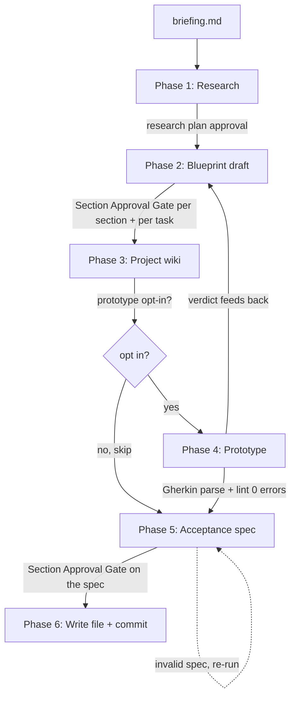

# Writing Blueprints

## Contents
- Overview / The Phase Flow
- Phase 1 Research / Phase 2 Blueprint Draft (Section Approval Gate) / Phase 3 Project Wiki / Phase 4 Prototype / Phase 5 Acceptance Spec (BDD) / Phase 6 Write File
- Multi-Phase Change Folders / File Structure / Must-Haves (Goal-Backward Verification)
- Hypothesis / Threat Matrix / Build Shape / One-Way-Door Checkpoints / Change Classification / Task Right-Sizing
- Plan header & task structure / Self-Review / Owed-Decision Gate / Ratify / Goldfish Review / Execution Handoff
- How to measure it / Common Rationalizations / Red Flags / Verification

## Overview

Turn a spec into a buildable implementation plan in six phases: research the
facts the design rests on, draft the blueprint section by section with the user
approving each section, persist the durable knowledge to the project wiki,
(optionally) de-risk the load-bearing technical unknowns with a prototype,
author the BDD acceptance spec from the validated blueprint, and write the
final `blueprint.md`.

The blueprint assumes the engineer has zero context for our codebase and
questionable taste. Document everything they need to know: which files to touch
for each task, code, testing, docs they might need to check, how to test it.
Give them the whole plan as bite-sized tasks. DRY. YAGNI. TDD. Frequent commits.
Assume they are a skilled developer who knows almost nothing about our toolset
or problem domain, and doesn't know good test design very well.

**Announce at start:** "I'm using the skillgrid:blueprint skill to create the
implementation plan."

**Config:** Read `.skillgrid/config.yaml` before starting. Use
`conventions.specs_root` for blueprint location. If the file doesn't exist, use
the default `.skillgrid/change-specs/`. Use the terms vocabulary from
`conventions.artifacts` (default `.skillgrid/projectwiki/glossary/
01-business-terms.md` + `02-technical-terms.md`) for names and concepts.
Constrain the blueprint by the in-force decisions: read the change's ADR Review
Manifest at `.skillgrid/change-specs/YYYY-MM-DD-<topic>/adr.md` (produced by
brainstorming; in-force set from the `## LOCKED` ADR index in
`.skillgrid/projectwiki/ASSUMPTIONS.md`) and respect every in-force ADR it names
— a blueprint that contradicts an in-force ADR must either follow it or record a
new superseding ADR file.

**The blueprint is pure-technical.** It is the *how*: architecture, file layout,
tasks, tests, constraints. The product *why* — user value, personas, success
metrics — lives in the spec (`briefing.md`) and in
`.skillgrid/projectwiki/reference/00-prd.md`; the blueprint **cites** those (a
`Spec:` line, a `per .skillgrid/projectwiki/reference/00-prd.md` or `per
.skillgrid/projectwiki/decisions/04-adr-NNNN-slug.md` constraint) and does not
restate them (per `_shared/craft/cite-dont-restate.md`). Operational rules are
cited as `per AGENTS.md § Rules`.

**Context:** If working in an isolated worktree, it should have been created via
`skillgrid:execute` Step 0 (isolated workspace) at execution time.

**Save plans to:** `.skillgrid/change-specs/YYYY-MM-DD-<feature-name>/blueprint.md`

## The Phase Flow

The blueprint runs in six phases, **internal to this skill** — distinct from
the orchestrator's `skillgrid` eight-phase delivery lifecycle (Intake →
Foundation → Architecture → Drafting → Adversarial Audit → Revision → Final
Score → Editorial). Within this skill, "Phase N" means the planning phase below;
the orchestrator's "Phase N" means the delivery phase. When both are in view,
say which (e.g. "blueprint Phase 4" vs "delivery Phase 4: Adversarial Audit").

The six phases are ordered and gated. Phases 1, 3, 4, and 5 each end in a
handoff; phase 2 is the heart of the skill.

| Phase | Name | Output | Gate |
|-------|------|--------|------|
| 1 | Research | `findings.md` `## Research:` section + projectwiki `sources/`/`syntheses/`/`concepts/` pages | research plan approval (fan-out); handoff report |
| 2 | Blueprint draft | `blueprint.md` (section by section) | **Section Approval Gate** per section + per task |
| 3 | Project wiki | durable pages in `.skillgrid/projectwiki/` + `projectwiki index` | page-home confirmation; no-new-findings gate |
| 4 | Prototype (optional) | `{prototype.dir}/NNN-name/` + `findings.md` `## Prototype:` section | user opt-in; hypothesis nod; verdict report |
| 5 | Acceptance spec | `{specs_root}/YYYY-MM-DD-<topic>/acceptance.feature` (lint-clean) | Gherkin parse + lint 0 errors; Section Approval Gate on the spec |
| 6 | Write file | committed `blueprint.md` + `acceptance.feature` | commit (spec zone, before any code) |



- **Phase 1 → 2:** research findings feed the draft. A design decision that
  rests on a research fact cites `findings.md`.
- **Phase 2 → 3:** the draft's decisions and cited research sources are
  persisted to the project wiki.
- **Phase 3 → 4 (optional):** the user decides whether to de-risk the
  load-bearing technical unknowns with a prototype.
- **Phase 4 → 2 (feedback):** a prototype's verdict + liftable module +
  constraints feed back into the draft (Phase 2 re-runs the affected sections)
  and into the wiki (Phase 3). The prototype can invalidate an approach —
  that is the point.
- **Phase 4 → 5 / Phase 3 → 5:** if no prototype (or after it), the wiki is
  finalized and the BDD acceptance spec is authored from the validated
  blueprint (BDD is always on — no opt-out).
- **Phase 5 → 6:** the acceptance spec must parse (Gherkin dry-run) and lint
  clean before the blueprint file is written and committed.

The phase order is not a wall: a prototype that invalidates an approach sends
the draft back to Phase 2 for the affected sections, and the wiki (Phase 3) is
updated to match. The gates are the hard stops; the phases are the working
order.

## Phase 1 — Research

External fact-finding that grounds the blueprint. Full protocol, both modes
(single-pass `research` and fan-out `code-research`), the epistemics, the
sourcing rules, the subagent briefs, and the synthesis contract:
[research-phase.md](references/research-phase.md).

**Run it when** the design or plan depends on a fact not in the codebase — a
library's current API, a version's behavior, a domain constraint, an
integration's real behavior, a competitor's offering. **Skip it** when the
answer is already known from the codebase or a simple local read.

- **Mode choice:** single-pass (the default, one dimension, one pass) vs
  fan-out (wide or high-stakes, or heavy reading that should run in the
  background). The user's explicit request beats the mode choice.
- **Output:** a `## Research: <question>` section in
  `{specs_root}/YYYY-MM-DD-<topic>/findings.md` (scaffold in
  [templates/research.md](templates/research.md)), committed, every load-bearing
  claim cited inline `[n]` with confidence flagged.
- **Handoff:** report the decision, the 2–3 findings that drive it, the
  biggest caveat, and the path to `findings.md`. The draft (Phase 2) reads the
  file; it does not reprocess the web.

## Phase 2 — Blueprint Draft (Section Approval Gate)

Draft the blueprint **section by section, gated per section and per task** —
not in one pass and reviewed at the end. Protocol:
[section-by-section.md](references/section-by-section.md).

- **Ingestion (R18):** before writing any section, read `briefing.md` in full,
  `findings.md` if present, `adr.md` if present; present a 2–3 sentence summary
  of the briefing's key decisions; the user confirms the drafting context.
- **Section order (R19):** the fixed drafting order — Header → Hypothesis →
  Must-Haves → Validation → Threat Matrix (if applicable) → File Structure →
  Global Constraints → Tasks 1..N → Self-Review → Commit. Each section carries its
  content contract (pointed at the SKILL.md section that defines it). The final
  document's layout follows `templates/blueprint.md`.
- **Per-section gate (R19):** after each section is written to `blueprint.md`,
  present the **Section Approval Gate** in the same turn — the chat summary
  (which section, the 2–3 key decisions in it, the path to `blueprint.md`)
  precedes the single-select gate (approve-and-proceed / request-revisions).
  No empty chat bubbles. The user can revisit any earlier section at any point.
- **Per-task gate (R20):** in the Tasks section, Task N+1 is not written until
  Task N is approved. The task template (Files / Interfaces / SATISFIES / Steps
  with code) is structurally unchanged — only the approval cadence changes.
- **Alternatives from the briefing (R23):** before writing the blueprint, read
  the briefing's `Approaches Considered` section; note rejected alternatives
  one line each (`Rejected: [approach] — [reason]`); if the section is absent,
  note `No alternatives recorded in briefing` rather than inventing them.
- **Artifact-first (R25):** **Do not dump the blueprint in chat.** Write to
  `blueprint.md` with the file tool and give the user the path; highlight 2–3
  key decisions in chat (one line each) and ask for review. All section/task approval gates follow `_shared/craft/review-discipline.md` (artifact-first, zero-tool turn-yield).

**Findings citation:** every design decision that rests on a research fact
(Phase 1), a feasibility result (Phase 4), or a chosen layout (a sketch) must
cite `findings.md` (the header's **Findings** line carries the path). If no
research/prototype ran, omit that line.

**The in-flight doubt gate.** The Section Approval Gate asks the user to
approve what is written; the doubt gate asks *you* whether a load-bearing claim
in the section is actually true before you present it. When a section asserts a
fact that, if wrong, would invalidate the section — a value that came from
nowhere, an interface assumed to exist, a constraint stated without a source —
run the check in the same turn, before the gate: **CLAIM** — name the one
load-bearing fact the section rests on. **EXTRACT** — point at its source
(a `findings.md` line, an ADR, a `briefing.md` decision, or the code itself).
**DOUBT** — is there a way the fact is asserted but unsourced (no citation, a
value that matches no column/field, a constraint that no research produced)?
**RECONCILE** — if sourced, proceed to the gate; if unsourced, treat it as an
Owed-Decision (the panel fires) rather than letting it ride into the blueprint
as if decided. This runs per section, in the drafting turn, and never blocks
the user — it converts a silent assumption into a named decision before it is
approved.

## Phase 3 — Project Wiki

Persist the blueprint's durable knowledge to the project wiki vault at
`.skillgrid/projectwiki/` — the LLM-wiki that outlives the change. This is the
phase that turns the per-change `findings.md` into durable, cross-change
knowledge.

**What to write** (locate the home first — `projectwiki query` +
`status --json` `by_type` — before writing; one file per concept; every page
carries 2+ `[[type/slug]]` wikilinks):

- **Decisions** the blueprint locks in that are ADR-shaped → `decisions/` per
  `_shared/adr-records/README.md` (numbering, IRON RULE, LOCKED row, `adr_style`
  template selection — this skill never mints ADR numbers itself; `brainstorm`
  drives it during the interview). A blueprint that contradicts an in-force ADR
  records a new superseding ADR here.
- **Research sources** the blueprint cites → `sources/` (one SourceSummary page
  per external source; a **summary, never a copy**; frontmatter `sources:`
  carries the `external:<name> <version>` citation + `build_fingerprint`
  staleness token via `projectwiki cite-source`).
- **Research results** the blueprint rests on → `syntheses/` (the result hub:
  question, method, findings, answer; cross-linked to every `sources/` page it
  drew on and every `concept` it spawned; `status: draft` while the change is
  open, finalized to `stable` by `reflect` at ship).
- **Reusable findings** cut from a synthesis → `concepts/` (a reusable idea or
  pattern that outlives the research result; links back to the `syntheses/`
  result and to ≥1 repo page that makes it actionable here).
- **Technical details** the blueprint pins down → `architecture/` (module map,
  data flow, boundaries) and `gotchas/` (discovered issues / non-obvious
  behavior a later build must not re-learn). A must-hold constraint →
  `invariants/` (with `claims:`). A domain term the blueprint introduces →
  `glossary/` (one page per term).

**Contradictions:** a new page never silently overwrites an existing one — it
**links** to the conflicting page and marks it `status: deprecated`, with the
deprecation reason on the deprecated page. Both pages link to each other.

**Rules** (per the `projectwiki` skill, cited not restated):

- The **same-edit rule** is non-negotiable: every page write is followed by
  `projectwiki index` — the engine refreshes the derived FTS rows and rewrites
  `index/last-update.json`. Page + reindex ship together or the change is
  incomplete.
- **Never hand-edit** derived state (`index/`, FTS, baselines, `config.json`) —
  `projectwiki index`/`reindex` rebuilds it.
- **External material** enters via `projectwiki cite-source` (stable source ID
  + section granularity) and frontmatter `sources[]`; the vault never copies raw
  source content.
- **Gate before shipping:** `projectwiki index` → `projectwiki validate`
  (pin-check) → `projectwiki lint` (health) → `projectwiki status --json`. The
  target is **no new findings**, not a zero: `--strict` fails only on
  error-severity codes (`broken_wikilink`, `missing_sources` on a grounded page,
  `ungrounded_grounded`); a warn baseline is normal on a vault that predates the
  checks. Never rewrite a page just to silence a warning — fix the cause or
  record it.
- Engine down → degrade to direct Markdown reads and declare `Degraded:
  projectwiki`; never invent a substitute retrieval path silently.

**Handoff:** report the pages written (one line each: type + slug + why), the
`projectwiki status --json` `by_type` / `orphans` / `stale` numbers, and
confirmation the gate passed. The blueprint (Phase 2/5) cites the vault pages
by `[[type/slug]]`; it does not restate them.

## Phase 4 — Prototype (optional, user-selectable)

A throwaway feasibility experiment that de-risks the load-bearing technical
unknowns the blueprint rests on. Full protocol:
[prototype-phase.md](references/prototype-phase.md).

This phase **runs only when the user opts in** at the phase 2/3 boundary.
After Phase 2 (and 3), present the opt-in:

> The draft is drafted and the durable knowledge is in the wiki. Before the
> file is written, do you want to de-risk the load-bearing technical unknowns
> with a prototype? Name the unknown(s) to probe (a library's real behavior, an
> integration's feasibility, a performance or data-shape question) — or skip to
> writing the file.

- **Opt in:** frame each unknown as a falsifiable Given/When/Then, get the nod,
  build the experiment in `{prototype.dir}/NNN-name/`, iterate, write the
  verdict (`VALIDATED` / `INVALIDATED` / `PARTIAL`) + investigation trail,
  append to `findings.md`, and report.
- **Opt out:** skip to Phase 5 (acceptance spec). Record `Prototype: skipped (user opt-out)` in
  the blueprint header so the choice is visible, not implicit.

**Feedback loop:** a prototype's verdict + liftable pure module + constraints
feed back into the draft (Phase 2 re-runs the affected sections; the
**Findings** header line now cites the `## Prototype:` section) and into the
wiki (Phase 3 updates `architecture/` / `concepts/` / `gotchas/` / `syntheses/`
to match). An `INVALIDATED` verdict kills a dead end before the real build hits
it — present **continue / pivot the approach / abandon** and wait for the
answer before proceeding.

## Phase 5 — Acceptance Spec (BDD, always on)

Derive the BDD acceptance spec (`acceptance.feature`, Gherkin) from the
**validated** blueprint, **before** implementation. BDD is always on
(non-negotiable, like TDD) — `bdd.enabled` is always `true` in
`.skillgrid/config.yaml`; there is no opt-out. The acceptance suite executes
the spec against the running application, and a green suite is the gate for
archive. Full protocol: [acceptance-phase.md](references/acceptance-phase.md).

**Prerequisite:** `blueprint.md` exists AND the Goldfish review passed with the
user's approval (Phase 2's Section Approval Gate + the User Review Gate). Never
write `acceptance.feature` without a validated blueprint — the spec is the
contract the code satisfies, and it is committed before code (Zone Rule, per
`_shared/work-unit-commits/README.md`).

- **Source:** the spec's requirements (one `### Requirement:` per briefing
  requirement) plus the blueprint's Must-Haves truths; the Threat Matrix's
  Applicable rows each get a concrete RED-test scenario.
- **Stack:** resolve `bdd.stack:` from `.skillgrid/config.yaml` (default
  `javascript` = cucumber-js; if absent and `acceptance-tests/` exists, infer
  from its contents and offer to record it; otherwise ask — never guess
  silently). Runner setup + files-to-copy:
  [references/javascript/SETUP.md](references/javascript/SETUP.md).
- **Authoring:** one `#### Scenario:` per behavior with a ` ```gherkin ` fence
  holding only Given/When/Then steps; scenario names prefixed `happy path` /
  `edge` / `failure` (every requirement has ≥1 of each); domain language from
  the glossary, observable outcomes in `Then`, falsifiable, one behavior per
  scenario. Template: [templates/acceptance.feature](templates/acceptance.feature).
  The Markdown → Gherkin mapping (headings become `Feature:`/`Rule:`/`Scenario:`,
  fences hold steps only): [references/EXTRACTION.md](references/EXTRACTION.md).
- **Syntax validation (mandatory):** after writing, run the runner in
  dry-run/parse mode (e.g. `cucumber-js --dry-run`) and gherkin-lint over the
  extracted output with `references/gherkin-lintrc.json`. Fix errors before the
  file is considered complete — invalid syntax blocks Phase 6.
- **Gate:** the Section Approval Gate on the spec (chat summary + single-select
  approve / request revisions), same format as Phase 2.

The red scenarios at propose time are the change's work list — execution
implements one pending step definition at a time (run the suite so the step
fails for the right reason, implement until it passes, then commit).

## Phase 6 — Write File

Write and commit the final `blueprint.md` and `acceptance.feature`.

- **Reconcile against the briefing** per Self-Review check 6 (contradictions
  quoted and listed first, additions reported when load-bearing, no silent
  rewrites — check 6 is the canonical statement).
- **Re-run the final Self-Review** (below) on the complete file — the
  section-by-section drafting may have drifted from the spec.
- **Acceptance spec present:** `acceptance.feature` exists in the change
  folder (Phase 5), lint-clean, with ≥1 `happy path` + `edge` + `failure`
  scenario per requirement.
- **Commit** the change folder (`git add` + `git commit`) — the artifacts are a
  checkpoint alongside the code. `blueprint.md` and `acceptance.feature` are
  both spec-zone files and commit together (the `pre-commit` zone guard,
  `_shared/work-unit-commits/README.md`, blocks mixing spec-zone changes with
  code).

**Role (do not rename):** `blueprint.md` is the *how* (implementation plan —
steps, files, code, verification); the companion `briefing.md` is the *what*
(requirements & intent). The header must read
`# <Topic> — Implementation Blueprint (steps, files, verification)`.
`brainstorming` and `resume` key phase state off these exact filenames — never
rename to `plan.md`/`design.md`, and never move the folder out of `specs/`.

- Copy `templates/blueprint.md` from this skill's directory and fill it in.
- (User preferences for plan location override this default)

## Multi-Phase Change Folders

When a blueprint spans multiple phases of a *build* (not the planning phases
above), each phase folder is a normal change folder (`briefing.md`, not
`spec.md`). Layout and rules: [multi-phase.md](references/multi-phase.md). The
spec-folder tree is in `_shared/rules/sdd-structure.md`.

### Per-phase change folders

When a blueprint is large enough to warrant phase separation (typically 4+
phases or 20+ tasks), split it into **one change folder per phase** as siblings
under `.skillgrid/change-specs/`, plus a parent folder holding the shared
blueprint index and shared context:

- **Parent folder** (`YYYY-MM-DD-<topic>/`) — not a change. Holds `blueprint.md`
  (status, tier, goal, architecture, tech stack, spec ref, and a phases table
  linking to each phase) and `shared/context.md` (hypothesis, terms,
  must-haves, global constraints, file structure shared across all phases).
- **Phase folders** (`YYYY-MM-DD-<topic>-phase-<N>/`) — each a normal change
  folder. `briefing.md` holds the phase goal. Later artifacts (`blueprint.md`,
  `tasks.md`, `review.md`) follow `_shared/rules/sdd-structure.md`.
- **Naming:** `<parent-change-name>-phase-<N>` (e.g.
  `2026-10-01-kubedash-5.0-phase-1`).
- **Back-links:** each phase `briefing.md` links to `../<parent>/blueprint.md`
  and `../<parent>/shared/context.md`. The parent's phases table links to
  `../<parent>-phase-N/`.
- **Do not nest** phase folders inside the parent — they must be siblings at
  the `.skillgrid/change-specs/` level.
- Each phase is sliced, executed, and shipped independently.

For smaller changes, use the standard single-folder layout.

## File Structure

Before defining tasks, map out which files will be created or modified and what
each one is responsible for. This is where decomposition decisions get locked in.

- Design units with clear boundaries and well-defined interfaces. Each file
  should have one clear responsibility.
- You reason best about code you can hold in context at once, and your edits are
  more reliable when files are focused. Prefer smaller, focused files over large
  ones that do too much.
- Files that change together should live together. Split by responsibility, not
  by technical layer.
- In existing codebases, follow established patterns. If the codebase uses large
  files, don't unilaterally restructure — but if a file you're modifying has
  grown unwieldy, including a split in the plan is reasonable.

This structure informs the task decomposition. Each task should produce
self-contained changes that make sense independently.

## Must-Haves (Goal-Backward Verification)

Before defining tasks, derive the **Must-Haves** section from the spec's
requirements. These are the observable outcomes that MUST be true when the
plan is complete. The verifier checks the result against this list, not just
that tasks exist. Three categories:

- **Truths:** observable behaviors that must hold (e.g., "calling X returns Y")
- **Artifacts:** files that must exist with real implementation, not stubs
- **Key links:** critical connections between artifacts that must work together

Every item must be verifiable. If you can't state a truth, artifact, or link
for a spec requirement, the requirement is ambiguous — go back to the spec.

Tag a Must-Have truth **`backstop`** when it cannot be confirmed by reading the
diff alone — it needs a held-out test, a runtime, or state the diff doesn't
show (a behavior only observable through a real integration, a timing property,
a cross-component contract). `backstop` truths get a concrete held-out test in
the plan, and they are the spec-time signal that `skillgrid:code-review`
consumes: its verification-gap lens abstains (routes to `could-not-verify`
rather than a confident pass) on a check a `backstop` truth designates as
exogenous. Omit the tag for truths a plain diff read settles.

## Hypothesis

Every blueprint MUST open with one falsifiable hypothesis. Copy this block into
`blueprint.md` under a `## Hypothesis` heading:

```markdown
**Claim:** [what the blueprint asserts will be true when complete]
**Right condition:** [observable evidence that the claim held]
**Wrong condition:** [observable evidence that the claim failed]
**Thinnest MVP:** [the smallest slice that would prove/falsify the claim]
**Door check:** [the first task that tests the hypothesis — if it fails, stop]
```

The hypothesis is the thinnest experiment that would prove or kill the
approach before the full build commits to it. The **door check** is the first
task in the blueprint that tests it — if the door check fails, the blueprint
is invalidated and the user decides whether to revise or abandon.

## Validation Matrix

Before defining tasks, derive the **`## Validation`** section from the
spec's requirements — the plan's statement of *how it will be proven*, written
before slicing. One row per in-scope requirement: the happy path, the edge,
the failure mode; the check (a runnable command or a named gate); and the
falsifier — the result that would falsify the plan. An out-of-scope row names
what is deliberately not proven.

- The **Check** column merges with the per-requirement test command (every
  in-scope requirement names a runnable signal before implementation).
- The **Happy / Edge / Failure** columns must line up with the
  `happy path` / `edge` / `failure` scenarios in `acceptance.feature` (Phase 5).
- Coverage is mechanical: a requirement with no row is a plan defect. `skillgrid:slicing`
  checks it before publishing, and `skillgrid:test`'s intent area re-runs the
  rows at gate time. A green suite is not the verdict — the matrix is.
- A `backstop` Must-Have truth (one the diff alone cannot confirm) gets its
  held-out test named in this matrix's Check column.

Copy the section into `blueprint.md` per the template block.

## Threat Matrix

If the blueprint touches routing, shell commands, subprocesses, version-control
automation, PR automation, executable-file classification, process integration,
Mnemonic tool contracts, or any `_shared/{planning,craft,verification,knowledge}/`
file, include a threat matrix section per `../_shared/references/threat-matrix.md`.
Copy this block into `blueprint.md` under a `## Threat Matrix` heading:

```markdown
| Boundary | Applicability | Design response | Planned RED test |
|---|---|---|---|
| {boundary} | Applicable / N/A: {reason} | {response} | {concrete test} |
```

- Mark every row `Applicable` or explicit `N/A: reason`.
- Every Applicable row MUST have a concrete RED test that becomes a task in
  `tasks.md` and a scenario in `acceptance.feature`.
- Omit the section entirely if no boundary is touched.

## Build Shape

Record the change's **build shape** in the blueprint header (`**Build shape:**
<name>`). The shape is *how the work is ordered* — which behavior exists first —
and it shapes the first execution wave. These are decades-old delivery
strategies; the pick is a recorded decision (with a one-line why), not a vibe:

| Shape | What it means | When it's right |
|---|---|---|
| **Tracer thread** | A thin end-to-end path through every layer (UI → API → DB) works first, then thickens | You want something real and connected as early as possible; integration risk is the unknown |
| **Smallest usable whole** | The thinnest version a person could actually use ships first, then grows | Ship-and-learn; scope is uncertain but the core value is clear |
| **Facade** | The UI shell stands up on placeholder data first; the real backend wires in later | The look needs sign-off before the plumbing earns its investment; a prototype path |
| **Journey** | One user path is completed fully — every state of it — before the next begins | Each path must feel finished; the paths are genuinely independent |

Recommend the shape that fits (one line why) and record it. `skillgrid:slicing`
reads the recorded shape to order the first wave. The shape is orthogonal to
the risk-first / contract-first ordering strategies in slicing (those order
*within* waves; the shape orders the *first* wave).

## One-Way-Door Checkpoints

A **one-way-door** decision is hard to reverse: it needs a migration, breaks a
published contract, changes a public API shape, or is otherwise expensive to
undo. When a task implements such a decision, tag it with
`> ⚠ one-way: <decision>` at the top of the task and **STOP to get explicit
user approval before proceeding**. List all one-way-door decisions in the
Must-Haves section. If none, write "None".

## Change Classification

Classify the blueprint before writing tasks:

| Class | Verification Floor | When |
|---|---|---|
| `trivial` | L1 (focused test) | ≤3 files, no behavior change |
| `small` | L1 | ≤10 files, single concern |
| `standard` | L2 (full suite + build) | Normal feature/bug fix |
| `risky` | L3 (+ coverage + lint) | New trust boundary, migration |
| `high-risk` | L4 (+ mutation + security) | Auth, data migration, public API, money, concurrency |

Record the classification in the blueprint header. The `qa` skill uses it to
select the verification level. See `../_shared/rules/verification-ladder.md`.

## Task Right-Sizing

A task is the smallest unit that carries its own test cycle and is worth a
fresh reviewer's gate. When drawing task boundaries: fold setup, configuration,
scaffolding, and documentation steps into the task whose deliverable needs them;
split only where a reviewer could meaningfully reject one task while approving
its neighbor. Each task ends with an independently testable deliverable.

## Plan header and task structure

Bite-sized steps, the plan document header, task structure, and the
no-placeholders rule: [task-structure.md](references/task-structure.md).

## Self-Review

After the blueprint is fully drafted (section-by-section, per Phase 2) and
re-run at Phase 6, look at the spec with fresh eyes and check the plan against
it. This is a checklist you run yourself — not a subagent dispatch.

**1. Spec coverage:** Skim each section/requirement in the spec. Can you point
to a task that implements it? List any gaps.

**2. Must-haves coverage:** Does the Must-Haves section (truths, artifacts, key
links) cover every spec requirement? If a spec requirement has no corresponding
truth, artifact, or key link, the plan won't verify correctly — add it.

**2. Must-haves + validation coverage:** does the Must-Haves section (truths, artifacts, key
links) cover every spec requirement? If a spec requirement has no corresponding
truth, artifact, or key link, the plan won't verify correctly — add it. Does
`## Validation` carry a row for every
in-scope spec requirement (happy / edge / failure / check / falsifier), with
the check naming a runnable command or named gate? A requirement with no row
is a plan defect — add the row. A `backstop` truth's held-out test must appear
in its Check cell.

**3. One-way-door completeness:** Are all hard-to-reverse decisions listed in
the Must-Haves section AND tagged with `> ⚠ one-way:` on the task that
implements them? If a migration, API change, or contract break is in a task but
not flagged, add the tag.

**4. Placeholder scan:** Search your plan for red flags — any of the patterns in
[task-structure.md](references/task-structure.md) under "No Placeholders".
Fix them.

**5. Type consistency:** Do the types, method signatures, and property names
you used in later tasks match what you defined in earlier tasks? A function
called `clearLayers()` in Task 3 but `clearFullLayers()` in Task 7 is a bug.

**6. Spec reconciliation:** re-read `briefing.md` and compare it against the
blueprint per [section-by-section.md](references/section-by-section.md) — a
**contradiction** (the briefing decided a question, the blueprint decides it
differently) is reported every time, quoting both; an **addition** (the
blueprint decides something the briefing never raised) is reported only if it
changes architecture, an external interface, or a dependency. Contradictions
are listed first. Do NOT change the blueprint to match the briefing on your own
— drafting reads code the brainstorm did not. If nothing diverges, say so in one
line.

**7. Wiki reconciliation (Phase 3 ran):** does the project wiki reflect every
durable decision, research source, and technical detail the blueprint pins
down? A `decisions/` ADR for each locked ADR-shaped choice, a `sources/` +
`syntheses/` hub for each cited research result, an `architecture/` or
`gotchas/` page for each pinned technical detail. A vault that has none of these
is a document archive, not a wiki — `status --json` `by_type` skew is the tell.

If you find issues, fix them inline. No need to re-review — just fix and move
on. If you find a spec requirement with no task, add the task.

## Owed-Decision Gate (input coverage)

After self-review passes and before the Goldfish review, run the **input
coverage check** to catch decisions nobody made yet.

**Do NOT judge this by introspection** ("do I feel like I'm inventing
something?"). The build model happily rationalizes a real decision as "just
wiring" and pushes past it. The check is mechanical:

1. Enumerate **every value this build must produce, compute, or display** —
   from the Must-Haves truths and the spec's requirements (a total, a date, a
   status, a count, a URL, a permission).
2. For each, ask: **does the blueprint name where it comes from?** A named
   source is: a spec input, a data column, a derivation from another named
   value, an in-force ADR, or a projectwiki page.
3. Any required value with **no named source is an owed decision.**

A decision is also owed when the build would have to invent:
- a provider, library, integration, or data model;
- a whole screen or page whose design the blueprint does not pin down
  (layout, composition, asset strategy);
- a feature's behavior the acceptance criteria constrain but the blueprint
  never settles ("what exactly should it do?" is still open).

**Local implementation detail** is the narrow exception: a choice among
options the named sources already permit — a loop style, a variable name,
which helper to call. The moment a choice determines a value's source or a
behavior an acceptance criterion constrains, it is load-bearing by definition,
however small it looks.

**No owed decisions** → proceed to the Goldfish review.

**Owed decisions exist** → present the panel:

> This blueprint owes a decision before it can be executed: `<name the
> specific load-bearing choice, e.g. "which date a "today" total is computed
> from — session time or the user's last-read row">`. How do you want to
> handle it?
>
> 1. **Resolve first** — settle the decision in
>    brainstorming/interviewing now, then return to this blueprint. The build
>    has a real decision, not a guess.
> 2. **Not a real decision** — you've judged there's nothing load-bearing
>    here. Proceed; record the judgment as a one-line `Decision note:` in the
>    blueprint header.
> 3. **Build on the assumption** — keep moving. Write the **Assumed block**
>    below into the blueprint, then proceed. The assumption now lives in a
>    file, not in this chat — it survives `/clear`, teammates read it, and a
>    later run builds against it instead of guessing again. It stays flagged
>    as owing ratification until `skillgrid:blueprint` (Ratify mode)
>    settles it. The flag never blocks execution.

**Presenting the options (R22):** when the owed decision is a **load-bearing**
choice (data model, component boundaries, storage, protocol) with ≥2
defensible options, present each with its **mechanism, trade-offs, and the
conditions under which it fails**. The agent does not rank the options, does
not mark a default, does not pick one — the owner chooses. If the owner says
"just pick one," restate the trade-offs and present the same gate again.
**Mechanical** choices (file naming, formatting, variable names) are decided by
the agent without a gate — only architectural choices go to the owner. The
gate's input-coverage mechanics (the value-source enumeration above) are
unchanged — this is the tone shift from "here's my recommendation, please
confirm" to "here are the options and their failure conditions, you decide."

### The Assumed block

On **Build on the assumption**, write this block into `blueprint.md` directly
after the header (before `## Must-Haves`), and set the header line
`**Status: ASSUMED**` (replace the default `**Status: PROPOSED**`). The
assumed values in the task steps are the named content — no placeholders for
them:

```markdown
**Status: ASSUMED** — owes ratification (run `skillgrid:blueprint`
with this blueprint as the topic to ratify)

| | |
|---|---|
| Owed decision | {the specific load-bearing choice that was not made} |
| Assumption built on | {the concrete assumption this build will use} |
| Code area | {the paths this build will touch} |
| Authorized by | {user name/handle}, at the blueprint gate |
```

Rules:
- Only this gate (via option 3) creates an `ASSUMED` blueprint. Nothing else
  sets the status.
- The Assumed block records the assumption — it does NOT carry options,
  rationale, or alternatives. That content is written by Ratify.
- `ASSUMED` never blocks execution, slicing, QA, or ship. It is surfaced
  (WARNING, never CRITICAL) by `skillgrid:qa`, carried into the ship Return
  Envelope, and listed in the final `report.md` until ratified.
- A blueprint stays `ASSUMED` through the whole change. Only Ratify clears it.

## Ratify

**When to use:** a change's blueprint carries `**Status: ASSUMED**` and the
decision is now being deliberated — often phrased "ratify <feature>", or
surfaced by `skillgrid:qa`'s decision-debt WARNING, the ship Return Envelope,
or `skillgrid:reflect`'s report.

**Process:**
1. Read the Assumed blueprint in full. Its Owed decision, Assumption built on,
   and Code area tell you what was decided provisionally and where the code
   lives.
2. Run the design conversation anchored to what was **actually built** (the
   same infer / ask / recommend discipline as brainstorming). Deliberate the
   decision properly.
3. Two outcomes:
   - **The assumption holds.** Fill in the real decision record in the
     change's `adr.md` (ADR + options considered + rationale, body per the
     `adr_style` template selected in `_shared/adr-records/README.md`), then
     clear the flag: set the status line to
     `**Status: PROPOSED**` (the build is still in flight) or
     `**Status: ACCEPTED**` (built and verified). Delete nothing else.
   - **The assumption was wrong.** Write a corrected blueprint (a new
     `.skillgrid/change-specs/YYYY-MM-DD-<topic>/blueprint.md` for the same
     topic), mark the old one `**Status: SUPERSEDED by <new blueprint path>**`,
     and tell the user the build rests on a wrong assumption and should be
     redone against the corrected blueprint.

**Never leave a blueprint ASSUMED after a ratify run.** Ratification is the
only path out of the state — that is what keeps an override honest without ever
blocking the work.

## Goldfish Review

The validation seam (run on `blueprint.md` after Phase 2/4 and before Phase 5):
the 5-stage fresh-context pipeline per [goldfish-review.md](references/goldfish-review.md).
The invocation passes `TargetFile` = `blueprint.md`, `GoldfishContext` =
`briefing.md` + referenced files + `findings.md`, `Step` = inferred from the
path classification (Interactive for New Project, Consolidated for New Function
with ≥3 tasks). Rounds iterate under the sharpening loop per
[goldfish-review-loop.md](references/goldfish-review-loop.md); each round's
findings resolve per [goldfish-resolve.md](references/goldfish-resolve.md).
Stage reports commit under the change folder's `review/` directory.

**User Review Gate** — the decide-then-fix loop: findings are routed back to
the user *while the blueprint is still PROPOSED and cheap to change*; for each
finding the user decides the resolution path, the blueprint is updated to
reflect it, and only the *final* updated blueprint is approved. On entering the
gate, write `changes.<topic>.gate: blueprint-validation` to `state.yaml` and
show the 30-second gate screen (User gate contract in
`_shared/rules/sdd-structure.md`); wait for the user's decision.

Never proceed to Phase 5/6 without the user approving the final blueprint. A
critique surfaced only after the blueprint is committed — with no user decision
feeding back into it — has missed its purpose.

## Execution Handoff

After the Goldfish review passes and the files are written (Phase 6), check if
slicing is needed:

**If the blueprint has 3+ tasks worth of work** — invoke `skillgrid:slicing` to
break it into vertical tracer-bullet tickets with dependency edges and execution
waves. Slicing produces `tasks.md` alongside the blueprint.

**If the blueprint has 1-2 tasks** — skip slicing, execute directly.

**Update `state.yaml`:** set `changes.<topic>.phase: blueprint` (the entry was
created by brainstorming; if it's missing, add it with `status: in_progress`).

Then offer execution choice:

**"Blueprint written and committed to
`.skillgrid/change-specs/YYYY-MM-DD-<feature-name>/blueprint.md`. Two execution
options:**

**1. Subagent-Driven (recommended)** - I dispatch a fresh subagent per task (or
per ticket, if sliced), review between tasks, fast iteration

**2. Inline Execution** - Execute tasks in this session using
`skillgrid:execute` (inline mode), batch execution with checkpoints

**Which approach?"**

**If Subagent-Driven chosen:**
- **REQUIRED SUB-SKILL:** Use `skillgrid:execute` (subagent mode)
- Fresh subagent per task + two-stage review

**If Inline Execution chosen:**
- **REQUIRED SUB-SKILL:** Use `skillgrid:execute` (inline mode)
- Batch execution with checkpoints for review

**Review at the end (both options):** the default is the lightweight pass of
`skillgrid:code-review` (the 3-axis pass at small/low-risk). For a large or
high-risk blueprint (at the review escalation threshold, per
`_shared/planning/rigor-tiers.md`), the final review escalates to
`skillgrid:code-review` fan-out — multi-reviewer. The execution skill decides
when to escalate; you just tell the user the option exists when the blueprint
looks risky.

## How to measure it

Per `_shared/craft/measurement.md`.

| | Indicator | Data source | Direction |
|---|-----------|-------------|-----------|
| Leading | % of changes whose merged diff matches `blueprint.md` with no out-of-scope files | PR metadata (files changed) vs. `blueprint.md` scope | should rise |
| Lagging | Rework cycles: commits touching the change's files after the first merge that revert or re-scope them | Git history | should fall |

## Common Rationalizations

| Rationalization | Reality |
|---|---|
| "The plan is obvious, skip the Must-Haves" | Goal-Backward Verification derives the observable outcomes the verifier checks against; without them a task can be "done" and the spec still unmet. |
| "I'll leave a placeholder and fill in later" | No Placeholders calls TBD, "implement later", and "similar to Task N" plan failures — the engineer may read tasks out of order and a placeholder is a hole, not a shortcut. |
| "I'll skip the one-way-door checkpoints, they're slow" | A one-way decision is expensive to undo; the `> ⚠ one-way:` stop is the only gate that surfaces a migration or contract break before the build commits to it. |
| "Each task is small, granularity rules don't matter" | Right-Sizing + Bite-Sized Granularity keep every task an independently testable deliverable with its own review gate — a vague task is one a reviewer can't reject or approve. |
| "That's just wiring — I'll decide it during execution" | The build model rationalizes real decisions as wiring and buries the choice in code. If a value's source isn't named in the blueprint, the Owed-Decision Gate says it is owed. Resolve it, or record it as Assumed — don't invent it mid-build. |
| "The Assumed flag will get in the way later" | An `ASSUMED` blueprint never blocks execution, QA, or ship. What blocks later is the *silent* decision — the one that lived only in chat and got re-guessed by the next session. The flag is cheap insurance that the assumption stays visible until it's ratified. |
| "Research is overkill for this change" | Phase 1 is for facts not in the codebase. If the design rests on a library's current API or a version's behavior, the blueprint cites `findings.md` — a fact your codebase *assumes* still gets re-verified against the source that owns it. |
| "The wiki is a nice-to-have, I'll skip Phase 3" | The wiki is the durable, cross-change knowledge that outlives the change. A blueprint that locks in an ADR-shaped decision or pins a non-obvious technical detail without filing it leaves the vault an archive, not a wiki — the next session re-derives it. |
| "I'll keep the prototype code, it's almost production-ready" | A prototype's output is an answer + a liftable pure module. Keeping the *demo* is a new request — classify it as a feature and go through the normal flow. |
| "I'll write the acceptance spec after the code works" | Phase 5 authors the spec from the validated blueprint, committed before code (Zone Rule). Post-hoc specs describe the code, not the requirement. |
| "One happy-path scenario per requirement is enough" | Every requirement has ≥1 `happy path` + `edge` + `failure` scenario. One happy path proves nothing about boundaries or errors. |
| "The blueprint is clear enough — I can skip the acceptance spec" | BDD is always on. The red scenarios at propose time are the change's work list, and a green suite is the gate for archive. |

## Red Flags

- A task contains a placeholder (TBD, "implement later", "similar to Task N") — No Placeholders is violated.
- A task is not independently testable, or two tasks share a file edit with no ordering — not a vertical tracer bullet.
- A one-way-door decision (migration, contract break, data model) has no `> ⚠ one-way:` stop.
- A task step uses a value whose source is named nowhere in the blueprint and no `ASSUMED` block covers it — an owed decision passed the gate.
- An `ASSUMED` block with an empty "Assumption built on" cell — the assumption must be concrete, not "TBD".
- The Must-Haves / Goal-Backward Verification section is missing or empty — the verifier has nothing to check against.
- A task's scope exceeds one fresh agent context window with no split proposed.
- A design decision rests on a research fact, feasibility result, or chosen layout that is not cited in `findings.md` (Phase 1/4 ran but the citation is missing).
- Phase 3 ran but the vault has no `decisions/`, `sources/`, or `syntheses/` page for a decision the blueprint pins down — the knowledge stayed in the per-change file and won't be recalled next session.
- A prototype verdict is `VALIDATED` with no edge case or comparison — the evidence rule is violated.
- Phase 4 was run without the user's explicit opt-in — it is user-selectable, not default.
- A `Then` step asserts internal state instead of an observable outcome, or a scenario has no `When` / no `Then` (Phase 5 Gherkin discipline).
- Implementation jargon (class, method, DB column) or a URL appears in a step or scenario name.
- A requirement has no `edge` or `failure` scenario, or scenario names collide (they are the `SATISFIES:` anchor for tasks).
- `acceptance.feature` was written before the blueprint passed the Goldfish review + user approval.

## Verification

- [ ] **Phase 1** — the `## Research:` section exists in `findings.md` (when
      research ran), committed, every load-bearing claim cited with confidence
      flagged; OR research was explicitly skipped (answer known from the
      codebase) and the header's Findings line is omitted.
- [ ] **Phase 2** — the blueprint was drafted section-by-section with the
      Section Approval Gate per section and per task; the user approved each
      section; the final `blueprint.md` exists at
      `.skillgrid/change-specs/YYYY-MM-DD-<feature-name>/blueprint.md` and opens
      with the Plan Document Header (Status, Goal, Architecture, Tech Stack,
      Spec).
- [ ] **Phase 3** — the project wiki reflects the blueprint's durable knowledge:
      `decisions/` ADRs for each locked choice, `sources/` + `syntheses/` for
      each cited research result, `architecture/`/`gotchas/` for each pinned
      technical detail; `projectwiki index` ran after every page write
      (`status --json` `stale: 0`); `projectwiki validate` + `lint` show no new
      findings.
- [ ] **Phase 4** — either the user opted in and the prototype produced an
      evidence-gated verdict (`VALIDATED`/`INVALIDATED`/`PARTIAL`) with the
      investigation trail, the `findings.md` `## Prototype:` section, and the
      feedback loop into the draft + wiki applied; OR the user opted out and
      `Prototype: skipped (user opt-out)` is recorded in the header.
- [ ] **Phase 5** — `acceptance.feature` exists in the change folder,
      passes the Gherkin parse (dry-run) and gherkin-lint with 0 errors,
      every requirement has ≥1 `happy path` + `edge` + `failure` scenario,
      and the Section Approval Gate on the spec was approved.
- [ ] **Phase 6** — the final `blueprint.md` and `acceptance.feature` are
      committed; the Self-Review
      (all checks including validation-matrix coverage and wiki reconciliation) ran; the Goldfish review
      produced a verdict — READY FOR EXECUTION (findings resolved or parked per
      the loop), not NEEDS REVISION; the user-decide-then-fix loop ran and the
      final blueprint was approved.
- [ ] The Owed-Decision Gate (input coverage check) ran: every value the build
      must produce has a named source, or the blueprint carries a filled
      `ASSUMED` block (no empty cells).
- [ ] The Must-Haves (Goal-Backward Verification) section is present and covers
      every spec requirement with verifiable truths, artifacts, and key links.
- [ ] A placeholder scan (the No Placeholders patterns) returns zero hits across
      all tasks.
- [ ] Every one-way-door decision is listed in the Must-Haves section and tagged
      `> ⚠ one-way:` on the task that implements it.
- [ ] The Execution Handoff is present — slicing decision made and an execution
      approach (Subagent-Driven or Inline) is offered, so the plan is ready to
      hand off.
