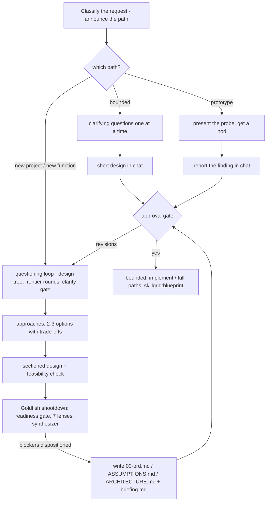

# Brainstorming Ideas Into Designs

## Contents
- Overview / When to Use / Four Paths / State
- Anti-Sycophancy & Stress-Testing / Anti-Pattern: "Too Simple To Need Approval"
- How to measure it / Common Rationalizations / Red Flags / Verification
- Checklist and process flow / The Process / After the design

**Announce at start:** "I'm using the skillgrid:brainstorm skill to turn this idea into a design."

## Overview

Turns a raw idea into an approved design and spec before any implementation begins. You classify the request onto one of four paths, work the context and options with your human partner, and present a design — and **the approval gate is non-negotiable: no implementation until your partner says yes.** Simplicity shrinks the artifact, never the approval.

## When to Use

- When a new feature, component, or capability needs to be explored before building
- When the approach is unclear and the options must be weighed (trade-offs, multiple paths)
- When a change might restructure how components fit or alter interfaces others depend on

**When NOT to use:** For a fully-specified, small, well-understood change where the design is already obvious and there is an existing flow to read — that is the **Bounded** path: a short design in chat and an approval, not this full interview → approaches → spec process. And the prototype path stops at "present the probe, get a nod."

**Config:** Read `.skillgrid/config.yaml` before starting. Use `conventions.specs_root` for spec location, `conventions.artifacts` for the terms zone (`01/02-*-terms.md`) and the requirements reference (`00-prd.md`), and the root `.skillgrid/projectwiki/ASSUMPTIONS.md` for the understanding record (the product statement, VERIFIED facts, the in-force ADR index in `## LOCKED` — open the Record path for the body — and the locked constraints) and `.skillgrid/projectwiki/ARCHITECTURE.md` for the live repo/program structure. Read the terms zone (`glossary/01-business-terms.md` + `02-technical-terms.md`) and the topic catalog (`.skillgrid/projectwiki/index.md`) before the first question — questions and designs use the project's vocabulary (the router's domain-model check defers this read to you). Open `reference/00-prd.md` when the change touches scope or acceptance. If the file doesn't exist, use the defaults shown in this skill.

Help turn ideas into fully formed designs and specs through natural collaborative dialogue.

**Questioning mandate:** Brainstorming ALWAYS uses questioning for mutual understanding. Use the agent's answer-select tool (`question` in opencode, `AskUserQuestion` in Claude Code, equivalent in other agents) to present options with tradeoffs. Never assume the user's preference — ask. One question at a time; stop and wait for the response before continuing. The full interview loop (design tree, frontier rounds, clarity gate) is in `references/questioning.md`.

Start by classifying how much process the request needs, then work
through your path: understand the context, refine the idea, present a
design, and get your human partner's approval.

<HARD-GATE>
Do NOT invoke any implementation skill, write any code, scaffold any
project, or take any implementation action until you have told your
human partner what you intend and they have approved it. This applies
to EVERY task on EVERY path below — the ceremony scales with the task;
the approval gate never does.
</HARD-GATE>

<HARD-GATE>
**No Code (the Elephant's boundary).** This session is the *designer*,
not the builder. It produces intent, requirements, trade-offs, and ADRs —
never code, scaffolding, file layouts, or function signatures beyond what
the spec requires to be unambiguous. If you catch yourself sketching
implementation (pseudocode, struct fields, endpoint shapes, file trees),
STOP: that content belongs in the blueprint, where the Goldfish protocol
validates it against the Zero-Decision Rule (see
`_shared/elephant-goldfish/implementation-readiness.md`) before any code
is written. The one exception is the Prototype path, whose throwaway probe
is code by definition — it stays labeled throwaway and never becomes the
answer.
</HARD-GATE>

## Four Paths

Before your first question, classify the request and say the
classification out loud — "this looks bounded, so I'll present a short
design here rather than write a spec" — so your human partner can
override it:

- **Prototype** — a feasibility question ("can we...", "is it possible...",
  "quick and dirty is fine") whose output is an answer, not code you
  keep. Two cases:
  - **Tiny** (one library, one command, one observable fact) — answer
    inline: present the question and what you'll try in 2-3 sentences,
    get a nod, find out as cheaply as correctness allows, report the
    finding in chat. No file.
  - **Real probe** (needs code executed, a comparison, edge cases, or a
    demo the user should feel) — delegate to the `skillgrid:prototype`
    skill, which owns the hypothesis, the falsifiable verdict, the
    investigation trail, and the consolidated findings file. The prototype
    skill's verdict is the recommendation; anything it built stays
    labeled throwaway.
  The tell for "real probe": you cannot state the answer without
  running something, or the answer depends on comparing two approaches.
- **Bounded** — a well-scoped change to code that already exists in
  this repo: a new flag, a small endpoint, a one-file fix.
  Understanding the kind of app is not enough — bounded means the flow
  you are changing is already here to read. If there is no existing
  flow to change, the task is not bounded. Ask the clarifying
  questions that matter, present a short design IN CHAT (a few
  sentences to a few short paragraphs), and STOP. Implementation
  starts only after your human partner says yes to that design — a
  bounded task's approval is as hard a gate as a new-function one.
  No spec file, no implementation plan document.
- **New Project** — a greenfield project, a new subsystem, or a change
  that restructures how components fit together or alters interfaces
   others depend on. There is no existing flow to read — you are
    creating the architecture. Follow the full process: interview the user
    (`references/questioning.md` — design tree, rounds, clarity gate), approaches,
    sectioned design. Run the Goldfish brainstorming shootdown per
     `references/shootdown.md` (readiness gate → 7 parallel fresh lenses →
     synthesizer; all 🔴 Blockers dispositioned before the ADR
    manifest is written). Then write the product requirements reference
    `.skillgrid/projectwiki/reference/00-prd.md` (from `templates/PRD.md`), the root
    understanding record `.skillgrid/projectwiki/ASSUMPTIONS.md` (from `templates/ASSUMPTIONS.md`:
    VERIFIED product statement + INFERRED hypotheses + LOCKED in-force table and
    constraints; it links to `00-prd.md`), and the live structure record `.skillgrid/projectwiki/ARCHITECTURE.md`
    (repo / program structure, from `templates/ARCHITECTURE.md`), plus the spec
    `.skillgrid/change-specs/YYYY-MM-DD-<topic>/briefing.md` from `templates/briefing.md`.
    If the global files already exist (a second project in the repo), merge rather
    than overwrite. Then the skillgrid:blueprint skill.
- **New Function** — a new feature, endpoint, or capability added to an
   existing project whose architecture is already in place. Follow the
   full process: interview the user (`references/questioning.md` — design tree,
   rounds, clarity gate, confidence stop, Out-of-scope line), approaches,
   sectioned design. Run the Goldfish
   brainstorming shootdown per `references/shootdown.md` (readiness gate →
   7 parallel fresh lenses → synthesizer; all 🔴 Blockers dispositioned
   before the ADR manifest is written). Then write the
    spec `.skillgrid/change-specs/YYYY-MM-DD-<topic>/briefing.md` from
    `templates/briefing.md`. If
     the feature changes `.skillgrid/projectwiki/reference/00-prd.md` (scope, feature, metric),
     the global `.skillgrid/projectwiki/ASSUMPTIONS.md` (new VERIFIED fact, a new ADR file under
     `decisions/04-adr-NNNN-slug.md`) or
     `.skillgrid/projectwiki/ARCHITECTURE.md` (new component, data store, integration), update
     those too — only when they exist AND the feature actually changes them. Then the
     skillgrid:blueprint skill.

**Decision gates:**

| Condition | Path |
|---|---|
| Feasibility question, output is an answer not kept code, one library/command/fact | **Prototype (tiny)** — inline answer, no file. |
| Feasibility question that needs code executed, a comparison, or edge cases | **Prototype (real probe)** — delegate to `skillgrid:prototype`; the verdict is the recommendation, artifacts stay throwaway. |
| Well-scoped change to an existing flow in this repo | **Bounded** — short design in chat, stop; implementation only after an explicit yes. |
| No existing flow to change | Not bounded — the task is new architecture; step up. |
| Greenfield, new subsystem, or restructured component fit/interfaces | **New Project** — full process, Goldfish shootdown, PRD + ASSUMPTIONS + ARCHITECTURE + briefing. |
| New feature/capability on an existing architecture | **New Function** — full process, Goldfish shootdown, briefing (+ global updates only when they actually change). |
| Doubt between two paths | Take the heavier one. |
| Hidden complexity discovered mid-task | Upgrade the path — stop, say so, run the shootdown at the new path. Nothing downgrades mid-task. |

When in doubt between two paths, take the heavier one. The ratchet is
one-way: hidden complexity discovered mid-task upgrades the path —
stop, say so, and step up. Nothing downgrades mid-task. The shootdown
rides the ratchet: a bounded task that upgrades to New Function mid-task
must run the shootdown at the new path.

## State

The two full paths (New Project, New Function) run long enough to outlive a
session: interview → approaches → design → feasibility → shootdown → ADR
manifest → briefing. The path state — which checklist item you are on, which approach
was approved — lives in conversation, which rots.

- **The spec-zone artifacts ARE the phase signal.** `skillgrid:resume`
  determines the phase from which files exist in the spec dir
  (`briefing.md` present = planning started; `blueprint.md` present =
  planning done; `tasks.md` with `[ ]` items = slicing done). No separate
  `state.md` is created.
- **The filenames are the role, not a label you may swap.** `briefing.md` =
  the *what* (requirements & intent: problem, success criteria, falsifiable
  requirements); `blueprint.md` = the *how* (implementation plan: steps,
  files, verification). Both headers must carry the role suffix —
  `— Design Briefing (requirements & intent)` /
  `— Implementation Blueprint (steps, files, verification)` — so a reader
  never mistakes one for the other. Do not rename to `plan.md`/`design.md`
  etc.: `resume` keys off the exact filenames.
- **At each phase transition**, commit the spec-zone artifacts that changed
  (the zone guard requires spec commits before code —
  `_shared/work-unit-commits/README.md`). The commit's
  `[skillgrid-context]` block's `Decisions:` line carries the key call
  (approved approach, declined ADR, feasibility verdict). If
  `mnemonic.enabled: true`, mirror with
  `mem_save(topic_key: skillgrid/<topic>/briefing, type: architecture)`
  (upsert).
- **On resume:** the `skillgrid:resume` check in `skillgrid:using-skillgrid`
  reads the spec-zone artifacts and the checkpoint, and re-enters at the
  first incomplete step.
- **Skip persistence** for the prototype and bounded paths — they are short by
  design and produce no spec dir.

## Anti-Sycophancy & Stress-Testing

The shootdown's seven lenses, the synthesizer, and the main agent's synthesis of
their findings are governed by the anti-sycophancy and stress-testing rules in
`_shared/craft/review-discipline.md` — cited, not restated; the
banned-vocabulary list has exactly one home there and appears nowhere in this
skill. The rules apply to the shootdown subagents (each lens brief carries
its isolation mandate) and to the main agent's synthesis: the Elephant
dedupes and groups findings without softening them — a 🔴 Blocker stays a
🔴 Blocker until the user disposes of it per `references/shootdown.md`.

## Anti-Pattern: "Too Simple To Need Approval"

Every path ends with your human partner approving your intent before
implementation. A todo list, a single-function utility, a config
change — the design may be two sentences in chat, but you MUST present
it and get approval. "Simple" tasks are where unexamined assumptions
cause the most wasted work. What scales with simplicity is the
artifact, never the approval.

## Scope Pushback

When the request piles **multiple independently shippable outcomes** into one
change, stop — do not refine a fat plan. Refining is the failure mode: a
larger interview, a longer briefing, more requirements, still one change.

- **Recognize it:** the request or draft briefing names more than one outcome
  that could be built, reviewed, and shipped on its own ("build X and also
  rework Y and add Z").
- **Stop and list the pile.** One line per outcome — what it is, why it is
  shippable independently.
- **Recommend one first slice** — the smallest usable whole that delivers
  value on its own. The default stance is **hold/reduce, not expand**: queue
  or drop the rest; do not grow the change.
- **The human picks** hold / cut / split for each piled outcome.
- **Record the pick** in the briefing's interview log (the `Clarity Report`
  section) before `blueprint.md` is written. A blueprint on a fat briefing
  with no recorded pick is a red flag.

Each kept outcome becomes its own spec → plan → implementation cycle (the
decomposition rule in "The Process" applies to what is held; this gate decides
what is cut before the first spec is written).

## How to measure it

Per `_shared/craft/measurement.md`.

| | Indicator | Data source | Direction |
|---|-----------|-------------|-----------|
| Leading | Time from first interview to a committed `briefing.md` | Git history (two commit timestamps) | should fall |
| Lagging | Rework: `briefing.md` commits dated after the first `blueprint.md` commit for the same change | Git history | should fall |

## Common Rationalizations

| Rationalization | Reality |
|---|---|
| "Too simple to need approval or a design" | What scales with simplicity is the artifact, never the approval. A two-sentence design in chat is still presented and still needs a yes. |
| "I'll decide the approach myself and skip the paths" | The path classification is the process — it scales the ceremony to the task. Picking it silently is skipping the gate that lets your partner override. |
| "The design is obvious, so skip the visual companion" | The companion is offered just-in-time only when a question is clearer shown than told. Obvious isn't the test — the test is whether it'd be understood better by seeing it. |
| "I'll start implementing while they read the design" | The gate is the approval, not the design's length. Present, then stop until you hear yes. |
| "I'll just refine the big plan so it covers everything" | A pile of independently shippable outcomes is a scope problem, not a plan problem. List the pile, recommend one first slice, let the human hold/cut/split — then write the plan for the pick, not the pile. |

## Red Flags

| Thought | Reality |
|---------|---------|
| "This is too simple to need a design" | Simple means a short design, not no design. Two sentences in chat, then approval. |
| "I'll call it bounded and skip the spec" | Reaching for a label to skip work IS the doubt — take the heavier path. |
| "It's bounded and the design is obvious — I'll start while they read it" | The gate is the approval, not the design's length. Present, then stop until you hear yes. |
| "I understand this kind of app, so it's bounded" | Bounded measures the repo, not your familiarity. A new project has no existing flow — it is a new project, not bounded. |
| "The prototype works, so I'll keep the code" | A prototype's output is an answer. Keeping the code is a new request — classify it. |
| "It grew, but I'm almost done — no need to re-classify" | Hidden complexity upgrades the path mid-task. Stop and say so. |
| "They approved the prototype, so the follow-up change is approved too" | Each task gets its own classification and its own approval. |
| "The briefing is still growing — I'll blueprints once it's settled" | A briefing that keeps absorbing requirements is a pile, not a design. Run Scope Pushback: list the outcomes, pick the first slice, record the hold/cut/split — then blueprint. |

## Verification

- [ ] A design or approach was produced (prototype answer, in-chat bounded design, or full spec) AND your human partner approved it — approval is quoted in the record, not implied
- [ ] The chosen path (prototype / bounded / new project / new function) was classified and stated out loud before the first question
- [ ] The approval gate was passed, not skipped — the task was not waved through as "too simple" without a presented design and an explicit yes
- [ ] For new project / new function: the chosen approach is committed in the spec-zone (and mirrored to mnemonic if `mnemonic.enabled: true`)
- [ ] If a visual companion or sketch was offered and accepted, the resulting mockup/frame artifact is saved (e.g. the sketch winner + constraints in the topic's `findings.md`)

## Output Contract

The deliverable depends on the classified path:

- **Prototype (tiny):** the finding, reported in chat — the answer to the
  feasibility question, no file.
- **Prototype (real probe):** the `skillgrid:prototype` findings file —
  hypothesis, falsifiable verdict, investigation trail; artifacts labeled
  throwaway.
- **Bounded:** the short design in chat (a few sentences to a few short
  paragraphs) and the user's explicit yes — approval is quoted in the record,
  not implied. No spec file.
- **New Project:** `00-prd.md`, `ASSUMPTIONS.md`, `ARCHITECTURE.md`
  (merged, not overwritten, when they pre-exist) + `briefing.md` in the
  change folder, plus the 2-line codebase-fit verdict in the spec's Context.
- **New Function:** `briefing.md` in the change folder, plus the 2-line
  codebase-fit verdict; global files updated only when the feature actually
  changes them.

Every path: the classification stated out loud before the first question, and
the approval gate passed with the quoted yes.

## Checklist and process flow

Path checklists (prototype, bounded, new project, new function) and the process-flow diagram: [paths.md](references/paths.md).

Classify first, announce the path, then complete that file's checklist for the path you named.

## The Process

The subsections below serve the bounded, new project, and new function
paths (a prototype stops at "present the probe, get a nod"). Sections from
**Exploring approaches** onward are new-project / new-function depth —
for bounded work, context plus a few questions plus a short in-chat
design is the whole process.

**Understanding the idea:**

- Check out the current project state first (files, docs, recent commits)
- Before asking detailed questions, assess scope: if the request describes multiple independent subsystems (e.g., "build a platform with chat, file storage, billing, and analytics"), flag this immediately. Don't spend questions refining details of a project that needs to be decomposed first.
- If the project is too large for a single spec, help the user decompose into sub-projects: what are the independent pieces, how do they relate, what order should they be built? Then brainstorm the first sub-project through the normal design flow. Each sub-project gets its own spec → plan → implementation cycle.
- **New Project / New Function:** run the questioning loop (`references/questioning.md`) to reach shared understanding. It structures the conversation as a design tree worked in rounds (frontier per round, facts looked up by you, decisions put to the user) and exits when the frontier is empty AND the clarity gate passes. This replaces one-at-a-time questioning.
- **Bounded:** ask clarifying questions one at a time — the conversation is short and casual, no frontier structure needed.
- Focus on understanding: purpose, constraints, success criteria

**Exploring approaches:**

- Propose 2-3 different approaches with trade-offs
- Present options conversationally with your recommendation and reasoning
- Lead with your recommended option and explain why
- YAGNI ruthlessly - remove unnecessary features from every approach and design

**Presenting the design:**

- Once you believe you understand what you're building, present the design
- Scale each section to its complexity: a few sentences if straightforward, up to 200-300 words if nuanced
- Ask after each section whether it looks right so far
- Cover: architecture, components, data flow, error handling, testing
- Be ready to go back and clarify if something doesn't make sense

**Design for isolation and clarity:**

- Break the system into smaller units that each have one clear purpose, communicate through well-defined interfaces, and can be understood and tested independently
- For each unit, you should be able to answer: what does it do, how do you use it, and what does it depend on?
- Can someone understand what a unit does without reading its internals? Can you change the internals without breaking consumers? If not, the boundaries need work.
- Smaller, well-bounded units are also easier for you to work with - you reason better about code you can hold in context at once, and your edits are more reliable when files are focused. When a file grows large, that's often a signal that it's doing too much.

**Working in existing codebases:**

- Explore the current structure before proposing changes. Follow existing patterns.
- Where existing code has problems that affect the work (e.g., a file that's grown too large, unclear boundaries, tangled responsibilities), include targeted improvements as part of the design - the way a good developer improves code they're working in.
- Don't propose unrelated refactoring. Stay focused on what serves the current goal.

**Codebase feasibility check (new project / new function — MANDATORY before writing the spec):**

Before writing the spec, verify the proposed design fits the codebase it will
live in. This is a gate, not a suggestion:

 1. **Read the relevant existing code.** For New Function: the files and flows
    the feature touches. For New Project: the repo's existing structure,
    `.skillgrid/projectwiki/ARCHITECTURE.md`, and `.skillgrid/projectwiki/ASSUMPTIONS.md` (if present).
2. **Check against existing patterns.** Does the proposed architecture follow
   how the codebase is already organized? Naming, layering, data access,
   error handling, testing conventions?
3. **Record a 2-line verdict** in the spec's Context section:
   - "Fits existing patterns: [yes / yes-with-notes / no]"
   - "[If no or with-notes: what diverges and why the divergence is
     justified, or what must change to fit]"
4. **If the design does NOT fit** and there's no justification, revise the
   design before writing the spec. A design that fights the codebase is a
   design that will rot.

This check catches the lazy-agent failure mode: proposing an architecture
that sounds right in the abstract but doesn't match how the code actually
works.

## After the design

Spec write-up, self-review, the user review gate, implementation handoff, and the visual companion offer: [after-the-design.md](references/after-the-design.md).

New project and new function end by invoking `skillgrid:blueprint`. Bounded work implements after approval, with no plan document. A prototype reports a recommendation.
