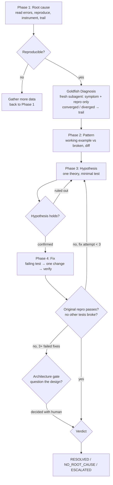

# Debug

## Contents

- Overview / Iron Law / When NOT to use
- Workflow (mermaid map)
- Config
- The Hypothesis Trail
- The Four Phases (Root cause (incl. Goldfish Diagnosis) → Pattern → Hypothesis → Implementation)
- The Verdict (RESOLVED / NO_ROOT_CAUSE / ESCALATED)
- Report
- Common Rationalizations / Red Flags
- Verification / References

Find the **root cause** of a defect before touching code, prove it with a
failing test, fix it at the source, and close with fresh verification
evidence. Symptom fixes are failure.

**Announce at start:** "I'm using the skillgrid:debug skill to find the root
cause."

**Iron law:**

```
NO FIXES WITHOUT ROOT CAUSE INVESTIGATION FIRST
```

If Phase 1 is not complete, no fix may be proposed. A "quick fix" applied
before the cause is stated is a hypothesis in costume — it gets tested as one.

**When NOT to use:** a trivial, fully-understood one-liner where the cause is
already known and the fix is mechanical (a typo, a missing import). State the
cause, verify the fix, done — do not run the four phases for their own sake.
Not for *finding* bugs nobody reported (that is `skillgrid:test` or dogfood);
this skill handles one reported or observed defect at a time.

**Prerequisites:** a git history (Phase 1.3 uses `git log` / `git diff`) and
the project's test runner (`testing.runner` from config). Neither is
optional — without a reproducible trigger, Phase 1 cannot complete.

## Workflow



## Config

Read `.skillgrid/config.yaml` before starting. Use:

| Config key | Used for |
|------------|----------|
| `testing.runner` | Test command for failing tests and verification |
| `commands.build` / `commands.lint` | Verification the fix must pass |
| `conventions.specs_root` | Where the change's `briefing.md` / `acceptance.feature` live (if the defect is inside a change) |
| `conventions.artifacts` | Terms vocabulary for the root-cause statement |
| `rules.fast_track` | Trivial-classification criteria (the "when not to use" gate) |
| `mnemonic.enabled` | If `true`, persist a durable root cause (fail-open) |

## The Hypothesis Trail

A debug session crosses compactions; the trail must survive them. A compaction
between Phase 1 and Phase 4 that loses the trail makes the agent re-investigate
what it already ruled out.

- **Write the trail to a state file:** `.skillgrid/meta/.sdd/debug/<date>-<slug>/state.md`
  (gitignored scratch). One entry per iteration:
  `hypothesis | source (goldfish | session) | evidence | verdict (confirmed | ruled out | open)`.
  The `source` field marks who found the hypothesis: `goldfish` hypotheses
  came from the fresh-context diagnosis (Phase 1 step 3) — they were found
  *without* the session's anchor — so they are tried before session-formed
  ones.
- **Append as you go** — after each Phase 2 comparison and each Phase 3 test,
  before the next step. Appending at the end is too late.
- **On resume:** read the state file first; resume at the first `open`
  hypothesis. Ruled-out hypotheses stay ruled out — never re-test them.
- **On close:** if the root cause is a design decision, the ADR is the durable
  record; if it is a bug, the TDD evidence in the fix commit is. The state file
  can go.

## The Four Phases

Each phase completes before the next begins.

### Phase 1: Root Cause Investigation

1. **Read the error completely.** Every line of every stack trace; file paths,
   line numbers, error codes. Do not skip warnings — they often state the
   solution.
2. **Reproduce consistently.** Exact trigger steps; does it fire every time?
   Not reproducible → gather data (log lines, input fixtures, env state)
   until it is. Never fix on a one-time sighting.
3. **Check recent changes.** `git log` / `git diff` around the symptom; new
   dependencies, config drift, environment differences.
4. **Goldfish Diagnosis (before you state your hypothesis as the working one).**
   Dispatch a fresh read-only subagent per the brief at
   `_shared/elephant-goldfish/goldfish-diagnosis.md`. The dispatch carries
   **only** the symptom + the repro steps — never your hypothesized root
   cause, never the session's investigation so far. Ask for its top 1–3
   candidate root causes with file:line + the evidence that would falsify
   each. R36 applies: a harness that cannot spawn a fresh-context subagent
   STOPS and says so (no same-context diagnosis counts). Then:
   - **Compare.** Convergence (its top candidate matches yours) → proceed
     with confidence; note it. Divergence → its candidates enter the trail
     FIRST (they were found without your anchor), and you tell the user:
     "the goldfish flagged a different root cause: <candidate>; here's why
     I think <yours> is still right — do I proceed or investigate that
     one?"
   - **Record.** Append the outcome to the state file:
     `goldfish: converged | diverged (candidates: …)`.
   - **Skip** for the trivial one-liner path (the "When NOT to use" gate)
     and when no repro exists yet — diagnosis without a repro is guessing;
     say "no repro, goldfish skipped" instead.
5. **Instrument at boundaries** (multi-component systems). Before proposing a
   fix, log what enters and exits each component boundary, verify
   config/env propagation, and check state at each layer. One instrumented
   run shows *where* it breaks; then investigate that component only.
6. **Trace the bad value backward** to where it originates — the origin is the
   fix site, not where the error surfaces. For the full backward-tracing
   technique: [references/root-cause-tracing.md](references/root-cause-tracing.md).

### Phase 2: Pattern Analysis

1. Find a **working example** of similar code in this codebase.
2. Read the relevant reference implementation completely — every line.
3. List **every difference** between working and broken, however small; "that
   can't matter" is untested and usually wrong.
4. Name the working example's **assumptions** (config, environment, callers)
   and check the broken path's assumptions hold.

### Phase 3: Hypothesis and Testing

1. State **one** hypothesis: "I think X is the cause because Y." Write it to
   the trail before testing — with `source: goldfish` or `source: session`
   per the trail contract above. When the Phase 1 diagnosis diverged, the
   goldfish candidates sit in the trail FIRST: try them before your own.
2. Test with the **smallest possible change** — one variable at a time.
3. The test speaks: confirmed → Phase 4; ruled out → record it and form a new
   hypothesis. Never stack a second fix on top of an unconfirmed first one.
4. When stuck, say "I don't understand X" and research it — pretend-to-know
   is how bad hypotheses ship.

**Competing-hypothesis investigations:** when several *mutually exclusive*
root causes fit the symptoms, do not fan out — a fan-out reports
independently and the reports never meet, so no theory gets ruled out. Run a
team investigation: spawn teammates that message each other to disprove the
other theories; converge only when the survivors can disprove the rest.

### Phase 4: Implementation

1. **Write the failing test first** — the simplest automated reproduction
   (or a one-off repro script when no framework exists). It must be RED
   before the fix exists. (Per `skillgrid:test-driven-verification`: the
   regression test is proven by red-green — write → green → revert fix →
   RED → restore → green.)
2. **Apply one fix**, at the origin of the bad value. No bundled
   refactoring, no "while I'm here" improvements.
3. **Verify with fresh evidence:** the failing test now passes (green output
   captured), no other tests broke, and the *original* reproduction from
   Phase 1 is re-run. No done-claim without this session's output.
4. **Failed-fix counter.** The fix did not work: count attempts.
   Fewer than 3 → back to Phase 1 with the new information. **3+ → STOP**
   and run the architecture question (below) with the human before attempt 4.
   Three patches that each reveal a new problem elsewhere is a wrong
   architecture, not a hard bug.

**If the root cause is a decision, not code — stop patching.** When the
confirmed cause is a data model that cannot hold the value, an API shape that
forces the bad path, or a provider choice with the wrong failure mode, the
code is doing what the decision told it to do. Record an ADR (the decision,
why it is flawed, what it costs), then route the decision: pre-existing → the
next blueprint's owed-decision list; mid-change → back to the blueprint
owner. A patch ships only as a recorded workaround while the decision stands.
Three patches around a bad decision is the same incident shipping twice.

## The Verdict (three states, evidence-gated)

Every debug session ends with exactly one:

- **`RESOLVED` ✓** — root cause stated, fix applied at the origin, failing
  test red→green, original repro re-run and passing, no other tests broken,
  trail complete.
- **`NO_ROOT_CAUSE` ⚠** — the investigation is complete and the defect is
  genuinely environmental, timing-dependent, or external. Requires the
  evidence for it: what was investigated, what was ruled out, why it is
  outside the code. Then add appropriate handling (retry, timeout, error
  message) and monitoring for next time. Note: 95% of "no root cause"
  verdicts are incomplete investigations — the trail must show the depth.
- **`ESCALATED` ✗** — 3+ failed fixes (architecture question open with the
  human), or a decision-cause with the ADR recorded but the redesign not yet
  routed. State the handoff: what is known, what is blocked on, who decides
  next.

A verdict is a claim with a demonstration. If you cannot point to specific
output, a diff, the trail file, or the reproduction that proves the verdict,
it is `ESCALATED` at best — never `RESOLVED` by vibes.

## Report

Write the close-out to `.skillgrid/meta/.sdd/debug/<date>-<slug>/report.md`:

| Section | Content |
|---------|---------|
| Symptom | The original report / observed behavior, verbatim where useful |
| Root cause | Stated in one paragraph, at the origin; or "No root cause" with the evidence |
| Trail | The hypothesis table (hypothesis \| source \| evidence \| verdict), ruled-out included; the goldfish diagnosis outcome (`converged` / `diverged`) where it ran |
| Fix | The diff summary; the failing test and its red→green evidence |
| Verification | Fresh output: repro re-run, suite result, build/lint |
| Verdict | `RESOLVED` / `NO_ROOT_CAUSE` / `ESCALATED` with the handoff if escalated |
| Durable record | ADR path (decision-cause), fix-commit SHA (bug), or project-wiki page filed |

**Durable record:** if `mnemonic.enabled: true`, persist a non-obvious root
cause or failure mode to the project wiki (`gotchas/`) per
`skillgrid:projectwiki` — fail-open. A root cause that recurs is a gotcha the
next session should recall, not re-derive.

## How to measure it

Per `_shared/craft/measurement.md`.

| | Indicator | Data source | Direction |
|---|-----------|-------------|-----------|
| Leading | % of debug sessions that render a three-state verdict backed by the named evidence (a "fixed" with fresh repro + suite pass, not just a patch) | the debug report's verdict block vs. its evidence list | should rise |
| Lagging | Recurrence: the same root cause re-filed as a new bug after a prior "fixed" verdict on the same area | Git history / issue tracker (re-filed bug referencing the prior fix) | should fall |

## Common Rationalizations

| Excuse | Reality |
|--------|---------|
| "Issue is simple, don't need process" | Simple issues have root causes too. The phases are fast for simple bugs. |
| "Emergency, no time for process" | Systematic debugging is faster than guess-and-check thrashing. |
| "Just try changing X and see" | A change made before the cause is stated is an unnumbered hypothesis. State it, test it, record it. |
| "Multiple fixes at once saves time" | Then nothing isolates what worked, and a new bug has no owner. |
| "I'll write the test after the fix works" | Untested fixes don't stick. The failing test written first proves both the bug and the fix. |
| "I see the problem, let me fix it" | Seeing a symptom is not understanding the cause. The fix site is where the bad value originates. |
| "One more fix attempt" (after 2+) | 3+ failures = architecture problem. Question the design with the human, don't patch again. |
| "The bug is in the code, I'll just patch it" | If the cause is a decision — data model, API shape, provider — patching is papering over. Record the ADR, route the decision. |
| "It's probably X" | "Probably" is a hypothesis that skipped its test. Trail entry, minimal test, verdict. |

## Red Flags — STOP and return to Phase 1

- "Quick fix for now, investigate later"
- "I'll add several changes and run the tests"
- "Skip the test, I'll verify manually"
- "Pattern says X but I'll adapt it differently" (reference not read completely)
- Proposing solutions before tracing the data flow
- "One more fix attempt" after 2+ failures
- Each fix reveals a new problem in a different place
- The confirmed cause is a decision and you are writing a patch anyway
- Trail not updated since the last phase boundary
- Human redirections: "is that actually happening?", "stop guessing",
  "we're stuck?" — each means a step was skipped; return to Phase 1

## Verification

- [ ] Root cause stated in one paragraph at the origin — or `NO_ROOT_CAUSE` declared with the investigation evidence.
- [ ] Reproduction was consistent before any fix; the original repro is re-run after the fix and captured.
- [ ] Trail file updated per iteration (`hypothesis | source | evidence | verdict`); no phase skipped ahead of the one before it; ruled-out hypotheses never re-tested.
- [ ] Goldfish Diagnosis ran (Phase 1 step 4) or its skip is recorded (trivial path / no repro); `converged`/`diverged` recorded in the state file when it ran; goldfish-source hypotheses tried before session ones.
- [ ] Failing test existed and was RED before the fix; red→green cycle captured (regression test proven).
- [ ] Exactly one fix applied at the origin; no bundled refactoring.
- [ ] Fresh verification evidence this session: repro pass, suite pass, build/lint pass.
- [ ] No 3+ failed fixes left unresolved without the architecture question asked with the human.
- [ ] A decision-cause was not patched silently: ADR recorded, decision routed, any patch labeled a workaround.
- [ ] Verdict rendered from the three-state gate, backed by the evidence listed above.
- [ ] Report written to the state dir; durable record filed (ADR / fix commit / project wiki) or explicitly none.

## References

- [references/root-cause-tracing.md](references/root-cause-tracing.md) — backward tracing through call stacks to the origin of the bad value
- [references/defense-in-depth.md](references/defense-in-depth.md) — validation layers to add after the root-cause fix, so the same class of defect cannot slip through again
- `skillgrid:test-driven-verification` — the gate function for the "fixed" claim (fresh evidence, no vibes)
- `skillgrid:regression-dog` — the behavioral-delta check on the fix diff before it commits
- `skillgrid:architectural-decision-records` — decision-cause recording and routing
- `skillgrid:prototype` — when the fix is itself an unproven technical claim, de-risk it before committing to the approach
