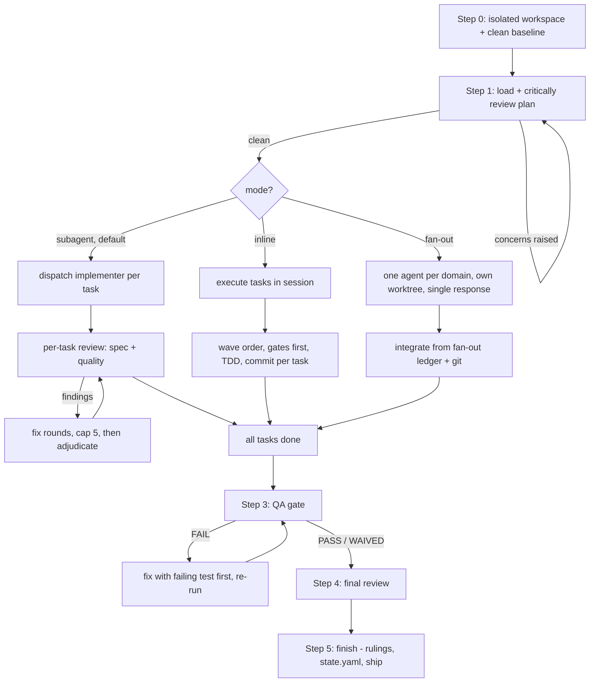

# Execute

## Contents
- Config / When to Use / The Lazy Discipline / The Process (Step 0 Setup, Status Guard, Execution Contract, Delivery Guard)
- Step 1 Load & Review Plan / Step 2 Execute (subagent, inline, fan-out) / Step 3 QA Gate / Step 4 Review / Step 5 Finish
- When to Stop and Ask / Remember / Common Rationalizations / Red Flags / Verification / References

Load the plan (or sliced `tasks.md`), review it critically, execute every task or ticket in wave order with review checkpoints, and hand off to QA.

**Announce at start:** "I'm using the skillgrid:execute skill to execute this plan."

This skill merges five former skills into one: workspace setup, three execution modes, the parallel fan-out pattern, and the lazy-minimal solution discipline.

- **Workspace setup** (from `isolated-workspace`) — before anything else: detect existing isolation, create an isolated workspace via native tools or git worktree fallback, run project setup, verify a clean baseline.
- **Subagent mode** (from `subagent-execution`) — dispatch a fresh implementer subagent per task/ticket, a task review (spec compliance + code quality) after each, and a broad whole-branch review at the end. Default when subagents are available.
- **Inline mode** (from `simple-execution`) — execute the tasks in the current session, step by step, with the same gates. Use when the platform has no subagent access or the user prefers inline.
- **Fan-out mode** (from `parallel-execution`) — 2+ independent problem domains (different test files, subsystems, root causes) get one agent each in its own worktree, dispatched in a single response, integrated from a fan-out ledger.
- **Lazy discipline** (from `ponytail`) — fully active on every coding response: before writing code, climb the ladder (YAGNI → reuse → stdlib → native → installed dep → one line → minimum code) and stop at the first rung that holds.

All modes share the same config, gates, wave order, ticket lifecycle, QA gate, and review protocol. The mode only changes *who writes the code and in what order* — dispatched implementers, this session, or concurrent agents.



## Config

Read `.skillgrid/config.yaml` before starting. Use:

| Config key | Used for |
|------------|----------|
| `conventions.scratch_dir` | Ledger directory (default `.skillgrid/meta/.sdd/`) |
| `testing.runner` | Test command in implementer briefs and verifications |
| `testing.tdd` | Strict-TDD branch machinery switch (basic TDD — a failing test before code — is always on regardless) |
| `commands.build` / `commands.lint` | Build and lint commands (inline mode) |
| `conventions.worktree_dir` | Worktree directory for isolated workspaces (default `.worktree/`) |
| `testing.setup` | Install command for new workspaces (e.g. `npm install`, `go mod download`) instead of auto-detecting |
| `conventions.artifacts` | Terms-file vocabulary (the `01-business-terms.md` / `02-technical-terms.md` under `.skillgrid/projectwiki/glossary/`) for briefs and rulings |
| `ticketing.enabled` | If `true` AND a `tasks.md` with tracker IDs exists (produced by `skillgrid:slicing`), update ticket status at each transition: `ready` (wave start) → `in-progress` (implementer dispatched / ticket started) → `review` (review started / verification passed) → `done` (review clean) |
| `ticketing.type` | Per-tracker CLI for the status updates above (see `skillgrid:slicing` § Tracker Adapters). When `hermes-kanban`: `claim` at execution start is the in-progress transition — it is atomic and prints the resolved workspace path, which becomes the implementer's worktree (Step 0a/0c below) |

Carry the in-force ADRs — per the change's ADR Review Manifest at `.skillgrid/change-specs/YYYY-MM-DD-<topic>/adr.md` — into implementer briefs so a worker doesn't re-litigate a settled decision or name things outside the ubiquitous language. Every implementation task follows `skillgrid:test-driven-development`: basic TDD (a failing test before code) is always on. **BDD is always on** — the brief names the task's `SATISFIES` scenario and the reviewer checks the acceptance scenario went RED→GREEN (TDD Evidence references the scenario name); enforce the spec-zone rule — commit `.skillgrid/change-specs/` changes before code changes, never both uncommitted (the `pre-commit` zone guard, `skillgrid:work-unit-commits`, blocks a mixed commit).

**Narration:** between tool calls, narrate at most one short line — the ledger and the tool results carry the record.

**Continuous execution:** Do not pause to check in with your human partner between tasks. Execute all tasks from the plan without stopping. The only reasons to stop are the four named below, or all tasks complete. "Should I continue?" prompts and progress summaries waste their time — they asked you to execute the plan, so execute it.

**Rulings, not stalls.** A running plan does not wait on a human. Conflicts, ambiguities, plan defects, a cap you would have asked to exceed — decide them. The spec is the binding authority, the plan is its argument, and your judgment settles what neither answers. Record every decision in the ledger as `Ruling: <what you decided> — <why> — <what it costs if wrong>`, and keep going. A wrong ruling costs rework your human partner can see and undo; a session parked on a question costs their whole day and buys nothing.

Four things stop you, and only these: an irreversible or destructive operation; a security-sensitive action; a side effect outside this worktree that norms say you ask about first (a merge, a push to a shared branch, a publish); and a plan so broken that every path forward is a guess. For those, stop and ask.

## The Lazy Discipline

Folded in from the `ponytail` skill (full protocol: [ponytail.md](references/ponytail.md)). It is **fully active on every coding response** in this skill — no drift back to over-building, still active if unsure. Before writing code, climb the ladder once and stop at the first rung that holds:

1. Does it need to exist at all? (YAGNI — speculative need = skip it, say so in one line)
2. Already in this codebase? Reuse it.
3. Stdlib does it? Use it.
4. A native platform feature covers it?
5. An already-installed dependency solves it? Never add a new one for what a few lines can do.
6. Can it be one line?
7. Only then: the minimum code that works.

The ladder runs *after* you understand the problem, never instead of it — trace the files the change touches first. Mark any real corner you cut with a `ponytail:` comment naming the ceiling and upgrade path. Never simplify away input validation at trust boundaries, data-loss error handling, security, accessibility, or anything the spec/blueprint explicitly requests — an explicit requirement outranks the ladder. Intensity: `/ponytail lite|full|ultra` (default **full**); "normal mode" / "stop ponytail" reverts for the session.

## When to Use

- You have a written implementation plan (or a `tasks.md` from `skillgrid:slicing`) to execute
- You need review checkpoints and a QA gate before integration
- A sliced change is at the `user-gate-slice` gate and the user said "Implement"

**When NOT to use:** there is no written plan yet (use `skillgrid:brainstorm` / `skillgrid:blueprint` first, then `skillgrid:slicing`). A single 1-2 ticket change that fits one context window can run inline without this skill's machinery.

**Mode choice:**

| Condition | Mode |
|---|---|
| Subagents available (Claude Code, Codex CLI, Codex App, Copilot CLI, Gemini CLI, or this harness's subagent tool) | **Subagent** (default) |
| No subagent access, or the user prefers inline | **Inline** |
| 2+ independent problem domains (different test files, subsystems, root causes; no shared state) | **Fan-out** — one agent per domain, each in its own worktree |
| 2+ coupled implementation tasks with overlapping files that can be made disjoint-write | **Fan-out (concurrent coupled build)** — see [references/concurrent-leaves.md](references/concurrent-leaves.md) |
| 4+ coupled leaves in flight at once needing lease/wave machinery | full orchestrator (out of scope here) |

**Fan-out triggers and exclusions:** use fan-out when 3+ test files fail with different root causes, multiple subsystems are broken independently, and each problem can be understood without the others' context. Don't fan out when the failures are related (fixing one might fix others), understanding requires full system state, agents would interfere (same files, shared resources), or you don't know what's broken yet.

## The Process

### Step 0: Setup

Before dispatching Task 1 (subagent mode) or starting the first task (inline mode):

1. **Isolated workspace** (never start on main/master without consent):

   **0a. Detect existing isolation first** — before creating anything, check whether you are already in an isolated workspace (worktree-detection snippet per `_shared/work-unit-commits/README.md` § Worktree detection):

   ```bash
   GIT_DIR=$(cd "$(git rev-parse --git-dir)" 2>/dev/null && pwd -P)
   GIT_COMMON=$(cd "$(git rev-parse --git-common-dir)" 2>/dev/null && pwd -P)
   BRANCH=$(git branch --show-current)
   ```

   **Submodule guard:** `GIT_DIR != GIT_COMMON` is also true inside git submodules — verify you are not in a submodule first (`git rev-parse --show-superproject-working-tree` returning a path means treat it as a normal repo).

   - **Already in a linked worktree** (and not a submodule): skip creation and report with branch state — "Already in isolated workspace at `<path>` on branch `<name>`." (Detached HEAD: note that branch creation is needed at finish time.) Do NOT create another worktree.
   - **Normal checkout:** has the user already indicated a worktree preference? If not, ask for consent: "Would you like me to set up an isolated worktree? It protects your current branch from changes." Honor any declared preference without asking. If the user declines, work in place.

   **0a'. Tracker-claimed workspaces override 0a–0c.** When the tracker is `hermes-kanban` (`ticketing.type`) and the ticket was claimed via `hermes kanban --board <slug> claim <task-id>`, the claim printed a resolved workspace path — use it as the implementer's worktree and skip 0a–0c (the claim already owns directory placement, isolation, and cleanup). Create a new worktree only when the ticket is not claimed (e.g. `ticketing.enabled: false`) or the claim's path is unavailable.

   **0b. Create via native worktree tools (preferred).** If the harness provides a worktree tool (`EnterWorktree`, `WorktreeCreate`, a `/worktree` command, or a `--worktree` flag), use it — it owns directory placement, branch creation, and cleanup. Using `git worktree add` when a native tool exists creates phantom state the harness can't see or manage.

   **0c. Git worktree fallback (only when no native tool).** Directory selection priority per `_shared/work-unit-commits/README.md` § Worktree root + detection: (1) a worktree directory declared in your instructions, (2) the project-root `.worktree/`, (3) `conventions.worktree_dir` from config, default `.worktree`. **MUST verify the directory is ignored before creating** (`git check-ignore -q <dir>`) — if not ignored, add it to `.gitignore` and commit first, or the whole tree gets committed. Then:

   ```bash
   git worktree add "$LOCATION/$BRANCH_NAME" -b "$BRANCH_NAME"
   cd "$LOCATION/$BRANCH_NAME"
   ```

   Sandbox fallback: if `git worktree add` fails with a permission error, tell the user the sandbox blocked worktree creation and work in the current directory instead.

   **0d. Project setup + clean baseline.** Run `testing.setup` from config (or auto-detect: `npm install` / `cargo build` / `pip install -r requirements.txt` / `poetry install` / `go mod download`), then run the test suite to verify the workspace starts clean. Tests fail → report and ask whether to proceed or investigate. Tests pass → report ready:

   ```
   Worktree ready at <full-path>
   Tests passing (<N> tests, 0 failures)
   Ready to implement <feature-name>
   ```

2. Run `node scripts/sdd-workspace.mjs PLAN_FILE` (from this skill's directory) to get this plan's git-ignored workspace
3. Establish the progress ledger at `<workspace>/progress.md` (your recovery map that survives compaction — trust it and `git log` over your recollection after compaction)
4. Read the plan (or `tasks.md` if `skillgrid:slicing` produced one)
5. Run the pre-flight conflict scan

Conversation memory is the single most expensive failure: controllers that lost their place have re-dispatched entire completed task sequences. The ledger is the fix, not todos.

Full workspace, ledger, commit position, and pre-flight-scan procedure: [setup.md](references/setup.md).

**Brownfield baseline (measure before you plan).** When the change lands in an existing repo you haven't measured, run the inspect pass of [code-structuring.md](references/code-structuring.md) — pygount LOC, top languages, 5 largest files, code-vs-comment ratio. The numbers calibrate the 400-line budget risk and the slicing; a repo that is 5K vs 500K LOC reads very differently at those gates.

### Status Guard

Before reading implementation files or dispatching any task, confirm readiness:

- If state is **`blocked`** (missing artifacts, unsafe context), STOP and return `blocked` with the missing items named.
- If state is **`all_done`**, do not dispatch. Return `success` with `Next: qa`. You own only up to the `qa` handoff. The rest of the chain is in `_shared/rules/sdd-structure.md`. Determine `all_done` from the live done-signal, in this priority order:
  1. **Tracker** (if `ticketing.enabled: true`): every ticket for this change is `done` in the tracker.
  2. **Per-plan ledger**: every `Task N:` line in `.skillgrid/meta/.sdd/<plan>/progress.md` reads `Task N: complete`.
  3. **Legacy fallback** (v1-format `tasks.md` only): every ticket is `[x]`.
- If state is **`ready`**, proceed only on the assigned pending tickets.

**Gate clear:** if `changes.<topic>.gate` in `state.yaml` is set (it was `user-gate-slice` at slicing), the user's "Implement" is what started this skill — clear the field in the same edit as the first ledger write. If there was no user confirmation, STOP at the gate screen and do not dispatch (User gate contract in `_shared/rules/sdd-structure.md`).

**Edit roots are bounded.** If the blueprint or `tasks.md` names specific directories/files as the change's affected areas, edit only under them. If a needed edit is outside, STOP and report the unsafe path. Never edit files outside the change's affected areas without a ruling.

### Execution Contract Check (optional ticket fields)

Before dispatching a ticket (subagent) or starting a ticket (inline), read its optional contract fields (see `skillgrid:slicing` → Ticket Execution Contract). All three are optional — absent means the ticket runs under the default rules, unchanged.

- **`Precondition:`** assert it with **read-only** checks only (file exists, env var set, health ping) before any code is written. Unmet → **STOP with a checkpoint** and name the unmet precondition; do not do partial work. A precondition you can't check read-only was written wrong — ledger it and re-check.
- **`Reversibility: one-way`** is a declared stop signal: it folds into the "four things stop you" rule (an irreversible operation). The ticket now *names* why it stops — surface the checkpoint explicitly instead of relying on judgment. `costly`/`reversible`/absent change nothing.

**The in-flight doubt gate.** A task whose verify passes is not the same as a task whose *claim* is true. When you (or a dispatched subagent) are about to mark a one-way or otherwise hard-to-reverse task complete, and a load-bearing fact about it rests only on the implementer's report, run the claim-check before the ledger line: **CLAIM** — state the one load-bearing fact the completion rests on. **EXTRACT** — pull the supporting evidence (the test output, the diff, the command you actually ran). **DOUBT** — ask: is the evidence consistent with the claim, or is there a way the claim is true *despite* the evidence (the test was skipped, the command matched the wrong target, the diff touched a file outside `Owns:`)? **RECONCILE** — if consistent, ledger the task complete with the evidence path; if not, name the gap and treat it as a failed gate, not a pass. This is the one-way mirror of the verify gate: verify answers "does it run?", doubt answers "is the claim I'm about to record true?". It runs only on the hard-to-reverse tasks — reversible tasks are caught by the ordinary fix loop.
- **`Fails-when:`** the verify command's failure signature. When a ticket's runnable verify has a `Fails-when`, a green pass is only green if the output does **not** match it. A verify command that can be neither passed nor failed (no `Fails-when`, no falsifiable `Then`) is not verification — flag it.

### Delivery Guard

Before dispatching the first ticket, read `tasks.md` for the four plain-text guard lines from the `## Delivery Strategy` section:

```
Decision needed before apply: {Yes | No}
Chained PRs recommended: {Yes | No}
Chain strategy: {stacked-to-main | feature-branch-chain | size-exception | pending}
400-line budget risk: {Low | Medium | High}
```

If **any** of `400-line budget risk: High`, `Chained PRs recommended: Yes`, or `Decision needed before apply: Yes`:

1. Check that a **resolved delivery path** exists:
   - A chosen chain strategy (`stacked-to-main` or `feature-branch-chain`) — not `pending`.
   - Or an accepted `size:exception` (maintainer explicitly approved a single PR above budget).
2. If **resolved**: implement only the assigned work-unit slice, keep its scope autonomous, and report the PR boundary in the ledger. For `feature-branch-chain`, verify each child diff targets the correct base branch (not main).
3. If **not resolved**: STOP before writing code and return `blocked` with:

   > Delivery decision required before execution: estimated work may exceed 400 changed lines. Ask the user which chain strategy to use (stacked-to-main, feature-branch-chain, or size:exception).

The guard runs **before** any code is written — implementing an above-budget slice only to discover the delivery strategy wasn't resolved wastes a batch of work and complicates rollback.

### Decompose & Gate (subagent mode)

Before dispatching Task 1, decompose the plan and gate each task on its own ownership and dependencies. This is the lightweight Depth Tree: a plan is a set of leaves (tasks) under branches (shared interfaces), and dispatch is gated on verified dependencies, not file order.

- **Inventory the outcomes.** Reread the plan/spec and list every independently-omittable outcome. A plan whose tasks omit an outcome nobody owns is a half-done plan — surface it before dispatch, not after.
- **Give each task exact file ownership and its dependencies.** Record two ledger lines per task before dispatch: `Task <N>: Owns: <repo-relative globs>` and `Task <N>: Needs: <task ids or interfaces it builds on>`. These are coordination metadata, not a filesystem sandbox — a task may still read outside its `Owns`, but it may not write to another in-flight task's `Owns`.
- **Dependency-gated dispatch.** Dispatch a task only when every task named in its `Needs:` has a `Task <M>: complete` ledger line. For a plan of independent tasks this is a no-op; for a coupled plan it is the missing safety. Never dispatch a task whose declared dependency is still in flight.
- **Branch integration gate.** If two or more tasks share an interface or file, name the task that *integrates* them and give it an extra `G<n>` gate: the child tasks' outputs compose and the shared interface holds end-to-end. This gate is independent of the child leaves — it verifies the branch, not just the parts. If it cannot be made runnable, it is a `manual` gate you review at the final review, not a silent skip.
- **Parent re-verify.** A leaf's self-pass does not count as verification. Before marking a task complete, re-run its `#### Gates` oracles yourself (the runnable `CHECK:`+`EXPECT:` lines) — see `skillgrid:test-driven-verification`. The implementer's report is a claim; your re-run is the evidence. **Filesystem as truth:** a return message is never the completion signal. Spot-check the worker's claimed artifacts on disk and `git log --grep=<task-id>` for its commit before marking the task done — a worker whose claims do not match disk or git is not done, whatever the message says (a lost return message with the artifact on disk is still done; a green message with nothing on disk is not).

Inline mode: the same discipline applies to the session itself — gates run before code, and a task's verification is the evidence, not a self-report.

### Model Selection (subagent mode)

Before dispatching any subagent, choose its model: use the least powerful tier that can handle the role, and **always specify the model explicitly** — an omitted model silently inherits your session's (most capable, most expensive) model. Mechanical implementation → cheap tier; integration/judgment → standard; architecture + the final whole-branch review → most capable; fix-loop rounds 4-5 → at least one tier above the implementer that got stuck. Turn count beats token price: mid-tier is the floor for reviewers and prose-driven implementers.

Full per-role rules and complexity signals: [model-selection.md](references/model-selection.md).

## Step 1: Load and Review Plan

1. Ensure the isolated workspace exists (Step 0).
2. Read the plan file. If a `tasks.md` exists alongside the plan (produced by `skillgrid:slicing`), read it instead: tickets replace tasks, and execution follows the wave order — never file order.
3. Review critically — identify any questions or concerns about the plan.
4. If concerns: raise them with the user before starting.
5. If no concerns: create todos for the plan items (or tickets, if sliced) and proceed. Keep them synced at every transition — `in_progress` when a task starts, `completed` when its verification passes and the ledger line lands (todo hygiene: [setup.md](references/setup.md)). The todo tool is whatever the harness provides (opencode: `todowrite`); on a harness with none, the plan/ledger is the surface.

**Parallel execution proposal (subagent mode):** after reading `tasks.md`, identify independent tasks (no dependency edges between them). Propose parallel execution to the user via the agent's answer-select tool: "Tasks X, Y, Z are independent — run them in parallel? (Recommended)" / "Run sequentially." The user selects because of price burden. Parallel tasks dispatch simultaneously; coupled tasks remain sequential.

## Step 2: Execute Tasks

### Subagent mode

The task loop — dispatch, review, fix rounds, the round-5 breaker, and the per-task cycle: [task-loop.md](references/task-loop.md).

- Dispatch an implementer per the template in [implementer-prompt.md](references/implementer-prompt.md) with a complete task brief (the `node scripts/task-brief.mjs PLAN_FILE N` output path in the prompt).
- After each implementer: generate the review package (`node scripts/review-package.mjs PLAN_FILE BASE HEAD`) and dispatch the task reviewer per [task-reviewer-prompt.md](references/task-reviewer-prompt.md) — spec compliance + code quality.
- Findings: fix rounds up to 5 (rounds ≤3 resume the implementer; rounds ≥4 a fresh implementer on a more capable model), each ending with a scoped re-review per [re-review-prompt.md](references/re-review-prompt.md). At the cap, adjudicate each open finding and ledger the ruling.

**Why subagents:** you delegate tasks to specialized agents with isolated context. By precisely crafting their instructions and context, you ensure they stay focused and succeed. They never inherit your session's context or history — you construct exactly what they need. This also preserves your own context for coordination.

**Minimal context mandate:** each subagent receives ONLY the data necessary for its task: the task description, relevant file paths, the specific ADR constraints that apply, and the `SATISFIES` scenario. Do not pass session history, full blueprints, or unrelated task context. The subagent's context is constructed, not inherited.

### Inline mode

For each task (or ticket, if sliced), in wave order:

1. Mark as `in_progress` (and ticket status `in-progress` if `ticketing.enabled`).
2. Follow each step exactly (the plan has bite-sized steps; a ticket has scope + acceptance criteria).
3. **Lazy check** (per [The Lazy Discipline](#the-lazy-discipline), fully active): before writing code, climb the ladder once — does this need to exist at all (YAGNI), is it already in the codebase, does stdlib or a native platform feature cover it, is it one line? Take the first rung that holds; ship the laziest working version and mark any real corner cut with a `ponytail:` ceiling comment. Never simplify away input validation at trust boundaries, data-loss error handling, security, accessibility, or anything the spec/blueprint explicitly requests.
4. **Structure check** (per `skillgrid:execute` → [code-structuring.md](references/code-structuring.md)): if the task **creates a new module/interface or reshapes an existing one** (splitting a file, extracting a seam, moving code to a shared module), apply the deep-module vocabulary — small interface, behaviour hidden behind the seam, the deletion test, the interface as the test surface, no single-adapter seams. If the task is a **clean-up / improve / refactor** of the code the change lands in (not a single bug fix), run the scoped jscpd health pass (duplication → dead code → complexity) on the affected areas, committing each step separately. If the task **adds or reshapes a REST endpoint** (a new resource/route, a changed contract, or an "API design/review" request), apply [api-design.md](references/api-design.md) — resource naming, semantic status codes, the response envelope, pagination, and the breaking-vs-non-breaking versioning decision before the code.
5. **Gates first:** before writing code, ensure the `#### Gates` block for this task's requirements in `acceptance.feature` is complete — every happy-path scenario has a `G<n>` (runnable `CHECK:`+`EXPECT:`, or `manual`/`ABANDON` with a reason). Author any missing gate now; an `ABANDON` becomes a handoff you surface, not a pass. (Per `skillgrid:test-driven-verification`.)
6. **TDD is always on:** follow `skillgrid:test-driven-development` — write the failing test first, watch it fail, then write the minimal code to pass. Never start implementation without a failing test. **BDD is always on** — the failing test is the task's `SATISFIES` scenario: confirm the acceptance scenario is RED before writing code, and name TDD Evidence after the scenario.
7. Run verifications as specified (the plan's verifications, or the ticket's acceptance criteria).
8. **Zone rule (BDD is always on):** edit `.skillgrid/change-specs/` *or* code in a single commit — never both uncommitted. Commit spec changes before code changes; the spec is the contract, the code satisfies it. The `pre-commit` zone guard (`skillgrid:work-unit-commits`) blocks a commit that stages both.
9. **Commit the task's changes** per `skillgrid:work-unit-commits` — conventional subject (no AI-attribution trailer), atomic + independently-revertable, a `[skillgrid-context]` block in the body. Commit *after* the task's gate is green, *before* any long install/build. The git hooks (`pre-commit`, `commit-msg`) enforce the guards; each commit is a checkpoint you can roll back to.
10. Mark as completed. The run's record is the Execution Ledger under `.skillgrid/meta/.sdd/` (ADR-0020). When `mnemonic.enabled: true`, upsert `execution-progress` with the body in `_shared/rules/mnemonic-memory.md`.

### Fan-out mode

When the plan decomposes into 2+ independent problem domains (different test files, different subsystems, different root causes, no shared state), investigate/fix them in parallel instead of sequentially:

1. **Identify independent domains.** Group the work by what's broken — each domain must be understandable and fixable without context from the others.
2. **One worktree per agent.** Fan-out agents MUST run in separate worktrees (Step 0b/0c per agent) — parallel agents in a shared checkout race on the index and produce unmergeable diffs.
3. **Create focused agent tasks.** Each agent gets: a specific scope (one test file or subsystem), a clear goal, constraints ("do NOT change production code" / "fix tests only"), and a specific expected output ("return summary of root cause and changes"). Prompts must be focused, self-contained (paste the error messages and test names), and specific about output.
4. **Dispatch in parallel — all dispatch calls in one response.** Multiple dispatch calls in one response = parallel execution; one per response = sequential.

   **Fan-out ledger:** summaries returned to your context rot with it — a compaction mid-integration loses which agents finished, what they changed, and whether the suite was re-run. Keep a fan-out ledger at `.skillgrid/meta/.sdd/<run-slug>/parallel-ledger.md` (git-ignored): one row per agent — `agent | task | status (dispatched|done|failed) | worktree | changed files | test result`. Write a row on dispatch, update it when the agent returns, append a wave-summary line when the suite is re-run. **Integrate from the ledger + git, not from in-context summaries.** If you suspect a compaction mid-run: re-read the ledger + `git status`/`git log`, then re-dispatch only the unfinished rows. If `mnemonic.enabled: true`, upsert `skillgrid/<topic>/execution-progress` when a wave completes (ledger path plus wave tail, per `_shared/rules/mnemonic-memory.md`).

5. **Review and integrate.** When agents return: read each summary, verify fixes don't conflict (two agents editing the same file = scope error), merge the worktrees into the parent branch in order, run the full test suite, and spot-check — agents can make systematic errors.

**Concurrent coupled build:** if the parallel work is 2+ *implementation* tasks that touch overlapping files or a shared interface, read [references/concurrent-leaves.md](references/concurrent-leaves.md) before dispatching — it adds the disjoint-`Owns:` contract, a branch integration gate, and parent re-verify on top of this pattern, and tells you when to fall back to sequential.

**Work Unit Evidence (required before marking complete, all modes):** every ticket, regardless of size, MUST produce a **Work Unit Evidence** row in the ledger before its tasks are marked complete:

| Unit | Focused test (cmd + result) | Runtime harness (cmd + result) | Rollback boundary |
|---|---|---|---|
| {ticket name} | {cmd} → {exit/result} | {cmd/scenario} → {result or N/A+reason} | {files/behavior} |

- **Focused test**: the smallest command proving this unit works.
- **Runtime harness**: a real integration/runtime path. Explicit `N/A` + reason only if no runtime boundary exists.
- **Rollback boundary**: the exact files/behavior that can be reverted without removing unrelated work.

A ticket without a complete evidence row is NOT complete. The reviewer checks for this row.

## Step 3: QA Gate

After all tasks are complete, run `skillgrid:qa`. It produces the test plan, goal-backward verification, verification-gap audit, traceability matrix, and TDD evidence audit, and renders the four-state gate (PASS / CONCERNS / FAIL / WAIVED).

- **PASS** → proceed to Step 4.
- **CONCERNS** → fix the in-scope open items with tests, re-run QA (re-verification mode), then proceed.
- **FAIL** → fix the CRITICAL findings with a failing test first, re-run QA. Cap per `_shared/planning/rigor-tiers.md` (fix loop cap), then escalate to the human.
- **WAIVED** → record the waiver, proceed to Step 4.

The QA gate answers "was the goal achieved and would verification catch a regression?" The final review answers "does the code follow standards and implement the spec?" They are complementary — QA is the quality gate, review is the standards/spec gate.

## Step 4: Review

### Subagent mode — final whole-branch review

Once every task is complete and `skillgrid:qa` has passed, run the whole-branch review: package the branch diff (`node scripts/review-package.mjs PLAN_FILE MERGE_BASE HEAD` from this skill's directory), run `skillgrid:code-review` per its topology on the most capable model — the 3-axis pass at small/low-risk, the fan-out at the review escalation threshold (per `_shared/planning/rigor-tiers.md`) — and present the reports side by side. Findings get ONE fix subagent + one scoped re-review, then the breaker adjudicates — there is no second fix wave.

Full protocol, escalation threshold, and fix-wave rules: [final-review.md](references/final-review.md).

### Inline mode — request review and fix findings

1. Request code review (follow `skillgrid:code-review`).
2. On findings: follow `skillgrid:receiving-code-review` (triage → fix → validate → log).
3. Loop until review is clean or capped per `_shared/planning/rigor-tiers.md` (fix loop cap).
4. Update ticket status → `done` for clean tickets (if `ticketing.enabled`).

## Step 5: Finish

Before you delete anything, collect every ledger line containing `Ruling:` — preflight rulings, parked findings, breaker adjudications, all of them — into your final message under "Rulings I made", in the order you made them, each with what it costs if wrong. The list is exhaustive: if the ledger holds a ruling, the list holds it. That list is the only place the decisions you took on your human partner's behalf reach them — they read it and rework whatever you got wrong. A ruling that dies with the workspace was a decision made in secret.

When the final review is clean and its fixes are merged, delete this plan's workspace (`rm -rf <workspace>`) — the git history is the record now. Sibling directories belong to other plans; leave them alone.

**Update `state.yaml`:** set `changes.<topic>.phase: execution`.

**Update tickets:** every clean ticket → `done` in the tracker (if `ticketing.enabled`); closing commits use `Closes <ID>`.

Announce: "I'm using the skillgrid:ship skill to integrate and close this change." **REQUIRED SUB-SKILL:** use `skillgrid:ship` — follow it to verify tests, present options, and execute the choice.

## When to Stop and Ask for Help

**STOP executing immediately when:**
- Hit a blocker (missing dependency, test fails, instruction unclear)
- Plan has critical gaps preventing starting
- You don't understand an instruction
- Verification fails repeatedly

**Ask for clarification rather than guessing.**

**Return to Step 1 when:** the partner updates the plan based on your feedback, or the fundamental approach needs rethinking. Don't force through blockers — stop and ask.

## Remember

- Review the plan critically first
- Climb the lazy ladder before every coding task (The Lazy Discipline) — never simplify away what the ladder protects
- Follow plan steps exactly
- Don't skip verifications
- Commit after every task per `skillgrid:work-unit-commits` — commits are your checkpoints
- Reference skills when the plan says to
- Stop when blocked, don't guess
- Never start implementation on main/master without explicit user consent
- If `tasks.md` exists, execute tickets in wave order, not file order

## How to measure it

Per `_shared/craft/measurement.md`.

| | Indicator | Data source | Direction |
|---|-----------|-------------|-----------|
| Leading | % of executed waves whose tickets reached `done` without a re-run (no wave re-dispatched after a failed review) | `state.yaml` + ticket status history (Backlog / tracker) | should rise |
| Lagging | Post-merge rework: commits touching the change's files after the first merge that revert or re-scope an executed ticket | Git history | should fall |

## Common Rationalizations

| Excuse | Reality |
|--------|---------|
| "The plan is clear enough, skip the critical review" | Step 1 says review critically and raise concerns before starting. A gap caught in review is one line; caught in execution it is a rework of tasks that depended on it. |
| "I'll run the tests at the end" | Basic TDD means a failing test exists before code. Verifications are per-task, so a red gate at the end can't tell you which task broke. |
| "This task is small, no need for a gate" | Gates are per requirement before code. Small tasks are where a missing gate silently skips the acceptance scenario. |
| "I'll fix the commit zone guard later" | The zone rule is one commit each for `.skillgrid/change-specs/` and code; the `pre-commit` hook blocks a commit that stages both. "Later" means a commit that was already wrong. |
| "Close enough on spec compliance" | Reviewer found spec gaps = not done. Fix or hit the cap and adjudicate — those are the only exits. |
| "I'll fix it myself, dispatching is overhead" | Controller fixes pollute your context and skip review. Resume the implementer (subagent mode). |
| "One more round will converge" | Past the cap, rounds don't converge — the failure is structural. Adjudicate and route. |
| "The reviewer will just find something new anyway" | Scoped re-reviews verify fixes; they cannot wander. New findings on untouched code go to the ledger, not the loop. |
| "This finding is obviously wrong, I'll drop it" | You adjudicate only at the cap, and every ruling is a ledger entry. Silent discards are forbidden. |
| "The fix was small, skip the re-review" | Unreviewed fixes are how regressions land. Every round ends with a scoped re-review. |
| "Reviews slow the loop down" | The loop without reviews is just unverified churn. Reviews are the loop's brakes and steering. |
| "Ledger bookkeeping is overhead" | The ledger is what survives compaction. Controllers without one have re-dispatched entire completed task sequences. |
| "The implementer spawned its own reviewer — free extra assurance" | It's a duplicate seat reviewing the same diff; the task review is the gate. A worker-spawned reviewer is a defect to flag, not rigor. |
| "The review found minor issues, ship anyway" | The review loop caps per `_shared/planning/rigor-tiers.md`, but a review only closes clean or escalated. Shipping with open findings skips the gate that exists to catch them. |
| "I'm obviously not in a worktree — no need to check" | Run the Step 0 detection. Harness-created isolation and submodules both fool eyeballing; the detection commands settle it. |
| "`git worktree add` is quicker than hunting for a native tool" | A native tool (e.g. `EnterWorktree`) owns placement, branching, and cleanup. Bypassing it is the #1 mistake — it creates phantom state the harness can't see or manage. |
| "The worktree directory is surely ignored already" | Run `git check-ignore`. An unignored worktree directory commits the whole tree into the repo. |
| "The workspace is fresh — baseline tests can wait" | A dirty baseline makes every later failure ambiguous. Run the tests now; proceeding past failures is your human partner's call. |
| "The tasks are independent enough, just run them back to back" | One dispatch per response = sequential execution. Multiple dispatches in the same response are what make them run in parallel — back-to-back just wastes the concurrency. |
| "Parallelizing is risky, I'll do it sequentially" | If the domains are genuinely independent, sequential costs you the whole wall-clock time for zero safety gain. The risk is bad scoping, not concurrency — fix the scope, not the order. |
| "I'll merge the fan-out results without checking each agent's output" | Agents can make systematic errors. Integrate from the ledger + git and review each summary and diff — never a blind merge. |
| "It's only two tasks, parallel is overkill" | Two independent investigations still save a full round-trip of wall-clock time. Dispatch cost is near zero; the benefit scales with independence, not count. |
| "One worktree for all the agents, they'll coordinate" | Shared checkouts race on the index and produce unmergeable diffs. One worktree per agent, always. |
| "I'll add the robust version to be safe" | Speculative robustness is a new dependency with a bug surface. Ship the lazy version, question it in the same response, let the user ask for the full version. |
| "Lazy means untested" | The check rule: a non-trivial change MUST leave its happy-path gate green, freshly run. Lazy shortens the code, not the check. |
| "I'll skip understanding the problem to ship a smaller diff" | The ladder runs after you understand, never instead of. A small diff in the wrong place isn't lazy, it's a second bug. |

## Red Flags

- Implementation started before the acceptance scenario was confirmed RED
- A commit stages both `.skillgrid/change-specs/` and code (zone guard violation)
- Task marked completed with no captured test output or exit code
- A task marked complete on the implementer's return message alone — the claimed artifact or commit was not spot-checked on disk / in git
- QA gate hit FAIL and the fix was applied without a failing test first
- Ticket status jumped past `review` to `done` without a clean review
- Work started on main/master without explicit user consent
- Edits landed in the main checkout instead of the isolated workspace
- Baseline tests not verified clean before starting work (a dirty baseline makes every later failure ambiguous)
- Existing isolation not detected and a duplicate worktree was created
- `git worktree add` used even though a native worktree tool was available
- Worktree directory not checked with `git check-ignore` before creation
- Fan-out agents shared a single checkout instead of one worktree each
- Two fan-out agents edited the same file or shared resource (no disjoint scope was set)
- Fan-out dispatches spread across multiple responses instead of one (running sequentially)
- The fan-out ledger is missing or stale — integration relies on in-context summaries that may have compacted
- Full test suite not re-run after all fan-out agents returned
- An implementer was dispatched without a complete task brief (no `task-brief` path, or the brief path is missing from the prompt)
- A subagent's output was trusted without parent re-verification — the `#### Gates` oracles were not re-run before marking the task complete
- The task loop re-dispatched the same task after round 5 without the breaker adjudicating — the cap was exceeded silently
- A task reviewer was dispatched without a diff file, or without all three inputs (brief, report, review package)
- The QA gate was skipped or its findings were not triaged before the final review ran
- A ticket without a complete Work Unit Evidence row was marked complete
- A `use case` / interface / factory / config block for one implementation or a value that never changes
- A new dependency added for what a few lines of stdlib or a native platform feature can do
- A `ponytail:`-marked corner with no named ceiling and upgrade path
- A non-trivial change declared done while its happy-path gate is unmet or unrun

## Verification

- [ ] The plan (or `tasks.md`) was read and critically reviewed; concerns raised and resolved before execution started
- [ ] Every task's gate is green: `CHECK:`+`EXPECT:` ran (or `manual` executed, `ABANDON` surfaced as a handoff) with captured output
- [ ] Test runner from `testing.runner` exits 0; build from `commands.build` and lint from `commands.lint` are clean
- [ ] Every ticket has a complete Work Unit Evidence row (focused test, runtime harness, rollback boundary)
- [ ] The lazy ladder was climbed before every coding task: the chosen rung is the minimum that satisfies the constraints, real corners carry a `ponytail:` ceiling comment, and nothing protected by "When NOT to be lazy" was simplified away
- [ ] The QA gate returned PASS or WAIVED with the waiver recorded; FAIL findings were fixed with a failing test first
- [ ] Subagent mode: every dispatched implementer received a complete task brief (the `task-brief` output path was in the dispatch prompt), and every subagent's `#### Gates` oracles were re-run by the parent before the task was marked complete
- [ ] The final review is clean or capped (per `_shared/planning/rigor-tiers.md`, fix loop cap); open findings logged with rulings
- [ ] Subagent mode: the task loop reached a terminal state — no task stuck cycling past round 5 without a recorded breaker adjudication
- [ ] If `ticketing.enabled: true`, every ticket's status reflects its real state (`ready` → `in-progress` → `review` → `done`)
- [ ] Step 0 workspace checks: existing isolation detected (submodule guard included), worktree directory confirmed ignored, clean baseline verified (test runner exit 0, `git status` clean)
- [ ] Fan-out (when used): each agent ran in its own worktree, all dispatches issued in a single response, the fan-out ledger has a row per agent, every agent summary and diff was reviewed for conflicts, and the full suite was re-run with the result in the ledger
- [ ] `state.yaml` carries `changes.<topic>.phase: execution`, the workspace is deleted after a clean review, and `skillgrid:ship` was invoked

## References

On-demand detail for this skill, in `references/`:

- [setup.md](references/setup.md) — workspace, progress ledger, commit position, and pre-flight conflict scan.
- [task-loop.md](references/task-loop.md) — dispatch, review, and the per-task cycle (subagent mode).
- [model-selection.md](references/model-selection.md) — per-role model-tier rules and complexity signals (subagent mode).
- [final-review.md](references/final-review.md) — whole-branch review protocol, escalation threshold, fix-wave rules (subagent mode).
- [example-workflow.md](references/example-workflow.md) — a worked end-to-end run of Setup → Task Loop → QA Gate → Final Review → Finish.
- [implementer-prompt.md](references/implementer-prompt.md) — dispatch template for the implementer subagent.
- [task-reviewer-prompt.md](references/task-reviewer-prompt.md) — dispatch template for the per-task spec+quality reviewer.
- [re-review-prompt.md](references/re-review-prompt.md) — dispatch template for the scoped fix re-review.
- [concurrent-leaves.md](references/concurrent-leaves.md) — the concurrent coupled build: disjoint `Owns:` contract, branch integration gate, parent re-verify (fan-out mode).
- [style-guide.md](references/style-guide.md) — how this skill and its `references/` / `scripts/` are written and kept current (authoring + drift sweep).
- [code-structuring.md](references/code-structuring.md) — the code-structuring part: measure a brownfield repo before planning (pygount), a scoped health pass (jscpd duplication → dead code → complexity), and the deep-module vocabulary for the interfaces a task creates or reshapes.
- [ponytail.md](references/ponytail.md) — the lazy discipline part: the ladder (YAGNI → reuse → stdlib → native → installed dep → one line → minimum), the check rule re-bound to `#### Gates`, intensity levels, and the "when NOT to be lazy" protections.
- [api-design.md](references/api-design.md) — the API-design part: REST resource naming, semantic status codes, the response envelope, pagination, filtering, auth, rate limiting, and versioning for the endpoints a task adds or reshapes.

Code style guides in `style-guides/` — Google's official per-language style conventions, one file per language (`typescript.md`, `javascript.md`, `python.md`, `go.md`, `cpp.md`, `java.md`, `csharp.md`, `swift.md`, `shell.md`, and 7 more). Load the matching guide before writing or reviewing code in that language; overview of all guides and cross-language golden rules: [google-styleguides.md](style-guides/google-styleguides.md).

Scripts in `scripts/`:

- `node scripts/task-brief.mjs PLAN_FILE N [OUTFILE]` — extract one task's full text into a brief file the implementer reads in one call.
- `node scripts/sdd-workspace.mjs PLAN_FILE` — create/verify this plan's git-ignored workspace.
- `node scripts/review-package.mjs PLAN_FILE BASE HEAD` — package a diff for review.
