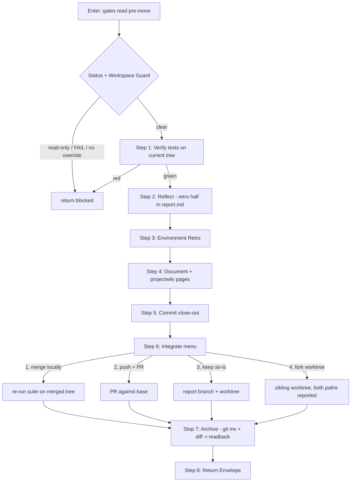

# Ship

## Contents
- Overview / When to Use / What You Receive / Phase Order / Status & Workspace Guard
- Gates (all must pass before ANY mutation) / What to Do / Environment Retro
- Change Closed / Rules / Fast-Track Variant / Gotchas
- Common Rationalizations / Red Flags / Verification / References

**Announce at start:** "I'm using the skillgrid:ship skill to close this change end to end."

You are the **TERMINAL** phase — the close of the SDD cycle. In one pass you do six things, in order:

1. **Reflect** — complete the change's retrospective: what shipped, sourced learnings (Decisions / Lessons / Patterns / Surprises), acceptance verdict.
2. **Environment retro** — sweep the agent environment (checks, navigation, steering no-ops, tool economy) and file findings; propose, never implement.
3. **Document** — write the human-facing record of the change from the real diff and commits, never from memory.
4. **Commit** — persist the close-out record (report + docs + wiki pages) per the work-unit commit contract.
5. **PR** — present the integration menu and execute the user's choice (merge / PR / keep).
6. **Archive** — mechanically move the change folder to `change-archive/` and release state.

The pipeline is `execute` → `test` → **`ship`** (terminal). Nothing runs after this phase except the next change.

**Persona-scope rule (reply language ≠ artifact language).** The persona this
skill adopts — the terminal-phase closer, working from the real diff and
commits — scopes the *artifacts* it writes (the report, the docs, the wiki
pages, the PR body), not the language of your reply to the user. Reply in the
language the user used; write the human-facing record in the language the
record's consumers read (the repo's documentation language, or the user's
instruction language). Never let the persona leak into the reply tone, and
never render an artifact in the reviewer's language when the repo's docs ship
in another. The persona is a lens on the *record*, not a setting on the *chat*.



**Iron law:**

```
DO NOT MERGE, PUSH, OR MOVE THE FOLDER UNTIL THE TEST SUITE IS GREEN ON THE INTEGRATED TREE
```

A green run only proves the tree it ran on. QA ran against the feature tree — run the suite again on the tree you are about to integrate.

## Overview

Ship closes a verified change: it reflects on what shipped, retros the environment, writes the human record from the real diff, commits the close-out, integrates the work to its base branch, and mechanically archives the change folder. It matters because shipping is where unverified work leaks into the base branch and the archive — the point of no return. The iron law above is the principle this phase enforces.

## When to Use

- A change has passed the QA gate and review, and is ready to be closed out and shipped.
- At the end of the pipeline (`execute` → `test` → **ship**), before the session ends.

**When NOT to use:** mid-change before the gates pass — ship is the terminal phase, not a mid-task step. For a change that never shipped (QA `FAIL` with no human override), stop and return `blocked` instead of running the steps.

## What You Receive

- **Change folder:** `.skillgrid/change-specs/YYYY-MM-DD-<topic>/` (briefing, blueprint, `acceptance.feature`, `tasks.md`, `report.md` with the QA half complete, `review.md` — the committed code-review audit record).
- **`report.md` → `## Gate Decision` verdict** — the hard gate (PASS / CONCERNS / FAIL / WAIVED) and any human override.
- **`review.md` → `## Verdict`** — the review floor (met / met-with-fixes / not met) + the independence grade.
- **`chain.strategy` in `.skillgrid/config.yaml`** — the project's delivery strategy, set at onboarding. It resolves the base branch (see Step 6).
- **`tasks.md` → `## Delivery Strategy`** — the guard lines and the work-unit table (the per-work-unit base boundaries for `feature-branch-chain`).
- **Fast-track waiver class** (`trivial` / `small`) if present — drives the light variant.

## Phase Order

Terminal. After `test` (QA + review + fix loop); no phase follows. The full chain is in `_shared/rules/sdd-structure.md`.

`prev-phase: [test]` · `next-phase: []` (terminal) · `artifact: report` (completed in place in the archive).

## Status and Workspace Guard

Before any step:

- If you are in a **read-only workspace** or the change folder is outside the allowed edit roots, STOP and report — do not commit, merge, or move across an unsafe boundary.
- If `report.md` → `## Gate Decision` is `FAIL` or carries an unresolved CRITICAL with no human override, STOP — return `blocked` (reason `qa-failed`). You cannot ship work the quality gate refused.
- If `review.md` → `## Verdict` is `not met` or an axis carries a Grade C independence grade, surface it as a WARNING and proceed only on an explicit human "ship it anyway" (record the override).

## Gates (all must pass before ANY mutation)

| Gate | Class | Rule |
|---|---|---|
| QA gate | **hard** | `report.md` → `## Gate Decision` verdict, read **pre-move** (the file is still in `change-specs/`). `PASS` / `WAIVED` → proceed (record the waiver). `CONCERNS` → advisory: surface the open items; proceed only on an explicit human override (record it). `FAIL` or an unresolved CRITICAL → **`blocked`** (reason `qa-failed`) — a launch-prompt claim "it's fixed in a later commit" does not clear it; a fresh passing test run is required. |
| Review gate | **advisory** | `not met` or a Grade C axis → WARNING, the human owns the decision. `met` / `met-with-fixes` → proceed. Never blocks on its own. |

If a hard gate fails, **STOP and return `blocked`** with the failing gate named. Do not reflect, do not move.

**The gate read is one call** — `node .agents/skills/ship/scripts/ship-gates.mjs <change-dir>` (read-only, pre-move). It returns `{qa, qa_blocks, qa_needs_override, review, review_needs_override, blocked, block_reason, findings}`: the `report.md` → `## Gate Decision` verdict + the unresolved-CRITICAL scan, and the `review.md` → `## Verdict` + Grade-C axes. `blocked: true` (exit 1) with `block_reason` `qa-failed` / `qa-critical-unresolved` / `qa-unverifiable` → return `blocked`. `qa_needs_override` / `review_needs_override` are the human decisions to surface — the script names them, it never makes them. When the script is absent, the gate read is the mechanical table above.

## What to Do

### Step 1: Verify Tests on the Current Tree

Run the project's full test suite (`testing.runner` from `.skillgrid/config.yaml`). A green run only proves the tree it ran on — this is the pre-integration check that replaces trusting an earlier session's run.

```
Tests failing (<N> failures). Must fix before shipping:
[show failures]
```

If tests fail, report and stop — the rest of the phase comes after a green suite.

### Step 2: Reflect (retrospective)

You are the **completion checkpoint**: the last chance to honestly say what worked, what did not, and whether the change is accepted.

**Final-state authority.** The report describes the state of the change **at close**, not at earlier points. When sources disagree, rank them — most authoritative first: (1) current repo/filesystem state at close, (2) git history of the change's commits, (3) the persisted `tasks.md`, (4) the QA half of `report.md` and the execution ledger (intermediate snapshots — valid history of what was true at their time, never evidence of final state). When a higher-ranked source says done/fixed and a lower-ranked snapshot says pending, report the final state and cite where the fix landed — do not echo the stale claim.

**Sourced learnings — every entry MUST point at evidence** (a file:line, a commit, a ticket ID, or a scenario). A finding with no source is a guess, not a learning. Four categories:

- **Decisions** — architecture / design / tooling choices made, with the tradeoff and why.
- **Lessons** — what would be done differently next time (root cause, not symptom).
- **Patterns** — reusable approaches or conventions established (name them so a future change can reuse them).
- **Surprises** — non-obvious gotchas, edge cases, or behaviors discovered (the highest-signal category for future sessions).

**Triage every Lesson and Surprise: process bug vs one-off.** A *process bug* names a reusable failure class that would likely recur in other changes (a navigation trap, a steering-file no-op, a verification gap) — route it back to the governing skill or `_shared` rule as a follow-up item. A *one-off* is specific to this change's context — it stays in the report alone. The test: *would the same lesson strengthen a future change, or only this one?*

**Acceptance verdict** — `accepted` / `accepted-with-open-items` / `rejected`. Ground it in the goal stated in `briefing.md` and the evidence in `report.md`'s QA half (goal-backward verification). `rejected` is **recorded, not enforced** — never a hard block; the human decides follow-up.

**Where it lands:** complete `report.md` IN PLACE in the change folder — do not recreate it. The QA half (through `## Gate Decision`) is already written; append the retro half from `## Final-State Facts` onward: final-state facts (what shipped, to which base, at which commit/PR — from git), the sourced learnings, the acceptance verdict, and any open items for the next change.

**Deferred-work sweep (when open entries exist):** if `.skillgrid/deferred-work.md` has `status: open` entries, run the sweep per `_shared/craft/deferred-work.md` — verify each open entry against the current code, partition (resolved / bundle / blocked / skip / decision), apply the status updates, and report the partition with the decisions surfaced to the human (zero-tool turn-yield). This is the scheduled moment the deferred work gets looked at: shipping a change while stale debt sits unverified is exactly the drift the sweep exists to catch. When no open entries exist, record "Deferred work: none open" in the retro half.

### Step 3: Environment Retro (sub-step)

Invoke the six-category sweep (full protocol: [../_shared/rules/sdd-structure.md](../_shared/rules/sdd-structure.md) § phase table + the category definitions below). For each, present a finding **only when its "Use when" fires**; a clean session legitimately produces none.

| Category | Question | Use when |
|---|---|---|
| **Navigation** | Was the agent slow to find the right files? | The session took a long time to find a piece of information. |
| **Automated checks** | Is there a check that could have caught an error the agent made? | The agent made a mistake a check could have caught — **or** the repo has no guardrail at all. |
| **Coding standards** | Should the reviewer enforce a new rule, or drop/clarify an old one? | The reviewer failed to catch a mistake. |
| **Steering-file no-ops** | Is there an instruction that does not change agent behavior? | The steering files (AGENTS.md / `state.yaml`) are large and unwieldy. |
| **Tool economy** | Did the agent make expensive, token-inefficient tool calls? | The agent made an expensive tool call that could be streamlined. |
| **Information access** | What did the agent need but could not see? | A crucial piece of information was not available to the agent. |

Rules: read the repo's existing guardrails (`config.yaml` `testing.*`, lint/check scripts, CI) **before** proposing a new check — an unwired or broken existing check is the finding, not a reinvention. A **mechanical** violation becomes a **deterministic check** (linter rule, hook, CI job); the steering/standards file is for **judgement calls** only. **Propose, don't implement** — real builds become `mem_save` findings + offered follow-up items, not inline edits.

**Where it lands:** append a `## Environment Retro` section to the same `report.md`:

```markdown
## Environment Retro

| Category | Finding | Fix lands in | Source |
|----------|---------|--------------|--------|
| Automated checks | repo has no pre-commit lint hook | add pre-commit hook running `<lint cmd>` | session: 3 lint errors caught only at review |
```

### Step 4: Document (human-facing record)

**Write per `skillgrid:writing` (record mode).** The record-mode contract —
the four types, the gather-from-the-record process (git + change folder, never
memory), the per-type audience pitch, the templates, and the rules (every
claim traces to a source, no marketing, the gate is named, `## Merge Danger`
for the PR body) — lives in `skillgrid:writing`, not here. This step
determines which types the change warrants and passes them:

**Write, where the change warrants it** (a trivial fast-track change skips
changelog / release-note; the PR body is always written when the PR option is
chosen):

| Type | When |
|---|---|
| `pr` | the PR option is chosen (Step 6, option 2) — always |
| `changelog` | the change has user-visible behavior (skipped on a trivial fast-track change) |
| `release-note` | a version is being cut for this change |

**Ship-specific additions (on top of the record-mode contract):**

- **Kanban cross-reference.** When the tracker is `hermes-kanban`, the PR
  body also lists the change's Kanban task IDs (from `tasks.md` → `Tracker
  ID`) so the board and the PR cross-reference each other.
- **Comments left for humans** (PR feedback, issue replies) follow
  `skillgrid:writing`'s comment voice.

**Projectwiki is updated in the same pass.** Per the task-bookend rule of [../projectwiki/SKILL.md](../projectwiki/SKILL.md): file every non-obvious artifact in its home before the commit — a code fact ("how it works" changed) → `architecture/`; a discovered quirk or failure lesson → `gotchas/`; a reusable pattern → `concepts/`; a must-hold constraint → `invariants/` (with `claims:`); a domain term → `glossary/`; a locked decision → `decisions/` (via the ADR records, `_shared/adr-records/` — ship never mints ADR numbers). Check `projectwiki query` + `status --json` before writing; every page gets 2+ outgoing wikilinks; **the same-edit rule**: `projectwiki index` immediately after the page writes, then `projectwiki validate` + `projectwiki lint` before the commit. A finding true only for this one change stays in `report.md` alone.

### Step 5: Commit

Commit the close-out per [../_shared/work-unit-commits/README.md](../_shared/work-unit-commits/README.md) — conventional subject, no AI-attribution trailer, atomic + independently-revertable, a `[skillgrid-context]` block in the body. Zone rule: `.skillgrid/` (spec zone) changes commit **before** code-zone changes, never both uncommitted.

Expected commits (skip any with nothing to commit):

1. `docs:` — `report.md` retro half + `## Environment Retro` + the human-facing records (changelog / release note) + projectwiki pages (+ `projectwiki index` output in the same edit).
2. The archive move (Step 7) stages as its own commit: `chore(archive): move YYYY-MM-DD-<topic> to change-archive` — commit after the `diff -r` readback passes.

If the user chose **merge locally** (Step 6, option 1), the work-unit commits were already landed on the feature branch during execution; only the close-out commits happen here, then the merge carries them.

### Step 6: Integrate (PR / merge / keep)

**Detect environment** (worktree-detection snippet per `_shared/work-unit-commits/README.md` § Worktree root + detection):

```bash
GIT_DIR=$(cd "$(git rev-parse --git-dir)" 2>/dev/null && pwd -P)
GIT_COMMON=$(cd "$(git rev-parse --git-common-dir)" 2>/dev/null && pwd -P)
```

`GIT_DIR != GIT_COMMON` (and not a submodule — `git rev-parse --show-superproject-working-tree` printing a path means normal repo) → linked worktree.

**Review budget check (before pushing):** the PR must fit the 400-changed-line review budget, or carry its documented exception — the decision table and count method are in [../_shared/work-unit-commits/README.md](../_shared/work-unit-commits/README.md) § PR review budget.

**Determine the base branch** from `chain.strategy` in `.skillgrid/config.yaml` (set at onboarding — the project-level delivery decision, not a per-change one; the chain-strategy decision table and the cross-fork limitation are in [../_shared/work-unit-commits/README.md](../_shared/work-unit-commits/README.md) § Chain strategy decision): `stacked-to-main` → `main`; `feature-branch-chain` → the work-unit table's base boundary for the final unit (per-unit boundaries live in `tasks.md` → `## Delivery Strategy`); `size:exception` → the single PR's target (usually `main`). If `chain.strategy` is missing or the change's `tasks.md` says `Chain strategy: pending` (the slicer deferred the decision), **ask** the user. Confirm before merging — merging into the wrong base is expensive to undo.

**Present the menu and wait** (the integration decision is the user's; discarding happens only on the typed word `discard`).

Decision gates follow `_shared/craft/review-discipline.md` (artifact-first: large reports/plans go to a file, not chat; zero-tool turn-yield: end the turn with no tool calls and go idle while the user decides).


```
Close-out complete. What would you like to do?

1. Merge back to <base-branch> locally
2. Push and create a Pull Request
3. Keep the branch as-is (I'll handle it later)
4. Fork the worktree (try option B while A iterates)

Which option?
```

**Option 1 — Merge locally:** merge the feature branch into the base, then **re-run the test suite on the merged result** (the iron law).

- **With worktrunk active:** `wt merge <base> --no-squash --no-commit` — the pipeline (rebase onto base → `[pre-merge] test` hook, which *is* the iron law running in the worktree → fast-forward merge; non-FF rejected) does the merge, and cleanup removes the worktree + branch. `--no-squash --no-commit` because work-unit commits are atomic and already exist — squashing them into one commit would destroy the independently-revertable history the commit contract builds.
- **Git fallback:** `git merge` (rebase first if the branch is behind), then run the suite.
- Green → clean up per `_shared/work-unit-commits/README.md` § Worktree removal + branch deletion: **only remove worktrees the session created** under the project-root `.worktree/` (or the declared `conventions.worktree_dir`); native-tool and tracker-claimed workspaces (e.g. hermes-kanban claims) are managed by their tool, so leave them to it. Branch deletion requires the no-added-changes check (same commit → ancestor → empty `base...branch` diff). With worktrunk: `wt remove --reap` (reaps detached processes by working directory, spares TTY-attached ones); without, check for processes with cwd under the worktree and report them. Force removal only after a backup ref (`git stash create` → `update-ref refs/skillgrid/pre-remove-<branch>`) with the recovery path in the report.
- Red → stop, leave everything in place, and investigate — nothing has been pushed, so the merge is local and recoverable.

**Option 2 — Push and create PR:** `git push -u origin <branch>`, create the PR/MR against the base with the forge's CLI, using the PR body from Step 4. Report the URL. **Keep the worktree** (and its scratch refs) — the user iterates on PR feedback there.

**Option 3 — Keep as-is:** report the branch and worktree location. Work stays; the change folder still archives (Step 7).

**Option 4 — Fork the worktree** (per `_shared/work-unit-commits/README.md` § Worktree lifecycle): create the sibling — `wt switch --create <branch>-alt --base <branch>` or `git worktree add .worktree/<branch>-alt -b <branch>-alt <branch>` — report both paths, and state which change the fork belongs to: a continuation of *this* change (same spec folder, new branch) or a *new* change (new spec folder). The original worktree keeps Option 3 semantics. Integration stays single-sink: a fork that also merges is a second change, not this one done twice.

**Rollback plan (mandatory before any GO):** name the trigger and the procedure — merged → `git revert <merge-commit> -m 1`; PR open → close the PR (the branch stays); branch kept → the branch is the rollback. A trivial fast-track change may use one line: "revert the single commit."

**Drift gate (pre-archive):** before the mechanical archive move, run `skillgrid:drift` on the change's `blueprint.md` (and any project-wiki pages the change touched). A BLOCKER-level divergence (a Must-Have the spec claims that the code lacks, or an architectural divergence that breaks a stated invariant) is **WAIVE or FIX** — the user names the waiver (human + recorded risk) or the fix lands before the folder moves. MAJOR divergences surface in the ship report. No drift → the report says "No drift detected." and the gate passes. See the drift skill's gate section.


### Step 7: Archive (mechanical move — LAST step)

The change folder moves from `change-specs/` (active) to `change-archive/` (closed historical record). A **mechanical filesystem operation** — content MUST NEVER pass through the model's Read/Write path. One call:

```bash
node .agents/skills/ship/scripts/ship-archive.mjs YYYY-MM-DD-<topic>
```

The script performs the whole transaction: pre-move snapshot → `git mv` (plain `mv` fallback for non-git trees) → source-gone check → **mandatory `diff -r` readback** against the pre-move snapshot → `state.yaml` close-out (remove `changes.<topic>`, increment `completed_changes`) → `state-lock release`.

- **Exit 0 = clean move.** Read the JSON: `moved: true`, `readback: ""` (empty = pass), `source_gone: true`, `state.completed_changes` is the new counter. Any other shape **FAILS** the phase.
- **Exit 2 = refused before any mutation** (no source folder, or the archive target already exists — the archive is an audit trail, never overwritten). Nothing was touched; fix and re-run.
- **Exit 1 = move failed mid-transaction** (non-empty readback, or source left in place). Inspect the JSON `readback` field verbatim.
- Commit the move (Step 5, commit 2) after the readback passes.
- **The archive is an audit trail** — created lazily if absent; archived changes are never deleted or modified after the move. A defect found after archiving becomes a new change, not an edit.
- If Node/shell access is unavailable, STOP and return `blocked` (reason `shell-access-unavailable`) — do not fall back to Read/Write moving.

**Close out state** (the script does the file edits — you only verify the JSON reports them):

- `state.yaml`: `changes.<topic>` entry removed, `progress.completed_changes` incremented. (If the change was blocked, also decrement `progress.blocked_changes` — the script leaves blocked changes to you, one manual line.)
- Session lock: the script calls `state-lock.mjs release <topic>` when it finds one (JSON `lock` field); a missing script is reported, not fatal.
- Mnemonic (skip if `mnemonic.enabled` is `false` — degrade explicitly, never fail silently):

```
mem_save(
  title:      "ship — YYYY-MM-DD-<topic>",
  topic_key:  "skillgrid/YYYY-MM-DD-<topic>/ship",
  type:       "architecture",
  scope:      "project",
  session_id: "{sid}",
  content:    "{close-out record: base branch, chain strategy, integration test evidence, PR/merge outcome, gate results, diff -r readback, acceptance verdict}"
)
```

### Step 8: Return Envelope

**Your FINAL output MUST be text — not a tool call.** Do the `mem_save` and commits *before* this text.

```markdown
## Change Closed

See `references/ship-closeout.md` for the full procedure.

## References

- [scripts/ship-gates.mjs](scripts/ship-gates.mjs) — the pre-mutation gate read as one call (report.md verdict + unresolved-CRITICAL scan, review.md verdict + Grade-C axes → `blocked` / override flags); [scripts/test-ship-gates.mjs](scripts/test-ship-gates.mjs) proves it
- [scripts/ship-archive.mjs](scripts/ship-archive.mjs) — the Step 7 archive move as one call (snapshot → `git mv` → source-gone check → `diff -r` readback → `state.yaml` close-out → lock release); [scripts/test-ship-archive.mjs](scripts/test-ship-archive.mjs) proves it
- [../test/SKILL.md](../test/SKILL.md) — upstream; wrote the QA half of `report.md`, whose `## Gate Decision` verdict drives the QA Gate (read pre-move), plus `review.md`.
- [../projectwiki/SKILL.md](../projectwiki/SKILL.md) — the task bookends, the page contract, the pin contract, and the same-edit rule the Step 4 wiki writes follow.
- [../_shared/adr-records/README.md](../_shared/adr-records/README.md) — ADR authoring + numbering; the `decisions/` pages ship routes through, never mints numbers itself.
- [../_shared/work-unit-commits/README.md](../_shared/work-unit-commits/README.md) — the Step 5 commit contract: format, sizing, the `[skillgrid-context]` block, the git-hook guards.
- [../_shared/rules/sdd-structure.md](../_shared/rules/sdd-structure.md) — the `change-specs/` → `change-archive/` layout, the phase chain, the `state.yaml` schema, the user-gate contract, and the Mnemonic slots.
- [../_shared/rules/mnemonic-memory.md](../_shared/rules/mnemonic-memory.md) — the `mem_save` shape (`title == topic_key`, `scope: "project"`, active `session_id`).
- [../_shared/planning/fast-track.md](../_shared/planning/fast-track.md) — the light-variant waiver this phase honors.
- [../_shared/rules/evidence-claims.md](../_shared/rules/evidence-claims.md) — the evidence rules behind Step 2's sourced learnings and the iron law: every "fixed" claim traces to a named test, a baseline failure needs a clean-base proof, and every block names an executable exit.
- [../writing/SKILL.md](../writing/SKILL.md) — Step 4's record-mode contract: the four record types, the gather-from-the-record process, the per-type audience pitch, the templates, and the claim-tracing / no-marketing / gate-named rules.
- [../skill-creator/references/rationalizations.md](../skill-creator/references/rationalizations.md) — the authoring rationalizations (script extraction, size, spine sections); load when you or the user push back on this skill's shape
