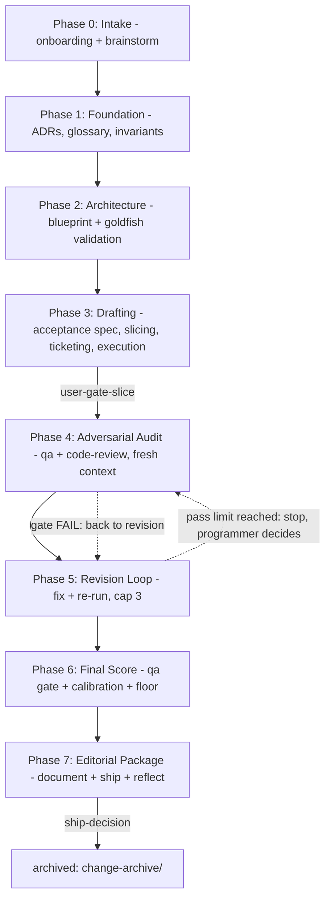

# SkillGrid

## Contents
- Overview / When to Use / Start here / The eight phases
- What makes the criticism worth reading / Specialists
- Rules that never bend / Common Rationalizations / Red Flags / Verification / References

**Announce at start:** "I'm using the skillgrid:skillgrid skill to take this program from idea to shipped."

## Overview

Take an idea to a complete program inside the programmer's own agent: planned, built, read blind, audited, revised and packaged, with every decision saved to files.

The goal is a program built with the measured patterns of production codebases, audited the way a demanding reviewer audits it, and packaged to run. It is a goal, not a promise: no workflow can guarantee that a program is good, secure or worth shipping.

## When to Use

- The programmer gives an idea, however short, and wants a working program from it.
- A `.skillgrid/` folder exists with an unfinished change and the programmer says "continue".
- The programmer wants a finished program audited, revised or packaged for release.

**When NOT to use:** a single bug fix, a typo, or a change that `fast-track.md` classifies as trivial or small — run the fast-track path instead of the full pipeline. Not for reviewing someone else's diff (`skillgrid:code-review` alone) and not for a one-off question.

## Start here

1. Read `references/patterns/glossary.md`. It fixes the roles: **programmer** builds, **user** runs the program.
2. Read `references/pipeline/host-contract.md`. It covers starting, resuming, checking in with the programmer, and recovering from failures.
3. Read `references/prompts/orchestrator.md`. It is the main loop.
4. Open the programmer's `.skillgrid` folder. If `.skillgrid/state.yaml` has a change entry, resume from it; otherwise start at Phase 0 with whatever idea the programmer gave. If the folder does not exist, run onboarding yourself (`references/pipeline/onboarding.md`) — it is now part of this skill, not a separate skill.

Resolve every `references/...` path from this skill's folder. The programmer's files live in `.skillgrid/`; `references/patterns/skillgrid-folder.md` shows the layout. This skill writes `.skillgrid/` only in the programmer's project root — never inside its own skill folder.

## Smart Entry (state-aware routing)

This skill is the **smart-entry router** for the skillgrid pipeline — the
state-aware front door that detects where a project is and routes to the
right next skill, so the programmer never has to decide which skill to run.
Pattern: `skillgrid:skill-creator` §10a.

**The pattern:** when the programmer says "what's next", "continue",
"where am I", or "resume", this skill does NOT do the work — it detects
state and dispatches exactly one skill, then stops.

1. **Detect state.** Read `.skillgrid/state.yaml` (the `changes.<topic>`
   entry and its `phase` field) and the change folder's artifacts to
   determine where the project is. This is a deterministic step — the state
   file is the source of truth:

   | State signal | Verdict | Route to |
   |---|---|---|
   | No `.skillgrid/` folder | `no-project` | Phase 0: onboarding (this skill) |
   | `state.yaml` exists, no `changes` entry | `empty-project` | Phase 0: brainstorm |
   | `changes.<topic>.phase` = `intake` | `in-intake` | `skillgrid:brainstorm` |
   | `phase` = `blueprint` | `in-architecture` | `skillgrid:blueprint` |
   | `phase` = `slicing` | `in-slicing` | `skillgrid:slicing` |
   | `phase` = `execution` | `in-execution` | `skillgrid:execute` |
   | `phase` = `qa` | `in-verification` | `skillgrid:test` |
   | `phase` = `ship` | `in-ship` | `skillgrid:ship` |
   | `phase` = `archived` | `complete` | report done; next change |

2. **Route.** The table above IS the Decision Gates — one row per state
   verdict, the action is "invoke `skillgrid:<name>`". No prose re-derivation.
3. **Dispatch.** Invoke exactly one skill and stop. The router never does the
   target skill's work itself.

**What stays out of the router:** the actual work. If this section grows
past ~100 lines, it has absorbed procedure that belongs in the target
skills. The router's job is *which skill to invoke*, not *what the skill
should do*.

**Surface profiles (token-budget curation).** When the skillgrid library
grows past ~15 model-invoked skills and the description index exceeds ~1% of
the context window, enable surface profiles — cluster-based toggles that
control which skill descriptions are active in the agent's context. The
pattern and the profile tiers (`core` / `standard` / `full`) are defined in
`skillgrid:skill-creator` §12b. The profile file (`.agents/skills/.surface.json`)
is read by the harness at install time; disabled skills remain on disk but
are not surfaced. Check the budget at the curation interval; drop clusters
with low `use_count` from the usage sidecar.

## The eight phases

Load only the active phase's prompt and the references `references/pipeline/manifest.yaml` lists for it. Order is fixed. Phase 4 is never skipped, and no score is rendered before it.

| Phase | Owner skill(s) | Gate | Main outputs |
|---|---|---|---|
| Phase 0: Intake | onboarding (this skill, `references/pipeline/onboarding.md`) → `brainstorm` (questioning loop included) | `intake` | `config.yaml`, `state.yaml`, `projectwiki/ASSUMPTIONS.md`, `projectwiki/index.md`, `briefing.md`, `adr.md` |
| Phase 1: Foundation | ADR records (`_shared/adr-records/`) + `research`/`prototype`/`sketch` (now blueprint Phase 1/4 when run via the blueprint) | `foundation` | `glossary/01-02`, `invariants/`, `entities/`, `concepts/`, `decisions/NNNN-*`, `findings.md` |
| Phase 2: Architecture | `blueprint` (5-phase plan + goldfish validation) | `blueprint-validation` | `blueprint.md` (validated) |
| Phase 3: Drafting | `blueprint` Phase 5 (acceptance spec) → `slicing` → `ticketing` → execution | `user-gate-slice` | `acceptance.feature`, `tasks.md`, code |
| Phase 4: Adversarial Audit | `qa` + `code-review`, fresh context | `qa-verdict` | `report.md` (QA half), `review.md` |
| Phase 5: Revision Loop | `receiving-code-review` + fix + re-run | — | `review.md` updated, `report.md` re-rendered |
| Phase 6: Final Score | `qa` gate + calibration + floor | — | `report.md` final verdict |
| Phase 7: Editorial Package | `document` + `ship` + `reflect` | `ship-decision` | PR body/changelog, archive move, retro half |

`references/pipeline/phases.md` is the one-screen overview. `references/pipeline/workflow.md` is the chain summary.

## What makes the criticism worth reading

- **Reviewers are blind.** They see the code and the acceptance scenarios, never the blueprint's targets, earlier scores or the panel's verdicts. `references/scoring/evaluator-protocol.md` sets who sees what.
- **Independence is measured and shown.** Critics run in isolated subagents, or in a second tool from another model family, when the host allows it (`references/hosts.md`). Every verdict carries its grade.
- **Four users decide, not one.** Primary, hostile, adjacent and casual users, built per program (`references/roles/panel.md`, `references/roles/blind-reviewer.md`).
- **Two gates, bounded.** The review gate decides whether the change holds up; the score gate decides what to fix. Three passes per gate, then an honest stop.
- **Measured patterns, named sources.** `references/patterns/index.md` points to code patterns, risk patterns and machine-code tells, each with its source.

## Specialists

Load when the phase calls for them:

- `references/specialists/prior-art.md` — comparable projects and benchmarks
- `references/specialists/domain-foundation.md` — domain model, invariants, interfaces
- `references/specialists/code-craft.md` — entry points, seams, errors, revision moves
- `references/specialists/consistency.md` — the ledger and the per-wave checks
- `references/specialists/fix-editor.md` — ticket-driven, targeted repair
- `references/specialists/release.md` — build, package, release notes
- `references/specialists/program-family.md` — only for multi-program or platform work

## Rules that never bend

- Save important decisions to files; keep `.skillgrid/state.yaml` true to what exists.
- Never skip Phase 4, and never score before it.
- Write the program, its artifacts and every screen in the programmer's language. Keep file names, state keys and gate ids in English.
- A program is "complete" when it meets its Definition of Done: the acceptance scenarios are green, the build passes, the QA gate is rendered, and the package exists. Quality gates are reported beside that label, never hidden.
- Never claim a test passed without the command and its output; never claim a program is ready to publish without a human decision.

## How to measure it

Per `_shared/craft/measurement.md`.

| | Indicator | Data source | Direction |
|---|-----------|-------------|-----------|
| Leading | % of phase handoffs where the named output artifact (briefing, blueprint, tasks, report, package) actually exists before the next phase starts | the phase manifest's outputs vs. the committed files | should rise |
| Lagging | Rework cycles: a program that, after being declared "complete", returns to an earlier phase (blueprint re-opened, QA re-run) before it is finally published | Git history / `state.yaml` phase transitions (phase regressions) | should fall |

## Common Rationalizations

| Rationalization | Reality |
|---|---|
| "The idea is clear, I can skip intake." | Every inferred audience, scope and risk class becomes a wrong assumption the programmer never got to correct. Write them down in one reply. |
| "The blueprint is obvious for a small program." | Small programs still have one-way doors (schema, public API, dependency). `blueprint` finds them before they are expensive. |
| "I'll run the audit at the end." | Reviewers that see the plan grade the plan. Blindness is only preserved if the packet is built before targets are set. |
| "The panel liked it, so the audit is unnecessary." | The panel judges whether users stay; the audit judges whether the change holds. Neither overrides the other. |
| "One more revision pass will fix it." | Past three passes a gate is not converging. Stop, show what is missing, let the programmer choose. |
| "The tests are green, so it ships." | Green proves the tree it ran on. QA, security scan, review floor and human approval are separate states. |

## Red Flags

- A phase output written without the previous artifact existing.
- A critic packet that contains a target, an earlier score or a panel verdict.
- A verdict reported without its independence grade.
- `state.yaml` updated before the artifact was read back.
- A fourth revision pass, or a pass that closes no high-severity ticket.
- "Complete" claimed while the QA gate is `FAIL`/`CONCERNS` with no human override.
- A critic grading its own work and calling it independent.

## Verification

- [ ] `state.yaml` matches the deepest artifact present (`qa` drift guard exits 0).
- [ ] **Self-validation backstop:** every new gate or checker this change introduces was run against this change's own spec folder before hand-off — with its negative half proven first (the checker catches a deliberately broken copy, e.g. a requirement with no `## Validation` row) and its positive half after (a clean run exits 0). A checker that never caught its own change is not wired.
- [ ] Every phase in `manifest.yaml` has its listed outputs on disk, read back.
- [ ] Phase 4 ran before any score; the audit packet contains no targets or scores.
- [ ] Every verdict in `report.md`/`review.md` names its independence grade.
- [ ] The QA gate verdict is `PASS`/`WAIVED`, or `CONCERNS`/`FAIL` with a recorded human decision.
- [ ] `ship` moved the folder to `change-archive/` with an empty `diff -r` readback.
- [ ] The final inventory lists files, work units, tests run with evidence, open windows, next step.

## References

- [references/patterns/glossary.md](references/patterns/glossary.md) — the terms; load first.
- [references/pipeline/host-contract.md](references/pipeline/host-contract.md) — start, resume, check in, recover.
- [references/pipeline/workflow.md](references/pipeline/workflow.md) — the phase chain, one screen.
- [references/pipeline/manifest.yaml](references/pipeline/manifest.yaml) — phase → prompt → references → gate → outputs.
- [references/pipeline/phases.md](references/pipeline/phases.md) — the eight phases at a glance.
- [references/pipeline/verification.md](references/pipeline/verification.md) — the exit checklist and recorded exceptions.
- [references/pipeline/state-extension.yaml](references/pipeline/state-extension.yaml) — the `genesis:` block in `state.yaml`.
- [references/hosts.md](references/hosts.md) — how to spawn an isolated critic per host.
- [references/prompts/](references/prompts/) — one prompt per phase plus the orchestrator loop.
- [references/roles/](references/roles/) — panel, blind reviewer, auditor.
- [references/scoring/](references/scoring/) — evaluator protocol and program score.
- [references/specialists/](references/specialists/) — seven on-demand specialists.
- [references/patterns/](references/patterns/) — glossary, folder layout, config/agent templates, measured patterns.
- [../skill-creator/references/rationalizations.md](../skill-creator/references/rationalizations.md) — the authoring rationalizations (script extraction, size, spine sections); load when you or the user push back on this skill's shape
