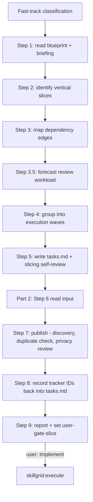

# Slicing

## Contents
- Config / When to Use / Fast-Track Classification
- Part 1: Slicing / Part 2: Ticketing / Tracker Adapters / Discovery / Backlog completeness gate
- Pre-submission Privacy Review / Work-Item Formatting / Slicing Strategy / Ticket Lifecycle / CLI-Only Guard
- Common Rationalizations / Red Flags / Verification / How to measure it

Break a blueprint into vertical tracer-bullet tickets that each fit a single fresh agent context window, then publish them to the configured tracker and drive their status through execution to closure.

**Announce at start:** "I'm using the skillgrid:slicing skill to slice the blueprint into executable tickets and publish them to the tracker."

**Position in the chain:** … → `blueprint` → **`slicing`** → `execute` → …
(per `_shared/rules/sdd-structure.md` § Phase Order). `blueprint` must have
completed before this skill starts. No divergence: `execute` does not start
until this skill (including the mandatory user gate) is complete.

This skill merges two former skills: `slicing` (blueprint → `tasks.md`) and `ticketing` (tracker publication + status lifecycle). The flow is one continuous pass: slice, then publish, then record IDs — no handoff between skills.

## Config

Read `.skillgrid/config.yaml` before starting. This skill reads:

| Config key | Used for |
|------------|----------|
| `conventions.specs_root` | Where `tasks.md` lives (default `.skillgrid/change-specs/`) |
| `conventions.artifacts` | Terms vocabulary for ticket titles and scope (default `.skillgrid/projectwiki/glossary/01-business-terms.md` + `02-technical-terms.md`) |
| `rules.fast_track` | Fast-track classification criteria |
| `ticketing.enabled` | Tracker publication switch: `false` means record a local-only waiver after slicing; do not skip the ticketing phase itself |
| `ticketing.type` | Tracker type: `backlogmd` \| `gh` \| `glab` \| `jira` \| `hermes-kanban` |
| `ticketing.project_key` | Jira project key (when `ticketing.type: jira`) |
| `ticketing.kanban.board` | Hermes Kanban board slug (when `ticketing.type: hermes-kanban`; default: the `project` name) |
| `ticketing.kanban.assignee` | Hermes profile to assign tickets to (when `ticketing.type: hermes-kanban`; default `default`) |
| `ticketing.backlogmd.dir` | Backlog.md directory (default `.backlog/`; skillgrid convention: `.skillgrid/projectwiki/backlog`, resolved from root `backlog.config.yml` `backlog_directory`) |
| `ticketing.backlogmd.task_prefix` | Backlog.md task ID prefix (default `task`) |
| `ticketing.backlogmd.zero_padded_ids` | Backlog.md task ID zero-padding (default `3`) |
| `ticketing.gh.labels` | GitHub triage label strings |
| `ticketing.glab.labels` | GitLab triage label strings |
| `testing.runner` | Test command for DoD seeding (Backlog.md) |

If `.skillgrid/config.yaml` doesn't exist, invoke `skillgrid:onboarding` first. A ticket that contradicts an in-force ADR — per the change's ADR Review Manifest at `.skillgrid/change-specs/YYYY-MM-DD-<topic>/adr.md` (in-force set from the `## LOCKED` ADR index in `.skillgrid/projectwiki/ASSUMPTIONS.md`) — must call it out, not silently override it.

## When to Use

- After `skillgrid:blueprint` produces a blueprint with 3+ tasks worth of work
- When the blueprint is too large for a single execution session
- When you need parallel execution waves (independent tickets can run concurrently)
- When a change needs to be tracked as work tickets, or tickets need creating, updating, or closing in the configured tracker (Backlog.md, GitHub, GitLab, Jira, Hermes Kanban)

**When NOT to use:** the blueprint has 1-2 tasks — just execute it directly with `skillgrid:execute` (inline mode). For ticket-status updates during execution (without slicing), follow the [Ticket Lifecycle](#ticket-lifecycle) section directly.

**Task creation mandate:** Ticketing ALWAYS uses the task creation skills (the tracker's task-creation tool — e.g. Backlog.md's `backlog_task_create`, or the tracker named in `.skillgrid/config.yaml` § `ticketing`). Never hand-write ticket rows without invoking the tracker's creation tool. **Prerequisite:** `acceptance.feature` must exist with valid syntax before slicing begins. **Position in artifact order:** Slicing is artifact #6 (briefing → blueprint → validation → cucumber tests → tasks → **slices**).

## Fast-Track Classification

Before slicing, classify the change per `.skillgrid/config.yaml` `rules.fast_track`:

| Class | Criteria | Slicing behavior |
|---|---|---|
| `trivial` | ≤3 files, no behavior change, no migration/dependency/trust-boundary change | Light `tasks.md` (1–3 tickets, 1–2 lines each). Waiver recorded in `briefing.md`. |
| `small` | Single file/concern, ≤10 files, no new capability | Light `tasks.md` (fewer phases, 1–2 lines per ticket). Waiver recorded in `briefing.md`. |
| `standard` / `risky` | Everything else | Full `tasks.md` with complete dependency graph, waves, and acceptance criteria. |

**Blocked from fast-track** (full pipeline mandatory): any threat-matrix row Applicable, new trust boundary or migration, multi-domain impact, 400+ line change. When in doubt, run the full pipeline.

The waiver record (class, skips, reason, approved-by) must be present in `briefing.md` before `slicing` produces a light `tasks.md`. See `../_shared/planning/fast-track.md`.

**Downstream:** the `SATISFIES` scenario names in `tasks.md` are the traceability oracle for `skillgrid:test` — every scenario must be referenceable from a test. Name them precisely.

**Assumed blueprints:** if `blueprint.md`'s line-3 STATUS banner is `assumed`, slicing proceeds normally (it is created only at the user's Owed-Decision Gate, so it counts as read — it never blocks). Add `Note: assumed decision (blueprint <path>)` to every ticket that implements the assumed value, so the decision debt is visible per ticket and survives into `qa`'s report and the ship Return Envelope.

## Part 1: Slicing

### Step 1: Read the Blueprint

1. Read `blueprint.md` (technical details, task breakdown, interfaces). Check the line-3 STATUS banner first: it must be `approved`, `assumed`, or `accepted` — still `proposed` means the user has not read it: HALT, ask the user to read and flip the banner themselves (`proposed` → `approved (YYYY-MM-DD)` — the agent never writes `approved`), record `blocked(blueprint): blueprint.md awaiting user approval` in `state.yaml`, and stop. An `assumed` banner carries the debt note above.
2. Read `briefing.md` (context, falsifiable requirements, acceptance criteria)
3. Identify all work units in the blueprint

### Step 2: Identify Vertical Slices

**Build shape (orders the first wave):** read `**Build shape:**` from the
blueprint header. It decides which behavior exists *first*:
- **Tracer thread** → ticket 1 is the thin end-to-end path through every layer; later tickets thicken it.
- **Smallest usable whole** → ticket 1 is the thinnest usable product (one complete, shippable behavior); later tickets grow it.
- **Facade** → the UI shell ticket comes first (on placeholder data), with `Fails-when:` on the wire-up boundary that separates shell from real backend.
- **Journey** → one user path's tickets form the early waves, completed fully before the next path's tickets start.

The shape orders the *first* wave only — risk-first / contract-first ordering
still applies *within* and after it.

Slice the work into tickets using these rules:

**Vertical, not horizontal.** Each ticket is a narrow but COMPLETE path through every layer (UI → API → DB → config). Not "all database schemas" then "all API endpoints" then "all UI." A vertical slice touches a little of each layer and produces working behavior. (`vertical slice`, `tracer bullet`, and `seam` are the leading words of this skill — the no-op and pretrain-first tests in `_shared/craft/leading-words.md` govern when to reach for them.)

**Sized for one fresh context window.** A ticket is right-sized when the *full execution context* — source files read + implementation + test output + iteration headroom — completes within **20% of a fresh context window**. The diff alone undersells the cost: a 300-line ticket that reads 8 files and runs a full test suite is easily 40-50k tokens. Practical guide: ≤3 files modified, ≤2 subsystems crossed, ≤500 lines changed (20-50% tests). If the agent needs to go back to the blueprint mid-ticket, the ticket is too big.

**Demoable on its own.** Each ticket produces something testable or verifiable independently. Not "set up the schema" (invisible) but "user can create an account and see it in the list" (visible).

**Prefactors first.** Shared infrastructure (DB schema, base classes, config) goes into early tickets that feature tickets depend on.

**Split by dependency, concern, or slim end-to-end.** If a ticket is too big, split along a natural seam:
- By dependency: the thing that must exist first becomes its own ticket
- By concern: two independent behaviors become two tickets
- By slim end-to-end: strip out secondary features, ship the core path first

**Order by risk when it matters.** The *first* ticket should de-risk the
change. Two named strategies, applied on top of vertical slicing:
- **Risk-first:** slice the riskiest / most-uncertain piece first (the novel
  integration, the unproven API, the migration). If it fails, you learn before
  investing in the dependent slices.
- **Contract-first:** when two sides (e.g. backend + frontend) would otherwise
  block each other, slice 0 is a frozen API contract (types / OpenAPI); each
  side then slices against it independently and integrates last.

**Wide refactors are the exception.** A single mechanical change with huge blast radius (e.g., rename a column across 40 files) can't be a tracer bullet. Sequence it as:
1. Expand ticket (add the new thing alongside the old)
2. Migrate tickets (move batches, each blocked by expand)
3. Contract ticket (remove the old, blocked by all migrate batches)

### Step 3: Map Dependency Edges

For each ticket, determine:
- **Blocked by:** which tickets must be *implemented* (not just sliced) before this one can start
- **Blocks:** which tickets wait on this one

**Dependency = implemented, not sliced.** Ticket B is blocked by ticket A until A is done, not until A is written down. This matters for execution: the dependency graph drives wave ordering.

**Acceptance-first (BDD is always on):** every ticket carries a `SATISFIES: <scenario-name>` pointing at its acceptance scenario in `.skillgrid/change-specs/<id>/acceptance.feature`. The scenario's RED state is confirmed before the implementation that turns it green. Order scenario/RED tickets ahead of their implementation tickets in the graph.

### Step 3.5: Forecast Review Workload

Before grouping into waves, estimate whether the implementation is likely to exceed the **400 changed-line review budget** (`additions + deletions`). This is a planning guard, not an exact diff count. Use available signals: number of tickets, files, integration points, tests, migrations, and how many concerns the change crosses.

| Risk | Estimate | Action |
|---|---|---|
| **Low** | ≤ 400 lines | `Chained PRs recommended: No`. Single PR is fine. |
| **Medium** | 400–800 lines | `Chained PRs recommended: No`, but note the estimate. One PR with a clear review path. |
| **High** | > 800 lines | `Chained PRs recommended: Yes`. Split into work units. |

**Decision gates:**

| Condition | Action |
|---|---|
| `trivial` / `small` class (per `rules.fast_track`) and no blocker | Light `tasks.md` (1–3 tickets, 1–2 lines each); waiver recorded in `briefing.md`. |
| Blocked from fast-track (any threat-matrix row Applicable, new trust boundary, migration, multi-domain, 400+ lines) | Full pipeline — complete dependency graph, waves, acceptance criteria. When in doubt, full pipeline. |
| Forecast ≤ 400 lines | `Chained PRs recommended: No` — single PR is fine. |
| Forecast 400–800 lines | `No`, but note the estimate — one PR with a clear review path. |
| Forecast > 800 lines | `Chained PRs recommended: Yes` — split into work units, each with start, finish, autonomous scope, verification, rollback boundary. |
| Ticket too big (needs the blueprint mid-ticket) | Split along a natural seam: dependency, concern, or slim end-to-end. |
| Single mechanical change with huge blast radius (rename across 40 files) | Expand → Migrate (batches, each blocked by expand) → Contract. Not a tracer bullet. |
| Two sides would block each other (backend + frontend) | Contract-first: slice 0 is a frozen API contract; each side slices against it, integrates last. |
| `blueprint.md` banner is `assumed` | Proceed (it counts as user-approved — created only at the user's Owed-Decision Gate); add `Note: assumed decision` to every ticket implementing the assumed value. |
| `requirement-coverage.mjs` reports uncovered requirements | Not publishable until the validation matrix covers the briefing. |
| `SATISFIES` dangling or a scenario unclaimed | Not publishable — fix the plan or the feature file, re-run. |

**If High**, split into **work units** that can become chained or stacked PRs — each with a clear start, clear finish, autonomous scope, verification, and a rollback boundary. Then set the **delivery strategy**:

| Strategy | Meaning |
|---|---|
| `ask-on-risk` (default) | `Decision needed before apply: Yes` — the orchestrator asks the user which chain strategy to use before execution |
| `auto-chain` | `Decision needed before apply: No` — proceed with slice 1 using the chosen strategy |
| `single-pr` | `Decision needed before apply: Yes` — requires `size:exception` before execution |
| `exception-ok` | `Decision needed before apply: No` — maintainer already accepted `size:exception` |

**Chain strategy** (a team decision, not the slicer's) — the three definitions and the `feature-branch-chain` base-boundary rule live in `_shared/rules/chain-strategy.md`; cite, don't restate. Record the choice in `tasks.md`, or defer with `Chain strategy: pending` when it is not the slicer's to decide.

**Fill in the `## Delivery Strategy` section** in `tasks.md` (the table + four plain-text guard lines + work-unit table). The four plain-text guard lines are the **contract** — `skillgrid:execute` matches them literally. Do not reword or drop any.

### Step 4: Group into Execution Waves

1. **Wave 1:** all tickets with no blockers (run in parallel)
2. **Wave 2:** tickets blocked only by Wave 1 tickets
3. **Wave N:** tickets blocked by Wave N-1 tickets

Independent tickets within a wave run in parallel worktrees. A ticket in a later wave waits for its dependency to be *complete* (reviewed, committed), not just started.

### Step 5: Write tasks.md

1. Copy `templates/tasks.md` from this skill's directory
2. Fill in the `> **STATUS:** \`sliced\` (YYYY-MM-DD)` banner on line 3 (see `_shared/rules/sdd-structure.md` § STATUS Banner)
3. Fill in:
   - Epic summary (2-3 lines from the blueprint)
   - Each ticket: title, scope, acceptance criteria, `SATISFIES` (scenario — BDD is always on), files, size, blocks, blocked by
   - **Ticket titles are ASCII only.** The backlog CLI slugifies titles into filenames; em dashes, en dashes, curly quotes, and other non-ASCII characters produce unquotable filenames. Use ASCII hyphens (`-`) for separators. See `references/ticketing/backlogmd-formatting.md` § Task title.
   - Dependency graph (mermaid)
   - Execution order (waves, acceptance-first)
   - When a ticket's scope or rationale rests on a constraint/decision it did
     not earn (an operational rule or a prior ADR), CITE the source rather than
     restate it (`per AGENTS.md § Rules <x>` / `per .skillgrid/projectwiki/decisions/NNNN-slug.md`).
4. Save to `.skillgrid/change-specs/YYYY-MM-DD-<topic>/tasks.md`

### Ticket Execution Contract (optional fields)

Each ticket MAY carry three optional, back-compat fields. **Absent = today's
behavior** — a ticket with none of them executes exactly as before. When present,
`skillgrid:execute` enforces them:

- **`Precondition:`** — one line of *read-only, checkable* prose on what must be
  true **before** the ticket starts (a file exists, an env var is set, a health
  ping passes). The executor asserts it (no code changes) and, if unmet, halts
  with a checkpoint instead of doing partial work. Write it as a check the
  executor can run, not a vibe.
- **`Reversibility: reversible | costly | one-way`** — how expensive undo is.
  `one-way` inserts a **human checkpoint before** the ticket (it feeds the
  existing "four things stop you" rule; declaring it makes the stop a signal,
  not a judgment call). `costly` is advisory; `reversible` (or absent) is the
  default.
- **`Fails-when:`** — for every runnable verify command, the output that
  constitutes **failure**. A verify command with no `Fails-when` can't be judged
  pass/fail — name the exit code, the assertion, or the output substring that
  means "it failed." Extends the existing rule that a `Given/When/Then` with no
  falsifiable `Then` is rejected; this applies to the verify command itself.

Use `one-way` and `Precondition:` on migration, trust-boundary, and destructive
tickets. Leave them off for routine, reversible work — the back-compat default
is the point.

5. Commit per `_shared/work-unit-commits` — conventional subject, a `[skillgrid-context]` block. Wave commits (between execution waves) carry the same block so a resumed session knows which wave is done and which is next.

### Slicing Self-Review

Before publishing tickets, check:

1. **Every ticket is vertical** — touches multiple layers, not just one
2. **Every ticket is demoable** — produces something testable/verifiable
3. **Every ticket fits one context window** — no ticket requires re-reading the blueprint
4. **Dependencies are real** — every "blocked by" edge represents an actual implementation dependency, not a convenience ordering
5. **Waves are correct** — no ticket appears in a wave before its blockers are in earlier waves
6. **No orphan work** — every task in the blueprint is covered by at least one ticket
7. **Acceptance criteria are falsifiable** — each ticket's acceptance criteria can be checked pass/fail
8. **Validation matrix is complete** — every requirement in `briefing.md` has a row in `blueprint.md`'s `## Validation` (happy / edge / failure / check / falsifier). A planner that dropped a requirement from the matrix is silently descopeing it: the slice is not publishable until the matrix covers the briefing (run `node .agents/skills/slicing/scripts/requirement-coverage.mjs <change-dir>` when the script is present — it prints the uncovered requirement IDs and exits 1; when it is absent, the check is the mechanical enumeration the script performs)
9. **Traceability is closed** — the script's `satifies_checked` run also crosses `tasks.md` `SATISFIES:` against `acceptance.feature`: every scenario a ticket claims must exist, and every scenario must be claimed by at least one ticket (a scenario no ticket names is an acceptance spec written for nothing; a ticket that claims a missing scenario is a broken oracle). Findings `satifies-dangling` and `scenario-unclaimed` both block publish — fix the plan or the feature file, then re-run. The check skips (and reports `satifies_checked: false`) only when `tasks.md` or `acceptance.feature` is absent — a blueprint without slicing yet

If any check fails, fix the slicing before continuing.

## Part 2: Ticketing

See `references/slicing-ticketing.md` for the full procedure.

## References

- [../skill-creator/references/rationalizations.md](../skill-creator/references/rationalizations.md) — the authoring rationalizations (script extraction, size, spine sections); load when you or the user push back on this skill's shape
