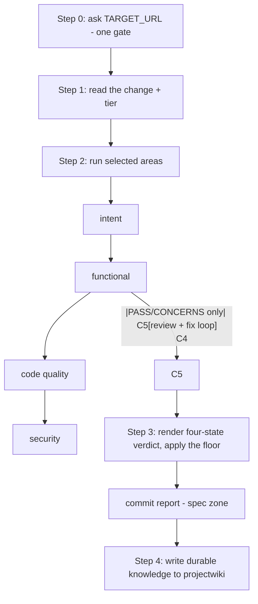

# Test

## Contents
- Config / When to Use / Area Selection
- The Process (Step 0 Target URL, Step 1 Read the Change, Step 2 Run the Selected Areas, Step 3 Render the Verdict, Step 4 Write the Results Back to the Project Wiki)
- Common Rationalizations / Red Flags / Verification / References

Verify a change from five angles — intent, functional, code quality, security, and review — running only the areas the change warrants, in order, and render a four-state verdict (PASS / CONCERNS / FAIL / WAIVED).

**Announce at start:** "I'm using the skillgrid:test skill to test this change."

This skill is a router over five test areas. Each area is a `references/` file
loaded on demand, so a small change never pays the token cost of the areas it
does not need. The areas are independent problem domains:

- **Intent testing** (references/intent-testing.md) — does the change satisfy the stated requirement? Goal-backward verification from the briefing's falsifiable truths and the `acceptance.feature` scenarios. This is the gate that actually verifies the feature exists, not just that the suite is green.
- **Functional testing** (references/functional-testing.md) — does the behavior actually run? The test suite, layer selection, the exploratory browser pass (driven by `playwright-cli` — full command reference in references/playwright-cli.md), and the regression check on the diff.
- **Code quality** (references/code-quality.md) — duplication and complexity via jscpd: exact / renamed / near-miss clones, the health score, dead code, and the refactoring hotspots.
- **Security** (references/security.md) — the five tools: trivy (SCA / secrets / IaC / SBOM), nuclei (broad DAST), wapiti (lightweight DAST), akca (deep evidence-backed DAST), and owasp-security (code/diff review).
- **Review + fix loop** (references/review-and-fix-loop.md) — does the code follow standards and implement the spec? The topology-driven code review (Standards / Spec / Security + conditional specialists, red team last), triage, and the receiving-code-review fix loop that closes the findings with tests.

The mode only changes *which areas run and how deep* — the config, the verdict, and the report are shared.

## Config

Read `.skillgrid/config.yaml` before starting. Use:

| Config key | Used for |
|------------|----------|
| `testing.runner` | Test command in the functional area and the verification the review triage and the fix loop run |
| `testing.layers` | Available test layers (`[unit, integration, e2e]`) for layer selection |
| `testing.coverage` / `quality.coverage_min` | Coverage command and threshold (default 80) |
| `testing.mutation` / `quality.mutation_min` | Mutation command and threshold (default 80) |
| `quality.p0_pass_rate` / `quality.p1_pass_rate` | Pass-rate floors (default 100 / 95) |
| `conventions.specs_root` (default `.skillgrid/change-specs/`) | Where `briefing.md` and `acceptance.feature` live |
| `security.trivy.command` / `.severities` / `.scan_types` / `.fail_on` | Trivy invocation; `fail_on` is the severity that FAILs the gate ("" = report only) |
| `duplication.command` / `.target` / `.fail_on` / `.formats` / `.ignore` | jscpd invocation; `fail_on` is the duplication % that FAILs the gate (0 = advisory, never block) |
| `rules.tiers.default` | Project rigor tier (T0–T3) that selects which audits run, the verification floor, and the review topology |
| `commands.lint` / `commands.build` | Lint and build commands for the review triage and the fix loop (alongside `testing.runner`) |
| `conventions.glossary` (default `.skillgrid/projectwiki/glossary/`) | Terms + in-force ADRs the review Standards lens checks against |
| `mnemonic.enabled` | If `true`, persist scan findings to mnemonic (fail-open) |
| `ticketing.enabled` | If `true`, update ticket status at gate transitions |

If a `quality:` block is absent, use the defaults shown and note in the report: "quality: not configured — using defaults. Run `skillgrid:onboarding` to set thresholds."

**Rigor tier (selects the floor):** the effective tier is `briefing.md`'s `Tier:` line → the blueprint header's `Tier:` line → `rules.tiers.default` → inferred from the change classification. The tier selects which audits run and the verification floor per `_shared/planning/rigor-tiers.md` (T0: self-check only, no gates; T1: L1 + runtime; T2: L2+L3; T3: L4 with mutation + security mandatory). The change-classification floor (`_shared/rules/verification-ladder.md`) still applies as the minimum — the tier never lowers the floor the change shape demands. Record the effective tier and the applied floor in the report header.

**The floor is the weakest dimension, never the average** (per `_shared/verification/floor.md`): the verdict can never be higher than the verdict the weakest area earns. A green overall that rests on an average while one area is FAIL is a FAIL floor, not a PASS.

**Narration:** between tool calls, narrate at most one short line — the report and the tool results carry the record.

**Target URL (ask at start):** before Step 1, ask the human for a `TARGET_URL` — a reachable, authorized URL the DAST security tools (nuclei / wapiti / akca) and the functional browser pass can scan. Ask exactly once, in a single gate, and yield on the answer:

- **The human provides a URL** → it unlocks the DAST tools and the browser pass; `node scripts/area-scope.mjs CHANGE_DIR <url>` selects them.
- **The human says there is none** (static change, no running target, or "just the static areas") → record `TARGET_URL: (none)` and the DAST tools + browser pass are `N/A — no reachable target`. Never guess a URL, and never spin up a server just to have one unless the human agrees.
- **A URL is already named** in the briefing, a prior turn, or the change's `findings.md` → use it without re-asking.

The URL is an input to the security and functional areas, not a gate: an absent URL downgrades those areas to static-only, it does not block the rest of the test.

## When to Use

- A change is ready to be tested, after implementation and before the final review or merge.
- A re-test run (when a prior `test` verdict returned CONCERNS or FAIL).
- A human asks "is this actually done / is this secure / is this clean?"

**When NOT to use:** mid-implementation (test is a gate at the end, not a running check); a single trivial change with one acceptance scenario that the spec reviewer in `skillgrid:code-review` already covers.

## Area Selection

Not every change needs all five areas. Select the areas the change warrants:

| Change shape | Intent | Functional | Code quality | Security | Review |
|---|---|---|---|---|---|
| Logic / behavior change with a requirement | **always** | **always** | yes | if it touches input, auth, config, or a dependency | **always** (after a PASS/CONCERNS intent+functional gate) |
| Dependency / IaC / Dockerfile change | if a requirement is affected | if a behavior is affected | yes | **always** (trivy) | if code is touched (T1+) |
| New user-facing flow (URL reachable) | **always** | **always** (+ browser) | yes | if it crosses a trust boundary | **always** (after a PASS/CONCERNS intent+functional gate) |
| Pure refactor / rename, no new trust boundary | if a requirement is affected | regression check only | **always** (jscpd is the point) | no | **always** (the diff is the point) |

A change that is only a refactor still runs code quality and review — those are the areas it exists for. A change that crosses a new trust boundary still runs security even if the diff is small. The review area runs **after** intent + functional render PASS or CONCERNS — there is no point reviewing standards on a diff that does not do the right thing; and at T0 it is skipped entirely (per `_shared/planning/rigor-tiers.md`).

## The Process

### Step 0: Ask for the Target URL

Per the `TARGET_URL` rule in Config: one gate, yield on the answer, then record `TARGET_URL: <url>` or `TARGET_URL: (none)` in the report header before reading the change.

### Step 1: Read the Change

Read, in order:
1. `briefing.md` — the falsifiable requirements (truths) and the stated goal
2. `acceptance.feature` — every scenario (the traceability oracle) and each requirement's `#### Gates` block
3. `blueprint.md` — the task breakdown, `SATISFIES` lines, the `Tier:` line, and the `**Status:**` line
4. `tasks.md` — the ticket list and dependency graph
5. `findings.md` (if present) — prototype/sketch results that constrain verification

Identify every scenario name, every ticket, every `SATISFIES` mapping, the stated goal, and the effective rigor tier.

### Step 2: Run the Selected Areas

Run each selected area in `references/` in this order: **intent → functional → code quality → security → review**. The order matters: intent first (does it do the right thing?), functional next (does it run?), then the two quality lenses on the code, then the review (standards/spec) on a diff that already does the right thing and runs. Each area produces findings classified as CRITICAL / WARNING / SUGGESTION and writes its section to the report.

- **Intent** → [references/intent-testing.md](references/intent-testing.md)
- **Functional** → [references/functional-testing.md](references/functional-testing.md)
- **Code quality** → [references/code-quality.md](references/code-quality.md)
- **Security** → [references/security.md](references/security.md)
- **Review + fix loop** → [references/review-and-fix-loop.md](references/review-and-fix-loop.md)

The review area runs only after intent + functional render PASS or CONCERNS (or is skipped at T0). An area not selected is recorded as `N/A — <reason>` in the report, never silently absent.

### Step 3: Render the Verdict

Complete the report from [templates/report.md](templates/report.md) and render the four-state gate — **the matrix is a script**: `node .agents/skills/test/scripts/verdict-render.mjs` (JSON in, JSON out). Feed it the area signals as the input shape in the script's header (each area's state per the criteria below); it returns `{verdict, floor_area, floor_reasons, non_answers, needs_human, notes}`. The matrix below is the contract the script implements — when they disagree, the script's output is the render and the matrix text is the bug to fix:

| Verdict | Criteria |
|---------|----------|
| **PASS** | All of: every truth VERIFIED (intent), every scenario covered by a test that ran and passed (functional), no CRITICAL finding from any area, all code-quality gates PASS or N/A (coverage / mutation / lint / typecheck / P0 / P1 at thresholds, jscpd duplication ≤ `duplication.fail_on` when `> 0`), no Trivy finding at or above `security.trivy.fail_on` (if set), the review signal is `REVIEW-PASS` (no unresolved `high`/`medium` entries) or an accepted `BACK-TO-APPLY`, and every verification-scope derivation `COMPLETE`. |
| **CONCERNS** | No CRITICAL finding and all hard gates PASS, but at least one of: a `PRESENT_BEHAVIOR_UNVERIFIED` truth, a WARNING finding, a P0 without triangulation, a changed-file coverage dip, a verification-scope that is `TRUNCATED`/`UNSCOPED` with a named re-run path, or a `STALE` verification. These are non-answers the human can clear by re-running with full scope or current evidence. |
| **FAIL** | Any of: a truth UNVERIFIED, a scenario with no covering test, a test that ran and failed, a CRITICAL finding from any area (including a CRITICAL assertion-quality gap), a CRITICAL security finding, a code-quality gate below threshold, a Trivy finding at or above `fail_on`, a duplication % above `duplication.fail_on` (if `> 0`), or an unresolved `high` review entry (the review signal is `BACK-TO-APPLY` with open items). |
| **WAIVED** | The human explicitly waived a specific criterion. The waiver, the criterion, and the accepted risk are recorded in the report. WAIVED is never a machine decision. |

**Hard rules:**
1. A human decision always overrides the machine verdict.
2. A change that fails its criteria with no human decision is recorded as **not accepted** — never silently accepted.
3. Passing tests do not substitute for running the system. The intent (goal-backward) check is the evidence, not the suite count.
4. A gate at threshold 0 is N/A — it cannot FAIL. Do not render FAIL for a disabled gate.
5. The floor caps the verdict: one FAIL-valued area makes it FAIL, any non-answer area caps it at CONCERNS. Never let a strong overall compensate for a weak part.
6. Fail-closed on scope: only a `COMPLETE`-scope verification satisfies the gate (per `references/verification-scope.md`). A `TRUNCATED`/`UNSCOPED`/`UNREADABLE` scope routes to CONCERNS (named re-run) or FAIL, never a silent PASS.

**Decision gates:**

| Condition | Action |
|---|---|
| No `TARGET_URL` provided | DAST tools and browser pass are `N/A — no URL`; record it in the report header. |
| Any area renders a FAIL-valued signal | Verdict **FAIL** — the floor caps; a strong overall never compensates for a weak part. |
| No CRITICAL, but a non-answer (unverified truth, WARNING, P0 without triangulation, TRUNCATED/UNSCOPED scope, STALE verification) | Verdict **CONCERNS** — name the re-run path; the human can clear it. |
| A gate threshold is 0 | That gate is N/A — it cannot FAIL. |
| Verification scope is not `COMPLETE` | Fail-closed: route to CONCERNS (named re-run) or FAIL, never a silent PASS. |
| The human explicitly waives a specific criterion | Verdict **WAIVED** — record the waiver, the criterion, and the accepted risk. Never a machine decision. |
| The human decides otherwise | The human decision overrides the machine verdict. |
| No durable, non-obvious knowledge surfaced | File nothing to the wiki — a clean PASS that learned nothing files nothing. |

**Commit the report** (spec zone rule: commit `.skillgrid/change-specs/` before code — the `pre-commit` zone guard enforces it).

### Step 4: Write the Results Back to the Project Wiki

The report is the per-change record; the project wiki is the durable one. At the end, file the non-obvious artifacts of this test run into `.skillgrid/projectwiki/` per `skillgrid:projectwiki` — the task-end bookend, not a drive-by edit. This is what the *next* session recalls instead of re-deriving.

File only what is durable and non-obvious; a clean PASS with no new knowledge files nothing.

| What the run produced | Project-wiki home | Page type |
|---|---|---|
| A discovered quirk, failure mode, or "this surprised me" | `gotchas/` | Gotcha |
| A reusable test pattern, threshold, or technique | `concepts/` | Concept |
| A new/changed security finding that is a standing property of the app (not a one-off) | `gotchas/` (the risk) or `invariants/` (a must-hold control) | Gotcha / InvariantContract |
| A change to how a tested behavior works | `architecture/` | Architecture |
| A security/quality constraint that must hold going forward | `invariants/` (with `claims:`) | InvariantContract |

**The verdict itself is not a wiki page.** The four-state verdict lives in `report.md` and `state.yaml` (per-change). Only the *knowledge* the run surfaced — a gotcha, a reusable technique, a standing risk, a must-hold control — is promoted to the wiki. A PASS that learned nothing files nothing; that is correct, not a miss.

**Write-back procedure** (per `skillgrid:projectwiki`):
1. **Locate the home first** and check what exists (`projectwiki query` + `status --json` `by_type`) before writing — a growing base beats a pile of duplicates.
2. **Write or revise** the page(s) with valid frontmatter (`type`, `status`, `claims:` on invariants) and 2+ outgoing wikilinks. One atomic insight per page.
3. **Same-edit rule:** every page write is followed by `projectwiki index` — the engine refreshes the derived rows. Page + reindex ship together or the change is incomplete.
4. **Gate:** `projectwiki index` → `projectwiki validate` (pin-check, no drift) → `projectwiki lint` (no new findings) → `projectwiki status --json` (the orphan count did not grow).
5. **Proactive save:** run `projectwiki generate` (incremental) so the derived hub reflects the new pages.

If the engine is down, degrade to direct markdown writes and declare `Degraded: projectwiki` — never invent a substitute retrieval path silently.

**Record in the report:** a `## Project Wiki` section listing the pages filed (path + one line each), or `Project Wiki: nothing filed — no durable, non-obvious knowledge surfaced` when the run learned nothing.

## Output Contract

The deliverable is the completed `report.md` (from `templates/report.md`)
committed in the change folder, plus the wiki write-back record. It MUST
contain:

- `TARGET_URL: <url>` or `TARGET_URL: (none)` in the header.
- One section per selected area (intent / functional / code quality /
  security / review), each with its findings classified CRITICAL / WARNING /
  SUGGESTION; unselected areas as `N/A — <reason>`, never silently absent.
- `## Gate Decision` — the four-state verdict (PASS / CONCERNS / FAIL /
  WAIVED) with the floor area and the named non-answers; WAIVED carries the
  waiver, the criterion, and the accepted risk.
- `## Fix Plans` (when the verdict is FAIL or CONCERNS) — one entry per
  diagnosed gap: the finding, its root cause, the fix (what to change, in
  which file), and the verification that proves the fix. These are the
  deliverable that feeds back into `skillgrid:execute` gap-closure mode —
  the loop is `execute → test → execute --gaps-only → test → …` until the
  verdict is PASS. A FAIL/CONCERNS report with no fix plans is a verdict
  without a next step.
- `## Project Wiki` — the pages filed (path + one line each), or `nothing
  filed — no durable, non-obvious knowledge surfaced`.

## How to measure it

Per `_shared/craft/measurement.md`.

| | Indicator | Data source | Direction |
|---|-----------|-------------|-----------|
| Leading | % of changes where the rendered verdict matches the evidence (a PASS with every listed area green, a FAIL/CONCERNS with a named failing area) | `report.md` `## Gate Decision` vs. its area results | should rise |
| Lagging | Defects caught post-ship that the gate's areas should have caught (a security or functional finding raised after the change was archived) | Git history / issue tracker (post-archive findings on the change's files) | should fall |

## Common Rationalizations

| Excuse | Reality |
|--------|---------|
| "The suite is green, so it's done" | Green tests only prove the code the agent thought to test. The intent (goal-backward) check is what verifies the feature exists; the suite is one input, not the verdict. |
| "It's a small change, skip the security area" | Small diffs cross trust boundaries all the time. If the change touches input, auth, config, or a dependency, security is in scope. |
| "A refactor doesn't need jscpd" | Duplication is what a refactor most often introduces or reveals. The code-quality area is the reason a pure refactor is tested. |
| "I'll run all five security tools on everything" | Each tool has a shape: trivy for deps/IaC/secrets, nuclei for broad CVE, wapiti for lightweight, akca for deep evidence. Run the ones the target warrants, not all five unscoped. |
| "I'll just assume a localhost URL for the DAST scan" | Ask for the TARGET_URL. A guessed URL that is not the real target (wrong env, no data, no auth) makes the DAST findings mean nothing. No URL → static-only, recorded as such. |
| "The report is the record, the wiki is optional" | The report dies with the change folder. File the non-obvious knowledge in the project wiki (gotchas / concepts / invariants) so the next session recalls it; a clean PASS that learned nothing files nothing. |
| "The scanner matched, so it's vulnerable" | A template match or fuzzer hit is a lead. Confirm reachability and exploitability before reporting; mark Confirmed / Likely / Needs verification. |
| "I'll just review the diff myself instead of dispatching" | You're the coordinator — reviewing inline burns the context you need to keep driving the work. Dispatch a lens subagent: the diff lives in its context, only the findings come back. An inline self-review is Grade C — diagnostic, not independent evidence. |
| "The reviewer is right, I'll just agree and fix it" | Performative agreement skips verification. Restate the requirement, verify against the codebase, push back with technical reasoning if it's wrong, then fix one at a time with tests. |
| "One more area will converge" | Past the fix-loop cap the failure is structural. Adjudicate and route to the human, don't keep re-running. |
| "I'll fold the areas into one big run" | The areas are independent domains with different evidence. Run them in order and keep each section of the report separate, so a finding is attributable. |

## Red Flags

- A truth marked VERIFIED with no named test that exercised it and passed in the output.
- A scenario with no covering test, or a `covered` row whose test was filtered/skipped and not re-run.
- The intent area skipped on a behavior change — goal-backward verification is the part that verifies the feature, not the suite count.
- A code-quality gate at threshold 0 rendered as FAIL instead of N/A.
- jscpd duplication reported as a defect without naming which pass (exact / renamed / near-miss) produced it.
- A security finding reported as Confirmed without reachability + severity + confidence.
- A scanner template/fuzzer match reported as a vulnerability without a demonstrated exploit path.
- All five security tools run unscoped on a small, known-stack change.
- A security area run on a code/config change with no running target (nuclei / wapiti / akca need a live URL).
- The DAST tools or browser pass ran without the human confirming a TARGET_URL, or a URL was guessed instead of asked.
- A durable, non-obvious finding (a gotcha, a standing risk, a must-hold control) left only in `report.md` with no project-wiki page filed.
- A project-wiki page written but `projectwiki index` not run after it (`status --json` shows `stale > 0`).
- The four-state verdict promoted to a wiki page (it is a per-change record, not durable knowledge).
- A verification-scope that is `TRUNCATED` or `UNSCOPED` routed to PASS with no named re-run path.
- A CRITICAL finding from one area compensated for by a green overall.
- A review run inline (no fresh subagent context) presented as independent evidence — it is Grade C, diagnostic only.
- A reviewer's self-assigned severity taken as the final verdict, or two findings merged because they share a file rather than a root cause.
- A `could-not-verify` review entry dropped on a silent pass instead of routed to a held-out test.
- A finding fixed without a test that was RED before the fix, or multiple findings fixed and tested together so a regression can't be attributed.
- The review signal recorded as `REVIEW-PASS` while an unresolved `high`/`medium` entry remains.
- The report committed before the verdict was rendered, or the verdict changed after the commit without a re-commit.

## Verification

- [ ] A `TARGET_URL` was asked for and recorded in the report header (`<url>` or `(none)`); the DAST tools and browser pass ran only when a URL was provided.
- [ ] The change was read (briefing, acceptance.feature, blueprint, tasks.md) and the effective rigor tier recorded in the report header.
- [ ] Every selected area ran in order (intent → functional → code quality → security); every unselected area is recorded `N/A — <reason>`.
- [ ] Intent: every truth has a named test that exercised it and passed, or is marked `PRESENT_BEHAVIOR_UNVERIFIED` / `UNVERIFIED` and routed to the human.
- [ ] Functional: every scenario is covered by a test that ran and passed; the browser pass ran when a URL was reachable; the regression check on the diff is present.
- [ ] Code quality: jscpd ran (the pass that matches the change), the health/summary is captured, and coverage / mutation / lint / typecheck / P0 / P1 are at thresholds or N/A.
- [ ] Security: the tools the target warranted ran; every reported finding states severity, the concrete match, reachability, blast radius, and confidence; no template/fuzzer match is reported as Confirmed without a demonstrated path.
- [ ] Review: the topology was selected from diff size/risk/tier and named; every selected lens ran fresh (Blindness Contract, independence grade labeled); each entry verified at its location and rendered one of the six verdicts; the fix loop closed the in-scope set with RED→GREEN tests; the review signal (`REVIEW-PASS`/`BACK-TO-APPLY` + counts) is recorded in `tasks.md` and `review.md` committed.
- [ ] The verdict was rendered from the four-state gate and the floor (weakest dimension) was applied; the report was committed.
- [ ] Durable, non-obvious knowledge was filed to the project wiki (gotchas / concepts / invariants / architecture) with `projectwiki index` + `validate` + `lint` run after, the orphan count not growing — or the report states `Project Wiki: nothing filed` when the run learned nothing.
- [ ] If `mnemonic.enabled: true`, scan findings were persisted (fail-open).
- [ ] If `ticketing.enabled: true`, ticket status reflects the verdict.

## References

On-demand detail for this skill, in `references/`:

- [intent-testing.md](references/intent-testing.md) — goal-backward verification of the briefing's truths and the acceptance scenarios; the four levels (Truth / Artifact / Key Link / Data Flow) and the status definitions.
- [functional-testing.md](references/functional-testing.md) — the test suite, layer selection, cadence, the exploratory browser pass (driven by `playwright-cli`), and the regression check on the diff.
- [playwright-cli.md](references/playwright-cli.md) — the browser automation tool: full command reference (open / navigate / interact / find / storage / network / devtools / sessions), raw output, snapshots, targeting elements, installation.
- `references/playwright/` — the ten task-specific browser guides, loaded only when the functional area's browser pass needs one: tests (run/debug), request-mocking, running-code, session-management, storage-state, test-generation, tracing, video-recording, pr-attachments, element-attributes.
- [code-quality.md](references/code-quality.md) — jscpd: clone kinds, the health/dashboard score, the summary hotspots, dead code, and the coverage/mutation/lint/typecheck/P0/P1 gates.
- [security.md](references/security.md) — the five tools: trivy, nuclei, wapiti, akca, owasp-security; when to run each, the triage rubric, and the finding block.
- [review-and-fix-loop.md](references/review-and-fix-loop.md) — the topology-driven code review (Standards / Spec / Security + conditional specialists, red team last), the Blindness Contract, the six-value verdict table, and the receiving-code-review fix loop (triage → fix → validate → repeat). When the diff touches a REST surface, the review area checks the contract against [api-design.md](../execute/references/api-design.md) (resource naming, semantic status codes, the envelope, pagination, and the breaking-vs-non-breaking versioning decision).

Scripts in `scripts/`:

- `node scripts/area-scope.mjs CHANGE_DIR [TARGET_URL]` — emit the area-selection table for a change (which areas to run, which are N/A, and why), from the change shape. Exit 0 = selection made, 2 = usage error.
- `node scripts/verdict-render.mjs [input.json]` — the four-state gate as one call (area signals in → `{verdict, floor_area, floor_reasons, non_answers, needs_human}` out); the matrix in Step 3 is the contract it implements. Exit 0 = rendered, 2 = usage.

Shared rules:

- [../_shared/rules/evidence-claims.md](../_shared/rules/evidence-claims.md) — the evidence rules behind the verdict: named-test closure, the taught-to-agree fixture check, baseline discipline (clean-base comparison, no stash/pop).
- [../skill-creator/references/rationalizations.md](../skill-creator/references/rationalizations.md) — the authoring rationalizations (script extraction, size, spine sections); load when you or the user push back on this skill's shape
