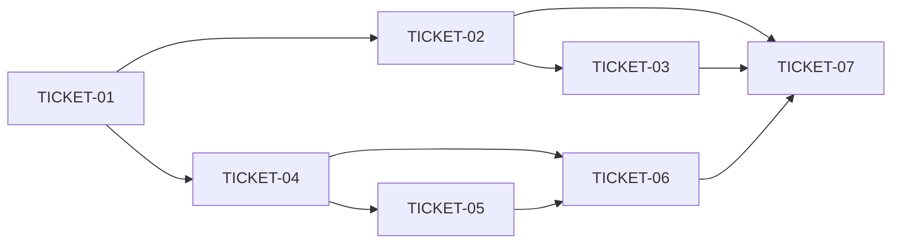

# Tasks — Mnemonic obs-split + embedded ANN

> **STATUS:** `sliced` (2026-10-10)

> Sliced from `.skillgrid/specs/2026-10-10-obs-split-hnsw/blueprint.md`.
> Vertical tracer-bullet tickets, dependency-ordered, sized for one fresh agent context window.

## Epic Summary

Split the `observations` god-table into core + 5 side tables behind a compat view (rollback window), and put vector top-K on an embedded cgo-free ANN path (IVF now, HNSW behind ADR-0037) with per-model dim namespaces. Preserves ADR-0011 bitemporal filters and the single-binary/SQLite invariants (ADR-0006/0009/0012).

## Delivery Strategy

| Field | Value |
|-------|-------|
| Estimated changed lines | ~1800-2400 (migrations + vectorstore + memory callers + tests + benches) |
| 400-line budget risk | High |
| Chained PRs recommended | Yes |
| Suggested split | PR 1 (TICKET-01 bench+audit) → PR 2 (TICKET-02+03 split+migrate callers) → PR 3 (TICKET-04+05+06 ANN+namespaces) |
| Delivery strategy | exception-ok |
| Chain strategy | size:exception (maintainer-approved single PR, 2026-10-10) |

Decision needed before apply: No
Chained PRs recommended: Yes
Chain strategy: size:exception
400-line budget risk: High

### Suggested Work Units

| Unit | Goal | Likely PR | Focused test command | Runtime harness | Rollback boundary |
|------|------|-----------|----------------------|-----------------|-------------------|
| 1 | Bench + caller audit (door check) | PR 1 | `go test ./mnemonic/internal/vectorstore/ -run TestBenchHarnessExists -v` | N/A (synthetic bench, no live service) | delete `bench_test.go` + audit file |
| 2 | Obs split + hot-path migration (+rollback drill) | PR 2 | `go test ./mnemonic/internal/memory/ -run TestObservationsParity -v` | copy of a real project store migrated + read back | `git revert` migration file; legacy `_legacy` table retained one release |
| 3 | ANN index (IVF + HNSW) + dim namespaces | PR 3 | `go test ./mnemonic/internal/vectorstore/ -v` | 20k/100k synthetic recall + latency bench | drop ANN tables → brute-force fallback path |

> The four plain-text guard lines above are the **contract** — `skillgrid:subagent-execution` matches them literally. If risk is High, `Chained PRs recommended` MUST be `Yes` and every work unit MUST name a focused test, a runtime harness (or `N/A` + reason), and a rollback boundary.

## Tickets

### TICKET-01 — Bench harness + observations caller audit

- **Scope:** Synthetic recall/latency bench skeleton + checked-in `FROM observations` caller list (door check for HNSW YAGNI call)
- **Acceptance:** `bench_test.go` runs and prints cold/warm baseline; if <50ms at 100k it records `DECISION: IVF-only`; caller audit file lists all 7+ read sites
- **SATISFIES:** hnsw-recall-latency (RED: harness absent)
- **Files:** `mnemonic/internal/vectorstore/bench_test.go`, `.skillgrid/specs/2026-10-10-obs-split-hnsw/observations_callers.txt`
- **Size:** ~S (<400)
- **Blocks:** TICKET-02, TICKET-04
- **Blocked by:** none

### TICKET-02 — Split observations behind compat view

- **Scope:** `054_obs_split.sql` (6 tables + compat VIEW + moved partial indexes) + parity test on a store copy
- **Acceptance:** row-hash parity vs pre-split dump; all `invalid_at` filters intact; `migrate()` idempotent re-run no-op
- **SATISFIES:** obs-parity-after-split (RED before migration exists)
- **Files:** `mnemonic/internal/store/migrations/054_obs_split.sql`, `mnemonic/internal/memory/observations_compat_test.go`
- **Size:** ~M (500-900)
- **Blocks:** TICKET-03, TICKET-07
- **Blocked by:** TICKET-01
- **Precondition:** `ls mnemonic/internal/store/migrations/` shows next-free number — rebase 054/055 if CLM (053-055) or CTX (056+) specs landed first
- **Reversibility:** one-way
- **Fails-when:** `TestObservationsParity` FAILs or `migrate()` second run changes `index_meta` count

### TICKET-03 — Hot-path callers off the view + lazy vectors

- **Scope:** Rewrite `memory/*.go` hot reads to `core+state`, vector loads lazy; `SaveWithAction` writes core + side rows in one tx
- **Acceptance:** `EXPLAIN QUERY PLAN` of `mem_context` hot query shows no `observation_vectors` scan; full `go test ./mnemonic/...` green
- **SATISFIES:** hot-path-avoids-blobs (RED: plan still hits view/vectors)
- **Files:** `mnemonic/internal/memory/*.go`, extend `observations_compat_test.go`
- **Size:** ~M (500-900)
- **Blocks:** TICKET-07
- **Blocked by:** TICKET-02

### TICKET-04 — VectorIndex interface + IVF probe search

- **Scope:** `VectorIndex` interface + `BruteForce` adapter + IVF centroids/assignments + probe-then-rerank search with brute fallback
- **Acceptance:** recall@10 >= 0.90 vs brute at 20k; corrupt IVF degrades to brute without error
- **SATISFIES:** ivf-recall (RED: no `ivf.go`)
- **Files:** `mnemonic/internal/vectorstore/index.go`, `mnemonic/internal/vectorstore/ivf.go`, `055` spectroscopy (IVF tables section of `055_hnsw_store.sql`)
- **Size:** ~M (500-800)
- **Blocks:** TICKET-05, TICKET-06
- **Blocked by:** TICKET-01

### TICKET-05 — HNSW backend (ADR-0037 gated)

- **Scope:** ADR-0037 + pure-Go HNSW impl + SQL persistence (`hnsw_nodes/links/meta`) + warm-load + dual-write in `embedPass`
- **Acceptance:** recall@10 >= 0.95 at 100k; cold <50ms / warm <10ms; drop-HNSW-tables fallback returns via brute
- **SATISFIES:** hnsw-recall-latency (RED: no `hnsw.go`; GREEN: bench targets met)
- **Files:** `.skillgrid/artifacts/04-adr-0037-embedded-ann-index.md`, `mnemonic/internal/vectorstore/hnsw.go`, `055_hnsw_store.sql` (HNSW section), `hybrid/vectorcache.go`
- **Size:** ~M (600-1000)
- **Blocks:** TICKET-06
- **Blocked by:** TICKET-04
- **Precondition:** ADR-0037 accepted and recorded in `.skillgrid/ASSUMPTIONS.md` § LOCKED before any HNSW import
- **Reversibility:** one-way
- **Fails-when:** `go list -m` shows a cgo dependency, or recall bench < 0.95

### TICKET-06 — Unpin dim 768, per-model namespaces

- **Scope:** Remove `Dim=768` pin; namespaced vec tables per `(model, dim)`; model-swap clears only its own namespace; explicit cross-dim error
- **Acceptance:** 768 + 1024 dim vectors coexist and query correctly; cross-dim query errors with typed error (no silent wipe)
- **SATISFIES:** per-model-dim-namespaces (RED: `vec_f32` dim error / wipe)
- **Files:** `mnemonic/internal/vectorstore/store.go`, `mnemonic/internal/vectorstore/store_test.go`
- **Size:** ~S (<500)
- **Blocks:** TICKET-07
- **Blocked by:** TICKET-04, TICKET-05

### TICKET-07 — Rollback drill + L4 gate

- **Scope:** Backup-`.dump` rollback drill on a copy + full verification (build, tests, `doctor --strict`, Trivy advisory, gofmt)
- **Acceptance:** hash-mismatch rollback restores legacy table read-only; `go build ./...`, `go test ./...`, `doctor --strict` green; Trivy reported (never blocking)
- **SATISFIES:** migration-rollback (RED: no drill evidence)
- **Files:** none (verification only) + verdict line appended to `briefing.md`
- **Size:** ~S (<200)
- **Blocks:** none
- **Blocked by:** TICKET-03, TICKET-06

## Dependency Graph

## Execution Order

- **Wave 1 (parallel):** TICKET-01
- **Wave 2 (parallel):** TICKET-02 (after TICKET-01), TICKET-04 (after TICKET-01)
- **Wave 3:** TICKET-03 (after TICKET-02), TICKET-05 (after TICKET-04)
- **Wave 4:** TICKET-06 (after TICKET-04 + TICKET-05)
- **Wave 5:** TICKET-07 (after TICKET-03 + TICKET-06)

> **Acceptance-first (BDD is always on):** a ticket's failing acceptance
> scenario (its `SATISFIES` scenario) is written and confirmed RED *before*
> the implementation that makes it green. Order RED-test / scenario tickets
> ahead of their implementation tickets in the dependency graph.

## Slicing Notes

- Tracer-thread shape: Wave 1 (TICKET-01) is the thin de-risking slice (bench numbers decide HNSW vs IVF-only before any migration is written).
- Wide-refactor guard: the observations split follows expand (TICKET-02 compat view) → migrate (TICKET-03 callers) → contract (view drop deferred to a later release, explicitly NOT this change).
- Split rationale: TICKET-04/05 split by seam (IVF needs no dep, HNSW needs ADR-0037) so IVF can ship even if HNSW is rejected at its one-way gate.
- Migration numbering: blueprint says 054/055 but CLM spec claims 053-055 and CTX claims 056+ (see `state.yaml` P26-10-08-ctx). TICKET-02 Precondition forces a rebase to next-free at execution time — never silently overwrite.
- Fast-track: BLOCKED (migration + Applicable threat rows) — full pipeline mandatory, no waiver.
- Ticketing: local-only waiver (no `backlog_*` MCP tools in this session; `.backlog/` tracker publish deferred to execution session with tracker access). IDs to be recorded here when published.

## Slicing Self-Review

1. Every ticket vertical — yes (each pairs migration/index DDL with the Go caller + its test).
2. Every ticket demoable — yes (bench output, parity test, EXPLAIN plan, recall numbers, rollback drill).
3. Fits one fresh context — yes (largest TICKET-05 ~1000 lines incl. tests, single subsystem + ADR doc).
4. Dependencies real — yes (split before caller migration; interface+IVF before HNSW/namespaces; all before gate).
5. Waves correct — yes (no ticket precedes its blockers).
6. No orphan work — yes (blueprint Tasks 1-7 → TICKET-01..07 1:1).
7. Acceptance falsifiable — yes (hash equality, EXPLAIN output, recall thresholds, latency bounds, typed errors).
