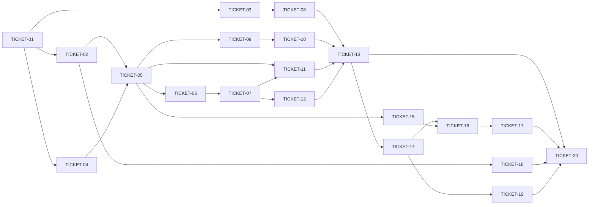

# Tasks — mnemonic-v2 memory function

> **STATUS:** `sliced` (2026-11-01)

> Sliced from `.skillgrid/change-specs/2026-10-31-mnemonic-v2-memory/blueprint.md`.
> Vertical tracer-bullet tickets, dependency-ordered, sized for one fresh agent context window.

## Epic Summary

Build the memory function of mnemonic v2 — the raw, sync-ready source-of-truth fact store (observations, sessions, relations, prompts, dedup, lookup, sync) behind a dialect-agnostic `Store` (SQLite | Postgres) and a 26-tool MCP `mem_*` surface — as a fresh Go module `mnemonic-v2/`, tracer-thread: the thin end-to-end `mem_save → SQLite store → MCP tool → JSON` path works first, then thickens.

Fast-Track: **standard** — high-risk classification (new trust boundary, public MCP contract, data migration; 20 tasks, ~8k+ changed lines). No fast-track waiver applies; full tasks.md per `.skillgrid/config.yaml` `rules.fast_track`.

## Delivery Strategy

| Field | Value |
|-------|-------|
| Estimated changed lines | ~8,000–10,000 (20 tasks, ~30–50% test code, 25+ new files) |
| 400-line budget risk | High |
| Chained PRs recommended | Yes |
| Suggested split | 7 work units (W1 module+store+FTS → W2 seams+config → W3 save pipeline+replay → W4 sessions+dedup-LLM → W5 relations+lookup+events → W6 MCP+CLI+sync → W7 PG+migrate+backstop) |
| Delivery strategy | ask-on-risk |
| Chain strategy | stacked-to-main (serial development per AGENTS.md § Rules — one change at a time; waves execute in order on the working branch) |

Decision needed before apply: Yes
Chained PRs recommended: Yes
Chain strategy: stacked-to-main
400-line budget risk: High

### Suggested Work Units

| Unit | Goal | Likely PR | Focused test command | Runtime harness | Rollback boundary |
|------|------|-----------|----------------------|-----------------|-------------------|
| 1 | Module skeleton, Store interface, SQLite store, migrations, FTS5 (Tasks 1–2) | PR 1 | `cd mnemonic-v2 && go test ./internal/core/...` | N/A — pure store layer, table-driven tests on temp-dir SQLite files | `mnemonic-v2/internal/core/store/` + `migrations/` — the whole directory reverts as one |
| 2 | Intelligence seams + config/project (Tasks 3–4) | PR 2 | `cd mnemonic-v2 && go test ./internal/intelligence/... ./internal/core/config/... ./internal/core/project/...` | N/A — seam contracts tested against httptest OpenAI-compat server | `mnemonic-v2/internal/intelligence/` + `internal/core/config` + `internal/core/project` |
| 3 | Save pipeline core + replay ledger (Tasks 5–6) | PR 3 | `cd mnemonic-v2 && go test ./internal/memory/...` | N/A — pipeline tested against in-memory/test store | `mnemonic-v2/internal/memory/pipeline.go` + `dedup.go` (hash branch) + ledger step |
| 4 | Sessions + dedup LLM path (Tasks 7–8) | PR 4 | `cd mnemonic-v2 && go test ./internal/memory/... -run 'TestSession|TestDedup|TestPrompt'` | N/A — session lifecycle + fake LLM seam | `mnemonic-v2/internal/memory/sessions.go` + LLM branch of `dedup.go` |
| 5 | Relations + lookup ladder + save events (Tasks 9–12) | PR 5 | `cd mnemonic-v2 && go test ./internal/memory/... -run 'TestRelation|TestJudge|TestLookup|TestTrail|TestSaveEvent'` | N/A — relations/lookup against test store + fake LLM | `mnemonic-v2/internal/memory/relations.go` + `lookup.go` + `eventbus.go` |
| 6 | MCP server + CLI + sync core/transport/autosync (Tasks 13–14, 15–17) | PR 6 | `cd mnemonic-v2 && go test ./internal/transport/... && go test ./internal/memory/... -run 'TestSync|TestAutosync'` | Real MCP stdio round-trip via `mnemonic-v2/cmd/mnemonic mcp` pipe test (Task 13 stdio-round-trip scenario) | `mnemonic-v2/internal/transport/` + `cmd/mnemonic/` + `internal/memory/sync.go|transport.go|autosync.go` |
| 7 | PG dialect + v1 seed migration + concurrency backstop (Tasks 18–20) | PR 7 | `cd mnemonic-v2 && MNEMONIC_PG_TEST_DSN=$DSN go test ./internal/core/store/... -run PG` | Real Postgres instance (DSN via `MNEMONIC_PG_TEST_DSN`, gate G15); two-process run in `mem doctor` integration | `mnemonic-v2/internal/core/store/postgres.go` + `migrations_pg/` + `internal/migrate/` |

> The four plain-text guard lines above are the **contract** — `skillgrid:subagent-execution` matches them literally. If risk is High, `Chained PRs recommended` MUST be `Yes` and every work unit MUST name a focused test, a runtime harness (or `N/A` + reason), and a rollback boundary.

## Tickets

> **Precondition (all tickets):** T0 checklist is complete and committed — `acceptance.feature`, ADR-0040/0041, spec amendments, `state.yaml` repoint, and the `mnemonic/` → `mnemonic_back/` archive commit (commits `ae57d7e3`, `f493f3c8`, `5ee9017f`). Task 1's code commit must not include any spec-zone file (pre-commit zone guard, per AGENTS.md § Rules).

### TICKET-01 — Module skeleton + Store interface + SQLite store (door check)
- **Tracker ID:** TASK-084  (milestone 2026-10-31-mnemonic-v2-memory)

- **Scope:** Fresh module `mnemonic-v2/` (module path `github.com/devopstales/skillgrid/mnemonic-v2`, Go 1.26, cgo-free); the full `Store` interface (spec `001-storage` §7 + additive `MarkReviewed`/`BumpRetrievalUsage`/`SearchPrompts`/`TouchForTest`/`SetTxnHook`); `SQLiteStore` with WAL DSN + write-retry wrapper; `syncid.NewSyncID`; initial `migrations/001_schema.sql` + FTS5 trigram tables; refcounted handle pool. This is the door check — if FTS5 trigram retrieval through the Store fails, stop: the blueprint is invalidated.
- **Acceptance:** `go test ./internal/core/...` passes: per-project file opens, add/get round-trip with `obs-` sync-id + provenance, `TestDoorCheckFTSRoundTrip` finds the saved row by trigram AND the <3-rune path goes through LIKE, ledger FK survives hard-delete with `observation_id` NULL, sync-id format `^(obs|rel|ses|prm)-[0-9a-f]{16}$`.
- **SATISFIES:** store-opens-per-project, door-check, sync-id-format, ledger-fk-set-null
- **Files:** `mnemonic-v2/go.mod`, `internal/core/store/{store,types,sqlite,pool}.go` + `migrations/001_schema.sql`, `internal/core/syncid/syncid.go`, tests; modify root `go.work`
- **Size:** ~1500 (M-L) — the largest single ticket; it is the door check and must stay whole (interface + dialect render + FTS together are the hypothesis being falsified)
- **Blocks:** TICKET-02, TICKET-03
- **Blocked by:** none
- **Precondition:** `go.work` builds (`cd /data/git/AI/skillgrid && go build ./...` exits 0) and `mnemonic_back/` exists in the tree.
- **Reversibility:** one-way (D5 — fresh module; moving v2 code back into `mnemonic/` later means re-baselining the module path everywhere)
- **Fails-when:** `go test ./internal/core/...` exits non-zero, OR `TestDoorCheckFTSRoundTrip` does not return exactly the seeded row for the trigram query.

### TICKET-02 — Migration suite + FTS5 trigger parity (both-dialects-from-empty regression)
- **Tracker ID:** TASK-085  (milestone 2026-10-31-mnemonic-v2-memory)

- **Scope:** Full migration set runs from an empty DB; re-open after migration is a no-op (additive); FTS triggers keep `observations_fts`/`prompts_fts` in sync on insert/update/delete; <3-rune terms fall back to LIKE; BM25 weights (title 5.0, content 1.0, topic_key 3.0) + boosts (pinned +0.10, recency, stability) produce the spec-ordered ranking.
- **Acceptance:** `go test ./internal/core/store/... -run 'TestMigration|TestFts|TestSearch'` passes: from-empty migration applies every file exactly once, re-open runs zero statements, trigger-sync assertion (delete a row, FTS count drops), LIKE fallback returns the seeded short-term row, ranking test with pinned/stale/identical rows returns spec order.
- **SATISFIES:** migration-runs-from-empty, migration-additive-reopen, fts-stays-in-sync, short-term-like-fallback, search-ranking-recency-stability (`migration-additive-reopen` is a task-level scenario per blueprint Task 2)
- **Files:** `internal/core/store/{migrate,fts}_test.go`, possibly `migrations/001_schema.sql` (gap-only fix per blueprint Task 2)
- **Size:** ~700 (M)
- **Blocks:** TICKET-05, TICKET-11
- **Blocked by:** TICKET-01

### TICKET-03 — Intelligence seams (LLM + Embedder + degradation policy)
- **Tracker ID:** TASK-086  (milestone 2026-10-31-mnemonic-v2-memory)

- **Scope:** `LLM` seam interface (4-way `Classify` → `DedupDecision`, `Judge`, `SuggestCandidates`), `Embedder` seam, OpenAI-compatible provider over one base URL (chat + embeddings), `degrade` package: ≤1 bounded retry, explicit `degraded: true` flag + reason, log line, never a silent floor.
- **Acceptance:** `go test ./internal/intelligence/...` passes: httptest OpenAI-compat server serves a 4-way classify payload and the seam returns the typed decision; nil seam → zero-value decision + `degraded: true`; failing seam (500) → one retry then the same floor with reason; embedder round-trip returns fixed-dim vectors; null embedder → `degraded`.
- **SATISFIES:** llm-seam-4-way-classify, degraded-explicit, degraded-bounded-retry (the first two are task-level scenarios per blueprint Task 3; `degraded-explicit`/`degraded-bounded-retry` are feature scenarios)
- **Files:** `internal/intelligence/llm/{llm,openai_compat}.go`, `internal/intelligence/embedder/embedder.go`, `internal/intelligence/degrade/degrade.go`, tests
- **Size:** ~900 (M)
- **Blocks:** TICKET-04, TICKET-08
- **Blocked by:** TICKET-01

### TICKET-04 — Config + project detection
- **Tracker ID:** TASK-087  (milestone 2026-10-31-mnemonic-v2-memory)

- **Scope:** YAML + env resolution (flag > env > file > default) per spec `006-config`; validation with actionable errors; project detection chain (explicit → `MNEMONIC_PROJECT` → cwd → git binding → basename) + `--all` semantics.
- **Acceptance:** `go test ./internal/core/config/... ./internal/core/project/...` passes: precedence matrix (flag beats env beats file beats default) for `data_dir`, `sync.dsn`, embedder config; invalid YAML → error naming the file+line; project resolution returns the right project for each selector case, `--all` lists every enrolled project file.
- **SATISFIES:** config-resolution-order, config-validation, project-detection-selectors (scenario names per blueprint Task 4's SATISFIES set — the acceptance.feature scenarios are the G-gate commands + the task-named scenarios the authoring pass added)
- **Files:** `internal/core/config/config.go`, `internal/core/project/project.go`, tests
- **Size:** ~800 (M)
- **Blocks:** TICKET-05, TICKET-14
- **Blocked by:** TICKET-01, TICKET-03

### TICKET-05 — Save pipeline core (validate → resolve → redact → hash floor → upsert → enqueue → commit)
- **Tracker ID:** TASK-088  (milestone 2026-10-31-mnemonic-v2-memory)

- **Scope:** `memory/pipeline.go` implementing the 10-step `mem_save` contract; redaction + truncation; `normalized_hash` dedup floor (hash dedupe → bump `duplicate_count`/`last_seen_at`; same `topic_key` → in-place revision + `observation_versions` snapshot); result shape `{id, sync_id, revision_count, dedup{verdict,reason,merged_into_sync_id}}`; `eventbus.go` created (Publish wired by Task 7).
- **Acceptance:** `go test ./internal/memory/... -run 'TestSave'` passes: save persists with valid sync-id + provenance; redact/truncate applied before hash; identical content → same id, `duplicate_count` bumped, no new row; same topic_key → `revision_count` incremented + history row; validation errors (empty title, bad type) reject before write; result JSON shape matches spec `001-observations` §3.
- **SATISFIES:** save-persists-with-sync-id, save-redact-truncate, save-validation, save-result-shape, hash-dedupe-noop
- **Files:** `internal/memory/{pipeline,dedup,importance,eventbus}.go`, `testutil_test.go`, tests
- **Size:** ~1500 (M-L)
- **Blocks:** TICKET-06, TICKET-07
- **Blocked by:** TICKET-02, TICKET-04

### TICKET-06 — Replay-safe saves (operation idempotency ledger)
- **Tracker ID:** TASK-089  (milestone 2026-10-31-mnemonic-v2-memory)

- **Scope:** Ledger step (4.5) before dedup: `observation_save_operations` check — same `OperationID` + identical payload → return committed id (`replayed: true`); changed payload → 409 `operation_conflict`; target hard-deleted → 410 `operation_expired` (ledger row survived via SET NULL FK, Task 1).
- **Acceptance:** `go test ./internal/memory/... -run 'TestReplay'` passes the three ledger scenarios above; a non-replayed save writes exactly one ledger row.
- **SATISFIES:** replay-identical-returns-committed-id, replay-changed-payload-409, replay-deleted-target-410
- **Files:** `internal/memory/pipeline.go` (ledger step), tests
- **Size:** ~600 (S-M)
- **Blocks:** TICKET-07
- **Blocked by:** TICKET-05

### TICKET-07 — Sessions (lifecycle, terminal semantics, resume, prompts) + event wiring
- **Tracker ID:** TASK-090  (milestone 2026-10-31-mnemonic-v2-memory)

- **Scope:** `memory/sessions.go`: `mem_session_start` (byte-exact id, `runtime_lease_expires_at` = now+30min, local-only), missing session → auto-register (S-3), ended session → 409 `session_already_ended`, resume continuation, `mem_session_finalize` atomic six-section `session_summary` + `ended_at` + enqueue + `session_finalizations` + `already_finalized` retry semantics; `user_prompts` capture (tri-state `capture_prompt`: absent→true) + `mem_search_prompts`; **wires the `bus.Publish(SaveEvent)` call site in the pipeline** (Task 5 created the bus).
- **Acceptance:** `go test ./internal/memory/... -run 'TestSession|TestPrompt|TestSaveEvent'` passes: lease timestamp ≈ now+30min; ended session 409; unknown session auto-registered then save proceeds; finalize writes all six sections atomically, retry returns `already_finalized: true`; `capture_prompt` absent stores the redacted prompt, explicit false stores nothing, `SearchPrompts` finds it.
- **SATISFIES:** session-start-lease, session-terminal-409, session-resume-continuation, session-finalize-atomic-idempotent, session-summary-six-section, save-into-ended-session, save-with-unknown-session, prompt-capture, prompt-search-finds-captured
- **Files:** `internal/memory/sessions.go`, `internal/memory/pipeline.go` (Publish call site), tests
- **Size:** ~1300 (M)
- **Blocks:** TICKET-13
- **Blocked by:** TICKET-06

### TICKET-08 — Dedup LLM path (primary Classify + trust-but-verify)
- **Tracker ID:** TASK-091  (milestone 2026-10-31-mnemonic-v2-memory)

- **Scope:** Fill the non-nil-seam branch of `dedup.Run`: LLM `Classify` as primary, hash floor remains the degraded branch (one code path, `degraded` flag distinguishes); trust-but-verify: LLM's candidate id must exist and match the redacted-hash pre-filter set, else fall back to the hash verdict; noop is first-class (`verdict=noop`, no write).
- **Acceptance:** `go test ./internal/memory/... -run 'TestDedup'` passes: fake LLM returns `update` → merged into target with `reason="llm"`; LLM returns a candidate id not in the pre-filter set → trust-but-verify rejects, hash floor verdict stands; LLM `noop` → first-class no-op; nil seam → `reason="hash"`.
- **SATISFIES:** dedup-llm-primary, dedup-trust-but-verify, dedup-noop-first-class
- **Files:** `internal/memory/dedup.go` (LLM branch), tests
- **Size:** ~700 (M)
- **Blocks:** TICKET-13
- **Blocked by:** TICKET-03, TICKET-05

### TICKET-09 — Relations: conflict-candidate detection + relevance gate
- **Tracker ID:** TASK-092  (milestone 2026-10-31-mnemonic-v2-memory)

- **Scope:** After a committed save, detect conflict candidates (same project+scope, OR-FTS title pre-filter, relevance gate: shared `topic_key` OR ≥2 significant shared title terms); materialize as `pending` `memory_relations`; fill `SaveResult.Candidates` + `JudgmentRequired`.
- **Acceptance:** `go test ./internal/memory/... -run 'TestRelation'` passes: a save whose title shares ≥2 significant terms with an existing row surfaces that row as `candidates[]` with `judgment_required: true`; a one-term overlap does not (gate fails → no candidate); a shared-topic_key candidate surfaces even with disjoint titles; candidates are persisted as `pending` relations, not in-memory only.
- **SATISFIES:** conflict-candidates-surfaced, relevance-gate-terms, no-candidate-when-gate-fails
- **Files:** `internal/memory/relations.go`, `internal/memory/pipeline.go` (steps 4 + 7.5), tests
- **Size:** ~900 (M)
- **Blocks:** TICKET-10
- **Blocked by:** TICKET-05

### TICKET-10 — Judgment + consolidate + scan
- **Tracker ID:** TASK-093  (milestone 2026-10-31-mnemonic-v2-memory)

- **Scope:** `mem_judge` (sets `judgment_status=judged` + provenance `marked_by_actor/kind/model`), `mem_judge_many` (1–32 batch, one queued write), `mem_compare` (direct judged relation, idempotent per pair), `mem_consolidate` (preview `plan.sources/survivor/project` + `Fingerprint`, confirm with stale fingerprint → `fingerprint_mismatch` + fresh plan, confirmed merge soft-deletes sources with `superseded_by_sync_id` + survivor `consolidated_from` footer), `mem_scan` re-surfacing.
- **Acceptance:** `go test ./internal/memory/... -run 'TestJudge|TestConsolidate|TestScan'` passes all six scenarios; `judge_many` issues exactly one store write (asserted via `SetTxnHook` counter).
- **SATISFIES:** judge-sets-provenance, judge-many-one-write, compare-idempotent, consolidate-preview-confirm, consolidate-fingerprint-mismatch, scan-resurfaces
- **Files:** `internal/memory/relations.go` (judge/compare/consolidate/scan), tests
- **Size:** ~1100 (M)
- **Blocks:** TICKET-13
- **Blocked by:** TICKET-09

### TICKET-11 — Lookup ladder (context / search / get) + wiki-first `mem_lookup` + RRF + vector leg
- **Tracker ID:** TASK-094  (milestone 2026-10-31-mnemonic-v2-memory)

- **Scope:** `memory/lookup.go`: `mem_search` compact rows (300-char preview + `truncated`) with the full boost stack; `mem_lookup` (exact `topic_key` → single upserted row or none; id/sync_id → full row; phrase → ≤5 FTS rows, no boosts; never widens); `mem_context` byte budget; `Store.VectorSearch` real via vec0 leg + RRF fusion (`fts`/`vector`/`rrf` routes); trail writer records every retrieval (query, route, filters, ids, `degraded`); `BumpRetrievalUsage` on the trail path (feeds importance); `MarkReviewed` resets `review_after = now + type-months`.
- **Acceptance:** `go test ./internal/memory/... -run 'TestLookup|TestSearch|TestTrail|TestReview'` + `go test ./internal/core/store/... -run 'TestVector|TestContext'` pass: search returns boosted ranking (Task 2) with compact rows; lookup by absent topic returns nothing (does not widen); vector leg with null embedder → `degraded: true` + FTS-only result; every search/lookup writes a trail row; a 10× retrieved row outranks an identical never-retrieved row under the importance formula; `MarkReviewed` on an overdue row returns it to `active`.
- **SATISFIES:** search-ranking-boosts, search-compact-rows, lookup-topic-key-exact, lookup-phrase-bounded, context-byte-budget, vector-blend-degraded, trail-recorded, usage-raises-importance, review-mark-reviewed-restarts-clock (`search-compact-rows` is a task-level scenario per blueprint Task 11)
- **Files:** `internal/memory/lookup.go`, `internal/core/store/sqlite.go` (`VectorSearch`/`Context` real), `internal/core/store/types.go` (query shapes), tests
- **Size:** ~1500 (M-L)
- **Blocks:** TICKET-13
- **Blocked by:** TICKET-02, TICKET-05, TICKET-07 (trails need the session context that sessions.go provides)

### TICKET-12 — Save event emission (wiki handoff) + consumer isolation
- **Tracker ID:** TASK-095  (milestone 2026-10-31-mnemonic-v2-memory)

- **Scope:** Complete the `SaveEvent` payload (`Entity` + `Importance`); exactly-one publication after commit; consumer failure never fails the save; **memory must not import the wiki package** (import graph asserted by test); `internal/wiki_teststub/` no-dependency consumer proof.
- **Acceptance:** `go test ./internal/memory/... -run 'TestSaveEvent|TestWiki'` passes: one save → exactly one `SaveEvent{SyncID, Project, Scope, Type, TopicKey, Entity, Importance, Degraded}`; a panicking/returning-error consumer is observed and the save still returns success; `go list -deps ./internal/memory` (run in test) contains no `internal/wiki`.
- **SATISFIES:** save-event-exactly-once, wiki-failure-never-fails-save, memory-does-not-import-wiki
- **Files:** `internal/memory/pipeline.go` (step 10 payload), `internal/memory/eventbus.go` (isolation test seam), `internal/wiki_teststub/`, tests
- **Size:** ~700 (M)
- **Blocks:** TICKET-13
- **Blocked by:** TICKET-07

### TICKET-13 — Shared handler + MCP stdio server (agent profile, write queue, envelope)
- **Tracker ID:** TASK-096  (milestone 2026-10-31-mnemonic-v2-memory)

- **Scope:** `internal/transport/handler/handler.go` — the one shared handler set (MCP + CLI call it; never diverge); `internal/transport/mcp/server.go` + `tools_mem.go` — all 26 `mem_*` tools via `mark3labs/mcp-go`; `agent` profile = exactly the 20 agent rows, `all` profile adds the 6 admin rows (contract test pins both sets literally, K5); write queue serializes concurrent writes; response envelope carries `degraded`.
- **Acceptance:** `go test ./internal/transport/...` passes: contract test asserts the literal 20-agent + 6-admin tool sets; two concurrent `mem_save` tool calls serialize (no interleaved writes, `SetTxnHook` counts 2 ordered transactions); failing store → envelope with `degraded: true` + reason; stdio round-trip: launch the MCP server, initialize, call `mem_save`, receive valid JSON-RPC result.
- **SATISFIES:** tool-contract-pinned, profile-membership, write-queue-serializes, envelope-degraded, stdio-round-trip
- **Files:** `internal/transport/handler/handler.go`, `internal/transport/mcp/{server,tools_mem,writequeue}.go`, tests
- **Size:** ~1500 (M-L)
- **Blocks:** TICKET-14
- **Blocked by:** TICKET-04, TICKET-07, TICKET-08, TICKET-10, TICKET-11, TICKET-12

### TICKET-14 — CLI surface (mem / sync / trail / doctor / mcp) + parity with MCP
- **Tracker ID:** TASK-097  (milestone 2026-10-31-mnemonic-v2-memory)

- **Scope:** `cmd/mnemonic/` dispatch (stdlib flag, v1 pattern): `mem` (save/get/search/lookup/context/judge/compare/consolidate/scan/update/delete/session/review/doctor/stats/timeline/merge-projects), `sync` (subcommands stubbed, real in TICKET-16), `trail recent|show`, `doctor`, `mcp`; **byte-identical JSON parity with MCP** (K6 — same handler, parity test); project selection from config/TICKET-04.
- **Acceptance:** `go test ./... -run 'TestParity|TestCli|TestDoctor'` passes: `mem save` CLI output == `mem_save` MCP tool output byte-for-byte (parity test); `--project` selection honored; `doctor` reports config/FTS/vector/embed round-trip + sets `degraded` on any gap, `--strict` exits non-zero.
- **SATISFIES:** cli-mcp-parity, cli-project-selection, cli-json-shape, doctor-strict-exits-nonzero-on-gap (`cli-json-shape` is a task-level scenario per blueprint Task 14)
- **Files:** `cmd/mnemonic/{main,mem,sync,trail,mcp,doctor}.go`, tests
- **Size:** ~1200 (M)
- **Blocks:** TICKET-16
- **Blocked by:** TICKET-04, TICKET-13

### TICKET-15 — Sync core (journal apply, tombstones, deferred-apply, enrollment)
- **Tracker ID:** TASK-098  (milestone 2026-10-31-mnemonic-v2-memory)

- **Scope:** `memory/sync.go`: pulled mutations applied **through the same store methods** (INV-4 — no raw SQL bypass); tombstone floors (a late upsert after a delete cannot resurrect); `sync_apply_deferred` (missing-FK mutations deferred, 5-retry cap → dead); `sync_enrolled_projects` gates the journal (un-enrolled project → journal writes rejected).
- **Acceptance:** `go test ./internal/memory/... -run 'TestSyncCore'` passes: a pulled upsert goes through `Store.ApplyPulledMutation` (asserted by test store call log, not raw SQL); tombstoned key + late upsert → row stays deleted; a missing-FK mutation defers, retries 5×, lands `dead`; saving on an un-enrolled project → journal write rejected with actionable error.
- **SATISFIES:** pull-applies-through-store, tombstone-floor-no-resurrect, deferred-apply-5-cap, enrollment-gates-journal
- **Files:** `internal/memory/sync.go`, `internal/core/store/sqlite.go` (`ApplyPulledMutation`/`Tombstone` real, deferred-apply), tests
- **Size:** ~1100 (M)
- **Blocks:** TICKET-16
- **Blocked by:** TICKET-05

### TICKET-16 — Sync transport (PG push/pull + chunk export/import + CLI sync subcommands)
- **Tracker ID:** TASK-099  (milestone 2026-10-31-mnemonic-v2-memory)

- **Scope:** `memory/transport.go`: `push` inserts pending mutations (≤100/batch, ≤8 MiB) into `schema_<project>.mutations` in one transaction, acks `last_acked_seq`; `pull` scoped to `schema_<project>` (fail fast when the project schema cannot be resolved — no `public` fallback); `memory/chunkcodec.go`: chunk id = first 8 hex of SHA-256 of the canonical payload; `sync export` → `manifest.json` + `chunks/*.jsonl.gz`; `sync import` loads the archive dialect-neutrally; Task 14's CLI `sync` stubs become real. One code path, two callers (K4 — CLI + autosync).
- **Acceptance:** `go test ./internal/memory/... -run 'TestSyncTransport|TestChunk|TestExport'` passes against a fake PG transport (httptest/fake DSN): push batches ≤100, acks seq monotonically; pull against a missing schema fails fast (error names the project); export→import round-trip reproduces the store state; chunk id stable across re-exports of the same payload.
- **SATISFIES:** push-acks-seq, pull-scoped-to-project-schema, schema-per-project-fail-fast, export-import-round-trip, chunk-id-stable
- **Files:** `internal/memory/{transport,chunkcodec}.go`, `internal/memory/sync.go` (push/pull), `cmd/mnemonic/sync.go`, tests
- **Size:** ~1300 (M)
- **Blocks:** TICKET-17
- **Blocked by:** TICKET-14, TICKET-15

### TICKET-17 — Autosync manager (lease-guarded, debounced, off the write path)
- **Tracker ID:** TASK-100  (milestone 2026-10-31-mnemonic-v2-memory)

- **Scope:** `memory/autosync.go`: when `sync.auto=true`, debounce 500 ms, SQLite-backed lease (one worker at a time), network I/O off the SQLite write path (`onWrite` hook = buffered-1 channel); manager start/stop in `cmd/mnemonic/mcp.go`.
- **Acceptance:** `go test ./internal/memory/... -run 'TestAutosync'` passes: two concurrent manager instances → one wins the lease, the other stands down (lease row asserted); 10 rapid saves → one debounced cycle after 500 ms; a save with a slow transport (500 ms) completes the write path in <50 ms (channel never blocks the commit).
- **SATISFIES:** autosync-single-lease, autosync-debounce, write-path-never-blocks-on-network
- **Files:** `internal/memory/autosync.go`, `internal/memory/pipeline.go` (`onWrite` hook), `cmd/mnemonic/mcp.go`, tests
- **Size:** ~900 (M)
- **Blocks:** none
- **Blocked by:** TICKET-16

### TICKET-18 — PostgresStore (the second dialect render)
- **Tracker ID:** TASK-101  (milestone 2026-10-31-mnemonic-v2-memory)

- **Scope:** `store/postgres.go`: `Open` dialect switch, `schema_<project>` scoping + fail fast; full PG render of the local schema (`migrations_pg/*.sql`, tsvector in place of FTS5, HNSW index for the vector leg per S-1 parity); `lib/pq` driver (ADR-0041).
- **Acceptance:** With `MNEMONIC_PG_TEST_DSN` set: `go test ./internal/core/store/... -run PG` passes — `Store.Search`/`VectorSearch` return the same Go result shape on both dialects (parity test runs both against identical fixtures); full migration set runs from an empty PG database; no `MNEMONIC_PG_TEST_DSN` → tests skip (not fail). CI must provide the DSN (gate G15).
- **SATISFIES:** pg-dialect-parity, migration-runs-from-empty-pg, pg-fts-tsvector
- **Files:** `internal/core/store/{postgres,store}.go`, `internal/core/store/migrations_pg/*.sql`, `go.mod` (+ `lib/pq`), tests
- **Size:** ~1500 (M-L)
- **Blocks:** none
- **Blocked by:** TICKET-01, TICKET-02
- **Precondition:** `MNEMONIC_PG_TEST_DSN` is set in the execution environment (a real Postgres ≥15 is reachable) — otherwise the ticket's gate tests skip and the parity claim is unproven; halt with a checkpoint if the DSN is absent.
- **Reversibility:** costly (D3 — driver choice is locked by ADR-0041; re-rendering for another driver means re-running the whole PG parity suite)
- **Fails-when:** any `TestPG*` test fails or reports non-skip with the DSN set, OR the dialect-parity fixture diff is non-empty.

### TICKET-19 — v1 → v2 seed migration (`mnemonic migrate`) + doctor completeness
- **Tracker ID:** TASK-102  (milestone 2026-10-31-mnemonic-v2-memory)

- **Scope:** `cmd/mnemonic/migrate.go` + `internal/migrate/migrate.go` (own package — opens the v1 file read-only, depends on `memory.Service`): read-only v1 export → v2 seed import; **v1 files stay untouched** (D4 — different schema philosophy, one-time seed, no auto-migration); `doctor` gains the completeness checks.
- **Acceptance:** `go test ./internal/migrate/...` passes: a fixture v1 DB is seeded into a fresh v2 store with observations + sessions + sync-state preserved; the v1 fixture file's mtime+bytes are identical before/after (asserted); running `migrate` twice is idempotent (hash dedupe absorbs the reseed).
- **SATISFIES:** v1-seed-import, v1-files-untouched
- **Files:** `cmd/mnemonic/migrate.go`, `internal/migrate/migrate.go`, `cmd/mnemonic/doctor.go` (completeness), tests + v1 fixture
- **Size:** ~1000 (M)
- **Blocks:** none
- **Blocked by:** TICKET-14
- **Reversibility:** one-way (D4 — choosing a different cutover later means re-importing on every machine)

### TICKET-20 — Concurrency backstop (two-process WAL) + full-suite gate
- **Tracker ID:** TASK-103  (milestone 2026-10-31-mnemonic-v2-memory)

- **Scope:** Two-process backstop: one process holds the store open while a second runs `mem_save` — both complete without corruption (WAL + busy timeout + retry backoff from Task 1); if it fails, the fix lands here and re-enters the retry wrapper. Full-suite gate: the entire `mnemonic-v2` test suite + `go vet` + build pass; gates G1–G16 from `acceptance.feature` are the checklist.
- **Acceptance:** `TestConcurrentProcessWAL` passes (two real OS processes, same project file, temp dir); `cd mnemonic-v2 && go build ./... && go vet ./... && go test ./...` all pass; every gate command in `acceptance.feature` Gates G1–G16 is executable and its EVIDENCE is captured.
- **SATISFIES:** concurrent-process-wal (backstop)
- **Files:** `internal/core/store/concurrency_test.go` (+ retry-wrapper fix if the backstop fails)
- **Size:** ~500 (S-M)
- **Blocks:** none
- **Blocked by:** TICKET-13, TICKET-17, TICKET-18, TICKET-19

## Dependency Graph

## Execution Order

- **Wave 1:** TICKET-01 (door check — everything waits on the store)
- **Wave 2 (parallel):** TICKET-02, TICKET-03, TICKET-04
- **Wave 3:** TICKET-05
- **Wave 4 (parallel):** TICKET-06, TICKET-09, TICKET-15
- **Wave 5 (parallel):** TICKET-07, TICKET-08, TICKET-11
- **Wave 6 (parallel):** TICKET-10, TICKET-12, TICKET-18
- **Wave 7:** TICKET-13
- **Wave 8 (parallel):** TICKET-14
- **Wave 9:** TICKET-16
- **Wave 10 (parallel):** TICKET-17, TICKET-19
- **Wave 11:** TICKET-20 (full-suite gate)

> **Acceptance-first (BDD is always on):** a ticket's failing acceptance
> scenario (its `SATISFIES` scenario) is written and confirmed RED *before*
> the implementation that makes it green. Order RED-test / scenario tickets
> ahead of their implementation tickets in the dependency graph.
>
> Serial development (AGENTS.md § Rules): waves execute in order; the
> parallel tickets *within* a wave may run in parallel worktrees, but the
> repo's serial rule means the default is sequential-within-wave on the
> working branch — parallelism is the escape hatch, not the default.

## Slicing Notes

- **Ticket = blueprint task 1:1.** The blueprint's 20 tasks are already vertical tracer-bullets (each names its own SATISFIES set, files, and falsifiable test expectations), so slicing preserved the task boundaries rather than re-slicing. No task needed splitting: the two M-L tasks (01, 05, 11, 13, 18) each stay whole because they are the named risk doors — Task 1 is the door check, Task 13 is the K5 contract, Task 18 is the D3 dialect render.
- **D5/TICKET-01 one-way:** the fresh module decision is user-approved (gate decision, blueprint header). Reversibility `one-way` inserts a human checkpoint before execution *only if* the door check fails — a pass means the hypothesis held and the module stays.
- **TICKET-11 depends on TICKET-07** (not just 02/05) because the trail writer records the *session* context of the retrieval, which `sessions.go` provides; this edge was added during slicing (the blueprint's task text does not name it — it is an implementation dependency the ticket's scope makes real).
- **TICKET-18 can run in wave 6** (needs only the store + migrations from wave 2) — placed late because its gate needs a real Postgres DSN and it is the last dialect proof before the full-suite gate; moving it earlier is safe if a DSN is available.
- **Assumed decisions:** none — `blueprint.md` carries `Status: PROPOSED`, no `ASSUMED` flags; the three gate decisions (S-3 dialect-render reading, missing-session auto-register, Accept+slice) were user-confirmed in the blueprint gate, so no `Note: assumed decision` lines are needed.
- **Cited, not restated:** module-extraction rule per `.skillgrid/artifacts/04-adr-0040-mnemonic-v2-module-extraction.md`; PG driver per `.skillgrid/artifacts/04-adr-0041-mnemonic-v2-postgres-driver.md`; serial development + conventional commits + zone guard per `AGENTS.md` § Rules; fast-track classes per `.skillgrid/config.yaml` `rules.fast_track`.
