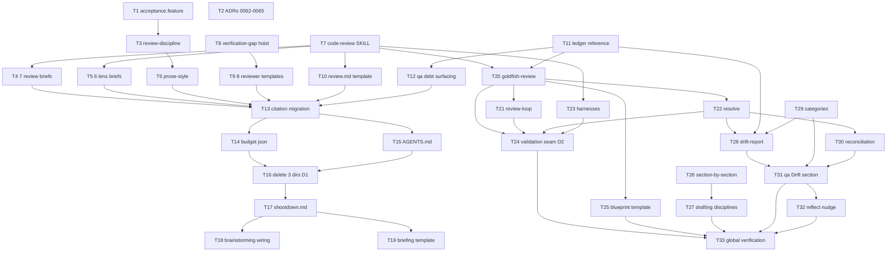

# EGM Goldfish — Tasks

> **STATUS:** `in-progress` (2026-11-12)

> Sliced from `blueprint.md` (per `skillgrid:slicing`). One ticket per blueprint
> task (33 tasks = 33 tickets, the repo's 1:1 precedent). Full ticket scope,
> steps, verification commands, and commit messages live in the blueprint's task
> sections — this file orders them.

## Epic Summary

Port the Elephant-Goldfish Model onto skillgrid as five tracks, all prose/JSON
skill artifacts (no Go): Track A — 6-lens fresh-context brainstorm shootdown;
Track B — 5-stage fresh-context Goldfish plan review (reference set inside
`writing-blueprints`); Track C — section-by-section drafting + 8 disciplines;
Track D — `qa` drift mode (advisory); Track E — merge `requesting-code-review` +
`parallel-code-review` into `code-review`, demote `review-ledger` to
`_shared/craft/review-ledger.md`. Tracer thread: shared EGM infrastructure + the
merged `code-review` skill (TICKET-03..16); full track (A) lands next; B, C, D
expand.

## Delivery Strategy

| Field | Value |
|-------|-------|
| Estimated changed lines | ~3000-4000 (33 prose tasks; new files ~25 + edits ~25) |
| 400-line budget risk | High |
| Chained PRs recommended | No |
| Suggested split | single change, sequential commits on release/2 (serial development, no PR workflow — repo ship pattern option 3) |
| Delivery strategy | exception-ok (user "execute" 2026-11-12 is the size:exception approval) |
| Chain strategy | size:exception |

Decision needed before apply: No
Chained PRs recommended: No
Chain strategy: size:exception
400-line budget risk: High

### Suggested Work Units

| Unit | Goal | Commits | Focused check | Rollback boundary |
|---|---|---|---|---|
| W1 (spec zone) | acceptance.feature + ADRs 0062-0065 | T1, T2 | scenario count == 43; ADR rows in ASSUMPTIONS | spec-zone commits revert |
| W2 (shared infra + code-review) | review-discipline, 13 persona briefs, code-review skill + templates, verification-gap hoist, ledger reference, qa debt surfacing | T3-T12 | per-task blueprint verify commands | per-task commits revert |
| W3 (cutover) | ~25 citation migrations, budget json, AGENTS.md, 3-dir deletion | T13-T16 | grep-zero deleted names; `git status --porcelain` D count | T16 revert (one-way D1 — approved by execute) |
| W4 (tracks A + B + D) | shootdown, goldfish reference set, section-by-section, qa drift refs | T17-T23, T26, T28-T30 | per-task verify commands | per-task commits revert |
| W5 (wiring) | writing-blueprints SKILL seam + template, qa Drift section, reflect nudge | T24, T25, T27, T31, T32 | per-task verify commands; qa size budget | per-task commits revert |
| W6 (global) | verification pass + Verification section | T33 | all 8 verify steps; go build/test green | report commit reverts |

## Wave 1 — spec zone (T1-T2)

- [ ] TICKET-01 (backlog: task-116.01) — acceptance.feature: 43 scenarios materialized from the briefing's `Acceptance scenario:` lines — Task 1. *(spec zone; commit before code zone.)*
- [ ] TICKET-02 (backlog: task-116.02) — ADRs 0062-0065 + ASSUMPTIONS LOCKED rows (0063 supersedes 0054; stale 0050-EGM note cleaned) — Task 2. *(spec zone.)*

## Wave 2 — shared infrastructure + merged code-review skill (T3-T12)

- [ ] TICKET-03 (backlog: task-116.03) — `_shared/craft/review-discipline.md` (anti-sycophancy + banned-vocabulary single home, R5/R12) — Task 3.
- [ ] TICKET-04 (backlog: task-116.04) — 7 review persona briefs in `_shared/elephant-goldfish/` (R11/R37) — Task 4.
- [ ] TICKET-05 (backlog: task-116.05) — 6 BRAINSTORM lens briefs in `_shared/elephant-goldfish/` (R1/R11) — Task 5.
- [ ] TICKET-06 (backlog: task-116.06) — prose-style No-flattery rule (cites review-discipline, R12) — Task 6.
- [ ] TICKET-07 (backlog: task-116.07) — `code-review/SKILL.md`: topology step + shared protocol (Blindness Contract once, six-value verdict table once, resilience rule) + dispatch + output contract (R39) — Task 7. *(one-way D1 start.)*
- [ ] TICKET-08 (backlog: task-116.08) — verification-gap canon hoisted to `_shared/verification/verification-gap.md` + interim pointer (R42) — Task 8.
- [ ] TICKET-09 (backlog: task-116.09) — 8 `code-review/reviewers/` templates (security merged per R40; gap canon cited) — Task 9.
- [ ] TICKET-10 (backlog: task-116.10) — `code-review/templates/review.md` output contract carried byte-structurally (R39) — Task 10.
- [ ] TICKET-11 (backlog: task-116.11) — `review-ledger` demoted to `_shared/craft/review-ledger.md` (R41) — Task 11. *(one-way D3.)*
- [ ] TICKET-12 (backlog: task-116.12) — qa surfaces review debt (Step 5 moved in) + routing to code-review + R17 parked-finding line (R42/R17) — Task 12.

## Wave 3 — citation cutover (T13-T16)

- [ ] TICKET-13 (backlog: task-116.13) — citation migration: ~15 skill sites + 14 docs/projectwiki sites + audit-procedure + receiving-code-review; delete T8's interim pointer (R43) — Task 13.
- [ ] TICKET-14 (backlog: task-116.14) — `skill-size-budget.json`: drop 2 names, add `code-review` (R43) — Task 14.
- [ ] TICKET-15 (backlog: task-116.15) — AGENTS.md workflow line: `requesting-code-review` -> `code-review` (R43) — Task 15.
- [ ] TICKET-16 (backlog: task-116.16) — delete `requesting-code-review/`, `parallel-code-review/`, `review-ledger/` (R43) — Task 16. *(one-way D1: precondition = zero live citations outside the 3 dirs; approved by user "execute" 2026-11-12.)*

## Wave 4 — tracks A, B, D reference sets (T17-T23, T26, T28-T30)

- [ ] TICKET-17 (backlog: task-116.17) — `brainstorming/references/shootdown.md`: 6-lens dispatch, freshness STOP rule, synthesis + blocker gate (R1-R3/R36/R37) — Task 17.
- [ ] TICKET-18 (backlog: task-116.18) — brainstorming SKILL + paths: shootdown wiring + Anti-Sycophancy section (R2/R5) — Task 18.
- [ ] TICKET-19 (backlog: task-116.19) — brainstorming `templates/briefing.md`: `## Shootdown Findings` + disposition gate (R3/R4) — Task 19.
- [ ] TICKET-20 (backlog: task-116.20) — `writing-blueprints/references/goldfish-review.md`: 5-stage pipeline + 4 presets + dispatch + record boundary + report artifacts (R6-R8/R13/R36/R37) — Task 20.
- [ ] TICKET-21 (backlog: task-116.21) — `references/goldfish-review-loop.md`: sharpening loop, 2-clean-round convergence, cap 5, settled/fixed, churn, turn-taking (R9) — Task 21.
- [ ] TICKET-22 (backlog: task-116.22) — `references/goldfish-resolve.md`: Elephant-side 4 actions + 4 rules + interactive gate + parking (R10/R17) — Task 22.
- [ ] TICKET-23 (backlog: task-116.23) — `references/harnesses.md`: R36 STOP rule + 4-harness portability table (R36/R38) — Task 23.
- [ ] TICKET-26 (backlog: task-116.26) — `references/section-by-section.md`: ingestion, section order, per-section/per-task gates, spec reconciliation, 8 disciplines (R18-R25) — Task 26.
- [ ] TICKET-28 (backlog: task-116.28) — `qa/references/drift-report.md`: drift workflow (R26-R31/R33) — Task 28.
- [ ] TICKET-29 (backlog: task-116.29) — `qa/references/divergence-categories.md`: 4 categories + heuristics (R27) — Task 29.
- [ ] TICKET-30 (backlog: task-116.30) — `qa/references/reconciliation.md`: two paths + dispositions + ledger mapping (R32) — Task 30.

## Wave 5 — wiring (T24, T25, T27, T31, T32)

- [ ] TICKET-24 (backlog: task-116.24) — replace `plan-review.md` with the goldfish validation seam in writing-blueprints SKILL (R6/R14/R15) — Task 24. *(one-way D2: seam = 5-stage fresh-context pipeline.)*
- [ ] TICKET-25 (backlog: task-116.25) — `templates/blueprint.md`: `## Review Summary` block + Self-Review reminder comment (R13/R14) — Task 25.
- [ ] TICKET-27 (backlog: task-116.27) — writing-blueprints SKILL drafting disciplines: ingestion step, section-by-section, spec reconciliation, owner-decides-architecture, alternatives, Tone & Discipline, artifact-first (R18/R19/R21-R25) — Task 27.
- [ ] TICKET-31 (backlog: task-116.31) — qa SKILL `## Drift mode (advisory)` section <40 lines (R26/R35) — Task 31.
- [ ] TICKET-32 (backlog: task-116.32) — reflect SKILL Drift Check advisory gate item (R34) — Task 32.

## Wave 6 — global verification (T33)

- [ ] TICKET-33 (backlog: task-116.33) — global verification: zero citations, link resolution, persona shape, single-home, size budgets, BDD parity, ADR rows, docs-only proof, `go build`/`go test` green; append `## Verification` to blueprint — Task 33.

## Dependency Graph

## Execution Order (waves)

1. **W1** (spec zone, parallel-safe): TICKET-01, TICKET-02.
2. **W2** (5 parallel worktrees, disjoint files): {03, 06} / {07, 10} / {08, 11} / {09} / {04, 05}.
3. **W3** (2 parallel worktrees): {12} / {13, 14, 15}; then TICKET-16 sequential (one-way D1; precondition grep-zero).
4. **W4** (3 parallel worktrees, disjoint files): {17, 18, 19} / {20, 21, 22, 23, 26} / {28, 29, 30}.
5. **W5** (2 parallel worktrees): {24, 25, 27} (after W4's writing-blueprints refs) / {31, 32} (after W4's qa refs).
6. **W6**: TICKET-33 (parent verifies; appends `## Verification` to blueprint).

One-way doors (approved by user "execute" 2026-11-12): D1 = TICKET-16 (3-dir
deletion), D2 = TICKET-24 (plan-review.md replaced by the 5-stage pipeline),
D3 = TICKET-11 (review-ledger demoted; `skillgrid:review-ledger` invocation form
gone).

## Traceability (SATISFIES)

### TICKET-01
**SATISFIES:** all 43 scenarios (the BDD surface for TICKET-03..33)

### TICKET-02
**SATISFIES:** structural (Must-Have truth 13 — verified in TICKET-33 Step 6)

### TICKET-03
**SATISFIES:** happy path anti-sycophancy-rules (rules-home half)

### TICKET-04
**SATISFIES:** happy path persona-briefs-present

### TICKET-05
**SATISFIES:** happy path six-lens-shootdown (persona-shape half)

### TICKET-06
**SATISFIES:** happy path review-discipline-cited (prose-style half)

### TICKET-07
**SATISFIES:** happy path code-review-topology

### TICKET-08
**SATISFIES:** happy path qa-debt-surfacing (canon-home half)

### TICKET-09
**SATISFIES:** happy path security-template-merge

### TICKET-10
**SATISFIES:** happy path code-review-topology (output-contract half)

### TICKET-11
**SATISFIES:** happy path ledger-as-reference

### TICKET-12
**SATISFIES:** happy path qa-debt-surfacing

### TICKET-13
**SATISFIES:** happy path code-review-topology (cutover half); happy path review-consolidation-cutover

### TICKET-14
**SATISFIES:** happy path review-consolidation-cutover (budget half)

### TICKET-15
**SATISFIES:** happy path review-consolidation-cutover

### TICKET-16
**SATISFIES:** happy path ledger-as-reference; happy path review-consolidation-cutover (deletion half)

### TICKET-17
**SATISFIES:** happy path six-lens-shootdown; happy path shootdown-path-scope; happy path blocker-disposition-gate

### TICKET-18
**SATISFIES:** happy path anti-sycophancy-rules; happy path shootdown-path-scope (wiring half)

### TICKET-19
**SATISFIES:** happy path shootdown-findings-in-briefing

### TICKET-20
**SATISFIES:** happy path goldfish-review-reference-set; happy path five-stage-pipeline; happy path four-presets

### TICKET-21
**SATISFIES:** happy path sharpening-loop-convergence

### TICKET-22
**SATISFIES:** happy path elephant-resolution; happy path parked-finding-surfaced-at-qa (parking half)

### TICKET-23
**SATISFIES:** happy path harness-portability; happy path no-subagent-stop (shared-rule half)

### TICKET-24
**SATISFIES:** happy path writing-blueprints-invokes-goldfish-review; happy path goldfish-review-reference-set (seam half)

### TICKET-25
**SATISFIES:** happy path review-artifacts-committed (report-path half)

### TICKET-26
**SATISFIES:** happy path ingestion-confirmation; happy path section-by-section-drafting; happy path per-task-gate; happy path spec-reconciliation; happy path artifact-first-delivery

### TICKET-27
**SATISFIES:** happy path ingestion-confirmation; happy path section-by-section-drafting; happy path spec-reconciliation; happy path owner-decides-architecture; happy path alternatives-from-briefing; happy path drafting-anti-sycophancy; happy path artifact-first-delivery

### TICKET-28
**SATISFIES:** happy path drift-report-skill; happy path target-artifacts; happy path sequential-source-grounding; happy path difference-filtering; happy path drift-report-artifact; happy path drift-reuses-resolution; happy path no-subagent-stop (drift half)

### TICKET-29
**SATISFIES:** happy path four-divergence-categories

### TICKET-30
**SATISFIES:** happy path two-way-reconciliation

### TICKET-31
**SATISFIES:** happy path drift-skill-size; happy path drift-report-skill (SKILL-surface half)

### TICKET-32
**SATISFIES:** happy path reflect-drift-check

### TICKET-33
**SATISFIES:** all remaining structural scenarios (zero-citation, single-home, size-budget, ADR-row, docs-only checks)

## Exit criteria

- All 14 Must-Have truths green (TICKET-33 verification pass); QA gate; two-axis
  review; ship.
