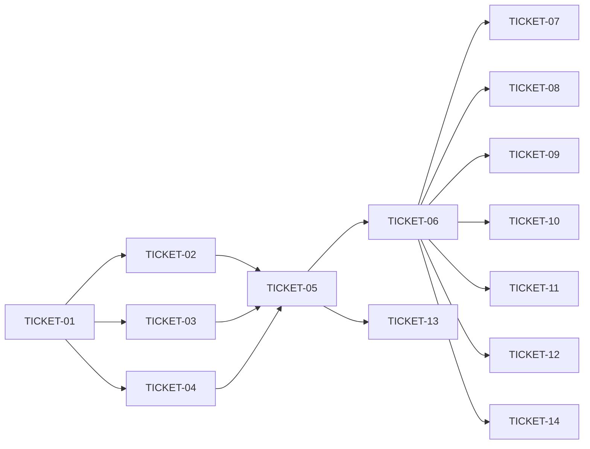

# Tasks — Obsidian Backlog.md Board plugin

> **STATUS:** `sliced` (2026-11-12)

> Sliced from `.skillgrid/change-specs/2026-11-12-obsidian-backlogmd-plugin/blueprint.md`.
> Vertical tracer-bullet tickets, dependency-ordered, sized for one fresh agent context window.

## Epic Summary

Ship an Obsidian plugin under `plugins/obsidian/backlogmd/` that renders backlog.md task files as a kanban board + backlog list and persists create/edit/move operations to frontmatter, honoring a configurable backlog directory. BoardMD-parity UX, no generated sidecars, desktop-only.

## Delivery Strategy

| Field | Value |
|-------|-------|
| Estimated changed lines | ~2500-3500 |
| 400-line budget risk | High |
| Chained PRs recommended | Yes |
| Suggested split | PR 1 scaffold+domain → PR 2 infra+app → PR 3 UI → PR 4 pull+settings |
| Delivery strategy | ask-on-risk |
| Chain strategy | pending |

Decision needed before apply: Yes
Chained PRs recommended: Yes
Chain strategy: pending
400-line budget risk: High

### Suggested Work Units

| Unit | Goal | Likely PR | Focused test command | Runtime harness | Rollback boundary |
|------|------|-----------|----------------------|-----------------|-------------------|
| 1 | Scaffold + domain model + frontmatter adapter (door check) | PR 1 | `npm test` (vitest) | N/A (pure unit tests) | delete plugins/obsidian/backlogmd/ |
| 2 | Config discovery + application commands | PR 2 | `npm test` | N/A | revert PR 2 |
| 3 | Kanban + backlog views + modals | PR 3 | `npm run build` + manual smoke | Obsidian desktop vault | revert PR 3 |
| 4 | Watcher + settings + milestones + GitHub pull | PR 4 | `npm run build` | Obsidian desktop vault | revert PR 4 |

## Tickets

### TICKET-01 — Scaffold plugin project

- **Tracker ID:** TASK-121
- **Scope:** Create the TypeScript Obsidian plugin skeleton (package.json, tsconfig, esbuild, manifest, main.ts) with a build that produces main.js.
- **Acceptance:** `npm install && npm run build` produces main.js with no type errors.
- **SATISFIES:** (scaffolding — no scenario)
- **Files:** package.json, tsconfig.json, esbuild.config.mjs, manifest.json, versions.json, styles.css, src/main.ts
- **Size:** ~200 (S)
- **Blocks:** TICKET-02
- **Blocked by:** none

### TICKET-02 — Domain: Task model and pure rules

- **Tracker ID:** TASK-122
- **Scope:** Implement Task interface, isDone, isBlocked in src/domain with unit tests.
- **Acceptance:** vitest passes; isBlocked true iff a dependency is not in a done status.
- **SATISFIES:** task-model
- **Files:** src/domain/task.ts, src/domain/status.ts, tests/domain/task.test.ts
- **Size:** ~150 (S)
- **Blocks:** TICKET-03, TICKET-05
- **Blocked by:** TICKET-01

### TICKET-03 — Infrastructure: frontmatter vault adapter (door check)

- **Tracker ID:** TASK-123
- **Scope:** Implement parseTask/serializeTask/updateFrontmatter with gray-matter; byte-stable round-trip test.
- **Acceptance:** round-trip test passes (body byte-identical, only edited field changes). If not, stop and switch serializer.
- **SATISFIES:** frontmatter-roundtrip
- **Files:** src/infrastructure/vault.ts, tests/infrastructure/vault.test.ts
- **Size:** ~250 (S)
- **Blocks:** TICKET-05
- **Blocked by:** TICKET-01

### TICKET-04 — Infrastructure: config loader + project discovery

- **Tracker ID:** TASK-124
- **Scope:** Implement ProjectConfig and discoverProjects honoring backlog_directory.
- **Acceptance:** discovers folders with config; honors backlog_directory; merges/dedupes manual roots.
- **SATISFIES:** project-discovery-from-scan, project-discovery-manual-root, project-discovery-dedupe, honors-backlog-directory
- **Files:** src/infrastructure/config.ts, src/application/ports.ts
- **Size:** ~250 (S)
- **Blocks:** TICKET-05
- **Blocked by:** TICKET-01

### TICKET-05 — Application: commands and queries

- **Tracker ID:** TASK-125
- **Scope:** Implement listTasks, moveTask, createTask, editTask, linkTasks over ports.
- **Acceptance:** vitest passes for moveTask and linkTasks; commands delegate to ports.
- **SATISFIES:** move-task, create-task, edit-task, link-tasks, bidirectional-link-add, bidirectional-link-remove, blocked-icon
- **Files:** src/application/*.ts, tests/application/move-task.test.ts
- **Size:** ~400 (M)
- **Blocks:** TICKET-06
- **Blocked by:** TICKET-02, TICKET-03, TICKET-04

### TICKET-06 — Composition root

- **Tracker ID:** TASK-126
- **Scope:** Wire layers in compose.ts; attach to plugin onload; register views/commands/settings.
- **Acceptance:** build passes; plugin loads in Obsidian without errors.
- **SATISFIES:** (wiring — no scenario)
- **Files:** src/compose.ts, src/main.ts
- **Size:** ~150 (S)
- **Blocks:** TICKET-07, TICKET-08
- **Blocked by:** TICKET-05

### TICKET-07 — UI: Kanban board view

- **Tracker ID:** TASK-127
- **Scope:** Implement KanbanView with columns per status, cards, blocked icon, drag-and-drop calling moveTask.
- **Acceptance:** board renders columns; drag updates status file and re-renders.
- **SATISFIES:** kanban-columns-from-statuses, kanban-card-in-status-column, drag-move-updates-status, cmd-click-opens-note
- **Files:** src/ui/kanban-view.ts, src/main.ts
- **Size:** ~400 (M)
- **Blocks:** none
- **Blocked by:** TICKET-06

### TICKET-08 — UI: Backlog list view

- **Tracker ID:** TASK-128
- **Scope:** Implement BacklogView with filter box and create button.
- **Acceptance:** filtering narrows list live; clearing restores all.
- **SATISFIES:** backlog-list-filter
- **Files:** src/ui/backlog-view.ts
- **Size:** ~250 (S)
- **Blocks:** none
- **Blocked by:** TICKET-06

### TICKET-09 — UI: Task create/edit modal

- **Tracker ID:** TASK-129
- **Scope:** Implement TaskModal with summary-required validation, dropdowns, type-ahead pickers, autosave.
- **Acceptance:** create requires summary; edit persists; modal reports saved.
- **SATISFIES:** create-task-requires-summary, create-task-writes-file, edit-task-autosave
- **Files:** src/ui/task-modal.ts
- **Size:** ~400 (M)
- **Blocks:** none
- **Blocked by:** TICKET-06

### TICKET-10 — File watcher refresh

- **Tracker ID:** TASK-130
- **Scope:** Implement debounced file watcher triggering view re-render.
- **Acceptance:** external edit refreshes board within 1s.
- **SATISFIES:** watcher-refresh-on-external-edit
- **Files:** src/infrastructure/watcher.ts, src/compose.ts
- **Size:** ~150 (S)
- **Blocks:** none
- **Blocked by:** TICKET-06

### TICKET-11 — Settings tab

- **Tracker ID:** TASK-131
- **Scope:** Implement declarative settings tab (roots, active project, workflow, repo link+token, render toggle).
- **Acceptance:** settings persist in data.json; token in secret storage.
- **SATISFIES:** settings-persist, token-in-secret-storage
- **Files:** src/settings/settings-tab.ts, src/main.ts
- **Size:** ~300 (M)
- **Blocks:** none
- **Blocked by:** TICKET-06

### TICKET-12 — Milestones view

- **Tracker ID:** TASK-132
- **Scope:** Implement milestone grouping/filtering; load from milestones/.
- **Acceptance:** tasks filter by milestone; milestones listed.
- **SATISFIES:** milestone-filter, milestone-list-loads
- **Files:** src/ui/milestone-view.ts (or backlog-view extension)
- **Size:** ~200 (S)
- **Blocks:** none
- **Blocked by:** TICKET-06

### TICKET-13 — GitHub/GitLab pull

- **Tracker ID:** TASK-133
- **Scope:** Implement client + pullIssues command; descriptions code-blocked by default.
- **Acceptance:** first pull creates tasks with source; second pull syncs title/assignee/state only.
- **SATISFIES:** github-pull-creates-tasks, github-pull-syncs-without-overwrite, github-pull-descriptions-code-blocked
- **Files:** src/infrastructure/github.ts, src/application/pull-issues.ts
- **Size:** ~400 (M)
- **Blocks:** none
- **Blocked by:** TICKET-05

### TICKET-14 — Project switcher + note header button

- **Tracker ID:** TASK-134
- **Scope:** Implement project switcher dropdown and "Edit task" header button on notes.
- **Acceptance:** switcher changes active project; header button opens edit modal.
- **SATISFIES:** commands-registered, cmd-click-opens-note
- **Files:** src/ui/project-switcher.ts, src/main.ts
- **Size:** ~200 (S)
- **Blocks:** none
- **Blocked by:** TICKET-06

## Dependency Graph

## Execution Order

- **Wave 1:** TICKET-01
- **Wave 2 (parallel):** TICKET-02, TICKET-03, TICKET-04
- **Wave 3:** TICKET-05
- **Wave 4:** TICKET-06
- **Wave 5 (parallel):** TICKET-07, TICKET-08, TICKET-09, TICKET-10, TICKET-11, TICKET-12, TICKET-13, TICKET-14

> **Acceptance-first (BDD is always on):** a ticket's failing acceptance scenario (its SATISFIES scenario) is written and confirmed RED before the implementation that makes it green. Order RED-test / scenario tickets ahead of their implementation tickets in the dependency graph.

## Slicing Notes

- TICKET-01 is the door check for the whole plugin (build pipeline).
- TICKET-03 is the door check for frontmatter stability (stop if round-trip fails).
- High 400-line risk → chained PRs recommended; user decides chain strategy before apply.
- No tracker tickets published yet — ticketing step will publish or record local-only waiver.
