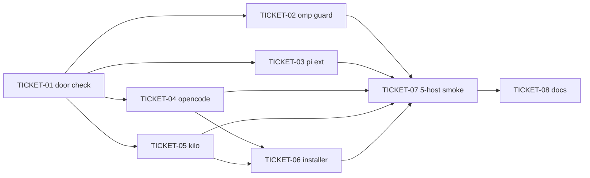

# Tasks — Skillgrid host plugins (router auto-load at session start)

> **STATUS:** `shipped` (2026-11-22; code-review round 1 PASS, 13 fixed / 13 parked; GO ship, keep release/2 as-is)

> Sliced from `.skillgrid/change-specs/2026-11-17-skillgrid-host-plugins/blueprint.md` (validated candidate b12cd7d1, goldfish round 1 PASS).
> Vertical tracer-bullet tickets, dependency-ordered, sized for one fresh agent context window.

## Epic Summary

- **Tracker ID:** t_b2626ffe (hermes-kanban epic, parked - unblock at wave start)

Deterministically auto-load the skillgrid router in every new session of the five agent hosts (omp, pi, opencode, Kilo Code, Cursor): one shared ~15-line bootstrap asset injected by each host's native session-start mechanism (omp keeps the shipped full-content hook), project-conditional, main-agent-only, fail-open, distributed by the existing installer. Tracer thread: ticket 1 is the thinnest end-to-end proof (bootstrap asset + cursor hook, the door check) before the remaining hosts stack on.

## Delivery Strategy

| Field | Value |
|-------|-------|
| Estimated changed lines | 1000-1400 (8 tickets, tests included) |
| 400-line budget risk | High |
| Chained PRs recommended | Yes |
| Suggested split | PR 1 (T1) -> PR 2 (T2) -> PR 3 (T3+T4+T5) -> PR 4 (T6) -> PR 5 (T7+T8) |
| Delivery strategy | ask-on-risk |
| Chain strategy | stacked-to-main (user-approved at the slice gate 2026-11-19) |

Decision needed before apply: No
Chained PRs recommended: Yes
Chain strategy: stacked-to-main
400-line budget risk: High

### Suggested Work Units

| Unit | Goal | Likely PR | Focused test command | Runtime harness | Rollback boundary |
|------|------|-----------|----------------------|-----------------|-------------------|
| 1 | bootstrap asset + cursor hook (door check) | PR 1 | `printf '{"cwd":"/tmp"}' \| hooks/cursor-session-start.sh` (no bootstrap, exit 0) + fresh cursor session in-repo (bootstrap in first-turn context) | real: fresh cursor sessions in-repo and in /tmp | delete the asset + revert the cursor hook hunk |
| 2 | omp session-start cwd guard + child-session probe | PR 2 | `go test ./...` (stays green) + fresh omp session (full router in first-turn context; absent in /tmp) | real: fresh omp sessions in-repo and in /tmp | revert the session-start.js guard hunk |
| 3 | pi + opencode + kilo router mechanisms | PR 3 | per-host node tests + fresh sessions per host (bootstrap present in-repo, absent in /tmp) | real: fresh pi/opencode/kilo sessions in-repo and in /tmp | delete the three mechanism files |
| 4 | installer distribution (router files + bootstrap step + sync refresh) | PR 4 | `go test ./skillgrid-cli/internal/install/` (new router-distribution tests) | N/A - Go dry-run tests are the harness (installer writes to ~/.skillgrid home copies) | revert the install-package diff |
| 5 | 5-host live smoke + docs | PR 5 | Task 7 smoke script (both clauses, all five hosts, positive + negative) | real: fresh sessions of all five hosts | delete the evidence file + revert the three docs files |

> The four plain-text guard lines above are the **contract** — `skillgrid:subagent-execution` matches them literally.

## Tickets

### TICKET-01 
- **Tracker ID:** t_06bb0c13 (hermes-kanban board skillgrid)
- bootstrap asset + cursor hook (door check)

- **Scope:** create the shared bootstrap asset at `.agents/skills/_shared/agent-config/router-bootstrap.md` (project notice, first-action line, request-class list, announce line, `{load_hint}` variants table - no project-specific content) and extend `hooks/cursor-session-start.sh` to prepend the bootstrap to `additional_context` before the mnemonic-server block (cwd already parsed from stdin JSON); live asset resolution `~/.skillgrid/router-bootstrap.md` -> repo clone -> static fallback; project-conditional + fail-open + subagent-skip in the hook
- **Acceptance:** asset file matches the Design contract line set (read-back check); `printf '{"cwd":"/tmp"}' | hooks/cursor-session-start.sh` emits no bootstrap and exits 0; fresh cursor session in this repo: bootstrap in first-turn context + first assistant turn announces the router or reads it first; fresh cursor session in /tmp: no injection; mnemonic server stopped: injection still holds; hook made to fail: session starts, no error surfaced; installed-copy vs checkout-asset marker test: installed copy wins; both missing: static fallback present
- **SATISFIES:**
  - happy path - a one-line edit to the bootstrap asset reaches the next session without reinstall
  - happy path - a cursor session start injects the router bootstrap even with the memory server down
  - happy path - a skillgrid project session receives the bootstrap
  - edge - a non-skillgrid directory session receives nothing
  - edge - the installed bootstrap copy takes precedence over the checkout asset
  - edge - hosts without a tool-mapping file get the plain first-action hint
  - failure - the bootstrap asset is missing at session start
  - failure - a session-start hook failure never blocks session start
  - failure - neither the installed copy nor the checkout asset is resolvable
  - failure - the cursor session-start hook is absent
  - happy path - hosts with a tool-mapping file get the mapping hint
- **Files:** `.agents/skills/_shared/agent-config/router-bootstrap.md` (new), `hooks/cursor-session-start.sh`, `review/smoke-evidence.md` (door-check excerpts)
- **Size:** ~60 (S)
- **Blocks:** TICKET-02, TICKET-03, TICKET-04, TICKET-05
- **Blocked by:** none
- **Reversibility:** reversible
- **Fails-when:** cursor session in-repo first-turn context lacks the bootstrap; /tmp session shows it; hook prints an error to the user; non-zero exit from the hook on /tmp cwd; live edit of the asset does not appear in the next session
- **Gate:** DOOR CHECK (blueprint) - if the cursor fresh session lacks the bootstrap or the hook breaks the session, STOP and re-verify the cursor hook mechanism before TICKET-02..05

### TICKET-02 
- **Tracker ID:** t_ff99e0ec (hermes-kanban board skillgrid)
- omp session-start cwd guard + child-session probe

- **Scope:** add the project-conditional cwd guard to the shipped `session-start.js` (`.skillgrid/config.yaml` at or above cwd; fail-open) so the full-content router injection fires only in skillgrid projects; run the child-session probe to fix the subagent behavior (observable: does a child/omp-spawned session receive the hook output); no new extension on omp (OQ2)
- **Acceptance:** `go test ./...` + build stay green (no Go touched); fresh omp session in this repo: full router content in first-turn context + announce/router-read on turn 1; fresh omp session in /tmp: no injection; child-session probe result recorded (subagent receives or not - the R3 observable); unreadable config: no injection, session starts
- **SATISFIES:**
  - happy path - an omp session start injects the full router content
  - edge - a subagent session skips the bootstrap
  - failure - an unreadable skillgrid configuration is treated as no project
- **Files:** `plugins/omp/.../session-start.js` (the shipped hook), `review/smoke-evidence.md` (probe result)
- **Size:** ~60 (S)
- **Blocks:** TICKET-07
- **Blocked by:** TICKET-01
- **Precondition:** TICKET-01 door check passed (cursor fresh session in-repo carries the bootstrap)
- **Reversibility:** reversible
- **Fails-when:** full router absent from the in-repo omp first-turn context; present in /tmp; guard change breaks the existing hook behavior (session-start output missing even in-project)

### TICKET-03 
- **Tracker ID:** t_1c83411b (hermes-kanban board skillgrid)
- pi project extension

- **Scope:** new committed repo file `.pi/extensions/skillgrid-router.ts` - extension factory (`export default function (pi: ExtensionAPI)`), `before_agent_start` appends the bootstrap section (live asset read per the resolution order, main-agent guard `ctx.agent.kind === "main"`, project-conditional)
- **Acceptance:** node test green (main agent in-project: bootstrap appended exactly once; subagent: unchanged; non-project cwd: unchanged; missing asset: static fallback); fresh pi session in this trusted repo: bootstrap in first-turn system context + announce/router-read on turn 1; non-skillgrid dir: no injection
- **SATISFIES:**
  - happy path - a pi session start injects the router bootstrap
  - edge - a non-skillgrid directory session receives nothing
  - failure - a tool-mapping reference file is missing at session start
- **Files:** `.pi/extensions/skillgrid-router.ts` (new), `review/smoke-evidence.md` (pi excerpt)
- **Size:** ~130 (S)
- **Blocks:** TICKET-07
- **Blocked by:** TICKET-01
- **Reversibility:** reversible
- **Fails-when:** bootstrap absent from the pi in-repo first-turn system context; present in non-project cwd; subagent context gains the bootstrap

### TICKET-04 
- **Tracker ID:** t_7df6b1f4 (hermes-kanban board skillgrid)
- opencode router module (V2 + V1 dual export)

- **Scope:** new opencode plugin module (tree re-created: `plugins/opencode/` was emptied by d5148778) - V2 entry: bootstrap as the `<context key="skillgrid-router">` entry; V1 dual export retained for 1.x users (day-one dual-export precedent); live asset resolution, project-conditional, main-agent only, fail-open
- **Acceptance:** node test green (V2: context entry present in-project, absent non-project; V1 export: loadable, same guards); fresh opencode session in this repo: router bootstrap entry in first-turn context + announce/router-read on turn 1; non-skillgrid dir: no injection
- **SATISFIES:**
  - happy path - an opencode session start injects the router bootstrap
- **Files:** `plugins/opencode/skillgrid-router.ts` (new; V1 + V2 exports), `review/smoke-evidence.md` (opencode excerpt)
- **Size:** ~240 (S/M)
- **Blocks:** TICKET-06, TICKET-07
- **Blocked by:** TICKET-01
- **Reversibility:** reversible
- **Fails-when:** router bootstrap entry absent from the opencode in-repo first-turn context; present in non-project cwd; V1 export fails to load

### TICKET-05 
- **Tracker ID:** t_4289b3e1 (hermes-kanban board skillgrid)
- kilo router plugin

- **Scope:** new `plugins/kilo/skillgrid-router.ts` mirroring the proven `~/.config/kilo/plugin/superpowers.js` pattern: `config` hook pushes the repo `.agents/skills` dir into `config.skills.paths`; `experimental.chat.messages.transform` injects the bootstrap into the first user message (present-guard: skip if already present; skip subagent); live asset resolution, project-conditional, fail-open
- **Acceptance:** `node --experimental-strip-types plugins/kilo/skillgrid-router.test.ts` green (first user message + project cwd + main agent: first-action line exactly once; second transform: no-op; subagent: unchanged; non-project: unchanged; missing asset: static fallback); fresh kilo session in this repo: bootstrap in first user message + skills path added + announce/router-read on turn 1; non-skillgrid dir: no injection
- **SATISFIES:**
  - happy path - a kilo session start injects the router bootstrap
- **Files:** `plugins/kilo/skillgrid-router.ts` (new), `plugins/kilo/skillgrid-router.test.ts` (new), `review/smoke-evidence.md` (kilo excerpt)
- **Size:** ~180 (S)
- **Blocks:** TICKET-06, TICKET-07
- **Blocked by:** TICKET-01
- **Reversibility:** reversible
- **Fails-when:** bootstrap absent from the kilo first user message in-project; duplicated after a second transform; subagent message modified; skills path not added

### TICKET-06 
- **Tracker ID:** t_9148c39d (hermes-kanban board skillgrid)
- installer distribution (router files + bootstrap step + sync refresh)

- **Scope:** installer gains the router distribution: `routerPluginRel` standalone constant (NOT folded into `nativePluginBases` - ADR-0067 reworks that copy set, this step must survive independently) + per-agent copy-set entries for opencode/kilo; host-agnostic `syncRouterBootstrap(c)` in hooktree.go (asset -> `~/.skillgrid/router-bootstrap.md`, existing copyFile, unconditional overwrite) wired into `Run` (after `syncMirrorDirs`) and `Config.SyncRepo`; dry-run/verbose parity; tree creation idempotent (create-if-missing)
- **Acceptance:** new Go tests green in the existing per-agent dry-run style: `--agents omp` -> settings hooks block (existing, asserted) + bootstrap copy; `--agents opencode` / `--agents kilo` -> router `.ts` file copied; every host key -> bootstrap copied; unknown key -> error naming the key, no files modified; unchanged re-run -> installed copy byte-identical; `sync-repo` with edited clone asset -> target file changes
- **SATISFIES:**
  - happy path - installing a host key distributes that host's injector files plus the bootstrap
  - happy path - sync-repo refreshes the installed bootstrap from an edited clone asset
  - edge - re-running the installer with unchanged content leaves the installed copy unchanged
  - edge - re-running the installer does not duplicate the injection
  - failure - an unknown agent key errors
- **Files:** `skillgrid-cli/internal/install/agents.go`, `hooktree.go`, `install.go`, `sync.go`, `install_test.go`
- **Size:** ~270 (M)
- **Blocks:** TICKET-07
- **Blocked by:** TICKET-04, TICKET-05
- **Precondition:** the `skill-pi` -> `omp` agent-key rename is committed on this branch (post-rename API: `SetupOmp`, `omp` key, `OMP_AGENT_DIR` - verify with `grep -rn "SetupOmp" skillgrid-cli/internal/install/`)
- **Reversibility:** reversible
- **Fails-when:** any dry-run test fails; unknown key exits 0; re-run rewrites the unchanged installed copy (mtime/bytes differ); sync-repo leaves the installed copy stale

### TICKET-07 
- **Tracker ID:** t_7754f121 (hermes-kanban board skillgrid)
- 5-host live smoke (backstop)

- **Scope:** held-out verification of every `backstop` truth (R2/R3/R4 across the five hosts): install (`skillgrid install --agents omp,opencode,kilo,cursor` post-rename + cursor plugin install + pi project trust), then per host (omp, pi, opencode, kilo, cursor): fresh session in this repo -> clause (a) positive (bootstrap / full router in first-turn context) + clause (b) (announce or router-read on turn 1); fresh session in /tmp -> clause (a) negative (no load, no announce, bootstrap absent); omp: re-confirm the child-session probe result (TICKET-02) - the R3 subagent observable; record transcript excerpts (positive + negative) in `review/smoke-evidence.md`; any host failing -> do not proceed to TICKET-08: fix or park with a ruling
- **Acceptance:** all five hosts pass both clauses in-repo; all five negative in /tmp; subagent-skip observable recorded; `go test ./...` + build + coverage + gofmt green; evidence committed
- **SATISFIES:**
  - happy path - a one-line edit to the bootstrap asset reaches the next session without reinstall (re-asserted live)
  - edge - all four pointer hosts read the identical live asset
  - happy path - a cursor session start injects the router bootstrap even with the memory server down (re-asserted live)
  - happy path - an omp session start injects the full router content (re-asserted live)
  - happy path - a pi session start injects the router bootstrap (re-asserted live)
  - happy path - an opencode session start injects the router bootstrap (re-asserted live)
  - happy path - a kilo session start injects the router bootstrap (re-asserted live)
  - edge - a non-skillgrid directory session receives nothing (all hosts)
  - edge - a subagent session skips the bootstrap (re-confirmed)
- **Files:** `review/smoke-evidence.md` (new)
- **Size:** ~60 evidence (S)
- **Blocks:** TICKET-08
- **Blocked by:** TICKET-02, TICKET-03, TICKET-04, TICKET-05, TICKET-06
- **Reversibility:** reversible
- **Fails-when:** any host's clause (a) positive or negative fails; any host's clause (b) fails; L3 gates red

### TICKET-08 
- **Tracker ID:** t_eb088c0b (hermes-kanban board skillgrid)
- docs (install lines + hook doc + plugins table)

- **Scope:** `README.md` `--agents` example line -> post-rename host key set (`opencode,kilo,cursor,omp`; hermes excluded - not a router host); `docs/user-guide/04-hooks.md` session-start.js entry -> project-conditional guard + fail-open + child-session behavior per the TICKET-02 probe result; `docs/user-guide/11-plugins.md` Skillgrid router per-host table -> pi row (committed project extension, `before_agent_start` append) and omp row (shipped full-content hook, no new extension) aligned with the blueprint's Per-host mechanism table
- **Acceptance:** read-back of all three files: `--agents` keys match `install.AvailableAgents()` post-rename; 11-plugins.md pi/omp rows match the blueprint's Per-host mechanism table; 04-hooks.md describes guard + fail-open + probed child behavior
- **SATISFIES:** - (no scenario; docs accuracy checked against the blueprint's Per-host mechanism table, blueprint Task 8 Step 4)
- **Files:** `README.md`, `docs/user-guide/04-hooks.md`, `docs/user-guide/11-plugins.md`
- **Size:** ~120 (S)
- **Blocks:** none
- **Blocked by:** TICKET-07
- **Reversibility:** reversible
- **Fails-when:** read-back shows a stale row (pre-rename key, stale pi/omp mechanism) or a mismatch with the blueprint table

## Dependency Graph

## Execution Order

- **Wave 1:** TICKET-01 (door check - STOP-and-reverify if it fails)
- **Wave 2 (parallel, separate worktrees per AGENTS.md):** TICKET-02, TICKET-03, TICKET-04, TICKET-05
- **Wave 3:** TICKET-06 (after TICKET-04 + TICKET-05; Precondition: rename commit)
- **Wave 4:** TICKET-07 (after all mechanisms + installer)
- **Wave 5:** TICKET-08

> **Acceptance-first (BDD is always on):** each ticket's `SATISFIES` scenario is confirmed RED before the implementation that turns it green (per-host: mechanism absent -> scenario fails; node/Go tests written first in each ticket's Step 1).

## Slicing Notes

- **1:1 with the validated blueprint** (b12cd7d1, Tasks 1-8) - the blueprint already sliced the work vertically per host; no re-slicing. Ticket titles are ASCII (backlog CLI slugifies into filenames).
- **TICKET-01 is the tracer thread / door check** (blueprint Build shape): the thinnest end-to-end path (host-native mechanism fires -> shared asset -> first-turn context) before the other four hosts stack on.
- **TICKET-06 external prerequisite:** the user's in-flight `skill-pi` -> `omp` rename must be committed before it starts (Precondition, checkable read-only). The ADR-0067 memory change reworks the same trees - `routerPluginRel` is standalone so no conditional remains on that change's internal shape (blueprint Task 6 sequencing decision).
- **No one-way doors:** every ticket is additive file creation + small hook edits; all Reversibility: reversible.
- **SATISFIES coverage:** all 24 acceptance.feature scenarios are referenced by at least one ticket (TICKET-07 re-asserts the per-host scenarios live as the backstop; TICKET-08 is the only ticket with no scenario - docs, checked against the blueprint table).
- **Wave 2 parallelism:** TICKET-02..05 touch disjoint files (shared contract = the bootstrap resolution order fixed by TICKET-01) - safe for parallel worktrees.
