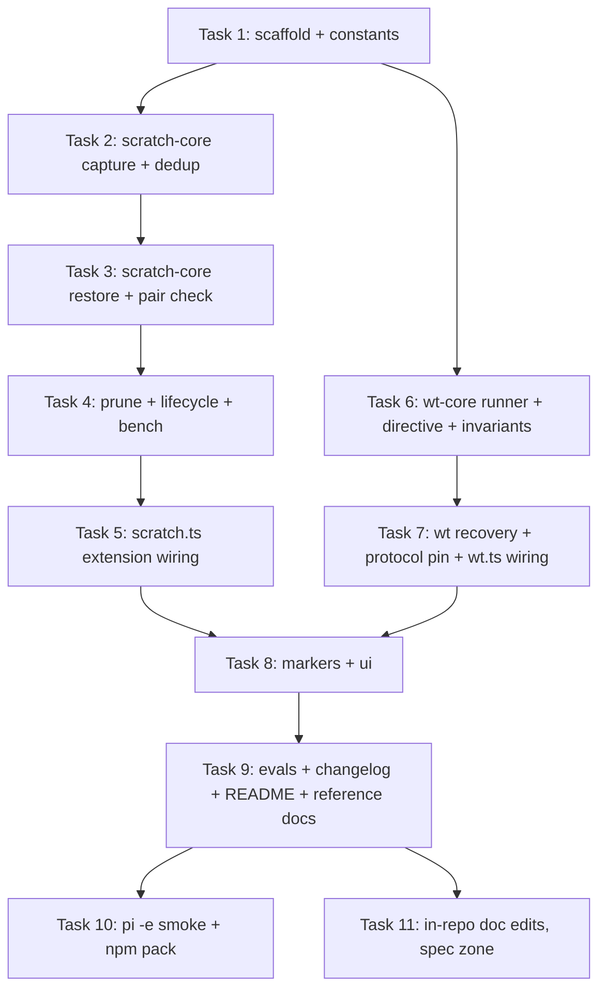

# Goldfish Stage 7 — Critic Review (three fresh subagents, one per brief)

Target: /data/git/AI/skillgrid-skills/.skillgrid/change-specs/2026-11-22-pi-worktree-plugin/blueprint.md
(Note: the file was recently revised — "Goldfish Stage 5/6 R1/R2-F00x" annotations mark already-resolved findings; treat them as part of the document. Do NOT re-raise a settled finding at the same scope: OD-2 worktree-root half (retired), verifyStandardRoot->observeWorktreeRoot, detectForeignMarkerPlugin (removed), generated wt-commands catalog (removed), tsconfig/typescript/statSync (removed), prose-regex drift guard (fence now).)

Persona briefs (read yours first, review strictly in that persona):
- design-critic: /data/git/AI/skillgrid-skills/.agents/skills/_shared/elephant-goldfish/design-critic.md
- structural:     /data/git/AI/skillgrid-skills/.agents/skills/_shared/elephant-goldfish/structural.md
- style: NO brief file exists in this repo — review as: prose/terminology/consistency critic (the blueprint skill's style.md was not authored yet; use the audit vectors: vague phrasing, inconsistent terminology, broken cross-references, duplicated statements that can drift, terminology not matching the Terms section)

Reading list (as needed):
- /data/git/AI/skillgrid-skills/.skillgrid/change-specs/2026-11-22-pi-worktree-plugin/findings.md
- /data/git/AI/skillgrid-skills/.skillgrid/change-specs/2026-11-22-pi-worktree-plugin/briefing.md
- /data/git/AI/skillgrid-skills/.agents/skills/_shared/work-unit-commits/README.md

Isolation contract (R37, re-asserted): 1. fresh context 2. read-only (no edits to the target; you may write ONLY your own report file) 3. no project instructions (this prompt is your entire context) 4. no network/MCP. Harness: omp task subagent — parts 1 & 4 enforced by construction, part 2 by discipline, part 3 by prompt scope; attest in your report header.

Target Standard (for design-critic + structural): the blueprint must be self-contained, consistent with the briefing's R1-R13, and executable task-by-task. Required headers: header block, Terms, Must-Haves, Validation, Threat Matrix, Global Constraints, File Structure, Alternatives, Build Order, Tasks 1-11, Review Summary, Self-Review.

Mode: REVIEW

--- BEGIN BLUEPRINT (full, 969 lines) ---
# @devopstales/pi-worktree — Implementation Blueprint (steps, files, verification)

> **For agentic workers:** REQUIRED SUB-SKILL: Use skillgrid:execute (subagent mode recommended, or inline mode) to implement this plan task-by-task. Steps use checkbox (`- [ ]`) syntax for tracking.

**Status:** PROPOSED

**Tier:** T2

**Build shape:** Tracer thread

**Goal:** Build the `@devopstales/pi-worktree` Pi plugin — two extension files (scratch checkpoints + worktrunk runner) whose pure-git cores implement the skillgrid worktree standard (`refs/skillgrid/` scratch layer, directive-based worktrunk runs with linked-session movement, skillguard invariants enforced in the wrapper).

**Architecture:** Two-layer split throughout: `src/core/` is pure (scratch-core imports only `node:*`; wt-core spawns `wt`/`git` but imports no Pi package), independently testable without a Pi install; `src/*.ts` extension files wire Pi events to the cores. The scratch core re-uses pi-rewind's temp-index mechanics with the skillgrid deltas (refs namespace, `.worktree` filter, branch-keyed restore check); the wt core re-uses pi-worktrunk's directive protocol with the skillguard invariants (standard-root observation, allow-list at creation, merge-default rewrite). Per `findings.md` R1–R5.

**Tech Stack:** TypeScript (Node/Bun), Pi extension API (`@earendil-works/pi-coding-agent`, Pi ≥ 0.99.1), `@earendil-works/pi-tui` (dialog/footer widgets only), `typebox` (tool schemas), git (plain, via `node:child_process` spawn — no shell), worktrunk `wt` on PATH (current release line; min version pinned in Task 7). Zero other runtime dependencies.

**Spec:** `.skillgrid/change-specs/2026-11-22-pi-worktree-plugin/briefing.md` (R1–R13)

**Findings:** `.skillgrid/change-specs/2026-11-22-pi-worktree-plugin/findings.md` (R1 directive protocol + linked sessions; R2 checkpoint shape; R3 capture mechanics + bench; R4 worktrunk CLI semantics; R5 the in-repo contract)

**Prototype:** skipped (user opt-out — pi-rewind's core is a proven reference implementation; the directive risk is covered by the min-version pin, startup check, and Task 7's integration tests)

**Wiki:** None — the projectwiki vault is not initialized in this repo (recorded in briefing § Impact on Global Docs; the durable pages are owed to the plugin repo's own vault at its first ship).

## Terms

Pointers only (canonical terms live in the glossary files; none exist yet in this repo — the briefing's § Terms section is the interim record): **tooling tier** (who creates worktrees: harness-native → worktrunk → git fallback), **scratch checkpoint** (`refs/skillgrid/` non-committing snapshot), **branch-keyed restore** (restore refuses when the current branch differs from the branch recorded at capture — a branch name exists in exactly one live worktree, so this is the full safety check), **linked session** (Pi session created at a worktree move; source stays resumable), **no-replay recovery** (recovery that does not execute a command requested after the directory died). All five defined in `briefing.md` § Terms.

## Must-Haves (goal-backward verification)

**Truths** (observable behaviors that must hold):
- MH-1: A turn that mutated the worktree produces exactly one new ref under `refs/skillgrid/` for the session, with the full metadata block (branch, head, index-tree, worktree-tree, session, turn, label, created, untracked, largeFiles, largeDirs); the real git index is byte-identical before/after capture.
- MH-2: A turn with no worktree change produces no new ref (worktree-tree SHA dedup; `createCheckpoint` returns `skipped`).
- MH-3: `restoreCheckpoint` on a matching branch restores a dirty tree (deleted tracked files return, post-checkpoint untracked files are removed, pre-existing untracked files survive, ignored/large skipped items are never deleted) and always takes a before-restore checkpoint first.
- MH-4: `restoreCheckpoint` is refused — with the mismatch named — when the current branch differs from the branch recorded at capture (the check is branch-only: a branch name exists in exactly one live worktree; Goldfish Stage 5 R1-F001 retired the worktree-root half).
- MH-5: Refs are bounded: the 51st capture in a session prunes the oldest (50 max); at session start, other sessions' refs are pruned in the background.
- MH-6: `createCheckpoint` completes in ≤150ms on a 5,000-file repo (bench output, per pi-rewind's flat-latency result in `findings.md` R3).
- MH-7: A `wt` invocation whose directive names a directory inside the original repository moves the Pi session to a linked session in that directory; the source session stays `/resume`-able; in print/json mode the result is `stopped` + restart directory, no move.
- MH-8: When the session's cwd is gone, the next wt call recovers to a surviving worktree (repository identity re-verified, main preferred) and does NOT run a command requested after the directory died.
- MH-9: First `wt` use observes the actual worktree root (the template is an owner-set worktrunk config value, outside the plugin's trust boundary — Goldfish Stage 5 R1-F002a); when worktrees land outside `<projectroot>/.worktree/` the report carries a one-line "observed root differs — noted", never a silent follow.
- MH-10: In a worktree context, `switch --create` with a branch outside `^(agent-|worktree-agent-|worktree-wf_)[A-Za-z0-9._/-]+$` is rejected with the nearest allowed form suggested; the primary checkout is unconstrained.
- MH-11: `merge` calls execute with `--no-squash --no-commit` prepended unless the caller explicitly passed either flag; the executed argv is observable in the result.
- MH-12: A `wt` call needing project-command approval shows the dialog; approving saves exactly those commands (approvals file updated) and retries once; no code path injects `-y`/`--yes`.
- MH-13: Markers follow the lifecycle (`session_start`→💬, `agent_start`→🤖, `agent_end`→💬, `session_shutdown`→clear) and are visible in `wt list`; a stale marker is reported and manually clearable. (No runtime dual-plugin detection — Goldfish Stage 5 R1-F003; the README note + install warning covers the conflict.)
- MH-14: `npm test` passes in a bare Node/Bun environment with only git + `wt` on PATH (no Pi install); an import-scan test fails the build if any `src/core/` file imports `@earendil-works/*`.
- MH-15: The contract-drift guard test fails when any plugin constant diverges from the value stated in `_shared/work-unit-commits/README.md`, naming the mismatch.

**Artifacts** (files that must exist with real implementation, not stubs):
- [`src/core/scratch-core.ts` — capture/restore/prune/list, temp-index mechanics, all constants]
- [`src/core/wt-core.ts` — directive runner, recovery, root-observation/allow-list/merge-default invariants]
- [`src/scratch.ts` — scratch extension: turn_end wiring, `scratch-restore` tool, `/checkpoint` command, footer]
- [`src/wt.ts` — wt extension: `worktrunk` tool, `/wt` command, linked-session moves, approval dialog]
- [`src/markers.ts` — marker lifecycle shared by both extensions]
- [`src/ui.ts` — footer status + restore dialog (files-only / cancel)]
- [`tests/scratch.test.ts`, `tests/wt-core.test.ts`, `tests/import-scan.test.ts`, `tests/contract-drift.test.ts`, `tests/bench.ts`]
- [`package.json` — `pi.extensions` manifest with both extension files; zero runtime deps beyond Pi packages + typebox]
- [`evals/evals.json` — the two ported execute scratch scenarios + marker/approval scenarios]
- [`references/scratch-restore.md`, `references/wt-commands.md` (one-page pointer doc — "the catalog is `wt --help`", hand-written, not generated)]
- [`changelog/releases/v0.1.0/` — per-release entry structure]
- In-repo (skillgrid-skills): `README.md` tool-list line + `_shared/work-unit-commits/README.md` reference-implementation pointer (Task 11).

**Key links** (critical connections that must work together):
- `scratch.ts`'s `turn_end` handler MUST call `scratch-core.createCheckpoint` with the session id from `ctx.sessionManager` — the ref id encodes it, and `pruneOtherSessions` at `session_start` keys off it.
- `restoreCheckpoint`'s branch check reads the *current* branch via `git rev-parse --abbrev-ref HEAD` in the session's cwd — a checkout on the wrong branch (including a detached HEAD) is refused by name; the ref itself lives in the shared `refs/skillgrid/` namespace, so a checkpoint is only readable from the same repository.
- `wt.ts`'s directive follow MUST reuse `wt-core.recover`'s recorded-worktree list: recovery is only allowed for worktrees recorded *before* removal (R1 safety rule).
- `wt-core.applyMergeDefaults` runs BEFORE `runDirectedWt` assembles argv — the rewrite is on the command, not on the result.
- `markers.ts` is the only writer of worktrunk marker state in the plugin; both extension files import it, neither writes markers directly.

**One-way-door decisions** (hard to reverse — explicit approval requested at Task 1):
- **OD-1: ref namespace `refs/skillgrid/`** — once sessions checkpoint into it, pruning policies and the contract-drift guard reference it; renaming later orphans existing refs. (Briefing R1; contract § Scratch checkpoints.)
- ~~**OD-2: restore refusal on worktree-root mismatch**~~ — **retired by Goldfish Stage 5 (R1-F001):** a branch name exists in exactly one live worktree, so the branch check already implies root identity; the worktree-root half is belt-and-suspenders over a case git makes unreachable. The branch-keyed check (inherited from pi-rewind) is the load-bearing invariant; no OD-2 approval is needed.
- **OD-3: merge-default argv rewrite** (`--no-squash --no-commit` prepended) — the one place the plugin mutates the user's command; a wrong default silently changes history shape for every `wt merge` through the tool.

## Validation

| Req | Happy | Edge | Failure | Check | Falsifier |
|-----|-------|------|---------|-------|-----------|
| R1 | mutating turn → 1 ref, full metadata, index untouched | unborn HEAD (zero-SHA capture) | capture throws mid-batch (no partial ref) | `bun test tests/scratch.test.ts` (capture group) | a second ref for one turn, or a mutated real index |
| R2 | read-only turn → `skipped`, ref count stable | turn with only ignored-file changes (tree unchanged) | dedup compares wrong SHAs | `bun test` (dedup group) | a ref appears for a read-only turn |
| R3 | restore on matching branch: deletes return, new untracked removed, pre-existing survive | before-restore snapshot itself is a ref | branch mismatch (incl. detached HEAD) → refused with named reason | `bun test` (restore group) | a restored file deleted, or a cross-branch restore completing |
| R4 | 51st capture prunes oldest; startup prunes other sessions | exactly 50 refs (no prune) | prune during active restore | `bun test` (prune group) | 51+ session refs surviving, or a current-session ref pruned |
| R5 | directive move → linked session, source resumable | print mode → `stopped` + path, no move | directive outside original repo → rejected, stay put | `bun test tests/wt-core.test.ts` + `pi -e` smoke | session not moved in TUI, or moved in print mode |
| R6 | cwd gone → recover to survivor (main preferred), pending command NOT run | removed by another process (no directive) | no surviving worktree → report restart location | `bun test` (recovery group) | the pending command executing in the new worktree |
| R7 | standard template → no note in report | foreign template → one-line "observed root differs" in the report | template set to a relative path | `bun test` (root-observation group) | foreign layout silently followed without the note |
| R8 | `switch --create agent-x` allowed in worktree context | `worktree-wf_auth` allowed; `feature-x` rejected with suggestion | primary checkout `feature-x` → allowed | `bun test` (allow-list group) | a rejected branch created anyway |
| R9 | `merge` → argv has both flags | explicit `--squash` → not rewritten for that flag | `--no-commit` present, `--no-squash` absent → only the missing one prepended | `bun test` (merge-defaults group) | a squash commit where work-unit commits were expected |
| R10 | unapproved hook → dialog, approve → runs once, approvals file updated | decline → command fails, approvals unchanged | non-interactive mode → fail + list what to approve | `bun test` (approval group) | `-y` appearing in any executed argv |
| R11 | lifecycle → 💬/🤖/💬/clear in `wt list` | kill before shutdown → stale marker reported | manual clear removes it | `bun test` (marker group) + `wt list` | a marker left after `session_shutdown` |
| R12 | `npm test` green without Pi installed | core import scan: a Pi import in `src/core/` fails the build | bench at 5k files > 150ms | `bun test` (import-scan) + `bun run bench` | any core test requiring a Pi install |
| R13 | constants match the contract file | a contract value changed → guard fails naming the diff | contract file moved (path fallback error, not silent pass) | `bun test tests/contract-drift.test.ts` | a diverged constant with a green guard |
| out-of-scope | — | — | — | — | conversation restore, per-tool checkpoints, auto-restore, picker TUI, OSC 7, alias machinery are NOT proven by this plan |

## Threat Matrix

Per the threat matrix convention (`_shared/references/threat-matrix.md` in the
skillgrid-skills repo): one row per applicable class, each with a test.

| Threat class | Applicable | Execution boundary | Test |
|---|---|---|---|
| Untrusted input | **Applicable** — worktrunk stdout/stderr and the directive file content are external (a malicious or buggy `wt` write could name any path); checkpoint ref metadata is read back from git on restore | Directive path must resolve inside the original repository's worktree set (R1 safety rule); ref ids validated against `^[\w-]+$` before use in `update-ref`/`for-each-ref`; ref metadata fields parsed, never interpolated into a shell (spawn with arg arrays, no shell) | `tests/wt-core.test.ts`: directive naming a path outside the repo → rejected, stay put; ref id with `/` or `..` → rejected at `loadCheckpointFromRef` |
| Git repository selection | **Applicable** — the plugin runs in worktrees, the primary checkout, and across moves; `git -C` vs relative cwd errors are the classic failure | every git call in the cores is `spawn("git", [...], {cwd: root})` with `root` from `git rev-parse --show-toplevel` captured per operation; the pair check compares `--show-toplevel` outputs (realpath'd), never user-typed paths | `tests/scratch.test.ts`: pair check from a subdirectory of the worktree (same toplevel → pass); from the primary checkout (different toplevel → refuse) |
| Commit state | **Applicable** — capture runs against unborn HEAD, detached HEAD, dirty index, partial staging | unborn HEAD → zero-SHA head, `read-tree` seed skipped (R3 `ZEROS`); detached HEAD in a worktree → captured, restore refused by the branch half of the pair (named) | `tests/scratch.test.ts`: capture on a fresh `git init` repo succeeds with zero-SHA; detached-HEAD restore refused with "branch mismatch: (detached)" |
| Push state | N/A — the plugin never pushes; `wt merge` is local-only (R4: "never fetches"), pushes stay with `ship` Step 6 | — | — |
| PR commands | N/A — no forge interaction in the plugin | — | — |
| Documentation-like paths | N/A — no dependency manifests or executable docs are parsed; `package.json` is written, not parsed-for-behavior | — | — |
| Concurrency | **Applicable** — the `worktrunk` tool is `executionMode: "sequential"` (R1); two `wt` calls in flight would race the directive file and the session state | the tool schema enforces sequential execution; `wt-core` holds an in-process mutex around directive-file creation/reading anyway (defense in depth for codemode queued calls) | `tests/wt-core.test.ts`: two concurrent `runDirectedWt` calls → the second waits (mutex), both complete, both directives honored in order |
| Filesystem boundaries | **Applicable** — temp directive file and temp index live in `os.tmpdir()`; the worktree root is user-configured (template) | temp files are `mkdtemp` + `0o600`, deleted in `finally`; the first-use root observation (R7) runs before any creation; `.worktree` is in the snapshot filter so worktrees never snapshot each other | `tests/wt-core.test.ts`: directive file deleted after failed invocation (no temp litter); `tests/scratch.test.ts`: an untracked `.worktree/` dir is absent from the captured tree |

## Global Constraints

- **Pi floor: 0.99.1+** (linked-session API; matches pi-worktrunk). `package.json` `engines` / README state it.
- **`wt` requirement:** current release line on PATH (the `WORKTRUNK_DIRECTIVE_CD_FILE` protocol is worktrunk-internal — `findings.md` R1). Startup check prints protocol support; absence → wt extension inert + "git fallback applies (skill Step 0c)" report. Min version pinned in the README at Task 7 (the one open fact from the briefing).
- **Zero runtime dependencies** beyond the Pi ecosystem: `@earendil-works/pi-coding-agent`, `@earendil-works/pi-tui`, and `typebox` are provided by the host Pi install — they are NOT listed in `package.json` (peer-only at most; see Task 1's snippet, which carries only `bun-types` as a devDependency). No shell in any git/wt invocation — `spawn(cmd, args[], {cwd, env, stdio})` only (threat matrix: untrusted input).
- **Core purity:** nothing in `src/core/` imports `@earendil-works/*` (enforced by `tests/import-scan.test.ts`, MH-14).
- **Ref namespace:** `refs/skillgrid/` (OD-1). Ref ids: `^[\w-]+$`.
- **Constants are the contract's values, verbatim** (`findings.md` R5): `AGENT_BRANCH_RE = /^(agent-|worktree-agent-|worktree-wf_)[A-Za-z0-9._/-]+$/`; `IGNORED_DIRS` = the 13 upstream dir names (`node_modules`, `.venv`, `venv`, `env`, `.env`, `dist`, `build`, `.pytest_cache`, `.mypy_cache`, `.cache`, `.tox`, `__pycache__`) + `.worktree`; `MAX_UNTRACKED_FILE_SIZE = 10 * 1024 * 1024`; `MAX_UNTRACKED_DIR_FILES = 200`; `MAX_PER_SESSION = 50`. Enforced by the contract-drift guard (R13).
- **Branch naming:** worktree-context creation restricted to the allow-list; primary checkout unconstrained (R8).
- **Merge default:** `--no-squash --no-commit` prepended unless explicitly overridden (R9, OD-3).
- **Standard root:** worktrees are expected under `<projectroot>/.worktree/` (the template is an owner-set worktrunk config value — the plugin observes the actual root at first use and notes a one-line "observed root differs" when it is elsewhere; it never verifies the config string itself — R7).
- **No auto-restore, ever:** every restore is a decision with diff preview (briefing out-of-scope; scope boundary in the contract).
- **No `-y`/`--yes` injection** anywhere in the wt runner (R10).
- **Markers:** `markers.ts` is the sole marker writer when this plugin is installed; if worktrunk's own Pi plugin is also installed, both write markers — the README note + install warning name the conflict (no runtime detection; Goldfish Stage 5 R1-F003).
- **Commit discipline** (per `_shared/work-unit-commits`): conventional commits, no AI-attribution trailer, `[skillgrid-context]` block in the body of each work-unit commit; spec-zone edits (this repo's `README.md` + `work-unit-commits/README.md`) commit before code-zone.
- **Package:** `@devopstales/pi-worktree` on npm; repo `devopstales/pi-worktree`; MIT.

## File Structure

New repo `devopstales/pi-worktree` (sibling of `skillgrid-skills`):

- `package.json` — name/version/license; `pi.extensions: ["./src/scratch.ts", "./src/wt.ts"]`; scripts (`test`, `bench`); zero runtime deps beyond the Pi packages + typebox.
- `src/core/scratch-core.ts` — **pure git, zero Pi imports.** Capture (temp-index mechanics per `findings.md` R3), restore (branch-keyed check + before-restore snapshot + safe-clean), list/load, prune/pruneOtherSessions. Exports the constants block (Global Constraints) as named exports so the drift guard and the UI can reference them.
- `src/core/wt-core.ts` — spawns `wt`/`git`, no Pi imports. `runDirectedWt` (directive protocol per R1), `recover` (recorded-worktree list, identity re-check, main preference, no-replay), `observeWorktreeRoot` (first-use one-line observation, R7), `checkBranchAllowList`, `applyMergeDefaults`, `supportsDirectiveProtocol` (startup check), in-process mutex.
- `src/scratch.ts` — extension file 1. `turn_end` → capture + footer; `session_start` → cache rebuild + resume checkpoint + background prune; registers `scratch-restore` tool (`{id?}`) and `/checkpoint` command; restore dialog via `ui.ts`.
- `src/wt.ts` — extension file 2. `worktrunk` tool (`{command, args?}`, sequential, compact description + on-demand `--help` catalog per R1) and `/wt` command; directive follow → linked-session move (print/json → `stopped`); recovery hook; approval dialog passthrough.
- `src/markers.ts` — marker lifecycle (R11); sole marker writer.
- `src/ui.ts` — footer `◆ N checkpoints`; restore dialog (files-only / cancel).
- `tests/scratch.test.ts` — capture/dedup/restore/prune/branch-check/unborn-HEAD/detached groups (R1–R4).
- `tests/wt-core.test.ts` — directive follow, no-replay recovery, root-observation, allow-list, merge-defaults, approval, mutex groups (R5–R10, R12); runs against a real `wt` binary in a temp repo (skipped with a named reason when `wt` is absent — the pure-parse groups like `applyMergeDefaults` still run).
- `tests/import-scan.test.ts` — fails if any `src/core/**` imports `@earendil-works/*` (R12/MH-14).
- `tests/contract-drift.test.ts` — parses the `~~~skillgrid-constants` fence in the skillgrid-skills contract file and diffs against the exported values (R13/MH-15); the contract path is the required env var `SKILLGRID_CONTRACT_PATH` (CI pins a copy, local dev points at the checkout).
- `tests/bench.ts` — capture latency at 20 / 500 / 5,000 / 50,000 files (MH-6 table).
- `evals/evals.json` — ported `scratch_dedup_readonly_turn` + `scratch_branch_safety_refused` (from skillgrid-skills `execute/evals/scenarios.yaml`) + marker-lifecycle + approval scenarios.
- `references/scratch-restore.md` — on-demand model doc: the restore protocol, refusal reasons, the branch-keyed check.
- `references/wt-commands.md` — hand-written one-page pointer doc: "the compact catalog is `wt --help`; run it for the live command list" (not generated — Goldfish Stage 5 R1-F004).
- `changelog/releases/v0.1.0/{manifest.yaml,entries/*.md,notes.md}` — pi-worktrunk's per-release structure.
- `README.md` — install, requirements (Pi ≥ 0.99.1, wt min version), the two-extension-file manifest note, the marker-writer warning, git-fallback behavior.

In-repo (skillgrid-skills), Task 11:
- `README.md` — Tool Dependency list: the `pi-worktree` line.
- `_shared/work-unit-commits/README.md` § Scratch checkpoints — the reference-implementation pointer line.

## Alternatives (from briefing)

- `Rejected: fork pi-worktrunk + bolt on scratch` — most of its LOC is the cuts we don't take (picker TUI, OSC 7, alias machinery); forking inherits an upstream we'd diverge from on merge-defaults and the allow-list.
- `Rejected: two npm packages (scratch / wt)` — over-versioning for v1.0; shared markers/ui + the joint fan-out story argue for one package; revisit if the family pattern demands it.
- `Rejected: port pi-rewind wholesale` — its checkpoint shape predates the contract (wrong ref namespace, no `.worktree` filter); we take its mechanics (including its branch-keyed restore check), write the contract-compliant core fresh.

## Build Order & Dependencies



Tasks 2–4 can run in parallel with Task 6 once Task 1 lands (disjoint files,
no shared state — a fan-out candidate, branches `worktree-wf_scratch` /
`worktree-wf_wt`); the plan is written sequentially as the tracer order.

---

### Task 1: Scaffold the repo + constants module

> **Checkpoint:** ⚠ one-way — **OD-1** (ref namespace `refs/skillgrid/`) and **OD-3** (merge-default argv rewrite). (OD-2, the worktree-root half of the restore pair, was retired by Goldfish Stage 5 R1-F001.) The constants + `REF_BASE` are declared here; all later tasks consume them. STOP for explicit approval before implementing if the ODs have not been approved at the User Review Gate.

**Files:**
- Create: `devopstales/pi-worktree` repo (git init, MIT LICENSE, `.gitignore`: `node_modules/`, `dist/`, `*.log`)
- Create: `package.json`
- Create: `src/core/constants.ts`
- Test: `tests/import-scan.test.ts`

**Interfaces:**
- Consumes: nothing (first task)
- Produces: `REF_BASE`, `AGENT_BRANCH_RE`, `IGNORED_DIRS`, `MAX_UNTRACKED_FILE_SIZE`, `MAX_UNTRACKED_DIR_FILES`, `MAX_PER_SESSION`, `isSafeRefId(id: string): boolean` — consumed by every later task
- Seam: none (in-process)
- Deletion test: the constants block reappears copy-pasted across scratch-core, wt-core, and the drift guard — exactly the drift the guard exists to catch
- Adapters: n/a

**SATISFIES:** `happy path core-tests-without-pi`

- [ ] **Step 1: Write the failing test** (import-scan passes trivially on an empty `src/core/`, but also asserts the constants module exports the exact contract values — the drift guard's in-repo precursor)

```ts
// tests/import-scan.test.ts
import { test, expect } from "bun:test";
import { readFileSync, readdirSync } from "node:fs";
import { join } from "node:path";

const CORE = join(import.meta.dir, "..", "src", "core");

test("no core file imports a Pi package", () => {
  for (const file of readdirSync(CORE)) {
    if (!file.endsWith(".ts")) continue;
    const src = readFileSync(join(CORE, file), "utf8");
    expect(src).not.toMatch(/from\s+["']@earendil-works\//);
  }
});

test("constants match the contract values", () => {
  const c = await import("../src/core/constants.ts");
  expect(c.REF_BASE).toBe("refs/skillgrid");
  expect(c.AGENT_BRANCH_RE.source).toBe("^(agent-|worktree-agent-|worktree-wf_)[A-Za-z0-9._/-]+$");
  expect([...c.IGNORED_DIRS]).toEqual([
    "node_modules", ".venv", "venv", "env", ".env", "dist", "build",
    ".pytest_cache", ".mypy_cache", ".cache", ".tox", "__pycache__", ".worktree",
  ]);
  expect(c.MAX_UNTRACKED_FILE_SIZE).toBe(10 * 1024 * 1024);
  expect(c.MAX_UNTRACKED_DIR_FILES).toBe(200);
  expect(c.MAX_PER_SESSION).toBe(50);
  expect(c.isSafeRefId("abc-123_X")).toBe(true);
  expect(c.isSafeRefId("../evil")).toBe(false);
});
```

- [ ] **Step 2: Run test to verify it fails**

Run: `bun test tests/import-scan.test.ts`
Expected: FAIL — `Cannot find module '../src/core/constants.ts'`

- [ ] **Step 3: Write minimal implementation**

```json
// package.json (relevant fields)
{
  "name": "@devopstales/pi-worktree",
  "version": "0.1.0",
  "license": "MIT",
  "type": "module",
  "pi": { "extensions": ["./src/scratch.ts", "./src/wt.ts"] },
  "scripts": { "test": "bun test", "bench": "bun run tests/bench.ts" },
  "devDependencies": { "bun-types": "latest" }
}
```

```ts
// src/core/constants.ts
export const REF_BASE = "refs/skillgrid";
export const AGENT_BRANCH_RE = /^(agent-|worktree-agent-|worktree-wf_)[A-Za-z0-9._/-]+$/;
export const IGNORED_DIRS = new Set([
  "node_modules", ".venv", "venv", "env", ".env", "dist", "build",
  ".pytest_cache", ".mypy_cache", ".cache", ".tox", "__pycache__", ".worktree",
]);
export const MAX_UNTRACKED_FILE_SIZE = 10 * 1024 * 1024;
export const MAX_UNTRACKED_DIR_FILES = 200;
export const MAX_PER_SESSION = 50;
export const isSafeRefId = (id: string) => /^[\w-]+$/.test(id);
```

- [ ] **Step 4: Run test to verify it passes**

Run: `bun test tests/import-scan.test.ts`
Expected: PASS (2 tests)

- [ ] **Step 5: Commit**

```bash
git add package.json src/core/constants.ts tests/import-scan.test.ts LICENSE .gitignore
git commit -m "feat: scaffold pi-worktree repo + contract constants"
```

---

### Task 2: scratch-core — capture (temp-index mechanics) + dedup

**Files:**
- Create: `src/core/scratch-core.ts` (capture half)
- Test: `tests/scratch.test.ts` (capture + dedup groups)

**Interfaces:**
- Consumes: `REF_BASE`, `IGNORED_DIRS`, `MAX_UNTRACKED_FILE_SIZE`, `MAX_UNTRACKED_DIR_FILES`, `isSafeRefId` (Task 1)
- Produces: `createCheckpoint(opts: {root: string; sessionId: string; turn: number; label: string}): Promise<CheckpointResult>` where `CheckpointResult = {status: "created"; id: string; worktreeTreeSha: string} | {status: "skipped"; reason: "unchanged"}`; `Checkpoint` type (`id, sessionId, branch, headSha, indexTreeSha, worktreeTreeSha, turn, label, created, preexistingUntracked: string[], skippedLargeFiles: string[], skippedLargeDirs: string[]`); `git(args: string[], opts?: {cwd?: string; env?: NodeJS.ProcessEnv; input?: string}): Promise<string>` (the shared spawn helper — no shell, per threat matrix)
- Seam: `git()` is the single process boundary for all git access
- Deletion test: capture logic reappears in restore and bench as inline spawn calls; the dedup state (last tree SHA) has no home
- Adapters: prod (real git) + tests (temp repos) = 2

**SATISFIES:** `happy path checkpoint-after-mutating-turn` + `happy path readonly-turn-no-ref`

- [ ] **Step 1: Write the failing tests**

```ts
// tests/scratch.test.ts — capture group (each test builds a fresh temp git repo)
import { test, expect, beforeEach, afterEach } from "bun:test";
import { mkdtemp, rm, writeFile, mkdir } from "node:fs/promises";
import { tmpdir } from "node:os";
import { join } from "node:path";
import { createCheckpoint, git } from "../src/core/scratch-core.ts";

let repo: string;
beforeEach(async () => {
  repo = await mkdtemp(join(tmpdir(), "pi-wt-"));
  await git(["init", "-b", "main"], { cwd: repo });
  await git(["config", "user.email", "t@t"], { cwd: repo });
  await git(["config", "user.name", "t"], { cwd: repo });
  await writeFile(join(repo, "a.txt"), "one\n");
  await git(["add", "a.txt"], { cwd: repo });
  await git(["commit", "-m", "init"], { cwd: repo });
});
afterEach(() => rm(repo, { recursive: true, force: true }));

test("mutating turn creates exactly one ref with full metadata", async () => {
  await writeFile(join(repo, "b.txt"), "two\n");
  const r1 = await createCheckpoint({ root: repo, sessionId: "s1", turn: 1, label: "edit b" });
  expect(r1.status).toBe("created");
  const refs = (await git(["for-each-ref", "refs/skillgrid/"], { cwd: repo })).split("\n").filter(Boolean);
  expect(refs).toHaveLength(1);
  const msg = await git(["log", "-1", "--format=%B", r1.id]);
  for (const field of ["branch main", "head ", "index-tree ", "worktree-tree ", "session s1", "turn 1", "label edit b", "untracked ["]) {
    expect(msg).toContain(field);
  }
});

test("capture leaves the real index byte-identical", async () => {
  const before = await git(["write-tree"], { cwd: repo });
  await createCheckpoint({ root: repo, sessionId: "s1", turn: 1, label: "x" });
  const after = await git(["write-tree"], { cwd: repo });
  expect(before).toBe(after);
});

test("read-only turn is skipped (dedup on worktree tree SHA)", async () => {
  const first = await createCheckpoint({ root: repo, sessionId: "s1", turn: 1, label: "a" });
  expect(first.status).toBe("created");
  const second = await createCheckpoint({ root: repo, sessionId: "s1", turn: 2, label: "b" });
  expect(second).toEqual({ status: "skipped", reason: "unchanged" });
});

test("unborn HEAD captures with zero-SHA head", async () => {
  const bare = await mkdtemp(join(tmpdir(), "pi-wt-bare-"));
  await git(["init", "-b", "main"], { cwd: bare });
  await writeFile(join(bare, "x.txt"), "x");
  const r = await createCheckpoint({ root: bare, sessionId: "s1", turn: 1, label: "unborn" });
  expect(r.status).toBe("created");
  expect(await git(["log", "-1", "--format=%B", r.id])).toContain("head 0000000000000000000000000000000000000000");
  await rm(bare, { recursive: true, force: true });
});
```

- [ ] **Step 2: Run tests to verify they fail**

Run: `bun test tests/scratch.test.ts`
Expected: FAIL — `createCheckpoint is not defined`

- [ ] **Step 3: Write minimal implementation** (temp-index mechanics per `findings.md` R3 — `GIT_INDEX_FILE` in an `mkdtemp` dir, seed `read-tree HEAD` when head ≠ ZEROS, `add --all` filtered files in batches of 100, `write-tree`, `commit-tree` with the metadata message, `update-ref ${REF_BASE}/<id>`; dedup compares the candidate tree SHA against the previous capture's within the same session — tracked in a module-level `Map<sessionId, worktreeTreeSha>`)

```ts
// src/core/scratch-core.ts (capture half — shape; the full body is ~200 LOC
// mirroring pi-rewind core.ts:354-445 with the skillgrid constants)
export async function git(args: string[], opts: {cwd?: string; env?: NodeJS.ProcessEnv; input?: string} = {}): Promise<string> {
  const proc = spawn("git", args, { cwd: opts.cwd, env: opts.env ?? process.env, stdio: ["pipe", "pipe", "pipe"] });
  // …collect stdout/stderr, resolve on 0, reject with stderr otherwise (no shell)
}

export interface Checkpoint { id: string; sessionId: string; branch: string; headSha: string;
  indexTreeSha: string; worktreeTreeSha: string; turn: number; label: string; created: string;
  preexistingUntracked: string[]; skippedLargeFiles: string[]; skippedLargeDirs: string[]; }
export type CheckpointResult = { status: "created"; id: string; worktreeTreeSha: string }
  | { status: "skipped"; reason: "unchanged" };

const lastTree = new Map<string, string>();

export async function createCheckpoint(o: {root: string; sessionId: string; turn: number; label: string}): Promise<CheckpointResult> {
  // 1. head (ZEROS if unborn), branch, indexTree = write-tree
  // 2. temp index: read-tree head (if ≠ ZEROS); filtered untracked+modified via
  //    `git status --porcelain=v1 -uall` → apply IGNORED_DIRS (any path component),
  //    MAX_UNTRACKED_FILE_SIZE, MAX_UNTRACKED_DIR_FILES → add --all in batches of 100
  // 3. worktreeTree = write-tree (temp index); if lastTree.get(sessionId) === worktreeTree → {status:"skipped",reason:"unchanged"}
  // 4. id = `${o.sessionId}-t${o.turn}-${Date.now()}` (isSafeRefId-checked);
  //    commit-tree with metadata message; update-ref `${REF_BASE}/${id}`; lastTree.set
}
```

- [ ] **Step 4: Run tests to verify they pass**

Run: `bun test tests/scratch.test.ts`
Expected: PASS (4 tests)

- [ ] **Step 5: Commit**

```bash
git add src/core/scratch-core.ts tests/scratch.test.ts
git commit -m "feat(scratch): temp-index capture + tree-SHA dedup"
```

---

### Task 3: scratch-core — restore + branch-keyed check

**Files:**
- Modify: `src/core/scratch-core.ts` (restore half)
- Test: `tests/scratch.test.ts` (restore group)

**Interfaces:**
- Consumes: `createCheckpoint`, `git`, `Checkpoint` (Task 2)
- Produces: `restoreCheckpoint(root: string, id: string): Promise<{status: "restored"} | {status: "refused"; reason: "branch" | "missing"; detail: string}>`; `loadCheckpoint(root: string, id: string): Promise<Checkpoint | null>`; `listCheckpoints(root: string, sessionId?: string): Promise<Checkpoint[]>`
- Seam: the branch check reads `git rev-parse --abbrev-ref HEAD` in `root` — a branch name exists in exactly one live worktree, so branch identity is the full safety check (Goldfish Stage 5 R1-F001 retired the worktree-root half); a missing ref is refused with reason `missing`, a wrong branch with reason `branch` + both names
- Deletion test: restore becomes a blind `reset --hard` with the safe-destroy class the contract forbids
- Adapters: prod + tests = 2

**SATISFIES:** `happy path restore-on-matching-pair` + `happy path restore-refused-cross-branch`

- [ ] **Step 1: Write the failing tests**

```ts
// restore group (appended to tests/scratch.test.ts)
test("restore on matching branch: deleted tracked file returns, post-checkpoint untracked removed, pre-existing survives", async () => {
  await writeFile(join(repo, "pre.txt"), "pre-existing\n");           // untracked AT capture
  const r = await createCheckpoint({ root: repo, sessionId: "s1", turn: 1, label: "base" });
  expect(r.status).toBe("created");
  await writeFile(join(repo, "a.txt"), "changed\n");
  await git(["add", "a.txt"], { cwd: repo });
  await git(["commit", "-m", "change a"], { cwd: repo });
  await writeFile(join(repo, "after.txt"), "born after\n");           // untracked AFTER capture
  const res = await restoreCheckpoint(repo, r.id);
  expect(res.status).toBe("restored");
  expect(await readFile(join(repo, "a.txt"), "utf8")).toBe("one\n");
  expect(await pathExists(join(repo, "after.txt"))).toBe(false);
  expect(await pathExists(join(repo, "pre.txt"))).toBe(true);
});

test("restore takes a before-restore checkpoint first", async () => {
  const base = await createCheckpoint({ root: repo, sessionId: "s1", turn: 1, label: "base" });
  await writeFile(join(repo, "a.txt"), "dirty\n");
  await restoreCheckpoint(repo, base.id);
  const refs = (await git(["for-each-ref", "refs/skillgrid/"], { cwd: repo })).split("\n").filter(Boolean);
  expect(refs).toHaveLength(2); // base + before-restore
});

test("refused: branch mismatch, named", async () => {
  const base = (await createCheckpoint({ root: repo, sessionId: "s1", turn: 1, label: "b" })).id as string;
  await git(["checkout", "-b", "agent-other"], { cwd: repo });
  const res = await restoreCheckpoint(repo, base);
  expect(res.status).toBe("refused");
  expect(res.reason).toBe("branch");
  expect(res.detail).toContain("main");
  expect(res.detail).toContain("agent-other");
});

test("refused: no such checkpoint", async () => {
  const res = await restoreCheckpoint(repo, "s1-t9-nope");
  expect(res).toMatchObject({ status: "refused", reason: "missing" });
});

test("detached HEAD: capture ok, restore refused with DETACHED named", async () => {
  await git(["checkout", "--detach"], { cwd: repo });
  const r = await createCheckpoint({ root: repo, sessionId: "s1", turn: 1, label: "d" });
  expect(r.status).toBe("created");
  const res = await restoreCheckpoint(repo, r.id);
  expect(res).toMatchObject({ status: "refused", reason: "branch" });
  expect(res.detail).toContain("DETACHED");
});
```

- [ ] **Step 2: Run tests to verify they fail**

Run: `bun test tests/scratch.test.ts -t restore`
Expected: FAIL — `restoreCheckpoint is not defined`

- [ ] **Step 3: Write minimal implementation** (per `findings.md` R3 restore mechanics + the branch-keyed check):

```ts
export async function loadCheckpoint(root: string, id: string): Promise<Checkpoint | null> {
  if (!isSafeRefId(id)) return null;
  const ref = `${REF_BASE}/${id}`;
  const meta = await git(["log", "-1", "--format=%B", ref], { cwd: root }).catch(() => null);
  // …parse metadata message into Checkpoint; null if ref absent
}

export async function restoreCheckpoint(root: string, id: string) {
  const cp = await loadCheckpoint(root, id);
  if (!cp) return { status: "refused" as const, reason: "missing" as const, detail: `no checkpoint ${id}` };
  const curBranch = (await git(["rev-parse", "--abbrev-ref", "HEAD"], { cwd: root })).trim(); // "DETACHED" when detached
  if (curBranch !== cp.branch)
    return { status: "refused", reason: "branch", detail: `checkpoint on '${cp.branch}', current '${curBranch}'` };
  // before-restore snapshot (automatic, best-effort — a failure here reports but proceeds):
  await createCheckpoint({ root, sessionId: cp.sessionId, turn: cp.turn + 1, label: `before-restore ${id}` });
  if (cp.headSha !== ZEROS) await git(["reset", "--hard", cp.headSha], { cwd: root });
  await git(["read-tree", "--reset", "-u", cp.worktreeTreeSha], { cwd: root });
  await safeClean(root, cp); // delete files in the snapshot that are neither
                             // preexistingUntracked nor skippedLarge* (never the
                             // ignored-dir set, never large skips)
  await git(["read-tree", "--reset", cp.indexTreeSha], { cwd: root }); // real index
  return { status: "restored" };
}
```

- [ ] **Step 4: Run tests to verify they pass**

Run: `bun test tests/scratch.test.ts`
Expected: PASS (9 tests total)

- [ ] **Step 5: Commit**

```bash
git add src/core/scratch-core.ts tests/scratch.test.ts
git commit -m "feat(scratch): safe restore with branch-keyed check"
```

---

### Task 4: scratch-core — prune + lifecycle + bench

**Files:**
- Modify: `src/core/scratch-core.ts` (prune half)
- Create: `tests/bench.ts`
- Test: `tests/scratch.test.ts` (prune group)

**Interfaces:**
- Consumes: `listCheckpoints`, `loadCheckpoint`, `MAX_PER_SESSION` (Task 1)
- Produces: `prune(root: string, sessionId: string): Promise<number>`; `pruneOtherSessions(root: string, current: string): Promise<number>`; `lastTree` state reset helper `resetSessionState()` (for `session_start` rebuild)
- Seam: none (in-process)
- Deletion test: refs grow unbounded per session and across sessions — the 525-stale-refs failure mode from `findings.md` R3
- Adapters: prod + tests = 2

**SATISFIES:** `happy path session-start-prune`

- [ ] **Step 1: Write the failing tests**

```ts
// prune group
test("51st capture prunes the oldest, keeping 50", async () => {
  let last: any;
  for (let t = 1; t <= 51; t++) {
    await writeFile(join(repo, `f${t}.txt`), `${t}\n`);   // each turn changes the tree
    last = await createCheckpoint({ root: repo, sessionId: "s1", turn: t, label: `t${t}` });
  }
  const refs = (await git(["for-each-ref", "refs/skillgrid/"], { cwd: repo })).split("\n").filter(Boolean);
  expect(refs).toHaveLength(50);
});

test("pruneOtherSessions removes other sessions' refs, keeps the current one", async () => {
  await createCheckpoint({ root: repo, sessionId: "old", turn: 1, label: "o" });
  await writeFile(join(repo, "n.txt"), "n");
  await createCheckpoint({ root: repo, sessionId: "cur", turn: 1, label: "c" });
  const n = await pruneOtherSessions(repo, "cur");
  expect(n).toBe(1);
  const refs = (await git(["for-each-ref", "refs/skillgrid/"], { cwd: repo })).split("\n").filter(Boolean);
  expect(refs).toHaveLength(1);
  expect(refs[0]).toContain("cur");
});
```

```ts
// tests/bench.ts — table per repo size (20 / 500 / 5,000 / 50,000 files)
// for each: build a temp repo with N tracked files, time createCheckpoint 5x,
// print {files, median_ms}; exit 1 if the 5,000-file median > 150 (MH-6)
```

- [ ] **Step 2: Run tests to verify they fail**

Run: `bun test tests/scratch.test.ts -t prune`
Expected: FAIL — `pruneOtherSessions is not defined`

- [ ] **Step 3: Write minimal implementation**

```ts
export async function prune(root: string, sessionId: string): Promise<number> {
  const cps = (await listCheckpoints(root, sessionId)).sort((a, b) => a.created.localeCompare(b.created));
  const excess = cps.length - MAX_PER_SESSION;
  for (let i = 0; i < excess; i++) await git(["update-ref", "-d", `${REF_BASE}/${cps[i].id}`], { cwd: root });
  return Math.max(0, excess);
}
export async function pruneOtherSessions(root: string, current: string): Promise<number> {
  let n = 0;
  for (const cp of await listCheckpoints(root)) if (cp.sessionId !== current) {
    await git(["update-ref", "-d", `${REF_BASE}/${cp.id}`], { cwd: root }); n++;
  }
  return n;
}
```

- [ ] **Step 4: Run tests + bench to verify they pass**

Run: `bun test tests/scratch.test.ts && bun run bench`
Expected: PASS (11 tests) + bench table printed, 5k-file median ≤ 150ms

- [ ] **Step 5: Commit**

```bash
git add src/core/scratch-core.ts tests/scratch.test.ts tests/bench.ts
git commit -m "feat(scratch): session pruning + latency bench"
```

---

### Task 5: scratch.ts — extension wiring (turn_end, tool, command, footer)

**Files:**
- Create: `src/scratch.ts`, `src/ui.ts` (footer + dialog)
- Test: `tests/scratch-ext.smoke.md` (a documented `pi -e` smoke script, not a unit test — wiring is verified by smoke per the plan's testing decisions)

**Interfaces:**
- Consumes: `createCheckpoint`, `restoreCheckpoint`, `listCheckpoints`, `pruneOtherSessions`, `resetSessionState` (Tasks 2–4)
- Produces: the `scratch-restore` tool (`{id?: string}` — no id → list with diff preview; id → confirm dialog → restore), the `/checkpoint` command (same flow by hand), footer `◆ N checkpoints`
- Seam: `pi.on("turn_end")` / `pi.on("session_start")` event surface
- Deletion test: the checkpoint contract has no live implementation in a Pi session — the skill's Step 0 scratch references become fiction
- Adapters: prod + smoke = 2

**SATISFIES:** `happy path checkpoint-after-mutating-turn` (end-to-end in a Pi session)

- [ ] **Step 1: Write the smoke script** (documented steps + expected observations in `tests/scratch-ext.smoke.md`: `pi -e ./src/scratch.ts` in a temp repo → edit a file via the agent → footer shows `◆ 1 checkpoint` → `/checkpoint` lists it with label → restore after a second edit → file back, dialog confirmed, `◆ 2 checkpoints` (before-restore snapshot))
- [ ] **Step 2: Run smoke to verify it fails** — `pi -e ./src/scratch.ts` loads but `turn_end` never fires a checkpoint (module missing)
- [ ] **Step 3: Write minimal implementation**

```ts
// src/scratch.ts (shape)
export default function (pi: ExtensionAPI) {
  let lastLabel = "";
  pi.on("before_agent_start", async (e) => { lastLabel = String(e.prompt ?? "").slice(0, 60); });
  pi.on("turn_end", async (_e, ctx) => {
    const r = await createCheckpoint({ root: repoRoot(ctx.cwd), sessionId: ctx.sessionManager.getSessionId(), turn: turnIndex, label: lastLabel });
    updateFooter(ctx, r.status === "created");
  });
  pi.on("session_start", async (_e, ctx) => {
    resetSessionState();
    rebuildCache(ctx);                       // load refs into the in-memory map
    void pruneOtherSessions(repoRoot(ctx.cwd), ctx.sessionManager.getSessionId()); // background
  });
  pi.registerTool({ name: "scratch-restore", parameters: Type.Object({ id: Type.Optional(Type.String()) }),
    async execute(_id, p, _s, _u, ctx) {
      if (!p.id) return { diffPreview: await listCheckpoints(repoRoot(ctx.cwd)) };
      const ok = await ctx.ui.select("Restore?", ["files-only", "cancel"]);
      if (ok !== "files-only") return { restored: false };
      return await restoreCheckpoint(repoRoot(ctx.cwd), p.id);
    }});
  pi.registerCommand("checkpoint", { description: "List/restore scratch checkpoints", handler: /* same flow */ });
}
```

- [ ] **Step 4: Run smoke to verify it passes** — all observations in Step 1 hold
- [ ] **Step 5: Commit**

```bash
git add src/scratch.ts src/ui.ts tests/scratch-ext.smoke.md
git commit -m "feat(scratch): turn_end wiring, restore tool, /checkpoint, footer"
```

---

### Task 6: wt-core — directive runner + the three invariants

**Files:**
- Create: `src/core/wt-core.ts`
- Test: `tests/wt-core.test.ts` (runner + invariants groups)

**Interfaces:**
- Consumes: `AGENT_BRANCH_RE`, `REF_BASE` (Task 1); scratch-core's `git()` (re-exported or duplicated-by-import from scratch-core — single `git()` helper, imported from `scratch-core.ts`)
- Produces: `runDirectedWt(args: string[], opts: {cwd?: string; signal?: AbortSignal; timeoutMs?: number}): Promise<{stdout: string; stderr: string; code: number; directive?: string}>`; `supportsDirectiveProtocol(): Promise<boolean>` (startup check: run `wt --version` + probe the env by running `wt list` with a temp directive file and observing whether it is written); `observeWorktreeRoot(cwd: string): Promise<{observed: string; note?: string}>` (first-use one-line observation — the template is an owner-set config value outside the plugin's trust boundary, so the plugin reads where a real worktree actually landed and, if it is not under `<projectroot>/.worktree/`, returns the one-line "observed root differs" note; no config-string verification — R7, Goldfish Stage 5 R1-F002a); `checkBranchAllowList(branch: string, inWorktree: boolean): {ok: boolean; suggestion?: string}` (synchronous pure regex check — no I/O); `applyMergeDefaults(args: string[]): string[]`; an in-process mutex guarding directive-file creation
- Seam: `runDirectedWt` is the single `wt` process boundary
- Deletion test: directive parsing, approval-aware spawning, and the three invariants scatter into `wt.ts`'s handlers (where they can't be tested without Pi)
- Adapters: prod (real `wt`) + tests (real `wt` in temp repos; pure-parse groups run without `wt`) = 2

**SATISFIES:** `happy path standard-root-observed` + `happy path allow-list-at-creation` + `happy path merge-defaults`

- [ ] **Step 1: Write the failing tests**

```ts
// invariants groups (pure — no wt needed)
test("applyMergeDefaults prepends both flags", () => {
  expect(applyMergeDefaults(["merge", "main"])).toEqual(["merge", "--no-squash", "--no-commit", "main"]);
});
test("applyMergeDefaults does not duplicate an explicit flag", () => {
  expect(applyMergeDefaults(["merge", "--squash", "main"])).toEqual(["merge", "--no-commit", "--squash", "main"]);
  expect(applyMergeDefaults(["merge", "--no-squash", "--no-commit", "main"])).toEqual(["merge", "--no-squash", "--no-commit", "main"]);
});
test("checkBranchAllowList: worktree context rejects with nearest suggestion", () => {
  expect(checkBranchAllowList("feature-x", true)).toMatchObject({ ok: false });
  expect(checkBranchAllowList("feature-x", true).suggestion).toMatch(/agent-feature-x|worktree-wf_x/);
  expect(checkBranchAllowList("worktree-wf_auth", true)).toMatchObject({ ok: true });
  expect(checkBranchAllowList("feature-x", false)).toMatchObject({ ok: true }); // primary checkout unconstrained
});
// runner groups (skip with a named reason when `wt` is absent)
test("observeWorktreeRoot: standard root → no note; foreign root → one-line note", async () => { /* real wt: create a worktree under .worktree/ → {observed, note: undefined}; create one under a foreign dir (temp wt.toml) → note matches /observed root differs/ */ });
test("directive naming a path outside the original repo is rejected", async () => { /* temp repo A + repo B; stub wt that writes B's path into the directive file; expect no move + report */ });
test("two concurrent runDirectedWt calls serialize on the mutex", async () => { /* both complete, directives honored in call order */ });
test("directive file is deleted after a failed invocation", async () => { /* stub wt exits 1; expect the mkdtemp dir gone */ });
```

- [ ] **Step 2: Run tests to verify they fail** — `wt-core.ts` missing
- [ ] **Step 3: Write minimal implementation** (directive runner per `findings.md` R1: `mkdtemp` + `0o600` file, env `WORKTRUNK_DIRECTIVE_CD_FILE` + `WORKTRUNK_SHELL_CWD` + `PWD`, spawn without shell, drain-then-delete in `finally`; mutex around the file lifecycle; `observeWorktreeRoot` runs `git worktree list --porcelain` from the repo root, finds the worktree containing `cwd`, and returns its path + the one-line note when it is not under `<projectroot>/.worktree/` — no config-string verification; `checkBranchAllowList` = the regex + nearest-form suggestion (`agent-<branch>` primary suggestion))
- [ ] **Step 4: Run tests to verify they pass**
- [ ] **Step 5: Commit**

```bash
git add src/core/wt-core.ts tests/wt-core.test.ts
git commit -m "feat(wt): directive runner + root-observation/allow-list/merge-default invariants"
```

---

### Task 7: wt-core — recovery + protocol pin; wt.ts — tool, command, moves, approvals

**Files:**
- Modify: `src/core/wt-core.ts` (recovery)
- Create: `src/wt.ts`
- Modify: `README.md` (min `wt` version pin — the open fact from the briefing; record the exact version verified today)
- Test: `tests/wt-core.test.ts` (recovery group), `tests/wt-ext.smoke.md`

**Interfaces:**
- Consumes: `runDirectedWt`, `supportsDirectiveProtocol` (Task 6); `ctx.sessionManager`, `ctx.mode`, `ctx.ui` (Pi surface per `findings.md` R1)
- Produces: `recordWorktrees(cwd)` / `recover(cwd, pendingArgs: string[] | null): Promise<{movedTo?: string; replayed: boolean}>` (recorded-worktree list is the recovery eligibility set — R1 safety); the `worktrunk` tool (`{command, args?}`, `executionMode: "sequential"`, compact description + on-demand `--help`, `promptGuidelines` incl. never-`-y` and never-parallel); the `/wt` command; the approval dialog passthrough
- Seam: the tool's `execute` + `pi.on("session_start")` recording
- Deletion test: a removed cwd crashes the next `wt` call instead of recovering; queued-mutation semantics disappear from codemode
- Adapters: prod + smoke = 2

**SATISFIES:** `happy path session-follows-worktree` + `happy path recovery-no-replay` + `happy path approval-passthrough`

- [ ] **Step 1: Write the failing tests**

```ts
// recovery group — fixture (module scope, real wt): a temp main checkout with
// wt initialized and ONE worktree `agent-demo` created via `wt switch --create agent-demo`
// (fixture paths: `mainWorktree` = the main checkout, `agentDemoWorktree` = that worktree)
test("cwd removed → recover to surviving worktree (main preferred), pending command NOT run", async () => {
  recordWorktrees(agentDemoWorktree);
  rm(agentDemoWorktree);                          // removed by "another process"
  const res = await recover(agentDemoWorktree, ["remove"]);   // requested after the directory died
  expect(res.movedTo).toBe(mainWorktree);
  expect(res.replayed).toBe(false);
});
test("no surviving worktree → report restart location, no move", async () => {
  // fresh fixture; remove the worktree AND the main checkout's directory contents
  // expect {movedTo: undefined, replayed: false} + a message naming the original path
});
```

Smoke (`tests/wt-ext.smoke.md`): `pi -e ./src/wt.ts` in a temp repo with `wt` → `wt switch --create agent-smoke` via the tool → session cwd is the new worktree, source session in `/resume`; print mode → `stopped` + path; unapproved `[pre-start]` hook → dialog, approve → runs once, `wt config show` shows the saved approval.

- [ ] **Step 2: Run tests to verify they fail** — recovery + `wt.ts` missing
- [ ] **Step 3: Write minimal implementation** (recovery per R1: on next wt call, if `ctx.cwd` is gone → filter the recorded list by repository identity (`git -C <path> rev-parse --git-common-dir` matches the original), prefer the default branch's worktree, create the linked "Session recovered" session, never run `pendingArgs`; `wt.ts` per R1's tool surface — the `promptGuidelines` list is copied from pi-worktrunk's with the skillgrid additions: "In a worktree context, branches follow the per-agent allow-list (agent-*, worktree-agent-*, worktree-wf_*). Merge calls default to --no-squash --no-commit." The approval dialog: parse worktrunk's approval-needed output, `ctx.ui.select` over the command list, on approve run `wt config approvals add` for exactly those, retry once)
- [ ] **Step 4: Run tests + smoke to verify they pass**
- [ ] **Step 5: Commit** — pin the verified `wt` version in the README in the same commit

```bash
git add src/core/wt-core.ts src/wt.ts tests/wt-core.test.ts tests/wt-ext.smoke.md README.md
git commit -m "feat(wt): no-replay recovery + worktrunk tool with session moves and approvals"
```

---

### Task 8: markers + ui

**Files:**
- Create: `src/markers.ts`
- Modify: `src/ui.ts` (dialog half if not already present), `src/scratch.ts` + `src/wt.ts` (import markers, drop any direct marker writes)
- Modify: `README.md` (dual-plugin note: if worktrunk's own Pi plugin is also installed, both write markers — uninstall one; Goldfish Stage 5 R1-F003: no runtime detection)
- Test: `tests/wt-core.test.ts` or `tests/markers.test.ts` (marker group — the marker state is worktrunk's `wt config state` surface, so this group drives `wt` and reads `wt list`)

**Interfaces:**
- Consumes: `wt` (marker state commands), Pi events `session_start` / `agent_start` / `agent_end` / `session_shutdown`
- Produces: `markWaiting(cwd)`, `markWorking(cwd)`, `clearMarker(cwd)` — no `detectForeignMarkerPlugin` (Goldfish Stage 5 R1-F003: the dual-plugin conflict is covered by the README note + install warning, not a runtime filesystem probe)
- Seam: Pi event surface; `markers.ts` is the sole marker writer (Global Constraint)
- Deletion test: marker state is never set or cleared by Pi events (the fan-out reconciliation rule loses its tool); stale markers go unreported
- Adapters: prod + tests = 2

**SATISFIES:** `happy path marker-lifecycle`

- [ ] **Step 1: Write the failing tests** (lifecycle sequence in `wt list` output after each event; kill-before-shutdown → stale reported; manual clear removes it)
- [ ] **Step 2: Run to verify they fail** — `markers.ts` missing
- [ ] **Step 3: Write minimal implementation** (event wiring per `findings.md` R1 marker table; stale detection = marker present + no live session for that worktree in `wt list`'s session columns; stale report text: "stale marker in <worktree> — run `wt <marker-clear>` to remove")
- [ ] **Step 4: Run to verify they pass**
- [ ] **Step 5: Commit**

```bash
git add src/markers.ts src/ui.ts src/scratch.ts src/wt.ts tests/markers.test.ts README.md
git commit -m "feat(markers): lifecycle markers, stale report, dual-plugin README note"
```

---

### Task 9: evals + changelog + README + reference docs

**Files:**
- Create: `evals/evals.json`, `changelog/releases/v0.1.0/` (manifest.yaml, entries/, notes.md), `references/wt-commands.md` (hand-written one-page pointer), `references/scratch-restore.md`, `README.md` (full)
- Test: `tests/contract-drift.test.ts`

**Interfaces:**
- Consumes: constants (Task 1), the contract file at `SKILLGRID_CONTRACT_PATH` (env override; the plugin repo has NO in-repo contract, so the env var is REQUIRED — unset → the test fails with "set SKILLGRID_CONTRACT_PATH to the skillgrid-skills work-unit-commits README (CI pins a copy, local dev points at the checkout)") — specifically the machine-readable `skillgrid-constants` fence in `_shared/work-unit-commits/README.md` § Scratch checkpoints (added by Task 11; Goldfish Stage 5 R1-F005: one parse instead of N prose regexes)
- Produces: the eval suite (ported `scratch_dedup_readonly_turn` + `scratch_branch_safety_refused` from `skillgrid-skills/.agents/skills/execute/evals/scenarios.yaml` + marker-lifecycle + approval scenarios); the two reference docs (hand-written; the wt command catalog stays live via `wt --help` — no generator, Goldfish Stage 5 R1-F004)
- Seam: `SKILLGRID_CONTRACT_PATH`
- Deletion test: the plugin's constants can diverge from the skill contract silently (the exact drift class R13 exists to kill)
- Adapters: CI (pinned contract copy) + local dev (live repo path) = 2

**SATISFIES:** `happy path contract-drift-guard`

- [ ] **Step 1: Write the failing test**

```ts
// tests/contract-drift.test.ts
test("plugin constants equal the contract file's values", async () => {
  const path = process.env.SKILLGRID_CONTRACT_PATH;
  if (!path) throw new Error("set SKILLGRID_CONTRACT_PATH to the skillgrid-skills work-unit-commits README");
  const src = await readFile(path, "utf8");
  // extract the machine-readable fence: a line-anchored ~~~skillgrid-constants block
  // (added by Task 11; the fence lines sit at column 0 in the contract file)
  // — one parse (the fenced block is a key: value list), no prose regexes
  // (on missing fence → FAIL with "contract fence not found at <path> — Task 11 not applied?")
  // compare each against the imported constants; on mismatch → FAIL naming both values
});
```

- [ ] **Step 2: Run to verify it fails** — then mutate one constant temporarily to verify the failure names the mismatch, then restore
- [ ] **Step 3: Write the artifacts** (evals in the repo's `evals/evals.json` format; changelog entry structure copied from pi-worktrunk's v0.1.0 layout; README: install, Pi ≥ 0.99.1, wt min version (Task 7's pin), the two-extension-file manifest note with the git-only-machine instruction (comment out the `./src/wt.ts` line), marker-writer warning + dual-plugin note, git-fallback behavior, the OD decisions recorded (OD-1, OD-3; OD-2 retired); `references/wt-commands.md`: one-page pointer — "the compact catalog is `wt --help`; this doc lists the commands the skillgrid invariants touch (switch, remove, merge, list) and their default rewrites")
- [ ] **Step 4: Run the full suite** — `bun test && bun run bench`
- [ ] **Step 5: Commit**

```bash
git add evals/ changelog/ references/ README.md tests/contract-drift.test.ts
git commit -m "chore: evals, changelog skeleton, README, reference docs, contract-drift guard"
```

---

### Task 10: End-to-end smoke + npm pack

**Files:**
- Modify: whatever the smoke reveals (expected: none — a fix here is a plan defect, stop and report)
- Create: `tests/e2e.sh` (the documented full smoke)

**Interfaces:**
- Consumes: everything
- Produces: a verified installable package
- Seam: `pi install npm:@devopstales/pi-worktree` (from the packed tarball)
- Deletion test: the plugin is only "works in the repo", never "works installed"
- Adapters: dev checkout + packed tarball = 2

**SATISFIES:** all R-happy scenarios end-to-end (the brief)

- [ ] **Step 1: Write `tests/e2e.sh`** — setup: temp repo with `wt` initialized (worktrees land under `.worktree/` via the standard template; marker state enabled in the temp repo's wt config), `bun pack`, fresh Pi home with the tarball installed. Then a scripted agent session, in this order: edit file (checkpoint) → read-only turn (no ref) → `wt switch --create agent-e2e` (session move) → allow-list rejection on `feature-e2e` (this fires only in the worktree context — i.e. AFTER the move) → `wt merge main --no-squash --no-commit` after a work-unit commit (history preserved) → `wt remove --reap` → marker sequence (🤖 working during the agent turn, 💬 waiting at rest, visible in `wt list`) → restore after a dirty turn
- [ ] **Step 2: Run it** — `bash tests/e2e.sh`
- [ ] **Step 3: Fix or stop** (a failure here is a plan defect — report, do not silently patch two layers)
- [ ] **Step 4: Re-run until green**
- [ ] **Step 5: Commit**

```bash
git add tests/e2e.sh
git commit -m "test(e2e): full install-and-run smoke"
```

---

### Task 11: In-repo doc edits (skillgrid-skills, spec zone)

**Files:**
- Modify: `/data/git/AI/skillgrid-skills/README.md` (Tool Dependency → Install list)
- Modify: `/data/git/AI/skillgrid-skills/.agents/skills/_shared/work-unit-commits/README.md` (§ Scratch checkpoints — reference-implementation pointer + the machine-readable `~~~skillgrid-constants` fence at column 0 that Task 9's drift guard parses)

**Interfaces:**
- Consumes: the constant values from Task 1 (the fence mirrors `src/core/constants.ts` verbatim)
- Produces: the two doc pointers the briefing's § Impact on Global Docs owes + the constants fence the drift guard depends on
- Seam: none (docs)
- Deletion test: the contract's scratch section again has no named implementation; the tool list omits the plugin
- Adapters: n/a

**SATISFIES:** `happy path contract-drift-guard` (the drift guard's contract path stays valid)

- [ ] **Step 1: README.md** — add to the Install (binary/CLI) list:

```markdown
- `pi-worktree` — Pi plugin: `pi install npm:@devopstales/pi-worktree`. Scratch checkpoints (`refs/skillgrid/`, turn-level, safe restore) + worktrunk runner with linked-session movement (execute Step 0b tier 1/2, ship Step 6; optional — the git fallback path is unchanged without it)
```

- [ ] **Step 2: work-unit-commits § Scratch checkpoints** — append to the section (the fence is shown indented here so the blueprint's own code fence stays valid; in the contract file the fence lines sit at **column 0** — the drift guard matches the line-anchored `~~~skillgrid-constants` opener, so a nested ` ``` ` fence would break its parse):

> Reference implementation: `@devopstales/pi-worktree` (`scratch-core.ts`); the constants in this section are its source of truth (its contract-drift guard test enforces the direction).
>
> ~~~skillgrid-constants
> REF_BASE: "refs/skillgrid"
> AGENT_BRANCH_RE: "^(agent-|worktree-agent-|worktree-wf_)[A-Za-z0-9._/-]+$"
> IGNORED_DIRS: ["node_modules", ".venv", "venv", "env", ".env", "dist", "build", ".pytest_cache", ".mypy_cache", ".cache", ".tox", "__pycache__", ".worktree"]
> MAX_UNTRACKED_FILE_SIZE: 10485760
> MAX_UNTRACKED_DIR_FILES: 200
> MAX_PER_SESSION: 50
> ~~~

(fence values = Task 1 `constants.ts` exports, verbatim — the drift guard parses this block, not the prose above it; Goldfish Stage 5 R1-F005)

- [ ] **Step 3: Run the drift guard against the edited contract** — `SKILLGRID_CONTRACT_PATH=… bun test tests/contract-drift.test.ts` (in the plugin repo)
- [ ] **Step 4: Commit** (spec zone — commits before any further code-zone work in this repo, per the zone rule)

```bash
git add README.md .agents/skills/_shared/work-unit-commits/README.md
git commit -m "docs: name pi-worktree as the scratch-checkpoint reference implementation"
```

## Review Summary

**Verdict:** PENDING GOLDFISH REVIEW

**Rounds run:** 0 — the Goldfish review (User Review Gate) has not run yet.

**Findings by severity:**
- CRITICAL: none (pending)
- WARNING: none (pending)
- SUGGESTION: none (pending)

**Parked findings:** none

**Reviewed:** — (to be filled by the Goldfish pipeline; do not hand-edit after it runs)

## Self-Review

Run before the User Review Gate (per `references/section-by-section.md` →
Spec Reconciliation R21).

1. **Placeholders:** none — every task has concrete files, test code, and
   commands. The two documented exceptions are intentional: Task 5 and Task 7
   carry smoke scripts (`tests/*.smoke.md`) instead of unit tests because
   extension wiring is verified by `pi -e` runs per the Testing Decisions;
   Task 7's min-`wt` version is recorded *during* the task (the briefing's
   open fact), not pre-filled from a guess.
2. **Internal consistency:** constants appear once (Task 1 `constants.ts`);
   every later task imports them. `git()` helper: defined in scratch-core
   (Task 2), imported by wt-core (Task 6) — stated in Task 6's Consumes. The
   Validation table's check commands match the task steps' run commands
   (`bun test …` groups).
3. **Scope:** matches the briefing's out-of-scope list exactly (the
   Validation out-of-scope row restates it). No task introduces a
   conversation-restore, auto-restore, picker, OSC 7, or alias feature.
4. **Ambiguity check:** the restore seam (Task 3) — branch identity is the
   full safety check because a branch name exists in exactly one live worktree
   — is restated in MH-4, the Key links bullet, and Task 3's Step 3 code.
   (The "session's cwd-resolved toplevel" phrasing that needed re-stating was
   retired with OD-2 by Goldfish Stage 5 R1-F001.)
5. **Task right-sizing:** 11 tasks, each one commit's worth; the largest
   (Task 7) is the only one touching three files and two test surfaces —
   acceptable at T2, split-able at slicing if the executor prefers.
6. **Spec reconciliation (against briefing.md):**
   - **Contradictions:** none. Every briefing requirement R1–R13 maps to a
     task (R1→T2, R2→T2, R3→T3, R4→T4, R5→T7, R6→T7, R7→T6, R8→T6, R9→T6,
     R10→T7, R11→T8, R12→T1/T4/T6, R13→T9). The briefing's Implementation
     Decisions (module list, interfaces, data flow, error handling,
     dependencies, the ref metadata snippet) are all honored: module list =
     File Structure verbatim; the `CheckpointResult`/`restoreCheckpoint`
     signatures in Tasks 2–3 are the briefing's interface shapes; error
     handling (wt missing → inert, foreign directive → stay put, refused
     restore → named reason, print mode → stopped) appears in Tasks 5–7.
   - **Additions (load-bearing):** the `SKILLGRID_CONTRACT_PATH` env override
     (Task 9) — an implementation detail the briefing raised as a
     cross-repo coupling question but did not decide; the mutex in
     `runDirectedWt` (Task 6) — defense-in-depth for codemode queued calls,
     consistent with the briefing's "sequential" constraint; the
     `skillgrid-constants` fence in the contract (Task 11) — the drift guard's
     parse target (Goldfish Stage 5 R1-F005). None changes architecture,
     external interface, or dependency set.
   - **Retirements (Goldfish Stage 5, round 1):** OD-2 (worktree-root half of
     the restore pair — R1-F001); `verifyStandardRoot` → `observeWorktreeRoot`
     one-line observation (R1-F002a); `detectForeignMarkerPlugin` (R1-F003);
     the generated `wt-commands.md` catalog + `make-catalog.ts` (R1-F004).


--- END BLUEPRINT ---
