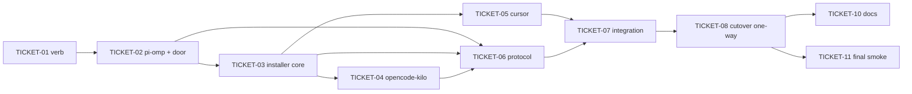

# Tasks — mnemonic-v2 host memory plugins (five hosts)

> **STATUS:** `sliced` (2026-11-18)

> Sliced from `.skillgrid/change-specs/2026-11-17-mnemonic-v2-host-memory-plugins/blueprint.md`.
> Vertical tracer-bullet tickets, dependency-ordered, sized for one fresh agent context window.

## Epic Summary

> **Epic (hermes kanban, board skillgrid):** t_d265a38c (blocked tracking card; children carry the work)
The mnemonic-v2 memory surface for five agent hosts (omp, pi, opencode, kilo, cursor): the shared `save-prompt` stdin verb, per-host capture adapters (pi-ExtensionAPI extension, single-file opencode/kilo plugin, cursor hook-triple + rule), the (host, family) tracked-set installer with `--family memory`, the v1 cutover (one-way), and the one-shot v1 store import. Protocol body stays single-sourced in the Go MCP instructions; host surfaces carry the host shell only.

## Delivery Strategy

| Field | Value |
|-------|-------|
| Estimated changed lines | ~3300 (incl. tests; ~1400 implementation) |
| 400-line budget risk | High |
| Chained PRs recommended | Yes |
| Suggested split | PR 1 (verb + import) -> PR 2 (pi-omp + installer) -> PR 3 (opencode-kilo + cursor + protocol) -> PR 4 (integration + cutover) -> PR 5 (docs + final smoke) |
| Delivery strategy | ask-on-risk |
| Chain strategy | pending (stacked-to-main suggested) |

Decision needed before apply: Yes
Chained PRs recommended: Yes
Chain strategy: pending
400-line budget risk: High

### Suggested Work Units

| Unit | Goal | Likely PR | Focused test command | Runtime harness | Rollback boundary |
|------|------|-----------|----------------------|-----------------|-------------------|
| 1 | The `save-prompt` verb + the v1 import script | PR 1 | `cd mnemonic && go test ./... -count=1 && bash ../scripts/fixtures/v1-import/test.sh` | real verb run over a temp store | `mem_prompt.go` + the `save-prompt` case in `mem.go`/`main.go` + `scripts/` |
| 2 | pi-omp extension v0 (live door check) + the installer core | PR 2 | `cd plugins/memory/pi-omp && node --test test/ && cd ../../../skillgrid-cli && go test ./internal/install/ -count=1` | live omp session (door check) | `plugins/memory/pi-omp/` + `skillgrid-cli/internal/install/` |
| 3 | opencode-kilo adapter + cursor surface + protocol (shells/compaction/probe) | PR 3 | `node --test` in both plugin dirs + `go test ./internal/transport/mcp/ ./internal/install/` | live opencode/kilo/cursor sessions | `plugins/memory/{opencode-kilo,cursor}/` + the protocol modules |
| 4 | Live integration + the one-way v1 cutover | PR 4 | `skillgrid status --family memory all` + the cutover grep gates | live five-host install | the cutover commit (reverts the repo; live configs via installer backups) |
| 5 | Docs + the final five-host smoke | PR 5 | the Task 11 matrix commands | live five-host matrix | docs files only; the smoke is verification |

> The four plain-text guard lines above are the **contract** — `skillgrid:subagent-execution` matches them literally. If risk is High, `Chained PRs recommended` MUST be `Yes` and every work unit MUST name a focused test, a runtime harness (or `N/A` + reason), and a rollback boundary.

## Tickets

### TICKET-01 — memory save-prompt verb (the host-capture stdin verb)
- **Tracker ID:** t_2e848a93 (hermes kanban, board skillgrid)

- **Scope:** the `mnemonic memory save-prompt` stdin verb (plain text | cursor JSON envelope, 256 KiB cap, 10-min dedup window, cwd project resolution, auto-register, exit codes 0/1/2) + handler + store probe + CLI wiring.
- **Acceptance:** the six verb scenarios pass (plain stdin stores one row + prints nothing; identical re-fire dedups; the cursor envelope extracts the prompt; >256 KiB truncates fail-open; project resolution mirrors the tool chain; a missing session row auto-registers). `go test ./...` green in the mnemonic module.
- **SATISFIES:** verb-save-prompt-plain, verb-idempotent-refire, verb-cursor-json-payload, verb-stdin-cap, verb-resolves-cwd-store-like-tools, verb-auto-registers-missing-session
- **Files:** `mnemonic/cmd/mnemonic/mem_prompt.go`, `save_prompt_test.go`, `internal/memory/save_prompt_once_test.go`, `mem.go`, `main.go`, `run_test_helpers_test.go`, `internal/memory/prompts.go`, `internal/transport/handler/handler.go`, `internal/core/store/{sqlite,postgres}.go`
- **Size:** ~450 (M)
- **Blocks:** TICKET-02
- **Blocked by:** none
- **Fails-when:** `go test ./... -count=1` exits nonzero, or `runCLI "memory" "save-prompt" --id s1 --project p` on plain stdin prints anything to stdout

### TICKET-02 — pi-omp extension v0 + live OMP door check
- **Tracker ID:** t_1b559f05 (hermes kanban, board skillgrid)

- **Scope:** the shared pi/omp extension v0 (session mint + register/end, per-prompt capture via the verb, subagent guard) + package.json + the live OMP door check (the hypothesis gate; fallback = per-session spawned MCP child, recorded as a deviation).
- **Acceptance:** the session/capture unit suites pass; a live omp session with the manual install produces exactly N prompt rows for N prompts, 1 session row, and 0 rows from a subagent run (T-omp-live); a dead verb fails open and increments the drop counter.
- **SATISFIES:** live-omp-door-check, fail-open-drop-counter
- **Files:** `plugins/memory/pi-omp/{index.ts,src/session.js,src/capture.js,package.json,test/session.test.mjs,test/capture.test.mjs}` + the runtime install under `~/.omp/agent/`
- **Size:** ~450 (M)
- **Blocks:** TICKET-03
- **Blocked by:** TICKET-01
- **Precondition:** a built mnemonic binary answering `memory save-prompt` exists (TICKET-01 committed; `go build -o /tmp/mnv2/mnemonic ./cmd/mnemonic`)
- **Fails-when:** the door-check row counts differ from the expected (N prompts -> N rows, 1 session row, 0 subagent rows)

### TICKET-03 — installer core: (host, family) manifests + --family memory
- **Tracker ID:** t_3e224456 (hermes kanban, board skillgrid)

- **Scope:** `registry.go` (the (host, family) tracked-set Manifest, the sjson JSON(C) merge, atomic write/backup, sha-verified uninstall) + `memory.go` (the five per-host plans over the dialect table, the one-way cutover matcher, the kilo AGENTS.md block, the engram check) + CLI wiring (`install --family memory`, `uninstall`, `status`) + the five fixture-HOME round-trip tests.
- **Acceptance:** all five fixture HOMEs: install / re-run no-op / foreign-untouched / uninstall byte-identical (clean HOMEs); the cutover rewrites the stale v1 key per dialect (one-way); the kilo install is byte-identical to opencode; the engram file coexistence is warned + listed; malformed config fails before any write. `go test ./internal/install/` green.
- **SATISFIES:** installer-roundtrip-fixture, cutover-rewrites-stale-entries, engram-coexistence-warning
- **Files:** `skillgrid-cli/internal/install/{registry.go,memory.go,memory_test.go}`, `skillgrid-cli/cmd/skillgrid/main.go`
- **Size:** ~800 (M)
- **Blocks:** TICKET-04, TICKET-05
- **Blocked by:** TICKET-02
- **Fails-when:** `go test ./internal/install/ -count=1` exits nonzero, or a fixture HOME differs from its pre-install snapshot after uninstall

### TICKET-04 — opencode-kilo memory adapter (single-file v2 plugin)
- **Tracker ID:** t_4284f5f8 (hermes kanban, board skillgrid)

- **Scope:** `plugins/memory/opencode-kilo/index.ts` (the `{ id, setup }` glue + pure exports: session-event extraction/registry with the parentID subagent guard, inbox-prompt capture with `--source-inbox-id`, the `mnemonic-memory_` normalizer + always-override `session_id` rewrite) + tests + the live opencode/kilo smoke through the installer.
- **Acceptance:** the rewrite/session/capture suites pass (10 tests); live opencode + kilo: 1 session row (harness id), prompt rows with `source_inbox_id`, a `mem_save` carrying a foreign `session_id` lands under the harness id (the rewrite fired), subagents add 0 rows; the two installed files are byte-identical.
- **SATISFIES:** live-opencode-kilo-session, fail-open-drop-counter
- **Files:** `plugins/memory/opencode-kilo/{index.ts,package.json,test/{rewrite,session,capture}.test.ts}` + the runtime install
- **Size:** ~450 (M)
- **Blocks:** TICKET-06
- **Blocked by:** TICKET-03
- **Precondition:** TICKET-03 committed (the installer exists); the opencode or kilo binary is available (a missing host is recorded as a deviation, the other host runs)
- **Fails-when:** a `mem_save` row lands under the foreign id, or `cmp` of the two installed files differs

### TICKET-05 — cursor surface: hook template + generated rule
- **Tracker ID:** t_ac072e8d (hermes kanban, board skillgrid)

- **Scope:** `plugins/memory/cursor/hooks.json` (the three v2 entries, `<BIN>`, the cursor pin, `loop_limit`) + `mnemonic.mdc` (host shell only: the 22-line mapping from `memAgentToolLines`, the `session_id: "cursor"` pin, the repair; zero v1 tokens) + the rule-shape test + `instructions_test.go` (the 2,048-rune guard + the generated-mapping diff) + the live cursor smoke.
- **Acceptance:** the mjs + Go suites pass; the installed rule contains the pin + the mapping and zero `web_cache_`/`fact_`/word-`serve` occurrences; the live cursor session: sessionStart -> 1 `cursor` session row, beforeSubmitPrompt -> prompt rows, an identical re-typed prompt dedups.
- **SATISFIES:** live-cursor-session, protocol-single-source
- **Files:** `plugins/memory/cursor/{hooks.json,mnemonic.mdc,test/rule-shape.test.mjs}`, `mnemonic/internal/transport/mcp/instructions_test.go` + the runtime install
- **Size:** ~200 (S)
- **Blocks:** TICKET-07
- **Blocked by:** TICKET-03
- **Fails-when:** the rule grep finds a v1 token, or the Go diff test reports a mapping drift

### TICKET-06 — protocol: host shells + compaction recovery + session-start probe
- **Tracker ID:** t_24614b44 (hermes kanban, board skillgrid)

- **Scope:** pi-omp `src/{compaction,shell}.js` (the engram-proven post-compact FIRST ACTION REQUIRED notice, the host shell with the conversation-id pin, the 3-leg probe under the shared 10 s deadline, the `.last-session-start.json` record, the warning) + the pi-omp glue + the opencode-kilo compaction/shell exports + the context/compaction hook wiring + the installer file-list delta (4 -> 6 files) + the status probe-record leg.
- **Acceptance:** all four plugin suites + the installer round trips (6 files) pass; live: a compacted pi/omp/opencode/kilo session's context carries the FIRST ACTION REQUIRED notice; a PATH-less fixture HOME gets the warning naming `not-found` + the exact repair, the record lands, and `status` surfaces it.
- **SATISFIES:** live-compaction-notice, probe-missing-binary-repair, fail-open-drop-counter, protocol-single-source
- **Files:** `plugins/memory/pi-omp/{src/compaction.js,src/shell.js,index.ts,test/{compaction,shell}.test.mjs}`, `plugins/memory/opencode-kilo/{index.ts,test/{compaction,shell}.test.ts}`, `skillgrid-cli/internal/install/{memory.go,memory_test.go}`
- **Size:** ~650 (M)
- **Blocks:** TICKET-07
- **Blocked by:** TICKET-02, TICKET-03, TICKET-04
- **Fails-when:** the post-compact context dump lacks the notice marker, or the probe record is missing after a session start

### TICKET-07 — cross-host live integration + status surface (pre-cutover checkpoint)
- **Tracker ID:** t_ca9d1f5f (hermes kanban, board skillgrid)

- **Scope:** all five hosts installed through the installer against the live configs; `skillgrid status --family memory all` verified live (installed/drift, drops, probe records, the engram coexistence, the stale-v1 pre-flight list); gaps fixed with RED-first diffs.
- **Acceptance:** the install tree matches the five tracked sets (kilo/opencode byte-identical, foreign entries untouched); the status output is recorded and shows: five installed hosts, the kilo `engram.ts` listed, the stale-v1 list verbatim, no fabricated drop/probe rows; a live omp session writes an all-legs-ok probe record that `status` reports.
- **SATISFIES:** engram-coexistence-warning, installer-roundtrip-fixture
- **Files:** (runtime) the five live installs + `~/.skillgrid/mnemonic/memory-install.json`; (only if a gap) `skillgrid-cli/internal/install/{memory.go,memory_test.go}`
- **Size:** ~50 (S)
- **Blocks:** TICKET-08
- **Blocked by:** TICKET-05, TICKET-06
- **Fails-when:** `status` reports drift on a fresh install, or the stale-v1 list is empty while live v1 keys exist

### TICKET-08 — one-way: v1 cutover (repo retirement + live config rewrite)
- **Tracker ID:** t_95bdcc48 (hermes kanban, board skillgrid)

- **Scope:** the repo retirement (the R8 deletion inventory, the conditional logo/v2sse check, the `hooks-cursor.json` memory-entry cutover, the `.cursor-plugin` description, the SKILL.md v2 rewrite, the setup.go kilo-block single-source) then, after the human confirm, the live rewrites (the installer's `cutStale` on re-install, the v1 pi extension residues) + the post-cutover grep gates + one session per host on the v2 set.
- **Acceptance:** the grep gates are empty (the convention surface: `:7438`/`skillgrid mcp`/`web_cache_`/`fact_`; SKILL.md: word `serve`/`daemon`; every `code_index` hit is `mnemonic-code`-qualified); the live installed set has zero functional v1 references; every host boots on the v2 plugin set only; `status` shows no stale-v1 lines.
- **SATISFIES:** cutover-rewrites-stale-entries, skillmd-v2-grep-gate
- **Files:** delete `plugins/pi/mnemonic/`, `plugins/kilo/`, the eight `plugins/opencode/` paths (+ conditional); `hooks/hooks-cursor.json`, `.cursor-plugin/plugin.json`, `.agents/skills/mnemonic/SKILL.md`, `skillgrid-cli/internal/setup/setup.go` (+ the install block writer) + (runtime) the live configs
- **Size:** ~300 (S)
- **Blocks:** TICKET-10, TICKET-11
- **Blocked by:** TICKET-07
- **Precondition:** TICKET-07's evidence is recorded (the stale-v1 list + the backup locations under `~/.skillgrid/mnemonic/backups/`)
- **Reversibility:** one-way
- **Fails-when:** a grep gate line prints a hit, or a host session loads a retired v1 plugin

### TICKET-09 — v1-to-v2 store import script
- **Tracker ID:** t_f20b7936 (hermes kanban, board skillgrid)

- **Scope:** `scripts/mnemonic-v1-import.sh` (`--from/--to/--dry-run`, the pre-flight guards incl. the target-`observations`-is-a-TABLE check, the satellite-conditional renderer, the provenance-marker idempotency, counts) + the fixture v1 store + the fixture test.
- **Acceptance:** the fixture test passes end to end: dry-run writes nothing (byte-identical target); the import lands 3 observations + 2 sessions (the orphan skipped, the NULL scope coalesced, the pinned satellite imported); `memory search` finds the content; a re-run adds 0; the v1-store-as-target guard fires.
- **SATISFIES:** v1-import-script
- **Files:** `scripts/mnemonic-v1-import.sh`, `scripts/fixtures/v1-import/{v1.sql,test.sh}`
- **Size:** ~250 (S)
- **Blocks:** none
- **Blocked by:** none
- **Fails-when:** `bash scripts/fixtures/v1-import/test.sh` exits nonzero

### TICKET-10 — docs: v2 surface for remaining convention files
- **Tracker ID:** t_f518de90 (hermes kanban, board skillgrid)

- **Scope:** the repo-wide v1-token sweep (ADR/change-archive excluded), the CHANGELOG entry for the v2 host surface, the CLI docs subsection for `--family memory` / `uninstall` / `status`.
- **Acceptance:** the sweep grep prints no unhandled hit; the changelog entry + CLI subsection exist and match the CLI help verbatim.
- **SATISFIES:** skillmd-v2-grep-gate
- **Files:** `CHANGELOG.md` (or the repo's changelog convention), `README.md`/`docs/`, the sweep's findings
- **Size:** ~100 (S)
- **Blocks:** none
- **Blocked by:** TICKET-08

### TICKET-11 — final live smoke: five-host matrix + live uninstall round trip
- **Tracker ID:** t_a5a0b081 (hermes kanban, board skillgrid)

- **Scope:** the live uninstall -> byte-identical -> reinstall proof on the real configs, then the full per-host T-matrix (prompt/session/subagent/rewrite/compaction/probe/dedup/status, the body exactly-once check per host); gaps fixed RED-first.
- **Acceptance:** every matrix row passes with recorded evidence (per-host row dumps, the status output, the uninstall proof); no open gaps (or recorded deviations with the missing host/machine named).
- **SATISFIES:** live-omp-door-check, live-opencode-kilo-session, live-cursor-session, live-compaction-notice, installer-roundtrip-fixture, protocol-single-source
- **Files:** (runtime only; repo only if a gap fix lands)
- **Size:** ~30 (S)
- **Blocks:** none
- **Blocked by:** TICKET-08
- **Precondition:** TICKET-08 committed (the cutover is done; the live configs are the v2 set)
- **Fails-when:** any matrix row's row dump differs from the expected counts

## Dependency Graph

## Execution Order

- **Wave 1 (parallel):** TICKET-01, TICKET-09
- **Wave 2:** TICKET-02 (after TICKET-01)
- **Wave 3:** TICKET-03 (after TICKET-02)
- **Wave 4 (parallel):** TICKET-04, TICKET-05 (after TICKET-03)
- **Wave 5:** TICKET-06 (after TICKET-02 + TICKET-03 + TICKET-04)
- **Wave 6:** TICKET-07 (after TICKET-05 + TICKET-06)
- **Wave 7:** TICKET-08 (after TICKET-07) - human checkpoint (one-way)
- **Wave 8 (parallel):** TICKET-10, TICKET-11 (after TICKET-08)

> **Acceptance-first (BDD is always on):** a ticket's failing acceptance
> scenario (its `SATISFIES` scenario) is written and confirmed RED *before*
> the implementation that makes it green. Order RED-test / scenario tickets
> ahead of their implementation tickets in the dependency graph.

## Slicing Notes

- The blueprint's 11 tasks slice 1:1 into tickets - the blueprint was written tracer-thread-first (verb -> pi-omp door -> installer -> host fan-out -> protocol -> integration -> cutover -> import -> docs -> smoke), so each task is already a vertical, demoable, context-fitted unit. No splits were needed; no ticket requires re-reading the blueprint (each carries the full interface code in its blueprint task).
- TICKET-09 is dependency-independent (bash + sqlite3 + the repo binary) and runs in Wave 1 parallel to the verb.
- Parallel waves in this repo use isolated worktrees (AGENTS.md § Rules - serial development: one change, but waves within it may parallelize on worktrees).
- The one-way door is TICKET-08's human checkpoint (Reversibility: one-way) - the executor stops before the live rewrites and presents the Task 7 evidence.
