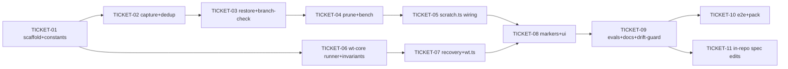

# Tasks — @devopstales/pi-worktree

> **STATUS:** `sliced` (2026-11-22)

> Sliced from `.skillgrid/change-specs/2026-11-22-pi-worktree-plugin/blueprint.md`.
> Vertical tracer-bullet tickets, dependency-ordered, sized for one fresh agent context window.

## Epic Summary

Build `@devopstales/pi-worktree` — one Pi plugin, two extension files — that implements the skillgrid worktree standard: turn-level scratch checkpoints (capture, dedup, safe restore, bounded refs) and worktrunk runs with session movement (directive protocol, no-replay recovery, branch allow-list, merge defaults, approval passthrough, markers). Core is pure git (zero Pi imports), enforced by an import-scan test. The contract-drift guard keeps the plugin's constants honest against the skillgrid-skills contract.

## Delivery Strategy

| Field | Value |
|-------|-------|
| Estimated changed lines | ~2800-3500 (new repo; 11 files in src/, 6 in tests/, evals/, references/, changelog/, README) |
| 400-line budget risk | High |
| Chained PRs recommended | Yes |
| Suggested split | PR 1 (T01) → PR 2 (T02-T04 ∥ T06) → PR 3 (T05-T08) → PR 4 (T09-T11) |
| Delivery strategy | ask-on-risk |
| Chain strategy | stacked-to-main |

Decision needed before apply: Yes
Chained PRs recommended: Yes
Chain strategy: stacked-to-main
400-line budget risk: High

### Suggested Work Units

| Unit | Goal | Likely PR | Review budget (lines) | Focused test command | Runtime harness | Rollback boundary |
|------|------|-----------|-----------------------|----------------------|-----------------|-------------------|
| 1 | Scaffold + constants + import-scan | PR 1 | ~150 / 400 | `bun test tests/import-scan.test.ts` | N/A (pure constants) | `src/core/constants.ts` + `package.json` + `tests/import-scan.test.ts` |
| 2 | Scratch core (capture + restore + prune + bench) + wt-core (runner + invariants) | PR 2 | ~900 / 400 (two disjoint cores) | `bun test tests/scratch.test.ts && bun test tests/wt-core.test.ts && bun run bench` | real git in temp repos; real `wt` in temp repos (skip when absent) | `src/core/scratch-core.ts` + `src/core/wt-core.ts` + `tests/scratch.test.ts` + `tests/wt-core.test.ts` + `tests/bench.ts` |
| 3 | Extension wiring (scratch.ts + wt.ts + markers + ui) | PR 3 | ~800 / 400 | `pi -e ./src/scratch.ts && pi -e ./src/wt.ts` (smoke) | real Pi session in a temp repo | `src/scratch.ts` + `src/wt.ts` + `src/markers.ts` + `src/ui.ts` |
| 4 | Evals + changelog + README + docs + e2e + in-repo spec edits | PR 4 | ~400 / 400 | `bun test && bash tests/e2e.sh` (full suite) | full plugin in a temp repo with Pi + wt | `evals/` + `changelog/` + `references/` + `README.md` + in-repo `README.md` + `work-unit-commits/README.md` |

> The four plain-text guard lines above are the **contract** — `skillgrid:execute` matches them literally. If risk is High, `Chained PRs recommended` MUST be `Yes` and every work unit MUST name a focused test, a runtime harness (or `N/A` + reason), and a rollback boundary.

## Tickets

### TICKET-01
- **Tracker ID:** TASK-001 — Scaffold pi-worktree repo + contract constants + import-scan

- **Scope:** Create the `devopstales/pi-worktree` repo (git init, MIT LICENSE, .gitignore), `package.json` (pi.extensions, engines, scripts, files), `src/core/constants.ts` (REF_BASE, AGENT_BRANCH_RE, IGNORED_DIRS, MAX_UNTRACKED_FILE_SIZE, MAX_UNTRACKED_DIR_FILES, MAX_PER_SESSION, isSafeRefId), and `tests/import-scan.test.ts` (no Pi imports in src/core/ + constants match contract values).
- **Acceptance:** `bun test tests/import-scan.test.ts` passes (2 tests: import-scan + constants-match). The constants module exports the exact contract values.
- **SATISFIES:** npm-test-passes-without-pi, import-scan-fails-on-pi-import
- **Files:** `package.json`, `src/core/constants.ts`, `tests/import-scan.test.ts`, `LICENSE`, `.gitignore` (all new)
- **Size:** ~150 (S)
- **Blocks:** TICKET-02, TICKET-03, TICKET-04, TICKET-06
- **Blocked by:** none
- **Precondition:** `git` and `bun` on PATH; the `devopstales/pi-worktree` directory does not yet exist (or is empty)
- **Reversibility:** one-way (OD-1 ref namespace `refs/skillgrid/` is declared here; OD-3 merge-default argv is consumed by Task 6)
- **Fails-when:** `bun test tests/import-scan.test.ts` exits non-zero

### TICKET-02
- **Tracker ID:** TASK-002 — scratch-core: temp-index capture + tree-SHA dedup

- **Scope:** Implement `createCheckpoint`, `git`, `repoRoot`, `Checkpoint`/`CheckpointResult` types, `lastTree` dedup map, `resetSessionState` in `src/core/scratch-core.ts` (capture half). 5 tests: mutating-turn metadata, index-identical, read-only-skip, unborn-HEAD zero-SHA, ignored-paths-absent.
- **Acceptance:** `bun test tests/scratch.test.ts -t "capture|dedup|unborn|ignored"` passes (5 tests). The real git index is byte-identical before/after capture. A read-only turn returns `{status:"skipped",reason:"unchanged"}`.
- **SATISFIES:** checkpoint-after-mutating-turn, readonly-turn-no-ref, unborn-head-capture, ignored-only-change-no-ref
- **Files:** `src/core/scratch-core.ts` (create), `tests/scratch.test.ts` (create)
- **Size:** ~350 (M, 200 impl + 150 tests)
- **Blocks:** TICKET-03, TICKET-04
- **Blocked by:** TICKET-01
- **Fails-when:** `bun test tests/scratch.test.ts` exits non-zero

### TICKET-03
- **Tracker ID:** TASK-003 — scratch-core: safe restore with branch-keyed check

- **Scope:** Implement `restoreCheckpoint`, `loadCheckpoint`, `listCheckpoints`, `safeClean` in `src/core/scratch-core.ts` (restore half). 5 tests: restore-on-matching-branch (deleted tracked returns, post-checkpoint untracked removed, pre-existing survives), before-restore checkpoint, refused-branch-mismatch-named, refused-missing-checkpoint, detached-HEAD-restore-refused.
- **Acceptance:** `bun test tests/scratch.test.ts -t "restore"` passes (5 tests). A restore on a mismatched branch is refused with reason `branch` + both branch names. A before-restore checkpoint always exists.
- **SATISFIES:** restore-on-matching-branch, restore-refused-cross-branch, restore-refused-missing-checkpoint
- **Files:** `src/core/scratch-core.ts` (modify), `tests/scratch.test.ts` (modify)
- **Size:** ~300 (M, 150 impl + 150 tests)
- **Blocks:** TICKET-04, TICKET-05
- **Blocked by:** TICKET-02
- **Fails-when:** `bun test tests/scratch.test.ts` exits non-zero

### TICKET-04
- **Tracker ID:** TASK-004 — scratch-core: session pruning + latency bench

- **Scope:** Implement `prune` (50-cap), `pruneOtherSessions` (liveness-aware, `PRUNE_MIN_AGE_MS` = 1h, injectable `now`), `PRUNE_MIN_AGE_MS` in `src/core/scratch-core.ts` (prune half). Create `tests/bench.ts` (capture latency at 20/500/5000/50000 files; exit 1 if 5k-file median > 150ms). 4 prune tests: 51st-capture-prunes-oldest, pruneOtherSessions-removes-other-sessions, liveness-threshold-keeps-fresh-sibling, exactly-50-no-prune.
- **Acceptance:** `bun test tests/scratch.test.ts -t "prune|cap"` passes (4 tests) + `bun run bench` prints the table with 5k-file median ≤ 150ms. Total scratch test count = 14.
- **SATISFIES:** fifty-cap-prunes-oldest, cross-session-prune-keeps-fresh-sibling, exactly-50-no-prune
- **Files:** `src/core/scratch-core.ts` (modify), `tests/scratch.test.ts` (modify), `tests/bench.ts` (create)
- **Size:** ~300 (M, 100 impl + 100 tests + 100 bench)
- **Blocks:** TICKET-05
- **Blocked by:** TICKET-03
- **Fails-when:** `bun test tests/scratch.test.ts` exits non-zero OR `bun run bench` exits non-zero

### TICKET-05
- **Tracker ID:** TASK-005 — scratch.ts extension wiring: turn_end, restore tool, /checkpoint, footer

- **Scope:** Create `src/scratch.ts` (extension file 1: `turn_end` → capture + footer, `session_start` → cache rebuild + resume dedup + background prune, `scratch-restore` tool, `/checkpoint` command) and `src/ui.ts` (`updateFooter`, `rebuildCache`, `restoreDialog` — the pinned shapes from Stage 9 F1). Create `tests/scratch-ext.smoke.md` (documented `pi -e` smoke script).
- **Acceptance:** `pi -e ./src/scratch.ts` in a temp repo: edit a file via the agent → footer shows `◆ 1 checkpoint`; `/checkpoint` lists it with label; restore after a second edit → file back, dialog confirmed, `◆ 2 checkpoints`. Smoke script observations all hold.
- **SATISFIES:** checkpoint-after-mutating-turn, dedup-on-unchanged-turn, resume-unchanged-turn-no-duplicate
- **Files:** `src/scratch.ts` (create), `src/ui.ts` (create), `tests/scratch-ext.smoke.md` (create)
- **Size:** ~300 (M, 200 wiring + 100 smoke doc)
- **Blocks:** TICKET-08
- **Blocked by:** TICKET-04
- **Precondition:** a Pi install (≥0.99.1) with `pi -e` on PATH
- **Fails-when:** `pi -e ./src/scratch.ts` smoke observations in `tests/scratch-ext.smoke.md` do not all hold

### TICKET-06
- **Tracker ID:** TASK-006 — wt-core: directive runner + three invariants (root-observation, allow-list, merge-defaults)

- **Scope:** Implement `runDirectedWt` (directive protocol: mkdtemp + 0o600, WORKTRUNK_DIRECTIVE_CD_FILE, spawn without shell, drain-then-delete, in-process mutex), `supportsDirectiveProtocol`, `observeWorktreeRoot` (first-use one-line observation), `checkBranchAllowList` (regex + nearest-form suggestion), `applyMergeDefaults` (prepends `--no-squash --no-commit` unless explicit) in `src/core/wt-core.ts`. Tests: pure-parse groups (applyMergeDefaults, checkBranchAllowList) run without `wt`; runner groups (observeWorktreeRoot, directive-outside-repo, mutex, directive-file-cleanup) skip with a named reason when `wt` is absent.
- **Acceptance:** `bun test tests/wt-core.test.ts` passes (all groups; runner groups skipped with named reason when `wt` absent). `applyMergeDefaults(["merge","main"])` returns `["merge","--no-squash","--no-commit","main"]`. `checkBranchAllowList("feature-x", true)` returns `{ok:false, suggestion:/agent-feature-x/}`.
- **SATISFIES:** standard-root-observed, foreign-root-noted, allow-list-at-creation, allow-list-rejected-with-suggestion, primary-checkout-unconstrained, merge-gets-default-flags, explicit-squash-not-rewritten, directive-outside-repo-rejected
- **Files:** `src/core/wt-core.ts` (create), `tests/wt-core.test.ts` (create)
- **Size:** ~400 (M, 250 impl + 150 tests)
- **Blocks:** TICKET-07
- **Blocked by:** TICKET-01
- **Fails-when:** `bun test tests/wt-core.test.ts` exits non-zero

### TICKET-07
- **Tracker ID:** TASK-007 — wt-core recovery + wt.ts: worktrunk tool, session moves, approvals

- **Scope:** Implement `recordWorktrees` (in-memory Map), `recover` (repository identity re-verified, default-branch preference via `git symbolic-ref`, no-replay, linked-session creation via `ctx.sessionManager`) in `src/core/wt-core.ts` (recovery half). Create `src/wt.ts` (extension file 2: `worktrunk` tool `{command, args?}` sequential, `/wt` command, directive follow → linked-session move, print/json → `stopped`, approval dialog passthrough, recovery hook). Update `README.md` (min `wt` version pin). Tests: recovery group (cwd-removed → recover to survivor, no-surviving → report). Smoke: `tests/wt-ext.smoke.md`.
- **Acceptance:** `bun test tests/wt-core.test.ts -t "recovery"` passes (2 tests). `pi -e ./src/wt.ts` smoke: `wt switch --create agent-smoke` via the tool → session cwd is the new worktree, source session in `/resume`; print mode → `stopped` + path; unapproved `[pre-start]` hook → dialog, approve → runs once.
- **SATISFIES:** session-moves-to-worktree, print-mode-stopped, recovery-no-replay, no-surviving-worktree, approval-approved-and-retried, approval-declined
- **Files:** `src/core/wt-core.ts` (modify), `src/wt.ts` (create), `tests/wt-core.test.ts` (modify), `tests/wt-ext.smoke.md` (create), `README.md` (modify)
- **Size:** ~500 (L, 300 impl + 150 tests + 50 smoke)
- **Blocks:** TICKET-08
- **Blocked by:** TICKET-06
- **Precondition:** a Pi install (≥0.99.1) with `pi -e` on PATH; `wt` binary on PATH for the recovery tests
- **Fails-when:** `bun test tests/wt-core.test.ts -t "recovery"` exits non-zero OR smoke observations do not hold

### TICKET-08
- **Tracker ID:** TASK-008 — markers + ui: lifecycle, stale report, dual-plugin note

- **Scope:** Create `src/markers.ts` (`markWaiting`, `markWorking`, `clearMarker` — the exact argv from findings.md R1; sole marker writer). Modify `src/ui.ts` (dialog half), `src/scratch.ts` + `src/wt.ts` (import markers, drop direct marker writes). Update `README.md` (dual-plugin note). Tests: marker group (lifecycle sequence in `wt list`, stale detection, manual clear).
- **Acceptance:** `bun test tests/markers.test.ts` passes (lifecycle: session_start→💬, agent_start→🤖, agent_end→💬, session_shutdown→clear; stale: kill-before-shutdown → reported; clear: `wt config state marker clear` removes it).
- **SATISFIES:** marker-follows-lifecycle, stale-marker-reported
- **Files:** `src/markers.ts` (create), `src/ui.ts` (modify), `src/scratch.ts` (modify), `src/wt.ts` (modify), `tests/markers.test.ts` (create), `README.md` (modify)
- **Size:** ~250 (M, 150 impl + 100 tests)
- **Blocks:** TICKET-09
- **Blocked by:** TICKET-05, TICKET-07
- **Precondition:** `wt` binary on PATH for the marker state commands
- **Fails-when:** `bun test tests/markers.test.ts` exits non-zero

### TICKET-09
- **Tracker ID:** TASK-009 — evals + changelog + README + reference docs + contract-drift guard

- **Scope:** Create `evals/evals.json` (array of `{name,description,input,expect}`; ported `scratch_dedup_readonly_turn` + `scratch_branch_safety_refused` + marker + approval scenarios), `changelog/releases/v0.1.0/` (manifest.yaml, entries/, notes.md — pi-worktrunk's structure), `references/wt-commands.md` (hand-written one-page pointer), `references/scratch-restore.md` (restore protocol, refusal reasons, branch-keyed check), `README.md` (full: install, Pi ≥0.99.1, wt min version, two-extension-file manifest note, marker-writer warning, git-fallback behavior). Create `tests/contract-drift.test.ts` (parses `~~~skillgrid-constants` fence from `SKILLGRID_CONTRACT_PATH`, diffs against exported constants; missing fence → FAIL; missing env → FAIL).
- **Acceptance:** `bun test` (full suite) passes. `SKILLGRID_CONTRACT_PATH=... bun test tests/contract-drift.test.ts` passes when constants match; fails naming the mismatch when they don't. `evals/evals.json` is valid JSON with the pinned format.
- **SATISFIES:** drift-guard-passes-on-match, drift-named, missing-fence
- **Files:** `evals/evals.json` (create), `changelog/releases/v0.1.0/` (create), `references/wt-commands.md` (create), `references/scratch-restore.md` (create), `README.md` (modify), `tests/contract-drift.test.ts` (create)
- **Size:** ~400 (M, 200 tests + 200 docs)
- **Blocks:** TICKET-10, TICKET-11
- **Blocked by:** TICKET-08
- **Fails-when:** `bun test` exits non-zero

### TICKET-10
- **Tracker ID:** TASK-010 — End-to-end smoke + npm pack

- **Scope:** Create `tests/e2e.sh` (full smoke: scripted Pi session via `pi --print -p` per turn, restore via tool `execute` with `id` set, the full checkpoint → restore → worktree-move → recovery → marker cycle). Run `bun pack` to verify the npm package structure. Fix whatever the smoke reveals (a fix here is a plan defect — stop and report).
- **Acceptance:** `bash tests/e2e.sh` exits 0 (all assertions pass). `bun pack` produces a valid `.tgz` with the `src/` + `references/` files.
- **SATISFIES:** npm-test-passes-without-pi
- **Files:** `tests/e2e.sh` (create), whatever the smoke reveals (modify)
- **Size:** ~200 (M, 150 e2e script + 50 fixes if any)
- **Blocks:** none
- **Blocked by:** TICKET-09
- **Precondition:** Pi install (≥0.99.1) + `wt` binary + `git` all on PATH; a temp repo with at least one commit
- **Fails-when:** `bash tests/e2e.sh` exits non-zero OR `bun pack` fails

### TICKET-11
- **Tracker ID:** TASK-011 — In-repo spec-zone edits (skillgrid-skills)

- **Scope:** In `skillgrid-skills`: update root `README.md` (Tool Dependency list: add the `pi-worktree` line), update `.agents/skills/_shared/work-unit-commits/README.md` § Scratch checkpoints (reference-implementation pointer line + the `~~~skillgrid-constants` fence at column 0). Run the contract-drift guard against the edited contract (`SKILLGRID_CONTRACT_PATH=... bun test tests/contract-drift.test.ts` in the plugin repo). Commit (spec zone).
- **Acceptance:** The `~~~skillgrid-constants` fence is present at column 0 in `work-unit-commits/README.md` with the exact values from Task 1 `constants.ts`. `SKILLGRID_CONTRACT_PATH=.agents/skills/_shared/work-unit-commits/README.md bun test tests/contract-drift.test.ts` (in the plugin repo) passes.
- **SATISFIES:** drift-guard-passes-on-match
- **Files:** `README.md` (modify), `.agents/skills/_shared/work-unit-commits/README.md` (modify) — in skillgrid-skills
- **Size:** ~50 (S)
- **Blocks:** none
- **Blocked by:** TICKET-09 (the drift guard test must exist before running it)
- **Reversibility:** reversible (spec-zone docs only)
- **Fails-when:** `SKILLGRID_CONTRACT_PATH=... bun test tests/contract-drift.test.ts` exits non-zero

## Dependency Graph

## Execution Order

- **Wave 1:** TICKET-01 (scaffold — everything depends on it)
- **Wave 2 (parallel):** TICKET-02 (scratch capture) ∥ TICKET-06 (wt-core runner) — disjoint files, no shared state
- **Wave 3:** TICKET-03 (scratch restore, after T02)
- **Wave 4 (parallel):** TICKET-04 (scratch prune, after T03) ∥ TICKET-07 (wt recovery + wt.ts, after T06)
- **Wave 5:** TICKET-05 (scratch.ts wiring, after T04)
- **Wave 6:** TICKET-08 (markers + ui, after T05 + T07)
- **Wave 7:** TICKET-09 (evals + docs + drift guard, after T08)
- **Wave 8 (parallel):** TICKET-10 (e2e + pack) ∥ TICKET-11 (in-repo spec edits) — both after T09

> **Acceptance-first (BDD is always on):** a ticket's failing acceptance scenario (its `SATISFIES` scenario) is written and confirmed RED *before* the implementation that makes it green. Order RED-test / scenario tickets ahead of their implementation tickets in the dependency graph.

> **Fan-out note:** Wave 2 (TICKET-02 ∥ TICKET-06) is the primary fan-out candidate — two disjoint cores (scratch-core.ts vs wt-core.ts) that can run in parallel worktrees (`worktree-wf_scratch` / `worktree-wf_wt`). Wave 4 (TICKET-04 ∥ TICKET-07) is a secondary fan-out. The scratch core is the critical path (T02→T03→T04→T05); the wt core is shorter (T06→T07).

## Slicing Notes

- **Ticket-to-Task mapping:** TICKET-NN = Task NN (1:1). The blueprint's 11 tasks were already work-unit-shaped; slicing preserved the boundaries.
- **Fan-out:** the blueprint's build-order note ("Tasks 2–4 can run in parallel with Task 6 once Task 1 lands") is the Wave 2 split. The scratch core (T02→T03→T04) is sequential within the scratch lane; the wt core (T06→T07) is sequential within the wt lane. The two lanes run in parallel.
- **TICKET-07 is the largest ticket (~500 lines, L).** It touches 3 files + 2 test surfaces. Acceptable at T2; if the executor prefers, it can be split into T07a (recovery in wt-core) + T07b (wt.ts wiring) at slicing time — but the blueprint's TDD steps are written as one unit.
- **TICKET-11 is in a different repo** (skillgrid-skills, not pi-worktree). It is the spec-zone commit that adds the `~~~skillgrid-constants` fence the drift guard parses. It must run after TICKET-09 (the drift guard test must exist) and commits in the spec zone before any further code-zone work in skillgrid-skills.
- **Assumed blueprints:** none — `blueprint.md` carries `Status: APPROVED`.
- **Ticketing:** published to Backlog.md as milestone `m-0` (2026-11-22-pi-worktree-plugin), TASK-001 through TASK-011 with dependency edges. `ticketing.enabled` set to `true` in `.skillgrid/config.yaml` (user override at the slice gate).
