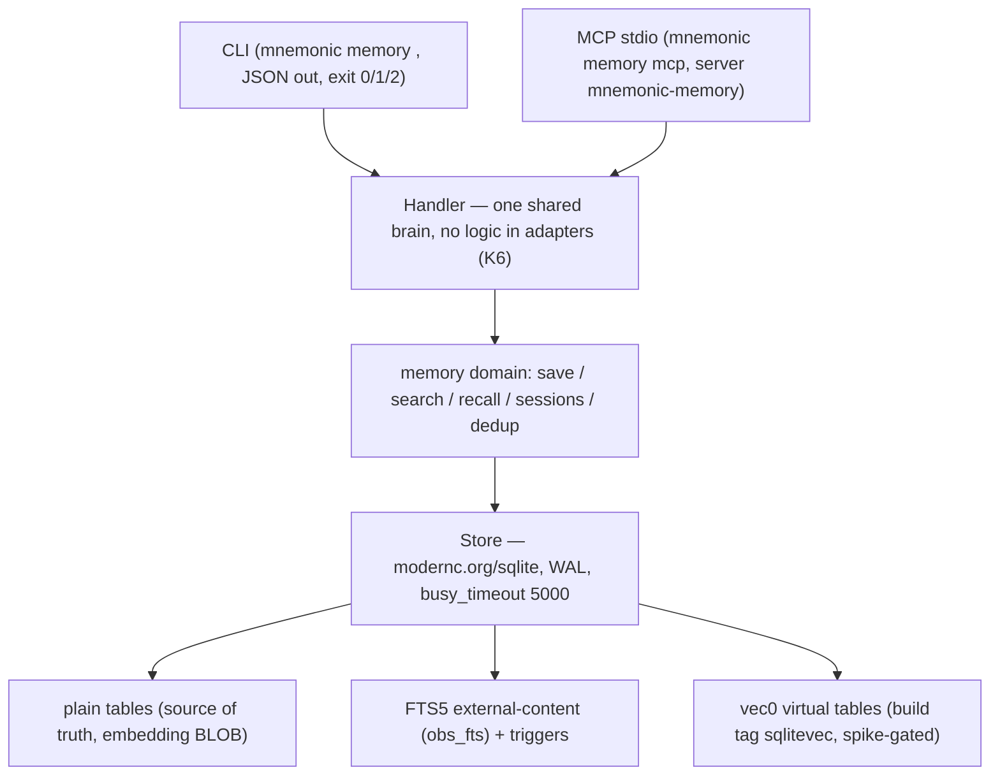
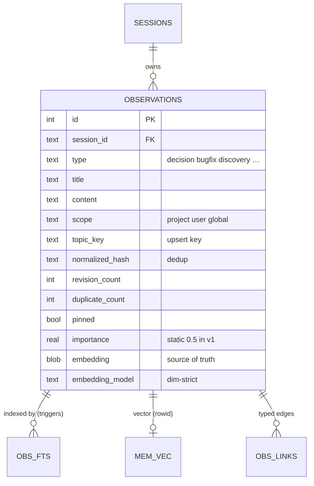

# mnemonic memory-core architecture (planned)

Draft module map + data model for [[entities/mnemonic]] v1 (memory core).
Nothing here is built yet — the code lands in `skillgrid-skills/mnemonic/`
during the change's execution phase; this page is the plan's durable home and
must be re-attested against the built code when it exists.

## Layering



Adapters map arguments 1:1 to Handler calls and render the same envelope —
the K6 seam ([[concepts/single-handler-two-adapters]]).

## Planned package layout

```
mnemonic/
  go.mod                    # module …/skillgrid-skills/mnemonic (path TBC)
  cmd/mnemonic/main.go      # top-level dispatch: init | doctor | <tool> …
  internal/store/           # sqlite engine, migrations, FTS, vector seams
  internal/memory/          # save/search/recall/sessions/dedup (Handler domain)
  internal/intelligence/    # embedder: onnx | api | hash; degrade (one bounded retry)
  internal/transport/       # handler, envelope, mcp adapter, cli adapter
  internal/project/         # detection chain: flag > env > git toplevel > basename
  internal/config/          # config.toml + env overlay
```

## Data model (single file, additive migrations, `schema_version` in `meta`)



- `obs_fts` is external-content over `title` + `content`, maintained by
  INSERT/**UPDATE**/DELETE triggers — the upsert/revision path is the known
  desync trap ([[gotchas/fts5-external-content-upsert]]).
- `mem_vec` is the vec0 ANN layer over the same ids; BLOB remains the source
  of truth ([[concepts/in-file-vector-layer]]).
- `trails` (one row per retrieval: query, route, per-leg ranks, hits) is the
  audit + eval substrate; `meta` carries `schema_version`.

## Recall pipeline

```
query → scope filter → FTS5 BM25 + vector KNN (vec0 or brute)
     → RRF fuse → recency/importance/pinned boosts → top-K with leg provenance
     → trail row; envelope carries route + degraded
```

`degraded: true` iff the vector leg did not run — the floor discipline
([[concepts/degradation-floor]]).

## Related

- Supersedes: none.
- Consumed by: [[syntheses/mnemonic-core]].
- Depends on: [[entities/mnemonic]] (scope + criteria),
  [[decisions/0004-vectors-in-file]],
  [[decisions/0008-memory-core-only-v1]],
  [[gotchas/fts5-external-content-upsert]].
