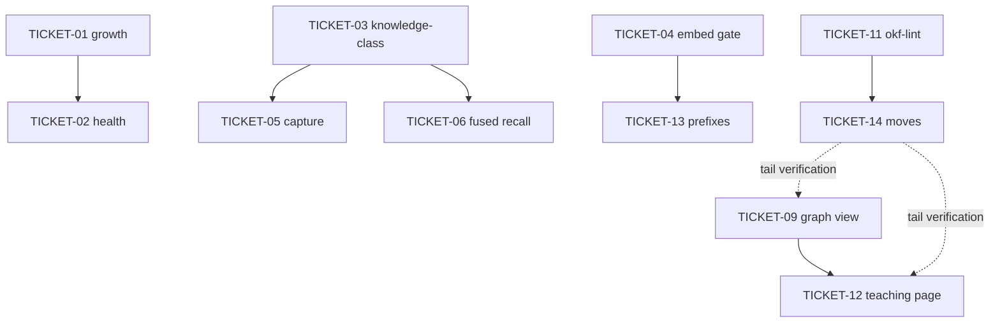

# Tasks — 2026-10-06-second-brain-learnings (sliced)

> **STATUS:** `sliced` (2026-10-11, delta 2026-10-17: TICKET-11 telemetry sink + .gitignore)

**Change:** 2026-10-06-second-brain-learnings
**Tier:** T2 · **Build shape:** Journey · **Delivery:** single branch, 14 tickets, High review risk (~2000–2800 lines: Go features + recall paths + graph views + lint script + bundle moves)
**Chain strategy:** single-branch (each work-unit PR merges to main in order = stacked-to-main)
**Traceability:** briefing.md R1–R5 ↔ blueprint.md Tasks 1–5 ↔ acceptance.feature @step-01..06 (G1–G7); R6 moves ↔ Task 6 ↔ TICKET-14 ↔ @step-15 (G16); R6 tooling ↔ Task 12 ↔ TICKET-11 ↔ @step-12 (G13); R7–R9 ↔ Tasks 7–9 ↔ TICKET-06..08 ↔ @step-07..09 (G8–G10); R10–R11 ↔ Tasks 10–11 ↔ TICKET-09..10 ↔ @step-10..11 (G11–G12); R12 ↔ Task 13 ↔ TICKET-12 ↔ @step-13 (G14); R13 ↔ Task 14 ↔ TICKET-13 ↔ @step-14 (G15)

**Epic summary:** Five second-brain engine features (growth, health, knowledge-class, embed gate, capture gate) plus a fused web recall, then the knowledge-base restructure (OKF bundle, lint guard, graph views) with skill/process wiring. Knowledge-base skill + `.obsidian` config already landed in-tree (uncommitted); TICKET-14 moves the bundle they describe.

**Ticketing:** Published 2026-10-11 — epic TASK-070 + TASK-070.01..14 (labels: second-brain-learnings; deps: .02→.01, .05→.03, .06→.03, .12→.09, .13→.04, .14→.11; `backlog doctor` clean). Grouping via milestone **m-9 `2026-10-06-second-brain-learnings`** (spec slug as milestone name; all 15 assigned, 0/15 done) — backlog has no real epics, so the milestone is the grouping mechanism and TASK-070 stays as parent pointer only. Execution still HELD per user re-gate.

## Waves

| Wave | Tickets | Rationale |
|------|---------|-----------|
| 1 | TICKET-01 (growth) + TICKET-04 (embed gate, independent codeindex) | No deps, parallel-safe |
| 2 | TICKET-02 (health rules, builds on TICKET-01 metrics) | Needs growth metrics shape stable |
| 3 | TICKET-03 (knowledge-class migration 051 + ADR 0038) ⚠ one-way | STOP for user approval before Step 3 (migration + backfill; snapshot first) |
| 4 | TICKET-05 (capture gate, reuses TICKET-03 class) + full regression G7 | Sequential after TICKET-03 |
| 5 | TICKET-06 (fused recall + contract ADR) | After TICKET-03 (shares search_blend.go); contract ADR needs LOCKED OK (bundle with re-gate) |
| 6 | TICKET-07 (reflect promotion) + TICKET-08 (onboarding wiring), docs-only | Disjoint skill files, parallel-safe; no code deps |
| 7 | TICKET-09 (knowledge graph derive + route + page) | Fixture-first, may start early; tail verification gated on TICKET-14's real bundle |
| 8 | TICKET-10 (MCP scope block + descriptions) | Parallel-safe; no shared files with TICKET-09 |
| 9 | TICKET-11 (okf-lint.mjs + fixtures) | No deps; TICKET-14 consumes it — lands before TICKET-14 executes |
| 10 | TICKET-12 (teaching graph page) | After TICKET-09 payloads for the full picture; fixture-first so it can build in parallel |
| 11 | TICKET-13 (chunk prefixes + ablation) | After TICKET-04 (shares indexer.go); ranker measured-not-changed |
| 12 | TICKET-14 (bundle moves + sweep + ADR-0039) ⚠ index-level | After TICKET-11 (lint verifies the moves); STOP for LOCKED OK |

## Dependency graph

## Delivery Strategy

| Field | Value |
|-------|-------|
| Estimated changed lines | ~2000–2800 |
| 400-line budget risk | High |
| Chained PRs recommended | Yes |
| Suggested split | WU-1 → WU-2 → WU-3 → WU-4 → WU-5 (table below) |
| Delivery strategy | ask-on-risk |
| Chain strategy | stacked-to-main (single-branch; each unit PR merges to main in order) |

Decision needed before apply: Yes
Chained PRs recommended: Yes
Chain strategy: stacked-to-main (single-branch; each unit PR merges to main in order)
400-line budget risk: High

### Suggested Work Units

| Unit | Goal | Likely PR | Focused test command | Runtime harness | Rollback boundary |
|------|------|-----------|----------------------|-----------------|-------------------|
| WU-1 | Engine features (TICKET-01..05) | PR 1 | `cd mnemonic && go test ./internal/...` | Full suite green (G7) | Revert feature commits; applied 051 migration stays (one-way, no down-migration) |
| WU-2 | Recall upgrades (TICKET-06+10+13) | PR 2 | `go test ./internal/memory/... ./internal/mcp/... ./internal/codeindex/...` | Fused + scoped + prefixed search green (G8/G12/G15) | Per-ticket revert; TICKET-13 needs re-index note |
| WU-3 | Knowledge bundle (TICKET-11+14) | PR 3 | `node .../okf-lint.mjs .` + G13/G16 | DRIFT clean, history intact, LOCKED resolves | Revert moves; LOCKED flips + sweep unpicked together |
| WU-4 | Graph views (TICKET-09+12) | PR 4 | `go test ./internal/knowledge/...` + `vitest run KnowledgeGraphPage GraphPage` | G11/G14 incl. fixture-only-or-live record | Remove route/page/resolver |
| WU-5 | Skill docs (TICKET-07+08) | PR 5 | `node scripts/check-skillgrid-skills.mjs` + G9/G10 greps | G9/G10 counts met, skills clean | Revert prose |

## Tickets

### TICKET-01: Growth timeline

- **Scope:** Cumulative added/total observation timeline per period via `GrowthTimeline`.
- **Acceptance:** Monthly buckets cumulative, soft-deleted excluded, empty store → `[]`.
- **SATISFIES:** @step-01 `growth-timeline` (G1)
- **Files:** `mnemonic/internal/secondbrain/lifecycle.go`, `mnemonic/internal/mcp/tools_memory.go`, `mnemonic/internal/secondbrain/lifecycle_test.go`
- **Size:** ~M (500–1500)
- **Blocks:** TICKET-02
- **Blocked by:** none
- **Do:** `GrowthTimeline(project, granularity day|week|month)` via `strftime` bucketing over `created_at`; exclude `deleted_at`/`archived_at`; `mem_lifecycle growth` action; empty store → `[]`.
- **Verify:** `cd mnemonic && go test ./internal/secondbrain/... -run TestGrowthTimeline_Monthly -v` PASS
- [ ] done

### TICKET-02: Health recommendations (5 rules)

- **Scope:** Five actionable, severity-graded health rules on the pure function.
- **Acceptance:** Each fixture triggers its rule with the right severity; all-off → empty list; no new DB queries.
- **SATISFIES:** @step-02 `health-recommendations` (G2)
- **Files:** `mnemonic/internal/secondbrain/lifecycle.go`, `mnemonic/internal/secondbrain/lifecycle_test.go`
- **Size:** ~S (<500)
- **Blocks:** none
- **Blocked by:** TICKET-01 (metrics shape)
- **Do:** Extend pure `healthRecommendations` (call directly in tests, not `Health()`, to avoid 24h cache): dedup HIGH density>0.05, embeddings MEDIUM with embedder-off no-nag gate, stale MEDIUM total>10 + >90d fraction, cleanup LOW archived>30%, review LOW `review_after<=now`. Stable ordering, no new DB queries.
- **Verify:** `cd mnemonic && go test ./internal/secondbrain/... -run TestHealthRecommendations -v` PASS
- [ ] done

### TICKET-03: Knowledge-class dimension + ADR ⚠ ONE-WAY

- **Scope:** Nullable durability dimension on observations with inference + backfill + ADR-0038.
- **Acceptance:** Decision reads back convention; filter + labels work; unfiltered search unchanged; migration applies once.
- **SATISFIES:** @step-03 `knowledge-class` (G3, G4)
- **Files:** `mnemonic/internal/store/migrations/070_add_knowledge_class.sql` (NEW — 070, not 051: 051 is CLM; runner name-sorted), `mnemonic/internal/memory/service.go`, `mnemonic/internal/memory/knowledge_class.go` (NEW), `mnemonic/internal/memory/search_blend.go`, `mnemonic/internal/mcp/tools_memory.go`, `.skillgrid/artifacts/04-adr-0046-knowledge-class-dimension.md` (NEW — 0046, not 0038: 0038 is skill-pi ticketing), `mnemonic/internal/memory/knowledge_class_test.go`
- **Size:** ~M (500–1500)
- **Blocks:** TICKET-05, TICKET-06
- **Blocked by:** none (migration 070; 051–053 are CLM, 054–058 occupied, untouched)
- **Do:** Nullable `knowledge_class episodic|convention|doc|unclassified` + index `(knowledge_class, project)` (class-leading for equality access); `inferKnowledgeClass(type)` on save/update; re-runnable heuristic backfill (decision/convention/architecture/config/standing→convention; session_log/learning/discovery/bugfix→episodic); `mem_search` optional filter (FTS-leg-only) + per-class labels; ADR-0046 (why dimension not KB-per-class).
- **Reversibility:** one-way (ADD COLUMN, no down-migrations; runner applies once). Soft one-way: backfill mutates rows — snapshot/backup before applying.
- **Verify:** `cd mnemonic && go test ./internal/memory/... -run TestSave_KnowledgeClassInfer -v` PASS; migration file present; unfiltered search unchanged
- **Precondition:** snapshot/backup of the target store exists and is restorable.
- **Fails-when:** migration apply errors, or any pre-existing memory test fails after apply.
- [ ] done — **STOP: user approval required before migration apply**

### TICKET-04: PageRank-guided embed gate

- **Scope:** Centrality-gated embedding selection with carve-outs and counts.
- **Acceptance:** Gate=50 embeds ≤ceil(N/2) + carve-outs; gate=100 identical to today; skipped NULL-vector degrades.
- **SATISFIES:** @step-04 `pagerank-embed` (G5)
- **Files:** `mnemonic/internal/codeindex/indexer.go`, `mnemonic/internal/codeindex/graph.go` (expose degree/PageRank; no `graph_index.go`), `mnemonic/internal/codeindex/indexer_test.go`
- **Size:** ~M (500–1500)
- **Blocks:** TICKET-13
- **Blocked by:** none (codeindex-only, parallel with 01–03)
- **Do:** Centrality rank from existing call/reference graph; `--embed-top <pct>` / `WithEmbedGate`, default 100 (today's behavior); gate=50 → ≤ceil(N/2) centrality-selected + docs + recent-changes carve-out; NULL vector for skipped (degrade per ADR-0009); report embedded/skipped counts.
- **Reversibility:** fully reversible (runtime flag, no schema).
- **Verify:** `cd mnemonic && go test ./internal/codeindex/... -run TestIndex_EmbedTop -v` PASS
- [ ] done

### TICKET-05: Confidence-gated capture + regression

- **Scope:** Deterministic capture classifier + suggest tool + full-suite green.
- **Acceptance:** High-confidence suggests without persisting; strong/weak/negative matrix exact; confirm creates exactly one row; full suite green.
- **SATISFIES:** @step-05 `confidence-capture` (G6) + @step-06 regression (G7)
- **Files:** `mnemonic/internal/secondbrain/infer.go` (or `capture.go`), `mnemonic/internal/mcp/tools_memory.go`, `mnemonic/internal/secondbrain/capture_test.go`
- **Size:** ~M (500–1500)
- **Blocks:** none
- **Blocked by:** TICKET-03 (suggested `knowledge_class`)
- **Do:** Deterministic `ClassifyCapture(text)->{trigger,confidence}` (10 named patterns, keyword+position score, no LLM); `mem_capture_suggest` threshold 0.75 default, returns draft without persisting; agent confirms via `mem_save`; idempotent never-writes. Then full `cd mnemonic && go test ./internal/...` green.
- **Verify:** `cd mnemonic && go test ./internal/secondbrain/... -run TestCaptureSuggest -v` PASS; `cd mnemonic && go test ./internal/...` PASS
- [ ] done

### TICKET-06: Fused mem_search recall + contract ADR

- **Scope:** Every `mem_search` also searches unexpired web_cache, labeled, RRF-fused; contract ADR recorded.
- **Acceptance:** Seeded web row appears labeled; expired rows absent; vector leg observations-only; otherwise unchanged.
- **SATISFIES:** @step-07 `fused-recall` (G8)
- **Files:** `mnemonic/internal/memory/search_blend.go`, `mnemonic/internal/memory/service.go` (query sites), `mnemonic/internal/mcp/tools_memory.go` (description), `mnemonic/internal/memory/search_blend_test.go`, `.skillgrid/decisions/04-adr-NNNN-fused-mem-search-contract.md` (post-R6 path; pre-R6 `artifacts/`)
- **Size:** ~M (500–1500)
- **Blocks:** none
- **Blocked by:** TICKET-03 (shares `search_blend.go`; implement after it lands)
- **Do:** Project-scoped `web_cache_fts` MATCH with `expires_at` exclusion, RRF fuse with existing ranker, web-hit labels (`corpus`, source, url, fetched_at, expires_at) + `web_cache_get` pointer; vector leg untouched; contract ADR (additive; next free number, NOT 0037/0038/0039 — verify highest; LOCKED row needs user OK, bundle with re-gate).
- **Reversibility:** fully reversible (query-path change, no schema; revert restores observations-only).
- **Verify:** `cd mnemonic && go test ./internal/memory/... -run TestMemSearch_FusedWebCache -v` PASS; prior exact-set search assertions re-baselined only where pinned (record each in commit message)
- [ ] done

### TICKET-07: Reflect promotion candidates (docs-only)

- **Scope:** Promotion-candidates step + template shape in the reflect skill.
- **Acceptance:** Step + selection rule + card shape + explicit-confirmation rule + verification item present; skill-check clean.
- **SATISFIES:** @step-08 `promotion-candidates` (G9)
- **Files:** `.agents/skills/lifecycle/reflect/SKILL.md`, report template section (reflect template or merged qa template — one canonical shape)
- **Size:** ~S (<500)
- **Blocks:** none
- **Blocked by:** none (docs-only, parallel-safe)
- **Do:** Selection rule (`session_id` match or fetched-at window + topic tags), candidate card shape (home, why, `sources:`, claim, cache id + URL), explicit-confirmation rule (interactive before close, else next session/change; same-edit on confirm; unconfirmed expire), verification item per card.
- **Reversibility:** fully reversible (prose only).
- **Verify:** G9 grep counts met; `node scripts/check-skillgrid-skills.mjs` clean for `reflect/`
- [ ] done

### TICKET-08: Onboarding recall + bootstrap (docs-only)

- **Scope:** Recall-before-detect + Step 1.5b bootstrap in the onboarding skill.
- **Acceptance:** Rule + procedure + verification items present; skill-check clean.
- **SATISFIES:** @step-09 `onboarding-recall-bootstrap` (G10)
- **Files:** `.agents/skills/lifecycle/onboarding/SKILL.md`, `.agents/skills/lifecycle/onboarding/references/process.md`
- **Size:** ~S (<500)
- **Blocks:** none
- **Blocked by:** none (docs-only, parallel-safe)
- **Do:** Step 1 recall-before-detect (re-runs read `index.md` + `log.md` tail + `mem_context`/`mem_search` before detecting; fresh skip with note); Step 1.5b bootstrap (brownfield enrolled conventions → `status: draft` + anchors, confirm-one-at-a-time, unconfirmed dropped); `skillgrid init --docs` unchanged.
- **Reversibility:** fully reversible (prose only).
- **Verify:** G10 grep counts met; `node scripts/check-skillgrid-skills.mjs` clean for `onboarding/`
- [ ] done

### TICKET-09: Knowledge-concept graph view (vertical slice)

- **Scope:** Per-call concept graph derive + open route + SPA page reusing the code-graph renderer.
- **Acceptance:** Fixture nodes/edges/backlinks exact; orphan/deprecated flagged; broken links tolerated; index/log excluded; empty → empty state.
- **SATISFIES:** @step-10 `knowledge-graph-view` (G11)
- **Files:** `mnemonic/internal/knowledge/graph.go`, `mnemonic/internal/knowledge/graph_test.go`, `mnemonic/internal/http/server.go` (one route), `skillgrid-ui/src/features/mnemonic/KnowledgeGraphPage.tsx` (+ route registration, vitest test)
- **Size:** ~M (500–1500)
- **Blocks:** TICKET-12 (payloads)
- **Blocked by:** none hard — fixture-first, may start early; tail verification gated on TICKET-14's real bundle (record `fixture-only` in commit if 14 hasn't landed)
- **Do:** Per-call derive of nodes/edges/backlinks from concept frontmatter + Markdown links (index/log excluded, broken links tolerated, orphan + deprecated flagged); open `GET /knowledge/graph` route (existing scoping); SPA page reusing code-graph D3 chrome with concept colors; bundle-size-cap assumption documented. New symbols `Concept*`-prefixed (no collisions as of 2026-10-11).
- **Reversibility:** fully reversible (new files + one route line; remove to revert).
- **Verify:** `cd mnemonic && go test ./internal/knowledge/... -v` PASS; UI vitest render PASS; `go vet` clean
- [ ] done

### TICKET-10: MCP scope block + descriptions (envelope-additive)

- **Scope:** Explicit multi-bucket scope block + progressive-disclosure wording; ranking untouched.
- **Acceptance:** Scope block present on ≥2-bucket hits; default shape byte-identical; federated tests unmodified and green.
- **SATISFIES:** @step-11 `explicit-search-scope` (G12)
- **Files:** `mnemonic/internal/mcp/tools_memory.go`, `mnemonic/internal/mcp/tools_secondbrain.go` + `tools_session_inject.go` (descriptions only), federated/shape tests
- **Size:** ~S (<500)
- **Blocks:** none
- **Blocked by:** none (parallel-safe; no shared files with TICKET-09)
- **Do:** Additive scope block (`buckets_hit[]`, per-bucket counts) ahead of merged ranks on ≥2-bucket hits; ranking untouched; progressive-disclosure wording in descriptions. Existing federated tests must pass UNMODIFIED — any edit to them fails the ticket.
- **Reversibility:** fully reversible (envelope field + strings).
- **Verify:** `cd mnemonic && go test ./internal/mcp/... -run TestMemSearch_ScopeBlock -v` PASS; full `./internal/mcp/...` green with federated tests untouched
- [ ] done

### TICKET-11: okf-lint.mjs knowledge lint script + fixtures (+ shadow-posture telemetry)

- **Scope:** Read-only drift guard with nine checks + telemetry sink over clean + drifted fixtures.
- **Acceptance:** Clean exits 0 (DRIFT clean, SCOPE COMPLETE); drifted exits 1 naming all four finding classes; fixtures unmodified; telemetry appends exactly one JSONL line per run to `.skillgrid/okf-metrics.jsonl` (or `OKF_METRICS_SINK` override) with `event:"lint"` + numeric `false_drift_rate` (0.0 first run); telemetry-write failure is non-fatal (warn to stderr, exit code unchanged); `.skillgrid/okf-metrics.jsonl` is gitignored.
- **SATISFIES:** R6 (tooling half) ↔ @step-12 `okf-lint` (G13)
- **Files:** `.agents/skills/verification/qa/scripts/okf-lint.mjs` (NEW), fixture bundle + runner test (e.g. `test/fixtures/okf-clean/`, `test/fixtures/okf-drift/` — co-location decided at authoring, recorded in commit message), `.gitignore` (add `.skillgrid/okf-metrics.jsonl`)
- **Size:** ~M (500–1500)
- **Blocks:** TICKET-14 (its verification consumes the script)
- **Blocked by:** none (Node-only, no Go)
- **Do:** Read-only Node verifier (existing guard conventions: exit 0 clean / 1 drift / 2 usage-parse, `SCOPE:` line per ADR-0010, `[project-root]` arg, `yaml` package only). Checks: (1) frontmatter-valid (parseable YAML, non-empty `type`, reserved `index.md`/`log.md` exempt except root `okf_version`); (2) index-complete both directions (concepts ↔ catalogs); (3) links-unbroken (in-bundle Markdown targets only, no network); (4) no-`[[wikilink]]`-syntax (relative Markdown links only — vault-compatible single syntax); (5) provenance-required (`status: stable` ⇒ `generated` present, plus `sources` when anchored; `draft` exempt — the agent never self-stamps); (6) claims-require-verification (`InvariantContract` ⇒ `claims[]` ⇒ `verification.anchors`); (7) anchors-match liveness (`all_of` terms in pinned path honoring `near`/`scope_lines`, claim literals in matched region → LIVE/DRIFT/CLAIM_BROKEN); (8) reverse-index-sync (regenerate expected map, diff committed file); (9) orphans advisory-only (never fails). Layout-aware: post-R6 roots with pre-R6 `artifacts/` fallback; neither found ⇒ UNSCOPED. Never writes concepts (no `--fix`; callers apply). **Telemetry (repocodex `metrics.jsonl` pattern, delta 2026-10-17):** after the checks complete, append one JSONL event to `.skillgrid/okf-metrics.jsonl` (path overridable via `OKF_METRICS_SINK`; parent dir auto-created). Event: `{"event":"lint","at":<iso-utc>,"drift":<n>,"findings":[<finding strings>],"false_drift_rate":<0.0-1.0>}`. `false_drift_rate` computation: read the prior file (if any), collect the previous run's finding strings, count how many are ABSENT in this run (false positives), rate = false / total_previous_drift (0.0 if no prior run or no prior drift). This is the ONLY write side-effect of the script; a telemetry-write failure (permissions, disk) warns to stderr and does NOT change the exit code. Purpose: measured data trail for promoting the lint gate from shadow (WARNING in qa) to ratchet (blocking) — the promotion decision is made on `false_drift_rate` numbers, not gut feeling.
- **Reversibility:** fully reversible (new script + fixtures + one .gitignore line; delete to revert).
- **Verify:** G13 gates PASS; telemetry: `OKF_METRICS_SINK=/tmp/okf-test-metrics.jsonl node .../okf-lint.mjs test/fixtures/okf-drift 2>/dev/null; true` run twice → `wc -l /tmp/okf-test-metrics.jsonl` = 2, first line is valid JSON with `event:"lint"` + numeric `false_drift_rate`; `node scripts/check-skillgrid-skills.mjs` unaffected (script, not skill); `git check-ignore .skillgrid/okf-metrics.jsonl` resolves.
- [ ] done

### TICKET-12: Teaching graph page (single page, tour, locals)

- **Scope:** Layout-browsing graph UI upgrade: tree, enriched inspector, search, filters, concept toggle, tour, ephemeral locals.
- **Acceptance:** Both-ways sync, identity + typed connections with source lines + preview, search centers, tour ≥3 stops, locals ephemeral with empty store diff, all degraded states render.
- **SATISFIES:** @step-13 `teaching-graph-page` (G14)
- **Files:** `mnemonic/internal/http/mnemonic_graph.go` (node enrich), locals resolver (co-locate with graph derive or codeintel — record choice in commit), `skillgrid-ui/src/features/mnemonic/GraphPage.tsx` (+ tree, inspector, search, filters, toggle, tour), Go + vitest tests
- **Size:** ~M (500–1500)
- **Blocks:** none
- **Blocked by:** TICKET-09 (payloads for the full picture); fixture-first so parallel-safe — record `fixture-only` if 09 hasn't landed
- **Do:** Node += lines (+ signature/doc if cheap); pure on-demand locals resolver (parse per click, never writes — store diff empty); tree panel from served file list synced both ways; typed connection groups with per-edge source lines + preview; search-to-focus; kind/community/layer filters + newcomer cap; concept toggle with anchor overlay; client-side tour (workflow → decisions → top-centrality). No new endpoint.
- **Reversibility:** reversible (payload fields additive; page changes revertible; resolver deletable).
- **Verify:** G14 gates PASS; `go vet` clean; route-table diff shows only the two already-planned routes
- [ ] done

### TICKET-13: Chunk prefixes + MMR-vs-RRF ablation (ranker untouched)

- **Scope:** Deterministic embed-input prefixes + recorded ablation; ranker measured, never changed here.
- **Acceptance:** Prefix present, raw display unchanged, ablation numbers in findings win-or-lose, `rank.go` diff empty.
- **SATISFIES:** @step-14 `contextualized-retrieval` (G15)
- **Files:** `mnemonic/internal/codeindex/indexer.go`, `mnemonic/internal/codeindex/indexer_test.go`; read-only: `mnemonic/internal/hybrid/rank.go` (ablation runs only)
- **Size:** ~S (<500)
- **Blocks:** none
- **Blocked by:** TICKET-04 (shares `indexer.go`; implement after it lands)
- **Do:** Deterministic `path · symbol · scope` prefix on embedding text only (display text + schema unchanged); MMR-vs-RRF ablation over eval fixtures with numbers appended to `findings.md` win or lose; LLM summaries and embedding-provider changes explicitly out. A ranker change on winning numbers is a NEW ticket, never smuggled in here.
- **Reversibility:** fully reversible (embed-input strings + findings note; re-index restores raw).
- **Verify:** `cd mnemonic && go test ./internal/codeindex/... -run TestChunkPrefix_Context -v` PASS; `git diff --stat` shows `rank.go` untouched
- [ ] done

### TICKET-14: Bundle moves + sweep + ADR-0039 ⚠ index-level

- **Scope:** Dissolve `artifacts/`, rename `archive/`→`xarchive/`, frontmatter pass, catalogs, reference sweep, hybrid-SoT ADR.
- **Acceptance:** Lint clean + SCOPE COMPLETE; LOCKED resolves; history intact through both moves; relocated ADR recallable; two zone-clean commits.
- **SATISFIES:** @step-15 `knowledge-moves` (G16)
- **Files:** Moves (`git mv` only): `artifacts/04-adr-*.md` (37 files) → `decisions/`, `archive/` → `xarchive/`; splits into `invariants/`/`glossary/`/`reference/`, new `workflows/sdd-pipeline.md`; new root `index.md`/`log.md`/`reverse-index.md` + per-dir catalogs; remove `artifacts/` when empty; new ADR-0039 amending ADR-0012 in `decisions/`; `ASSUMPTIONS.md` LOCKED rows, `ARCHITECTURE.md` §9, `config.yaml` path keys, `sdd-structure.md` + skills + hooks + dashboard paths (reference sweep); frontmatter-only pass over relocated ADRs (`status/supersedes/date` untouched), `ARCHITECTURE.md`, `specs/*` + `xarchive/*`; never `config.yaml` values, never `state.yaml`
- **Size:** ~M (500–1500 review-weight; moves + prose, no code logic)
- **Blocks:** TICKET-09 + TICKET-12 tail verification (their `fixture-only` commits schedule it here)
- **Blocked by:** TICKET-11 (lint verifies the moves — lands first)
- **Do:** Per blueprint Task 6 Steps 1–6 (snapshot → dry-run → STOP-gated execute → bidirectional verify incl. `okf-lint.mjs` exit 0 → history/retrieval check → two zone-clean commits).
- **Reversibility:** costly (revert possible but LOCKED flips + sweep must be unpicked together — one revert unit, never partial).
- **Verify:** `okf-lint.mjs` exit 0 with `DRIFT: clean` + `SCOPE: COMPLETE`; zero MISSING LOCKED rows; `artifacts/` + `archive/` gone; `git log --follow` intact; `code_search` hits new paths
- **Precondition:** TICKET-11 merged AND user approval for the LOCKED-index rewrite recorded (STOP).
- [ ] done — **STOP: user approval required before Step 3 + LOCKED OK for ADR-0039**

## Execution notes

- TDD per ticket: failing test → minimal impl → green → commit `feat(mnemonic): ...` (no AI trailers).
- Edit scope guard: files outside the ticket's Files set → halt + checkpoint.
- Blocked format: record `blocked(<phase>): <reason>` in state.yaml notes.
- Already-landed in-tree work (not ticketed, ships with the spec-zone commit): `knowledge-base` skill, `architectural-decision-records` + `sdd-structure.md` wiring, `.skillgrid/.obsidian/app.json` + `.gitignore`.
