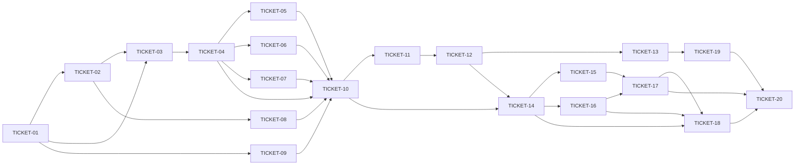

# Tasks — skill-pi

> **STATUS:** `ticketed` (2026-10-09)

> Sliced from `.skillgrid/specs/2026-10-09-skill-pi/blueprint.md`.
> Vertical tracer-bullet tickets, dependency-ordered, sized for one fresh agent context window.
> Ticketed into `.backlog/` via the backlogmd MCP tool.

## Ticket ID Mapping

| Ticket | Backlog ID | Title |
|--------|------------|-------|
| TICKET-01 | TASK-069 | T01 skill-pi/ module skeleton + ADR-0042 dependency pin |
| TICKET-02 | TASK-070 | T02 Launcher CLI + cwd shim + exit-75 respawn loop |
| TICKET-03 | TASK-071 | T03 Global config + system prompt delta |
| TICKET-04 | TASK-073 | T04 Five opencode-behavior extension ports |
| TICKET-05 | TASK-074 | T05 Permission + tickets + context + mcp-bridge extensions |
| TICKET-06 | TASK-075 | T06 pi-tui TUI |
| TICKET-07 | TASK-077 | T07 /memory-sync command + skills sync |
| TICKET-08 | TASK-076 | T08 Installer extension + --where + trust persistence |
| TICKET-09 | TASK-072 | T09 Chronos injection + version-pair + supply-chain gate |
| TICKET-10 | TASK-078 | T10 Foundation e2e tracer (R1-R22 proof) |
| TICKET-11 | TASK-079 | T11 goals table + tasks.goal_id migration (ADR-0039) |
| TICKET-12 | TASK-080 | T12 SpawnTask + team_spawn_task accept goal_id; reviews read route |
| TICKET-13 | TASK-081 | T13 ListTasksByGoal with per-status counts |
| TICKET-14 | TASK-082 | T14 pi squad extension scaffold (6 team-plane HTTP tools + squad_reviews) |
| TICKET-15 | TASK-083 | T15 Role discovery (roles.ts) |
| TICKET-16 | TASK-084 | T16 Worktree isolation (worktree.ts) |
| TICKET-17 | TASK-085 | T17 Subagent spawner (spawn.ts) + role prompts |
| TICKET-18 | TASK-086 | T18 Checkpoint (goal.ts) + two-review done gate |
| TICKET-19 | TASK-087 | T19 Dashboard goal-progress view |
| TICKET-20 | TASK-088 | T20 Swarm e2e tracer (goal-loop proof) |

## Epic Summary

Ship `skill-pi` — an opinionated, non-fork distribution of Pi that runs with the skillgrid standards, skills, memory, code index, events, squad, compaction, a permission extension, ticketing, a context extension, a custom TUI, and `/memory-sync` — all from skill-pi's own config paths (`~/.skill-pi/` + a per-project cwd shim to `<project>/.skill-pi/`), never touching a plain `pi` install. On top of that proven foundation, add a swarm extension: the main pi lead runs a goal-loop over the mnemonic team plane, spawning Pi SDK subagent sessions as worker/reviewer, enforcing the two-review done gate, with opt-in per-task worktree isolation and a `goals` container so the dashboard shows goal progress.

Two tracers in sequence: **Tracer A** (T1–T10, foundation) is proven end-to-end before **Tracer B** (T11–T20, swarm) layers on.

## Delivery Strategy

| Field | Value |
|-------|-------|
| Estimated changed lines | ~6000–8000 (20 tasks; foundation ~3500–4500, swarm ~2500–3500) |
| 400-line budget risk | High (new top-level `skill-pi/` module + Go plane migration + installer) |
| Chained PRs recommended | Yes |
| Suggested split | PR 1 (foundation T1–T10) → PR 2 (swarm T11–T20) |
| Delivery strategy | ask-on-risk |
| Chain strategy | stacked-to-main |

Decision needed before apply: Yes
Chained PRs recommended: Yes
Chain strategy: stacked-to-main
400-line budget risk: High

### Suggested Work Units

| Unit | Goal | Likely PR | Focused test command | Runtime harness | Rollback boundary |
|------|------|-----------|----------------------|-----------------|-------------------|
| 1 | `skill-pi/` module skeleton + ADR-0042 dep pin | PR 1 | `node --test skill-pi/version.test.js` | N/A (file-equality, no runtime) | `skill-pi/` + ADR file; remove = clean revert |
| 2 | Launcher CLI + cwd shim + exit-75 loop | PR 1 | `node --test skill-pi/bin/skill-pi.test.js` | fake child process (stubbed exit codes) | `skill-pi/bin/`; revert = launcher gone |
| 3 | Global config + system prompt delta | PR 1 | `node --test skill-pi/version.test.js -t config` | grep + unit test | `skill-pi/{mcp,settings}.json` + `system/` |
| 4 | Five opencode-behavior extension ports | PR 1 | `node --test skill-pi/extensions/*.test.ts -t port` | stubbed HTTP layer | `skill-pi/extensions/` (4 files + tests) |
| 5 | Permission + tickets + context + mcp-bridge | PR 1 | `node --test skill-pi/extensions/*.test.ts -t "permission\|ticket\|context\|bridge"` | stubbed HTTP + local store | 4 extension files + tests |
| 6 | `@earendil-works/pi-tui` TUI | PR 1 | `node --test skill-pi/tui/*.test.ts` | pure functions (breakpoint, gauge tone) | `skill-pi/tui/` + `themes/` |
| 7 | `/memory-sync` + skills sync | PR 1 | `node --test skill-pi/extensions/memory-sync.test.ts` | local mnemonic store (temp) | `skill-pi/prompts/` + `install/` + `skills/` |
| 8 | Installer extension + `--where` + trust | PR 1 | `go test ./skillgrid-cli/ -run TestInstall -v` | stubbed `npm ci` subprocess | `skillgrid-cli/` (Go) |
| 9 | Chronos + version-pair + supply-chain gate | PR 1 | `node --test skill-pi/version.test.js -t "chronos\|supply"` | file-equality + clock assertion | `skill-pi/extensions/chronos.ts` + test |
| 10 | Foundation e2e tracer (R1–R22 proof) | PR 1 | `node --test skill-pi/e2e.test.js` | real `skill-pi` launch in temp repo | `skill-pi/e2e.test.js` (integration only) |
| 11 | `goals` table + `tasks.goal_id` migration (ADR-0039) | PR 2 | `go test ./internal/integration/ -run TestTeamGoals -v` | real SQLite store (temp) | `056_team_goals.sql` + integration test |
| 12 | `SpawnTask` + `team_spawn_task` accept `goal_id`; reviews route | PR 2 | `go test ./internal/integration/ -run 'TestSpawnByGoal\|TestListReviews' -v` | real SQLite store | 3 Go files + test |
| 13 | `ListTasksByGoal` per-status counts | PR 2 | `go test ./internal/integration/ -run TestGoalProgressQuery -v` | real SQLite store | `goals.go` + HTTP route + test |
| 14 | pi squad extension scaffold (6 tools + `squad_reviews`) | PR 2 | `node --test skill-pi/extensions/skillgrid-squad.test.ts` | stubbed HTTP (mock server) | `skillgrid-squad.ts` + test + role placeholders |
| 15 | Role discovery (`roles.ts`) | PR 2 | `node --test skill-pi/extensions/skillgrid-squad.test.ts -t role` | temp roles dir | `roles.ts` + test + role files |
| 16 | Worktree isolation (`worktree.ts`) | PR 2 | `node --test skill-pi/extensions/skillgrid-squad.test.ts -t worktree` | temp git repo | `worktree.ts` + test |
| 17 | Subagent spawner (`spawn.ts`) + role prompts | PR 2 | `node --test skill-pi/extensions/skillgrid-squad.test.ts -t spawn` | stubbed pi subagent SDK | `spawn.ts` + test + role prompts |
| 18 | Checkpoint (`goal.ts`) + two-review gate | PR 2 | `node --test skill-pi/extensions/skillgrid-squad.test.ts -t "checkpoint\|gate"` | temp file + stubbed reviews | `goal.ts` + test |
| 19 | Dashboard goal-progress view | PR 2 | dashboard test (locate at exec time) | dashboard test harness | dashboard route/component + test |
| 20 | Swarm e2e tracer (goal-loop proof) | PR 2 | `node --test skill-pi/extensions/skillgrid-squad.test.ts -t e2e` | temp store + temp git repo | e2e test + lead prompt |

> The four plain-text guard lines above are the **contract** — `skillgrid:subagent-execution` matches them literally. Risk is High: every work unit names a focused test, a runtime harness (or `N/A` + reason), and a rollback boundary.

## Tickets

### TICKET-01 — `skill-pi/` module skeleton + ADR-0042 dependency pin

- **Scope:** Create the `skill-pi/` top-level module with `package.json` (piConfig identity + exact pi pin), `pi-version.txt`, ADR-0042, and README.
- **Acceptance:** `pi-version.txt` content equals the `package.json` dependency string for `@earendil-works/pi-coding-agent` (exact, no `^`/`~`/range). ADR-0042 is in `.skillgrid/artifacts/` and indexed in `.skillgrid/ASSUMPTIONS.md` § `LOCKED`. README names the min pi version for `piConfig.configDir`.
- **SATISFIES:** `skill-pi-module-skeleton`
- **Files:** `skill-pi/package.json`, `skill-pi/pi-version.txt`, `skill-pi/README.md`, `.skillgrid/artifacts/04-adr-0042-skill-pi-dependencies.md`, `.skillgrid/ASSUMPTIONS.md`, `skill-pi/version.test.js`
- **Size:** ~150 (S)
- **Blocks:** TICKET-02, TICKET-03, TICKET-09
- **Blocked by:** none
- **Precondition:** findings.md has the pi version + `piConfig.configDir` min-version contract
- **Reversibility:** one-way (ADR-0042: exact pin shapes the installer + TUI + min-version guard)
- **Fails-when:** `node --test skill-pi/version.test.js` exits non-zero

### TICKET-02 — Launcher CLI + cwd shim + exit-75 respawn loop

- **Scope:** Implement `skill-pi/bin/skill-pi.js`: env relocation, shim build (rebuild-from-scratch every launch), chdir, spawn (not exec), exit-75 loop (capped), owned subcommands (`init`/`sync`/`version`), `--where` 8-key JSON, trust persistence, `PI_SKIP_VERSION_CHECK` + `--no-skills` args.
- **Acceptance:** A fake child exiting 75 is re-spawned (second spawn asserted); a child exiting 0 is not re-spawned; a child exiting 75 eleven times stops the loop (cap). After `buildShim`, the shim's `package.json` has `piConfig.configDir = ".skill-pi"`; a new file in the real root is visible through the shim on rebuild. A missing root exits non-zero, no spawn. `--where` emits the 8-key JSON with `configDir === <project-root>/.skill-pi` and `agentDir === ~/.skill-pi`. `version` prints the pinned version without TUI. A pi flag like `--session` is forwarded. Spawn env has `PI_SKIP_VERSION_CHECK=1` + `--no-skills --no-prompt-templates --no-themes --extension <root>`. Fresh run fires trust prompt; after accept, `~/.skill-pi/trust.json` has a key = shim realpath; second run no prompt.
- **SATISFIES:** `skill-pi-launcher`, `cwd-shim`, `spawn-respawn-loop`, `owned-subcommands`, `where-json`, `trust-first-run`
- **Files:** `skill-pi/bin/skill-pi.js`, `skill-pi/bin/skill-pi.test.js`
- **Size:** ~400 (S)
- **Blocks:** TICKET-03, TICKET-08
- **Blocked by:** TICKET-01
- **Fails-when:** `node --test skill-pi/bin/skill-pi.test.js` exits non-zero

### TICKET-03 — Global config + system prompt delta

- **Scope:** Write `skill-pi/mcp.json`, `skill-pi/settings.json` (no provider base URL literal; base URL from env), `skill-pi/system/SYSTEM.md` (delta only, no persona/engram blocks), `skill-pi/system/APPEND_SYSTEM.md`.
- **Acceptance:** `grep -rE "https?://[a-z0-9.-]+/(v1|api)" skill-pi/settings.json skill-pi/mcp.json` returns no remote provider base URL (loopback `127.0.0.1:7438` allowed). Setting `SKILLGRID_MNEMONIC_HTTP_URL` changes the effective base URL. `grep -c "gentle-ai:persona\|gentle-ai:engram-protocol" skill-pi/system/SYSTEM.md` is 0.
- **SATISFIES:** `global-config-no-url`, `system-delta-only`
- **Files:** `skill-pi/mcp.json`, `skill-pi/settings.json`, `skill-pi/system/SYSTEM.md`, `skill-pi/system/APPEND_SYSTEM.md`, `skill-pi/version.test.js` (extend)
- **Size:** ~150 (S)
- **Blocks:** TICKET-04, TICKET-05
- **Blocked by:** TICKET-01, TICKET-02

### TICKET-04 — Five opencode-behavior extension ports

- **Scope:** Port `plugins/opencode/{mnemonic-memory,mnemonic-codeindex,skillgrid-events,skillgrid-compaction}.ts` to Pi's `ExtensionAPI.tool()` shape; reserve the squad slot (full squad is TICKET-14).
- **Acceptance:** Each port registers tools with byte-compatible names/params/behavior vs the opencode plugin. A `mem_save` call lands in the mnemonic store (integration: local store). A mutation failure sets the in-memory failure latch. `BASE_URL`/`AGENT` env resolution identical to the opencode plugin.
- **SATISFIES:** `extension-ports-register`
- **Files:** `skill-pi/extensions/mnemonic-memory.ts`, `skill-pi/extensions/mnemonic-codeindex.ts`, `skill-pi/extensions/skillgrid-events.ts`, `skill-pi/extensions/skillgrid-compaction.ts`, `skill-pi/extensions/*.test.ts`
- **Size:** ~500 (M)
- **Blocks:** TICKET-05, TICKET-06, TICKET-10
- **Blocked by:** TICKET-03

### TICKET-05 — Permission + tickets + context + mcp-bridge extensions

- **Scope:** Implement `permission.ts` (3-tier merge, tree-sitter bash matcher, edit gate, "Allow always" persists to local tier), `tickets.ts` (ticket tool + `/tickets` command, 40k truncation), `context.ts` (`/skillgrid context [usage|injections|compact]`), `mcp-bridge.ts` (register MCP servers as `mcp__<server>__<tool>` tools).
- **Acceptance:** A project-tier rule is overridden by the same tool+pattern in the local tier. A missing local file does not error. "Allow always" appends to the local file only. A tree-sitter parse of `git status | grep error` matches both rules. A command with a parse error falls back to wildcard matching. A `deny` rule on `rm -rf *` blocks `git status | rm -rf /` via the `rm` segment. `ticket ready` returns ready-for-agent tasks. `ticket create` produces `.backlog/tasks/task-NNN.md`; no `.tickets/` dir. A 50k-char list is truncated to 40k. `/skillgrid context usage` renders a "Mnemonic" category. `/skillgrid context injections` shows hidden parts. A pi session exposes `mcp__<server>__<tool>` entries for mnemonic/backlog/fluxcd/codescene/trivy.
- **SATISFIES:** `permission-gate`, `ticket-tool`, `context-command`, `mcp-bridge-registry`
- **Files:** `skill-pi/extensions/permission.ts`, `skill-pi/extensions/tickets.ts`, `skill-pi/extensions/context.ts`, `skill-pi/extensions/mcp-bridge.ts`, `skill-pi/extensions/*.test.ts` (extend)
- **Size:** ~700 (M)
- **Blocks:** TICKET-10
- **Blocked by:** TICKET-03, TICKET-04

### TICKET-06 — `@earendil-works/pi-tui` TUI

- **Scope:** Build the TUI on `@earendil-works/pi-tui` primitives: alt-screen root, header + context gauge, transcript (ScrollView), right rail (agents widget + changes viewer), bottom bar (compact layout). Breakpoint + gauge tone are pure functions.
- **Acceptance:** At width ≥140 the full layout (header + transcript + right rail) is selected. At width <140 the compact layout (bottom bar + agents widget) is selected. The gauge tone escalates at 0.80 (warning) and 0.95 (critical) usage ratios. Theme tokens in `skill-pi/themes/`.
- **SATISFIES:** `tui-breakpoint`, `tui-gauge-tone`
- **Files:** `skill-pi/tui/`, `skill-pi/themes/`, `skill-pi/tui/*.test.ts`
- **Size:** ~600 (M)
- **Blocks:** TICKET-10
- **Blocked by:** TICKET-04

### TICKET-07 — `/memory-sync` command + skills sync

- **Scope:** Implement `/memory-sync` (JSONL union merge by observation id, `merge=union` in `.gitattributes`, SQLite DB gitignored) and `sync.sh` (copy `~/.agents/skills/` → pi skills location, source unchanged).
- **Acceptance:** A store with N observations exports N rows. A second run with the same store exports N rows (not 2N). An empty store exports 0 rows (valid empty JSONL). After `sync.sh`, a representative `~/.agents/skills/<name>/SKILL.md` is present in the pi skills location; `~/.agents/skills/` is unchanged.
- **SATISFIES:** `memory-sync-jsonl`, `skills-sync`
- **Files:** `skill-pi/prompts/memory-sync.md`, `skill-pi/install/sync.sh`, `skill-pi/install/install.md`, `skill-pi/skills/`, `skill-pi/extensions/memory-sync.test.ts`, `.gitattributes`
- **Size:** ~300 (S)
- **Blocks:** TICKET-10
- **Blocked by:** TICKET-04

### TICKET-08 — Installer extension + `--where` + trust persistence

- **Scope:** Extend `skillgrid-cli` (Go) `install`/`sync-repo`/`setup` to copy `skill-pi/` → `~/.skill-pi/`, `npm ci` the pinned pi, materialize `<project>/.skill-pi/` + shim, put `skill-pi` on PATH. Confirm `--where` + trust wiring from TICKET-02.
- **Acceptance:** A stubbed `npm ci` that exits non-zero makes the install report failure (no `~/.skill-pi/node_modules/@earendil-works/pi-coding-agent` marked installed). A successful stubbed `npm ci` + copy + materialization produces `~/.skill-pi/node_modules/` at the pinned version, `<project>/.skill-pi/` materialized, the shim built, and `skill-pi` on PATH.
- **SATISFIES:** `installer-npm-ci`, `where-json`, `trust-first-run`
- **Files:** `skillgrid-cli/` (Go, modified), `skillgrid-cli/` install-seam test, `skill-pi/bin/skill-pi.js` (confirm)
- **Size:** ~350 (S)
- **Blocks:** TICKET-10
- **Blocked by:** TICKET-02

### TICKET-09 — Chronos injection + version-pair + supply-chain gate

- **Scope:** Implement `chronos.ts` (date/time injection into pi session context). Extend `version.test.js` with the version-pair equality + supply-chain assertions (exact pin, no `^`/`~`/range, shrinkwrap present).
- **Acceptance:** A pi session's context includes the injected date/time from `chronos.ts`, matching the system clock (within 1s). `pi-version.txt` content equals the `package.json` dependency string. The `@earendil-works/pi-*` deps are exact (no `^`/`~`/range).
- **SATISFIES:** `chronos-injection`, `version-pair-equality`
- **Files:** `skill-pi/extensions/chronos.ts`, `skill-pi/version.test.js` (extend)
- **Size:** ~200 (S)
- **Blocks:** TICKET-10
- **Blocked by:** TICKET-01

### TICKET-10 — Foundation e2e tracer (R1–R22 proof)

- **Scope:** Integration test driving a real `skill-pi` launch in a temp skillgrid repo, asserting the full R1–R22 surface. Wire the foundation modules together (integration, not new code).
- **Acceptance:** A `skill-pi` launch in a temp repo: reads global config from `~/.skill-pi/` + project config through the cwd shim (R1/R2); re-materializes the shim (R3); materializes a real gitignored `.skill-pi/` (R4); exposes the five ports' tools (R5); gates `edit` via permission (R6); exposes `ticket` tool (R7); renders context commands (R8); renders TUI at breakpoint (R9); exports `/memory-sync` JSONL (R10); lists synced skills (R11); honors version pin (R12); installs via Go installer (R13); forwards pi flags + owns subcommands (R14); emits `--where` (R15); keeps `SYSTEM.md` a delta (R16); overrides base URL (R17); spawns with skip-version + no-skills args (R18); exposes `mcp__*` tools (R19); persists trust (R20); injects date/time (R21); re-spawns on exit 75 (R22). `~/.pi/` and `<project-root>/.pi/` are byte-identical before and after.
- **SATISFIES:** `foundation-e2e`
- **Files:** `skill-pi/e2e.test.js`, `skill-pi/` (confirm wiring)
- **Size:** ~400 (S)
- **Blocks:** TICKET-11 (Tracer B gate)
- **Blocked by:** TICKET-04, TICKET-05, TICKET-06, TICKET-07, TICKET-08, TICKET-09

---

### TICKET-11 — `goals` table + `tasks.goal_id` migration (ADR-0039)

- **Scope:** Create migration `056_team_goals.sql`: `goals` table, `tasks.goal_id` nullable FK, `tasks.worktree_branch` nullable column, both indexes. Integration test asserting schema.
- **Acceptance:** The `goals` table exists. Insert a goal, insert a task with `goal_id` set — the task's `goal_id` column reads back the goal id. A task with no goal has `goal_id IS NULL`. The migration file is numbered above the newest existing migration (verified at exec time).
- **SATISFIES:** `goal-container-migration`
- **Files:** `mnemonic/internal/store/migrations/056_team_goals.sql`, `mnemonic/internal/integration/step07_team_goals_test.go`
- **Size:** ~200 (S)
- **Blocks:** TICKET-12
- **Blocked by:** TICKET-10 (Tracer A complete)
- **Reversibility:** one-way (ADR-0039: schema migration, table + index shape)
- **Fails-when:** `go test ./internal/integration/ -run TestTeamGoals -v` exits non-zero

### TICKET-12 — `SpawnTask` + `team_spawn_task` accept `goal_id`; reviews read route

- **Scope:** Add `GoalID *string` to `SpawnTask` param struct; include `goal_id` in the INSERT. Add optional `goal_id` param to `team_spawn_task` MCP + HTTP. Add `ListReviews(ctx, taskID)` service method + `GET /teams/tasks/{id}/reviews` route (defect A: the two-review gate's read path).
- **Acceptance:** `SpawnTask` with `GoalID` set → task's `goal_id` equals the goal id. `SpawnTask` with `GoalID` nil → `goal_id IS NULL`. Submit a `spec_compliance` review and a `code_quality` review, then `ListReviews(taskID)` returns both with the right `ReviewType`/`Passed`.
- **SATISFIES:** `spawn-task-by-goal`
- **Files:** `mnemonic/internal/service/teams.go`, `mnemonic/internal/mcp/tools_teams.go`, `mnemonic/internal/http/teams.go`, `mnemonic/internal/integration/step07_team_goals_test.go` (extend)
- **Size:** ~300 (S)
- **Blocks:** TICKET-13, TICKET-14
- **Blocked by:** TICKET-11

### TICKET-13 — `ListTasksByGoal` with per-status counts

- **Scope:** Create `mnemonic/internal/service/goals.go`: `ListGoals` (per-status counts) + `ListTasksByGoal` (returns `TaskRow{ID,Title,Status,WorktreeBranch}`). Add `GET /teams/goals` + `GET /teams/goals/{id}/tasks` HTTP routes.
- **Acceptance:** A goal with tasks in 3 statuses → `ListGoals` returns the goal with correct per-status counts. `ListTasksByGoal` returns the goal's tasks (not the NULL-goal one). A task with `goal_id IS NULL` appears under "(no goal)" and is not lost.
- **SATISFIES:** `goal-progress-query`
- **Files:** `mnemonic/internal/service/goals.go`, `mnemonic/internal/http/teams.go` (extend), `mnemonic/internal/integration/step07_team_goals_test.go` (extend)
- **Size:** ~250 (S)
- **Blocks:** TICKET-19
- **Blocked by:** TICKET-12

### TICKET-14 — pi squad extension scaffold (6 team-plane HTTP tools + `squad_reviews`)

- **Scope:** Port `plugins/opencode/skillgrid-squad.ts` 6-tool logic to `skill-pi/extensions/skillgrid-squad.ts` (pi `ExtensionAPI.tool()` shape). Add `squad_reviews` read tool (calls `GET /teams/tasks/{id}/reviews` from TICKET-12). Add `goal_id` pass-through to `squad_spawn_task`. Create role placeholder files.
- **Acceptance:** Each of the 7 tools posts/gets the right endpoint with the right body (byte-compatible with the opencode plugin for the 6; `squad_reviews` → `GET /teams/tasks/{id}/reviews`). A mutation failure sets the in-memory failure latch. `squad_spawn_task` with a `goal_id` posts the field; without `goal_id` posts `null`/omits it.
- **SATISFIES:** `squad-http-adapter`
- **Files:** `skill-pi/extensions/skillgrid-squad.ts`, `skill-pi/extensions/skillgrid-squad.test.ts`, `agents/pi/roles/worker.md` (placeholder), `agents/pi/roles/reviewer.md` (placeholder), `skill-pi/package.json` (confirm identity)
- **Size:** ~400 (S)
- **Blocks:** TICKET-15, TICKET-16, TICKET-17, TICKET-18
- **Blocked by:** TICKET-12, TICKET-10 (foundation proven)

### TICKET-15 — Role discovery (`roles.ts`)

- **Scope:** Implement `discoverRoles(rolesDir): Role[]` (glob `*.md`, parse `model:` frontmatter, strip frontmatter from prompt). Register a `swarm_role` tool. Give `worker.md`/`reviewer.md` real minimal prompts.
- **Acceptance:** In a temp roles dir with `a.md`, `b.md` (with `model: x`), and a non-`.md` file: `discoverRoles` returns `{a},{b}` (not the non-`.md`), `b.model === "x"`. Write `c.md` and re-call — `c` appears (new file = new role, no code change).
- **SATISFIES:** `role-discovery`
- **Files:** `skill-pi/extensions/roles.ts`, `skill-pi/extensions/skillgrid-squad.test.ts` (extend), `agents/pi/roles/worker.md`, `agents/pi/roles/reviewer.md`
- **Size:** ~200 (S)
- **Blocks:** TICKET-17
- **Blocked by:** TICKET-14

### TICKET-16 — Worktree isolation (`worktree.ts`)

- **Scope:** Implement `createWorktree(repoRoot, taskID)`, `commitWorktree(path, branch, taskID)`, `removeWorktree(path, branch)`. Branch = `worktree-agent-swarm-<taskID>` (matches precommit-guard regex). Reject `task_id` not matching `[A-Za-z0-9-]+` before any git call. Wire into `skillgrid-squad.ts` spawn path.
- **Acceptance:** In a temp git repo: `createWorktree` produces a path under `.worktrees/` and a branch matching `^(agent-|worktree-agent-|worktree-wf_)[A-Za-z0-9._/-]+$`. A `task_id` with a space is rejected (no git exec). `commitWorktree` on a repo with changes produces a commit on the branch. A git failure (non-zero exit) leaves the worktree path on disk and returns stderr.
- **SATISFIES:** `worktree-isolation`
- **Files:** `skill-pi/extensions/worktree.ts`, `skill-pi/extensions/skillgrid-squad.test.ts` (extend), `skill-pi/extensions/skillgrid-squad.ts` (extend)
- **Size:** ~300 (S)
- **Blocks:** TICKET-17, TICKET-18
- **Blocked by:** TICKET-14

### TICKET-17 — Subagent spawner (`spawn.ts`) + role prompts

- **Scope:** Implement `swarmSpawn({role, taskID, worktree?})`: resolve role via `discoverRoles`, create worktree if requested, spawn pi subagent session with role prompt + `owner=taskID` + cwd. Serial guard: a second `swarmSpawn` while one is active throws. Register `swarm_spawn` tool. Write full worker/reviewer role prompts.
- **Acceptance:** `swarmSpawn({role:"worker", taskID:"t1"})` → the fake SDK received `owner="t1"`, `cwd=<repoRoot>`, worker role prompt. With `worktree:true` → `cwd` is the worktree path. A second `swarmSpawn` while the first is active throws "a worker is already active". `role:"nope"` → unknown-role error.
- **SATISFIES:** `swarm-spawn-subagent`, `serial-by-default`
- **Files:** `skill-pi/extensions/spawn.ts`, `skill-pi/extensions/skillgrid-squad.test.ts` (extend), `skill-pi/extensions/skillgrid-squad.ts` (extend), `agents/pi/roles/worker.md`, `agents/pi/roles/reviewer.md`
- **Size:** ~350 (S)
- **Blocks:** TICKET-18, TICKET-20
- **Blocked by:** TICKET-15, TICKET-16

### TICKET-18 — Checkpoint (`goal.ts`) + two-review done gate

- **Scope:** Implement `goalMark(taskID, status)` (atomic write: temp + rename, shape `{current, status, updated}`) + `goalResume()` (read + validate, corrupt/absent → null). Implement `bothReviewsPassed(taskID)` (calls `squad_reviews`, true only if both a passing `spec_compliance` AND a passing `code_quality` review exist). Gate `squad_mark_done` on it. On a passing gate, trigger `commitWorktree` for `worktree:true` tasks (commit-on-done is a code guarantee, not conversational).
- **Acceptance:** `goalMark` then `goalResume` round-trips `{current, status}`. A corrupt file (truncated JSON) → `goalResume` returns null (not a throw). Seed a task with only a passing `spec_compliance` review → `bothReviewsPassed` is false and `squad_mark_done` refuses. Add a passing `code_quality` → `bothReviewsPassed` true and `squad_mark_done` proceeds. A `code_quality` with `passed=false` → still false.
- **SATISFIES:** `checkpoint-roundtrip`, `two-review-gate`
- **Files:** `skill-pi/extensions/goal.ts`, `skill-pi/extensions/skillgrid-squad.test.ts` (extend), `skill-pi/extensions/skillgrid-squad.ts` (extend)
- **Size:** ~350 (S)
- **Blocks:** TICKET-20
- **Blocked by:** TICKET-14, TICKET-16, TICKET-17

### TICKET-19 — Dashboard goal-progress view

- **Scope:** Locate the existing dashboard surface (grep `skillgrid-ui/` + `skillgrid-cli/`). Add a goal list (from `GET /teams/goals`) + goal detail (from `GET /teams/goals/{id}/tasks`) showing per-status counts + task list with `worktree_branch`. Route `goal_id IS NULL` tasks to a "(no goal)" bucket.
- **Acceptance:** A goal with tasks in pending/in-progress/review_spec renders the 3 counts. A goal-less task renders under "(no goal)" and is not lost.
- **SATISFIES:** `dashboard-goal-progress`
- **Files:** `<located dashboard route/component>`, dashboard test
- **Size:** ~300 (S)
- **Blocks:** TICKET-20
- **Blocked by:** TICKET-13

### TICKET-20 — Swarm e2e tracer (goal-loop proof)

- **Scope:** Integration test against a real temp store + temp git repo: lead decomposes a goal → `squad_spawn_task` with `goal_id` → `swarmSpawn` worker (worktree) → `squad_submit_output` → reviewer spec → reviewer code → `squad_mark_done` → assert goal shows 1 done + branch exists. Write the lead's goal-loop prompt (the conversational driver, R7).
- **Acceptance:** The task's `goal_id` is set. The goal's per-status count shows `done:1`. The branch `worktree-agent-swarm-<taskID>` exists with a commit. The checkpoint `progress.json` reflects `done`. The lead's goal-loop prompt encodes R7's sequence + checkpoint discipline.
- **SATISFIES:** `e2e-goal-loop`
- **Files:** `skill-pi/extensions/skillgrid-squad.test.ts` (extend), `skill-pi/system/APPEND_SYSTEM.md` (or `prompts/`), lead goal-loop prompt
- **Size:** ~400 (S)
- **Blocks:** none (tracer complete)
- **Blocked by:** TICKET-17, TICKET-18, TICKET-19

## Dependency Graph

## Execution Order

### P1 — Foundation (skill-pi folder base structure; build goal: build pi that calls skill-pi and uses skill-pi folders)

- **Wave 1:** TICKET-01 (module skeleton + ADR-0042 dep pin)
- **Wave 2:** TICKET-02 (launcher CLI + cwd shim + exit-75 respawn loop, after TICKET-01)
- **Wave 3:** TICKET-03 (global config + system prompt delta, after TICKET-01 + TICKET-02), TICKET-09 (chronos + version-pair + supply-chain gate, after TICKET-01), TICKET-08 (installer extension + --where + trust, after TICKET-02)

### P3 — TUI (TUI interface for skill-pi, logo from opencode tui plugin, tokyonight color)

- **Wave 4:** TICKET-04 (five opencode-behavior extension ports, after TICKET-03)
- **Wave 5:** TICKET-06 (pi-tui TUI, after TICKET-04)

### P2 — Permission system

- **Wave 6:** TICKET-05 (permission + tickets + context + mcp-bridge extensions, after TICKET-03 + TICKET-04)

### P4 — Mnemonic integration

- **Wave 7:** TICKET-07 (/memory-sync command + skills sync, after TICKET-04)

### Foundation gate

- **Wave 8:** TICKET-10 (foundation e2e tracer, after TICKET-04 + TICKET-05 + TICKET-06 + TICKET-07 + TICKET-08 + TICKET-09) — **Tracer A complete gate**

### P5 — Mnemonic context integration
### P6 — Mnemonic team work (swarm)

- **Wave 9:** TICKET-11 (after TICKET-10)
- **Wave 10:** TICKET-12 (after TICKET-11)
- **Wave 11:** TICKET-13 (after TICKET-12), TICKET-14 (after TICKET-12 + TICKET-10)
- **Wave 12:** TICKET-15 (after TICKET-14), TICKET-16 (after TICKET-14)
- **Wave 13:** TICKET-17 (after TICKET-15 + TICKET-16)
- **Wave 14:** TICKET-18 (after TICKET-14 + TICKET-16 + TICKET-17), TICKET-19 (after TICKET-13)
- **Wave 15:** TICKET-20 (after TICKET-17 + TICKET-18 + TICKET-19) — **Tracer B complete**

> **Acceptance-first (BDD is always on):** a ticket's failing acceptance scenario (its `SATISFIES` scenario) is written and confirmed RED *before* the implementation that makes it green.

> **Tracer gate:** TICKET-10 (foundation e2e) must pass before TICKET-11 (swarm migration) starts. The swarm slice layers on the proven foundation.

## Slicing Notes

- **Two-tracer build shape:** Tracer A (T1–T10) is a complete vertical slice — a working `skill-pi` foundation proven e2e. Tracer B (T11–T20) layers the swarm on. The gate between them is TICKET-10 → TICKET-11.
- **ADR one-way doors:** TICKET-01 (ADR-0042, pi dependency pin) and TICKET-11 (ADR-0039, goals table + FK) are one-way. Both are tagged `Reversibility: one-way` in their tickets, which inserts a human checkpoint before execution.
- **TICKET-05 is the largest foundation ticket** (~700 lines, 4 extensions). If it exceeds the 400-line budget in practice, split into `permission.ts` + `tickets.ts` (5a) and `context.ts` + `mcp-bridge.ts` (5b) — the mcp-bridge is a prerequisite for the five ports' MCP calls, so 5b before 5a's integration test.
- **TUI (TICKET-06) runs before the permission system (TICKET-05).** The TUI depends only on TICKET-04 (extension ports), not on the permission system. This lets the TUI be built and visually verified against the working launcher + config before the permission layer is added. Both still feed the TICKET-10 e2e gate.
- **TICKET-14 depends on TICKET-12** (the reviews read route) AND **TICKET-10** (foundation proven). The squad extension is the swarm's entry point into the pi side; it needs the plane's `GET /teams/tasks/{id}/reviews` route (defect A) and the proven foundation's extension-loading mechanism.
- **TICKET-19 dashboard location is a find, not a placeholder:** the query contract is pinned by TICKET-13; the render location is located at exec time by grepping `skillgrid-ui/`.
- **File boundary assumption:** `skill-pi/extensions/skillgrid-squad.test.ts` is the single test file for all swarm extension tests (TICKET-14 through TICKET-20 extend it). This keeps the test surface in one place and mirrors the opencode plugin's single-file test pattern.
- **`agents/pi/roles/` is at repo root** (not under `skill-pi/`), per the blueprint's file structure. The role files are committed (not synced from `~/.agents/`).
- **Serial development constraint:** one change at a time. The wave structure above is strictly sequential within each tracer; no parallel tickets within a wave (except TICKET-09 in Wave 3, which is independent of TICKET-03/04).
