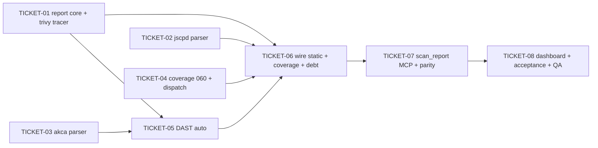

# Tasks — Quality Report

> **STATUS:** `sliced` (2026-10-17)

> Sliced from `.skillgrid/specs/2026-10-17-quality-report/blueprint.md`.
> Vertical tracer-bullet tickets, dependency-ordered, sized for one fresh agent context window.
> Build shape: **tracer thread** — TICKET-01 is the thin end-to-end path (collect → emit → route → page); later tickets thicken it.

## Epic Summary

One command produces a unified quality report (CVE, SAST, DAST, duplication, code debt, test coverage) for **any** project skillgrid is installed in. The report service reuses the existing scan pipeline (`findings` store, ADR-0030), adds two parsers (jscpd, akca) + their `scannerCommands` arms, a grep debt source, and a detected-dispatch coverage source (line %, five languages, ADR-0038). Emits JUnit XML + JSON, served by `GET /report/{fmt}` + the `scan_report` MCP tool, visualized on a new `/reports` dashboard page. Fail-open throughout (ADR-0016).

## Delivery Strategy

| Field | Value |
|-------|-------|
| Estimated changed lines | ~2400–3000 (Go report pkg + parsers + migration + MCP + HTTP + UI six panels + tests) |
| 400-line budget risk | High |
| Chained PRs recommended | Yes |
| Suggested split | PR 1 (report core + endpoints) → PR 2 (parsers + debt + DAST + full static set) → PR 3 (coverage dispatch) → PR 4 (dashboard + acceptance) |
| Delivery strategy | ask-on-risk |
| Chain strategy | feature-branch-chain |

Decision needed before apply: Yes
Chained PRs recommended: Yes
Chain strategy: feature-branch-chain
400-line budget risk: High

### Suggested Work Units

| Unit | Goal | Likely PR | Focused test command | Runtime harness | Rollback boundary |
|------|------|-----------|----------------------|-----------------|-------------------|
| 1 | Report core (collect-over-findings, JUnit+JSON emit, `/report/{fmt}`, `scan_report`) + trivy tracer | PR 1 (base=main) | `go test ./mnemonic/internal/report/ ./mnemonic/internal/mcp/ ./mnemonic/internal/http/ -count=1` | N/A — unit + httptest (no live scanner) | `mnemonic/internal/report/` + `http/report.go` + `mcp/tools_report.go` removable as a set |
| 2 | Parsers (jscpd, akca) + `scannerCommands` arms + debt grep + DAST auto + full static set | PR 2 (base=PR1 branch) | `go test ./mnemonic/internal/scan/ ./mnemonic/internal/report/ -count=1` | N/A — fixture-driven parsers + stubbed runner | `parse.go`/`service.go` scanner arms + `report/debt.go` + `report/dast.go` |
| 3 | Coverage: migration 060 + detected dispatch (5 langs, line %) + coverage panels | PR 3 (base=PR2 branch) | `go test ./mnemonic/internal/report/ -run 'Cover|DetectKind' -count=1` | N/A — fixture JSON per language (no live coverage run) | `migrations/060_coverage.sql` + `report/coverage.go` |
| 4 | Dashboard `/reports` page (six panels) + `acceptance.feature` green + QA gate | PR 4 (base=PR3 branch) | `cd skillgrid-ui && npx vitest run src/features/reports/` | Browser: open `/reports` on a fixture project | `skillgrid-ui/src/features/reports/` |

> The four plain-text guard lines above are the **contract** — `skillgrid:subagent-execution` matches them literally. Risk is High, so every work unit names a focused test, a runtime harness (or N/A + reason), and a rollback boundary.

## Tickets

### TICKET-01 — Report core: trivy tracer end-to-end (door check)

- **Scope:** The `report` package skeleton (`Service`, `Report`/`SourceResult`/`CoverageRow`, `Collect` with the trivy source + fail-open shell), the two emitters (`emit.JUnit` with zero-finding empty testsuites, `emit.JSON`), `reportConfigFrom` (reads `dast.url` from the downstream `config.yaml`), the `scan.FindingsByScan` + `scan.ExecRunner` helpers, the `GET /report/{fmt}` routes (write-auth wrapped), and the minimal `/reports` page + route (trivy/CVE panel only). The tracer thread: if this end-to-end path doesn't work, the collect-over-findings approach is wrong (blueprint Hypothesis door check).
- **Acceptance:** `GET /report/json` on a Go fixture returns a `trivy` section with the fixture CVE and HTTP 200 (door check); `GET /report/junit.xml` is well-formed JUnit with a `trivy` testsuite and a zero-finding source emits `<testsuite tests="0">`; a source that errors is present with `status="error"` and the report still emits; `GET /report/json` renders the `/reports` page CVE panel.
- **SATISFIES:** `report-aggregates-static-sources`, `report-source-error-is-fail-open`, `junit-xml-per-tool-testsuite`, `junit-xml-zero-finding-source-is-empty-testsuite`, `json-report-shape`, `cve-trivy-report`, `report-http-endpoints`, `dashboard-reports-page`
- **Files:** `mnemonic/internal/report/{service,collect}.go` + `emit/{junit,json}.go` + tests; `mnemonic/internal/scan/service.go` (+`FindingsByScan`, +`ExecRunner`) + `service_test.go`; `mnemonic/internal/http/{report.go,report_test.go,server.go}`; `skillgrid-ui/src/features/reports/{ReportsPage.tsx,api.ts,ReportsPage.test.tsx}` + `app.tsx`
- **Size:** ~900 (M)
- **Blocks:** TICKET-02, TICKET-03, TICKET-04, TICKET-05, TICKET-06
- **Blocked by:** none
- **Fails-when:** `go test ./mnemonic/internal/report/ -run TestCollect_TrvySource_FailOpen` exits non-zero, OR `GET /report/json` does not return 200 with a `trivy` section (door check fails → stop and revisit collect-over-findings).

### TICKET-02 — jscpd parser + `scannerCommands` arm (duplication source)

- **Scope:** `parseJscpd` (maps `--reporters json` clones → `Finding{rule_id:duplication}`), the `Parse` dispatch arm, the `scannerCommands["jscpd"]` arm so `scan.Start` can run it. jscpd is **already installed** by `GlobalTools()` — no installer change. (Parser hardcodes `MEDIUM`; no severity-map entry.)
- **Acceptance:** `TestParseJscpd` maps a 2-clone fixture to 2 findings (rule_id=duplication, file+line, severity MEDIUM); `TestParseDispatchIncludesJscpd` no longer returns "unsupported tool"; `TestScannerCommandsIncludesJscpd` passes.
- **SATISFIES:** `duplication-jscpd-report`
- **Files:** `mnemonic/internal/scan/{parse.go,service.go,parse_test.go}` + `fixtures/jscpd.json`
- **Size:** ~250 (S)
- **Blocks:** TICKET-06
- **Blocked by:** none (independent of TICKET-01; runs in Wave 1)
- **Fails-when:** `go test ./mnemonic/internal/scan/ -run 'TestParseJscpd|TestScannerCommandsIncludesJscpd'` exits non-zero.

### TICKET-03 — akca parser + `scannerCommands` arm

- **Scope:** `parseAkca` (maps AKCA evidence-driven `findings[]` → `Finding` with rule id + file + proof), the `Parse` arm, the `scannerCommands["akca"]` arm, and the `toolSeverityMaps["akca"]` entry (`ERROR→HIGH`, `WARNING→MEDIUM`).
- **Acceptance:** `TestParseAkca` maps a 3-finding fixture to 3 findings (rule id + file + normalized severity).
- **SATISFIES:** `dast-auto-from-config` (akca leg)
- **Files:** `mnemonic/internal/scan/{parse.go,service.go,severity.go,parse_test.go}` + `fixtures/akca.json`
- **Size:** ~200 (S)
- **Blocks:** TICKET-05
- **Blocked by:** none (runs in Wave 1)
- **Fails-when:** `go test ./mnemonic/internal/scan/ -run TestParseAkca` exits non-zero.

### TICKET-04 — Coverage: migration 060 + detected dispatch (kind detect + CmdFor + StoreCoverage + Go parse)

> ⚠ one-way: migration 060 adds the `coverage` table (additive SQLite schema change). STOP for explicit user approval before applying it to a live project DB.

- **Scope:** `060_coverage.sql` (`coverage` table + index), `DetectKind` (manifest-based project-kind detection), `CmdFor` (native coverage command per kind — all five arms), `StoreCoverage` (single signature: `ctx, db, project, rows, now`; upsert), and `parseCoverGo` + the `parseCover(k, data)` dispatcher. Task 4 implements the Go parse arm (door-check language); the other four arms are TICKET-06.
- **Acceptance:** `TestDetectKind` maps each manifest to its kind (go.mod→go, package.json→ts, pyproject.toml→py, Cargo.toml→rust, pom.xml→java, else unknown); `TestCmdFor_AllFive` returns a command for all five kinds and errors for unknown; `TestStoreCoverage_Upsert` upserts (not duplicates) and latest `pct_line` wins.
- **SATISFIES:** `coverage-dispatch-go`
- **Files:** `mnemonic/internal/store/migrations/060_coverage.sql`; `mnemonic/internal/report/{coverage.go,coverage_test.go}` + `fixtures/cover.go.json`
- **Size:** ~400 (M)
- **Blocks:** TICKET-06
- **Blocked by:** none (runs in Wave 1)
- **Reversibility:** one-way (migration 060)
- **Precondition:** migration 059 is the highest applied; `ls mnemonic/internal/store/migrations/ | sort | tail -1` shows a number < 060.
- **Fails-when:** `go test ./mnemonic/internal/report/ -run 'TestDetectKind|TestCmdFor_AllFive|TestStoreCoverage_Upsert'` exits non-zero, OR the store migration suite fails to apply 060.

### TICKET-05 — DAST auto from `dast.url` + fail-open (wapiti/nuclei/akca)

- **Scope:** `collectDAST` — empty `DastURL` → `nil` (no DAST section); set → reachability probe (HEAD, 3s timeout); unreachable → all three `SourceResult{Status:"unavailable"}`; reachable → run wapiti/nuclei/akca via the reused `scan.Service`. Per-tool error → that tool `error`, others continue (fail-open). Wire `rep.Dynamic = collectDAST(ctx)` into `Collect`.
- **Acceptance:** `TestCollectDAST_Unset_Nil` returns nil; `TestCollectDAST_Unreachable_FailOpen` returns three `unavailable` sources with static sources still present; `TestCollectDAST_Reachable_RunsThree` returns three `ok` sources with findings.
- **SATISFIES:** `dast-auto-from-config`, `dast-unreachable-fail-open`, `dast-unset-is-absent`
- **Files:** `mnemonic/internal/report/{collect.go,dast_test.go,service.go}`
- **Size:** ~350 (M)
- **Blocks:** TICKET-06
- **Blocked by:** TICKET-01 (reuses the `Collect`/`SourceResult` shape), TICKET-03 (akca must be runnable via `Start`)
- **Fails-when:** `go test ./mnemonic/internal/report/ -run 'TestCollectDAST'` exits non-zero.

### TICKET-06 — Wire remaining static sources (semgrep + jscpd) + coverage arms + debt + full static set

- **Scope:** `collectSemgrep` + `collectJscpd` (mirror `collectTrivy`: Start → StoreFindings → read back); the four remaining coverage parse arms (`parseCoverTS/Py/Rust/Java` from the native JSON shapes) wired through `parseCover`; `collectDebt` (grep `TODO|FIXME|XXX` → findings, walk `s.root` skipping `node_modules`/`.git`/`vendor`); `collectCoverage` wired into `Collect` (upserts rows, marks `unavailable` on missing tool). Final `Static` set = `[trivy, semgrep, jscpd, debt, coverage]`.
- **Acceptance:** `TestCollect_FullStaticSet` asserts all five static sources present; `TestParseCover_AllKinds` maps ts/py/rs/java fixtures to correct file+pct_line; `TestCollectDebt` finds 3 markers (debt:TODO/FIXME/XXX) with file+line; `TestCollect_CoverageToolMissing_Unavailable` marks coverage `unavailable` with no propagated error.
- **SATISFIES:** `sast-semgrep-report`, `duplication-jscpd-report`, `coverage-dispatch-ts`, `coverage-dispatch-py`, `coverage-dispatch-rs`, `coverage-dispatch-java`, `debt-markers-report`, `coverage-tool-missing-unavailable`
- **Files:** `mnemonic/internal/report/{collect.go,debt.go,coverage.go,collect_test.go,coverage_test.go,dast_test.go}` + `fixtures/cover.{ts,py,rs,java}.json`
- **Size:** ~700 (M)
- **Blocks:** TICKET-07
- **Blocked by:** TICKET-01, TICKET-02 (jscpd arm), TICKET-04 (coverage CmdFor/StoreCoverage), TICKET-05 (DAST wired so the full Collect is stable)
- **Fails-when:** `go test ./mnemonic/internal/report/ -run 'TestCollect_FullStaticSet|TestParseCover_AllKinds|TestCollectDebt|TestCollect_CoverageToolMissing_Unavailable'` exits non-zero.

### TICKET-07 — `scan_report` MCP tool + HTTP/MCP parity

- **Scope:** `scan_report` MCP tool (arg `format: junit|json`) + `registerReportTools`, called in **both** `Start()` and `NewServer()` of `mcp/server.go`. The handler calls the same `Collect` + emitter as the HTTP route (byte-identical output for the same report).
- **Acceptance:** `TestScanReportTool_Registered` asserts `scan_report` is present with a required `format` arg; `TestScanReportHandler_JSON` returns valid JSON with a `static` key; `TestScanReport_Parity_SameReportBothEmitters` shows the same `Report` → `emit.JUnit` is deterministic and the MCP output equals the emitter output.
- **SATISFIES:** `report-aggregates-static-sources` (MCP leg), `report-mcp-tool-registered`, `report-mcp-http-parity`
- **Files:** `mnemonic/internal/mcp/{tools_report.go,tools_report_test.go,server.go}`
- **Size:** ~300 (S)
- **Blocks:** TICKET-08
- **Blocked by:** TICKET-01 (Collect + emitters), TICKET-06 (full static set so the report is complete)
- **Fails-when:** `go test ./mnemonic/internal/mcp/ -run 'TestScanReport'` exits non-zero.

### TICKET-08 — Dashboard `/reports` page: six panels + acceptance green + QA gate

- **Scope:** Extract `SevBadge` from `SecurityPage.tsx` into `components/ui/Badges.tsx` (exported; `SecurityPage` re-imports it). Six panels (CVE, SAST, DAST, duplication, debt, coverage — each pure presentational; coverage uses a d3 heat bar). `ReportsPage` renders the static panels always; `DastPanel` only when `rep.dynamic?.length` (absent when unset, "unavailable" when unreachable). Confirm `acceptance.feature` (24 scenarios) is green; run the full Go + UI suites; run the QA gate (L3, per the risky classification).
- **Acceptance:** `ReportsPage.test.tsx` — all six panels render from a full fixture JSON; the DAST panel is omitted when there is no `dynamic` section; the DAST panel shows an unavailable state when `dynamic[].status="unavailable"`. Full `go test ./...` + `npx vitest run` green. QA gate PASS (or documented CONCERNS).
- **SATISFIES:** `dashboard-reports-page`, `dashboard-dast-conditional`, `dashboard-dast-unavailable`
- **Files:** `skillgrid-ui/src/features/reports/panels/*.tsx` (six) + `ReportsPage.tsx` + `ReportsPage.test.tsx`; `skillgrid-ui/src/components/ui/Badges.tsx`; `skillgrid-ui/src/features/security/SecurityPage.tsx` (re-import SevBadge); `.skillgrid/specs/2026-10-17-quality-report/acceptance.feature` (confirm green)
- **Size:** ~800 (M)
- **Blocks:** none
- **Blocked by:** TICKET-07 (the report must be complete + served before the page renders real data)
- **Fails-when:** `cd skillgrid-ui && npx vitest run src/features/reports/ReportsPage.test.tsx` exits non-zero, OR `go test ./...` exits non-zero.

## Dependency Graph

## Execution Order

- **Wave 1 (parallel):** TICKET-01, TICKET-02, TICKET-03, TICKET-04
- **Wave 2:** TICKET-05 (after TICKET-01 + TICKET-03)
- **Wave 3:** TICKET-06 (after TICKET-01 + TICKET-02 + TICKET-04 + TICKET-05)
- **Wave 4:** TICKET-07 (after TICKET-06)
- **Wave 5:** TICKET-08 (after TICKET-07)

> **Acceptance-first (BDD is always on):** each ticket's `SATISFIES` scenario is written into `acceptance.feature` (done — 24 scenarios) and confirmed RED before the implementation that makes it green. `acceptance.feature` already exists with valid syntax, satisfying the slicing prerequisite.

## Slicing Notes

- **Tracer thread honored:** TICKET-01 is the thin end-to-end path (collect → emit → route → page) and carries the door check. Every later ticket thickens one source or layer.
- **Wave 1 has four parallel tickets** (T01–T04) with no cross-dependencies: T01 is the report core, T02/T03 are independent parsers, T04 is the coverage table + dispatch. They touch disjoint files (except T02/T03 both edit `scan/parse.go` + `scan/service.go` — if serial execution is enforced per AGENTS.md § Rules, run T02 then T03; the wave grouping is for parallel-capable executors).
- **AGENTS.md § Rules — serial development:** this repo is "one change at a time, no parallel branches." The waves above describe *dependency* order; under serial execution they become a strict sequence T01 → T02 → T03 → T04 → T05 → T06 → T07 → T08. The parallel wave grouping is retained so a parallel-capable executor (subagent worktrees) can compress it.
- **One-way door:** only TICKET-04 (migration 060). The first draft's second one-way door (jscpd in `SecurityTools()`) is dropped — jscpd is already in `GlobalTools()`.
- **T02/T03 file overlap:** both add a `Parse` arm + a `scannerCommands` entry in `scan/parse.go`/`scan/service.go`. Small, non-conflicting edits (different switch arms + different map keys). Under serial execution there is no merge; under parallel worktrees they must be sequenced or the executor must rebase.
- **Coverage is the only new table** (060). No other schema change. The report is otherwise a pure view over the existing `findings` store (ADR-0030).
- **Assumption carried from the blueprint (not ratify-flagged):** jscpd/akca/coverage tools are external CLIs invoked via `exec`, installed on the downstream machine — recorded in ADR-0038. No new Go dependency.
