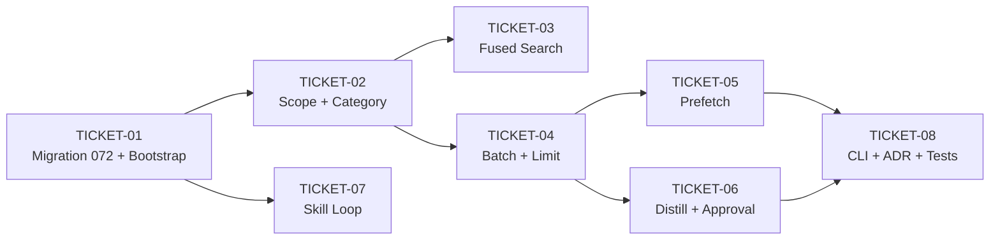

# Tasks — Global Operational Memory + Skill Improvement Loop

> **STATUS:** `sliced` (2026-10-24)

> Sliced from `.skillgrid/specs/2026-10-24-global-llm-wiki/blueprint.md`.
> Vertical tracer-bullet tickets, dependency-ordered, sized for one fresh agent context window.

## Epic Summary

Add a cross-project, cross-session, cross-agent fact store in `global.sqlite` with AKL importance, char limit, prefetch injection, background distill, write approval, and a skill improvement loop (observe → inspect → amend → evaluate). Change A of the `2026-10-24-global-llm-wiki` spec (ADR-0049). Per ADR-0012 (SQLite as second-brain store), ADR-0048 (hybrid SoT), ADR-0023 (OpenAI-compatible LLM), ADR-0045 (OpenCode V2 plugins), ADR-0031 (Go 1.22+ floor).

## Delivery Strategy

| Field | Value |
|-------|-------|
| Estimated changed lines | ~1100–1500 |
| 400-line budget risk | High |
| Chained PRs recommended | Yes |
| Suggested split | PR 1 (W1: bootstrap+migration) → PR 2 (W2: routing+search+batch) → PR 3 (W3: prefetch+distill+skill-loop) → PR 4 (W4: CLI+ADR+tests) |
| Delivery strategy | ask-on-risk |
| Chain strategy | stacked-to-main |

Decision needed before apply: Yes
Chained PRs recommended: Yes
Chain strategy: stacked-to-main
400-line budget risk: High

### Suggested Work Units

| Unit | Goal | Likely PR | Focused test command | Runtime harness | Rollback boundary |
|------|------|-----------|----------------------|-----------------|-------------------|
| 1 | Global store bootstrap + migration 072 + scope routing | PR 1 | `go test ./mnemonic/internal/service/ ./mnemonic/internal/facts/ -run "TestOpenGlobal|TestScope|TestGlobalAdd" -v` | N/A (unit tests, no runtime harness) | Revert migration 072 + `global.go` + `scope.go` |
| 2 | Fused search + batch ops + char limit + substring matching | PR 2 | `go test ./mnemonic/internal/facts/ -run "TestFused|TestBatch|TestOverflow|TestDedup|TestSubstring" -v` | N/A (unit tests) | Revert `scope.go` merge + `batch.go` + `facts.go` changes |
| 3 | Prefetch injection + background distill + write approval + skill loop | PR 3 | `go test ./mnemonic/internal/facts/ ./mnemonic/internal/skills/ -run "TestRender|TestDistill|TestWriteApproval|TestObserve|TestInspect|TestAmend|TestEvaluate" -v` | OpenCode plugin: `node plugins/opencode/test/memory-prefetch.test.ts` (if available) | Revert `prefetch.go` + `distill.go` + `loop.go` + `execute.go` + plugin |
| 4 | CLI surface + ADR-0049 + threat-matrix RED tests | PR 4 | `go test ./mnemonic/ -v` (full mnemonic package) | `skillgrid memory global --help` (CLI smoke) | Revert `memory.go` + ADR file + test additions |

> The four plain-text guard lines above are the **contract** — `skillgrid:subagent-execution` matches them literally. If risk is High, `Chained PRs recommended` MUST be `Yes` and every work unit MUST name a focused test, a runtime harness (or `N/A` + reason), and a rollback boundary.

## Tickets

### TICKET-01 — Migration 072 + Global Store Bootstrap

- **Scope:** Create `facts.category` column (migration 072), `Service.OpenGlobal()`, `__global__` skip in `ListProjects`/`RunTTLExpiry`. The door check: can `store.Open(dataDir, "__global__")` create `__global__.sqlite` and can `ListProjects` skip it?
- **Acceptance:** `__global__.sqlite` created in data dir; `category` column exists with default `'memory'`; `ListProjects` excludes `__global__`; `RunTTLExpiry` skips `__global__`; file name is exactly `__global__.sqlite` (not mangled by `NormalizeID`).
- **SATISFIES:** `happy path — global store is created and opened`, `edge — global store is excluded from project listing`, `edge — global store is excluded from TTL expiry`, `failure — global store file name is not mangled by normalization`
- **Files:** `mnemonic/internal/store/migrations/072_facts_category.sql` (create), `mnemonic/internal/service/global.go` (create), `mnemonic/internal/service/global_test.go` (create), `mnemonic/internal/service/service.go` (modify: ListProjects + RunTTLExpiry skip)
- **Size:** ~300 (S)
- **Blocks:** TICKET-02, TICKET-03, TICKET-04, TICKET-05
- **Blocked by:** none
- **Reversibility:** one-way (migration 072 adds NOT NULL DEFAULT column)
- **Fails-when:** `go test` exits non-zero, or `__global__.sqlite` file not found in data dir after `OpenGlobal`

### TICKET-02 — Scope + Category Params on Fact Tools

- **Scope:** `facts.Scope` type (project/global/all), `facts.Route()` returning (dataStore, trailStore), `category` param on `Add/Search/Forget/Decay`, `scope` + `target` params on all MCP `fact_*` tools. Trail semantics: global `fact_add` trails to caller's project store (C3).
- **Acceptance:** `fact_add(scope=global, target=memory)` → row in `global.sqlite` with `category='memory'`, trail in project store. `fact_add(scope=global, target=user)` → `category='user'`, user limit (1375). `fact_add(scope=project)` → project store only. All 5 fact tools (add, search, forget, decay, decay_all) accept `scope`. Unknown session → clean error.
- **SATISFIES:** `happy path — global fact add writes to global store with project trail`, `happy path — project fact add writes to project store (unchanged)`, `edge — global fact add with target user uses user category`, `failure — global fact add with unknown session fails cleanly`
- **Files:** `mnemonic/internal/facts/scope.go` (create), `mnemonic/internal/facts/scope_test.go` (create), `mnemonic/internal/facts/facts.go` (modify: category + trailStore), `mnemonic/internal/mcp/tools_facts.go` (modify: scope + target on all tools), `mnemonic/internal/mcp/tools_facts_test.go` (modify)
- **Size:** ~500 (M)
- **Blocks:** TICKET-03, TICKET-04
- **Blocked by:** TICKET-01
- **Fails-when:** `go test ./mnemonic/internal/facts/ -run TestScope` exits non-zero, or global fact not found in `global.sqlite`

### TICKET-03 — Fused Search (Stable Merge)

- **Scope:** `facts.FusedSearch()` — stable merge by each store's BM25 rank (not RRF), labels each hit with scope + category. Trail goes to project store only. `scope=all` MCP param.
- **Acceptance:** Both stores searched; hits interleaved by rank; each labeled with scope + category. One-store match returns only that store's hit. Trail in project store, not global. Empty stores → empty result, no error.
- **SATISFIES:** `happy path — fused search returns hits from both stores`, `edge — fused search with no matches in one store`, `edge — fused search trail goes to project store only`, `failure — fused search with empty stores returns empty`
- **Files:** `mnemonic/internal/facts/scope.go` (modify: add FusedSearch), `mnemonic/internal/facts/facts_test.go` (modify: fused search tests), `mnemonic/internal/mcp/tools_facts.go` (modify: scope=all path)
- **Size:** ~300 (S)
- **Blocks:** none
- **Blocked by:** TICKET-02
- **Fails-when:** `go test ./mnemonic/internal/facts/ -run TestFused` exits non-zero, or hit missing scope/category label

### TICKET-04 — Batch Operations + Char Limit + Substring Matching

- **Scope:** `facts.Batch()` — atomic operations array, char limit checked on final result only. `OverflowError` struct (current_entries + usage). Exact dedup. Substring matching for patch/remove (`old_text` param, ambiguous-match error, no-match with closest_entries). Char limits from `config.d/indexing.yaml` (memory=2200, user=1375).
- **Acceptance:** Batch free 200 + add 250 at 2100/2200 → success (final 2150). Overflow at 2150/2200 + 100-char add → `*OverflowError` with entries + usage. Exact duplicate → "no duplicate added". Patch with `old_text` substring → updated. Ambiguous match → error. No match → error with closest_entries.
- **SATISFIES:** `happy path — batch frees space and adds new fact`, `edge — overflow returns structured error with current entries`, `edge — exact duplicate is rejected`, `edge — patch uses substring matching`, `failure — ambiguous substring match returns error`, `failure — no-match substring returns error with closest entries`
- **Files:** `mnemonic/internal/facts/batch.go` (create), `mnemonic/internal/facts/batch_test.go` (create), `mnemonic/internal/facts/facts.go` (modify: char limit enforcement), `mnemonic/internal/mcp/tools_facts.go` (modify: operations array)
- **Size:** ~600 (M)
- **Blocks:** TICKET-05, TICKET-06
- **Blocked by:** TICKET-02
- **Fails-when:** `go test ./mnemonic/internal/facts/ -run "TestBatch|TestOverflow|TestDedup|TestSubstring"` exits non-zero

### TICKET-05 — Prefetch Injection (Plugin + MCP Resource + CLI)

- **Scope:** `facts.RenderFrozenSnapshot()` — renders all facts sorted by importance, two labeled sections (GLOBAL MEMORY + USER PROFILE), `\n§\n` separators, usage headers. OpenCode V2 plugin (`memory-prefetch.ts`) — idempotent per session (memoize by session ID), fail-open. MCP resource `memory/global`. CLI `skillgrid memory global prefetch`.
- **Acceptance:** Output contains both section headers with usage % + char counts. Entries separated by `\n§\n`. Sorted by importance DESC. Plugin: second call with same session ID returns cached result. CLI error → empty string (fail-open). Empty store → empty sections, no error.
- **SATISFIES:** `happy path — prefetch renders two labeled sections`, `edge — prefetch is frozen mid-session`, `failure — prefetch with empty store renders empty sections`
- **Files:** `mnemonic/internal/facts/prefetch.go` (create), `mnemonic/internal/facts/prefetch_test.go` (create), `plugins/opencode/src/memory-prefetch.ts` (create), `mnemonic/cmd/mnemonic/memory.go` (modify: prefetch subcommand), `mnemonic/internal/mcp/server.go` (modify: MCP resource)
- **Size:** ~500 (M)
- **Blocks:** none
- **Blocked by:** TICKET-04
- **Fails-when:** `go test ./mnemonic/internal/facts/ -run "TestRender|TestPrefetch"` exits non-zero, or output missing section headers

### TICKET-06 — Background Distill + Write Approval

- **Scope:** `facts.Distill()` — one LLM pass (ADR-0023), scope-classifying prompt, coalescing (latest snapshot wins). Write approval: `pending_facts` table (in migration 073), stage on passive write, `fact_pending_list/approve/reject` MCP tools. Durable (survives restart).
- **Acceptance:** One LLM call per session close. Project fact → project store, global fact → global store. Coalescing: one call, latest wins. LLM down → session closes, no facts written. Write approval: staged in `pending_facts`, survives restart, approve → in `facts` + deleted from `pending_facts`. Explicit writes bypass gate. Reject → discarded.
- **SATISFIES:** `happy path — distill extracts and routes facts by scope`, `edge — distill coalescing (latest snapshot wins)`, `failure — distill failure does not break session close`, `happy path — passive write is staged and approved`, `edge — pending queue survives server restart`, `edge — explicit writes bypass the approval gate`, `failure — rejected pending fact is discarded`
- **Files:** `mnemonic/internal/facts/distill.go` (create), `mnemonic/internal/facts/distill_test.go` (create), `mnemonic/internal/store/migrations/073_skill_usage_outcome.sql` (create: pending_facts table), `mnemonic/internal/mcp/tools_facts.go` (modify: pending queue tools), `mnemonic/internal/facts/batch.go` (modify: staged writes)
- **Size:** ~600 (M)
- **Blocks:** TICKET-08
- **Blocked by:** TICKET-04
- **Fails-when:** `go test ./mnemonic/internal/facts/ -run "TestDistill|TestWriteApproval"` exits non-zero, or pending fact lost after restart

### TICKET-07 — Skill Improvement Loop (Observe + Inspect + Amend + Evaluate)

- **Scope:** Migration 073 (skill_usage.outcome + feedback). C2 fix: `execute.go` logs failure/timeout rows. `skills.Inspect()` — aggregate usage, exact-match stderr grouping, top-N. `skills.Amend()` — LLM proposes patch → `<code_path>.amended`. `skills.Evaluate()` — before/after outcome rate, regression → discard, improvement → apply + git commit. Project-scoped.
- **Acceptance:** Skill exit 1 → usage row with `outcome='failure'` + stderr. Timeout → `outcome='error'`. Inspect: 5 runs, 3 failures "timeout" → 40% success, "timeout" as top pattern. Amend: `<code_path>.amended` created, original unchanged. Evaluate regression: 80%→50% → discard, original restored. Evaluate improvement: 50%→80% → apply + commit.
- **SATISFIES:** `happy path — skill failure is logged with outcome and stderr`, `happy path — inspect detects recurring failure pattern`, `happy path — amend writes a new file without modifying the original`, `edge — evaluate detects regression and rolls back`, `edge — evaluate detects improvement and applies`, `failure — skill timeout is logged as error outcome`
- **Files:** `mnemonic/internal/store/migrations/073_skill_usage_outcome.sql` (modify: add outcome + feedback columns), `mnemonic/internal/skills/loop.go` (create), `mnemonic/internal/skills/loop_test.go` (create), `mnemonic/internal/skills/execute.go` (modify: log failures), `mnemonic/internal/skills/skills.go` (modify: outcome tracking), `mnemonic/internal/mcp/tools_skills.go` (modify: inspect/amend/evaluate tools)
- **Size:** ~700 (M)
- **Blocks:** none
- **Blocked by:** TICKET-01
- **Reversibility:** one-way (migration 073 + execute.go behavior change)
- **Fails-when:** `go test ./mnemonic/internal/skills/ -run "TestObserve|TestInspect|TestAmend|TestEvaluate"` exits non-zero, or failure row missing from skill_usage

### TICKET-08 — CLI Surface + ADR-0049 + Threat-Matrix RED Tests

- **Scope:** CLI `--scope`, `--target`, `pending/approve/reject`, `prefetch` subcommands. ADR-0049 (Context/Decision/Consequences, references ADR-0012/0048/0023/0045/0031). Threat-matrix RED tests: isolation, overflow, fused, injection shape, batch atomicity, trail FK, migration.
- **Acceptance:** `memory fact add --scope global --target memory` → row in global store. `memory global pending` → lists pending facts. `memory global approve all` → in store. `memory global prefetch` → snapshot format. `--scope invalid` → non-zero exit + usage error. ADR file exists with correct format. All threat-matrix RED tests pass.
- **SATISFIES:** `happy path — CLI adds a global fact with scope and target`, `happy path — CLI lists and approves pending facts`, `edge — CLI prefetch prints the frozen snapshot`, `failure — CLI with invalid scope returns usage error`
- **Files:** `mnemonic/cmd/mnemonic/memory.go` (modify: all subcommands), `mnemonic/internal/facts/facts_test.go` (modify: threat-matrix tests), `.skillgrid/decisions/04-adr-0049-global-operational-memory.md` (create)
- **Size:** ~400 (S)
- **Blocks:** none
- **Blocked by:** TICKET-05, TICKET-06
- **Fails-when:** `go test ./mnemonic/ -v` exits non-zero, or ADR file missing

## Dependency Graph

## Execution Order

- **Wave 1 (parallel):** TICKET-01 (bootstrap + migration)
- **Wave 2 (parallel):** TICKET-02 (scope routing), TICKET-07 (skill loop)
  - T07 is independent of T02 (different tables: skills/skill_usage vs facts)
  - Both blocked only by T01
- **Wave 3 (parallel):** TICKET-03 (fused search), TICKET-04 (batch + limit)
  - Both blocked by T02
  - T03 and T04 are independent of each other
- **Wave 4 (parallel):** TICKET-05 (prefetch), TICKET-06 (distill + approval)
  - Both blocked by T04
  - Independent of each other
- **Wave 5:** TICKET-08 (CLI + ADR + tests)
  - Blocked by T05 + T06

> **Acceptance-first (BDD is always on):** a ticket's failing acceptance scenario (its `SATISFIES` scenario) is written and confirmed RED before the implementation that makes it green. The `acceptance.feature` is already committed — each ticket's executor confirms the scenario is RED before implementing.

## Slicing Notes

- **Build shape: Tracer thread.** TICKET-01 is the thin end-to-end path: migration → `OpenGlobal()` → `ListProjects` skip. It proves the `__global__` pseudo-project approach works before any intelligence (routing, search, batch, prefetch) is built.
- **T07 (skill loop) is in Wave 2, not Wave 4.** It depends only on T01 (migration 073 + `skill_usage` table), not on the facts routing (T02). Running it in Wave 2 parallelizes the skill work with the facts work.
- **Migration 073 is split across T06 and T07.** T06 creates the `pending_facts` table; T07 adds `outcome` + `feedback` columns to `skill_usage`. Both are in the same file (`073_skill_usage_outcome.sql`) but different DDL statements. T07 runs first (Wave 2), T06 runs second (Wave 4) — T06 appends to the file T07 created.
- **T04 blocks both T05 and T06** because both need the char limit enforcement (T05 renders the snapshot with usage headers; T06 stages writes that respect the limit).
- **T08 is the integration ticket.** It wires the CLI to all the functions built in T01–T07, writes the ADR, and adds the threat-matrix RED tests. It's the "everything works together" verification.
- **One-way doors:** T01 (migration 072) and T07 (migration 073 + execute.go change) are one-way. The executor must stop for human approval before implementing.
