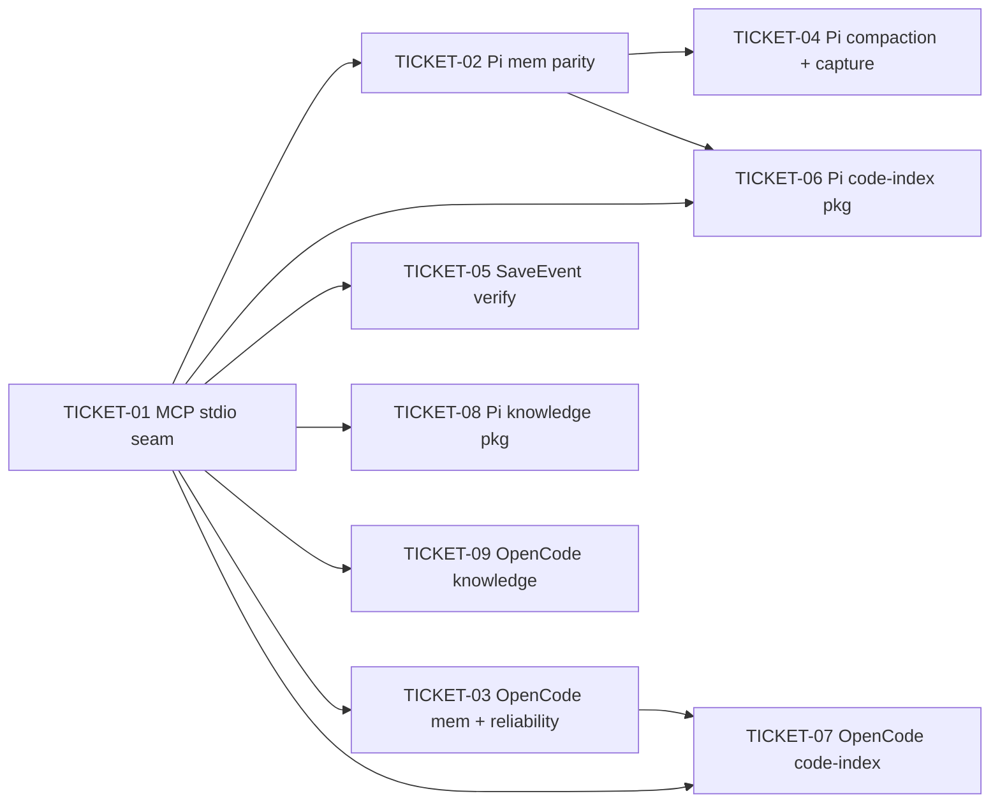

# Tasks — Mnemonic-v2 Agent Plugins (memory / code-index / knowledge)

> **STATUS:** `sliced` (2026-11-05)

> Sliced from `.skillgrid/specs/2026-11-04-mnemonic-v2-memory-plugins/blueprint.md`.
> Vertical tracer-bullet tickets, dependency-ordered, sized for one fresh agent context window.

## Epic Summary

Deliver three plugin families per host (memory / code-index / knowledge-base) for
OpenCode and Pi over the v2 engine's MCP stdio surface: full tool-surface parity
per family (28 `mem_*`, 25 `code_*`, 12 `kb_*`), engram-proven reliability
behavior on the memory plugin, and the SaveEvent → brain-side wiki handoff
verified. The knowledge family is gated on the KB function shipping. The
pi-research fold (R6: capability gating, lifecycle, described degradation,
consumer queue, read guard, skill+CLI distribution) applies to the memory +
code-index families on both hosts; the knowledge-base plugin is excluded
(user direction 2026-11-05).

## Delivery Strategy

| Field | Value |
|-------|-------|
| Estimated changed lines | ~7800-8300 |
| 400-line budget risk | High |
| Chained PRs recommended | Yes |
| Suggested split | PR 1 (memory family, T01-T05) → PR 2 (code-index family, T06-T07) → PR 3 (knowledge family, T08-T09) |
| Delivery strategy | ask-on-risk |
| Chain strategy | pending |

Decision needed before apply: Yes
Chained PRs recommended: Yes
Chain strategy: pending
400-line budget risk: High

### Suggested Work Units

| Unit | Goal | Likely PR | Focused test command | Runtime harness | Rollback boundary |
|------|------|-----------|----------------------|-----------------|-------------------|
| 1 | Memory family: MCP stdio seam + 28 mem tools + reliability + compaction + SaveEvent verify (both hosts) | PR 1 | `cd plugins/pi/mnemonic && npm test && cd ../../plugins/opencode && npm test` | Real: plugin tool call against a live `mnemonic mcp` child process (v2 binary) | Revert PR 1 (seam + memory modules; v1-HTTP files untouched) |
| 2 | Code-index family: `pi-codeindex` package + OpenCode entry, full 25 code tools | PR 2 | code-index parity tests under both plugin packages + `cd plugins/opencode && npm test` | Real: code_search against an indexed fixture repo via the plugin tool | `plugins/pi/codeindex` (new package, deletable) + OpenCode entry file |
| 3 | Knowledge family: `pi-knowledge` package + OpenCode entry, 12 kb tools | PR 3 | kb parity tests (spec-pinned table until KB tools land) | Real: kb_query against a bootstrapped vault (post-KB-ship; N/A pre-ship — spec-pinned parity only) | `plugins/pi/knowledge` (new package) + OpenCode entry file |

> The four plain-text guard lines above are the **contract** — `skillgrid:subagent-execution` matches them literally. If risk is High, `Chained PRs recommended` MUST be `Yes` and every work unit MUST name a focused test, a runtime harness (or `N/A` + reason), and a rollback boundary.

## Tickets

### TICKET-01 — MCP stdio seam with mem_save round-trip in Pi plugin
- **Tracker ID:** t_2eefd13c

- **Scope:** The tracer thread / door: rewrite `plugins/pi/mnemonic/api.js` from the v1-HTTP client to the v2 MCP stdio client (spawn `mnemonic mcp` child process, JSON-RPC over stdio, `tools/list` + `tools/call`, lifecycle/teardown, redaction on input) and prove one complete tool end-to-end: Pi `mem_save` → v2 engine → persisted observation. Includes the parity-test skeleton (plugin-registered set vs v2 contract set — red on count until T02). R6 folds: the seam exposes the server capability probe (families present per `tools/list`) that family gating reads (PR-1); the MCP child gets the PR-2 lifecycle — `session_shutdown` reason branching (`quit` → bounded drain ≤5s + force-exit watchdog; reload/resume/fork → drain without exit), unref'd timers, no orphaned child.
- **Acceptance:** `go build ./mnemonic-v2/...` clean; the round-trip test spawns the real v2 `mnemonic mcp` binary, calls mem_save through the new seam, and asserts the persisted observation (id returned); child process is torn down on plugin exit with the bounded drain + watchdog (a hung drain leaves no orphaned child); the capability probe reports the registered tool families; parity test exists and fails on tool count (red until T02).
- **SATISFIES:** happy path — agent saves a new memory through the plugin tool
- **Files:** `plugins/pi/mnemonic/api.js` (rewrite), `plugins/pi/mnemonic/index.ts` (wiring), `plugins/pi/mnemonic/mnemonic-memory.ts` (mem_save handler), `plugins/pi/mnemonic/package.json` (add test script — `node --experimental-strip-types` over the test dir), `plugins/pi/mnemonic/test/*`
- **Size:** ~800 (M)
- **Blocks:** TICKET-02, TICKET-03, TICKET-05, TICKET-06, TICKET-07, TICKET-08, TICKET-09
- **Blocked by:** none
- **Precondition:** `go test ./mnemonic-v2/... -count=1` green (v2 memory function shipped; `mnemonic-v2/internal/transport/mcp/contract_test.go` D1 contract holds)
- **Fails-when:** round-trip test exits non-zero, or the test logs "want persisted observation id, got" with an error/empty id, or the parity skeleton does not exist

### TICKET-02 — Pi memory plugin full 28 mem tool parity
- **Tracker ID:** t_671c8db6

- **Scope:** Register the full v2 `mem_*` set (28 tools: 22 agent-profile + 6 admin) in the Pi plugin through the seam (agent profile by default, admin via `all`); parity test green (plugin set == v2 contract set, source of truth `mnemonic-v2/internal/transport/mcp/contract_test.go`); `mem_lookup` miss path returns a miss without erroring. R6 folds: PR-1 — the 6 admin `mem_*` tools are registered but `exposure: 'hidden'` by default; enabling the `all` profile re-registers them `direct` (session_start + live config) with no pi restart (pi has no unregister API). PR-6 — the package ships `agent-skill/` (SKILL.md with "Use for X / Not for Y" description discipline, per-command timeouts with queue headroom, single-background-mechanism rule), a zero-dep `run.mjs` launcher (ordered engine resolution; exit 78 = engine/config missing, printing the repair + config paths), and a manifest-tracked installer (install / uninstall / status; symlinks into detected agents; never clobbers a foreign skill; uninstall removes exactly what it created; stale links GC'd) — post-ship packaging step, spec-locked here.
- **Acceptance:** parity test passes (28 == 28, names verbatim); admin tools are hidden on the default profile and re-exposed on `all`-profile enable without restart; a mem_lookup call for an unknown topic returns the v2 miss envelope with no thrown error; the launcher exits 78 with the repair + config paths when the engine is missing; `cd plugins/pi/mnemonic && npm test` green.
- **SATISFIES:** edge case — agent looks up an unknown topic through the plugin tool
- **Files:** `plugins/pi/mnemonic/mnemonic-memory.ts` (full tool set), `plugins/pi/mnemonic/index.ts` (registration + exposure gating), `plugins/pi/mnemonic/agent-skill/*` (new: SKILL.md, scripts/run.mjs), `plugins/pi/mnemonic/package.json` (bin entry + test script), `plugins/pi/mnemonic/test/*` (parity + lookup-miss + gating + launcher exit code)
- **Size:** ~1000 (M, borderline L)
- **Blocks:** TICKET-04, TICKET-06
- **Blocked by:** TICKET-01

### TICKET-03 — OpenCode memory entry with reliability behavior over MCP stdio
- **Tracker ID:** t_017f03f9

- **Scope:** Point the OpenCode memory entry (`mnemonic-memory.ts` + `tools/mem_*.ts`) at the v2 MCP stdio seam; extend to the full 28 `mem_*` set; port engram reliability: capture/lifecycle fail-open, writes fail-closed (single attempt, ambiguous-outcome recovery, no blind retry), retry/self-heal without duplicating the write; update the package `test` script to run ALL test files (currently single-file) + Pi-host-parity coverage for the OpenCode plugin. R6 folds (OpenCode equivalents): PR-1 — no exposure API on OpenCode: registration-time gate + self-guarding "unavailable" response envelope for gated tools (admin `mem_*` on the same profile rule as Pi); PR-2 — the host lifecycle hooks drive the same bounded drain + force-exit watchdog for the shared stdio child. PR-6 is host-agnostic and shipped once by T02 — no duplication here.
- **Acceptance:** with the v2 server unreachable, a capture tool resolves without throwing and the agent continues (fail-open) while a write surfaces the error (fail-closed); a transient-failure fixture shows the retry succeeding with exactly one persisted observation; OpenCode parity test passes (28 == 28); `cd plugins/opencode && npm test` green.
- **SATISFIES:** failure state — memory server unreachable through the plugin; failure state — retry and self-heal after transient failure
- **Files:** `plugins/opencode/mnemonic-memory.ts`, `plugins/opencode/tools/mem_*.ts` (extend to 28), `plugins/opencode/package.json` (test script → all files), `plugins/opencode/test/*`
- **Size:** ~1000 (M)
- **Blocks:** TICKET-07
- **Blocked by:** TICKET-01

### TICKET-04 — Pi compaction recovery and passive capture redaction
- **Tracker ID:** t_ff29ffba

- **Scope:** Port the engram behavior into the Pi plugin event wiring: compaction recovery runs on `before_agent_start` and persists prior work through `mem_session_summary` over the seam; passive capture redacts private spans before storage per the redaction policy. R6 fold: PR-2 — compaction recovery is additionally triggered from the named `session_before_compact` / `session_compact` events (deterministic trigger, not only before_agent_start inference); the recovery persists prior work in both trigger paths.
- **Acceptance:** a simulated compaction event causes the plugin to call mem_session_summary with the prior-work content (verified via the test harness's engine capture); a captured tool output containing a private span stores a capture with the span redacted per policy; `cd plugins/pi/mnemonic && npm test` green.
- **SATISFIES:** happy path — compaction recovery persists prior work; edge case — passive capture redaction
- **Files:** `plugins/pi/mnemonic/skillgrid-compaction.ts` (extend), `plugins/pi/mnemonic/skillgrid-events.ts` (extend), `plugins/pi/mnemonic/test/*`
- **Size:** ~750 (M)
- **Blocks:** none
- **Blocked by:** TICKET-02

### TICKET-05 — SaveEvent emission verify and wiki consumer wiring
- **Tracker ID:** t_d4d5aae8

- **Scope:** Verify (no server behavior change) that the v2 memory function emits the SaveEvent on successful persist (emission-verification test in the v2 module against the `004-transport-mcp` §5 contract: observation identity carried, wiki-ingestion failure does not roll back the save); wire the plugin's event path (`skillgrid-events.ts`) to the SaveEvent observation; verify the brain-side wiki consumer entry end-to-end against `/data/git/AI/pi-llm-wiki` (wiki_observe / wiki_capture_source) — the consumer implementation stays the wiki repo's. R6 fold: PR-4 — the consumer wiring uses a per-observation in-flight lock map (TOCTOU when the same fact is re-emitted), bounded drain with a shared teardown budget (≤5s; un-drained remainder counted, not hung), and drop-count surfacing — no unbounded queue.
- **Acceptance:** v2 test: a committed save emits exactly one SaveEvent carrying the observation identity; a failing wiki consumer does not fail the save (save remains committed); an uninitialized wiki vault is handled without failing the save; `go test ./mnemonic-v2/... -count=1` green.
- **SATISFIES:** happy path — save emits a SaveEvent for the wiki; edge case — wiki vault not initialized; failure state — wiki ingestion failure does not lose the memory save
- **Files:** `mnemonic-v2/internal/...` (SaveEvent emission verification test only — no behavior change), `plugins/pi/mnemonic/skillgrid-events.ts` (extend), cross-repo read of `/data/git/AI/pi-llm-wiki` consumer entry
- **Size:** ~700 (M)
- **Blocks:** none
- **Blocked by:** TICKET-01

### TICKET-06 — Pi code-index package with full 25 code tool parity
- **Tracker ID:** t_af76b422

- **Scope:** New `@devopstales/pi-codeindex` package (`package.json` with publishConfig GitHub npm, `index.ts`, `codeindex-tools.ts`) registering the full 25 v2 `code_*` set over the seam; extract `plugins/pi/mnemonic/mnemonic-codeindex.ts` into the new package (memory package drops the module + `index.ts` import; `package.json` files[] update); bump `@devopstales/pi-mnemonic` 0.1.1 → 0.2.0 with a README note that `code_*` moved; parity test (25 == 25) + staleness workflow (code_status → code_index → code_search) + fail-open. R6 folds (Pi): PR-1 — the 25 `code_*` tools are registered but `exposure: 'hidden'` until the seam capability probe reports the code-index family registered; re-evaluated at session_start, no restart. PR-3 — described-OFF: when the semantic leg is unavailable, `code_search` / `code_semantic` / `code_status` responses AND the health surface carry ONE identical sentence naming the missing embedder + the repair; FTS-leg results still served; reported as disabled, not unhealthy (availability probed by resolution, memoized per process, fail-fast). PR-5 — subagent/sandbox-context `code_read` confined to the project root (realpath-resolved, symlink-aware) with a secret-file denylist (`.env*`, `id_*`, `*.pem`, `*.tfstate`, shell history, credentials files); denial = `read denied: <reason>`.
- **Acceptance:** parity test passes (25 == 25, names verbatim vs v2 registration); staleness fixture: code_status reports stale → code_index refreshes → code_search reflects the current tree; server unreachable → fail-open; `plugins/pi/mnemonic` no longer contains the codeindex module and its test suite stays green; `cd plugins/pi/codeindex && npm test` green.
- **SATISFIES:** happy path — agent searches code through the code-index plugin; edge case — stale index refresh workflow; failure state — memory server unreachable through the code-index plugin
- **Files:** `plugins/pi/codeindex/*` (new), `plugins/pi/mnemonic/{package.json,index.ts,mnemonic-codeindex.ts}` (extraction), `plugins/pi/mnemonic/README` note
- **Size:** ~1050 (M, borderline L)
- **Blocks:** none
- **Blocked by:** TICKET-01, TICKET-02
- **Precondition:** `2026-10-31-mnemonic-v2-code-index` shipped per `.skillgrid/state.yaml` (v2 registers the full 25 `code_*` set; contract test green)
- **Reversibility:** costly (npm publish of pi-mnemonic 0.2.0 is not reversible; existing installers lose code_* unless they add the new package)

### TICKET-07 — OpenCode code-index entry with full 25 code tool parity
- **Tracker ID:** t_6a66c577

- **Scope:** Extend the OpenCode code-index entry (`mnemonic-codeindex.ts` + `tools/code_*.ts`) to the full 25 v2 `code_*` set over the seam; parity (25 == 25) + staleness workflow + fail-open consistent with the memory entry. R6 folds (OpenCode equivalents): PR-1 — no exposure API: registration-time gate + self-guarding "unavailable" envelope for `code_*` until the seam capability probe reports the code-index family. PR-3 — described-OFF: `code_search` / `code_semantic` / `code_status` responses AND the health surface carry ONE identical sentence naming the missing embedder + the repair; FTS-leg results still served; disabled, not unhealthy. PR-5 — subagent-context `code_read` confined to the project root (realpath-resolved) with the secret-file denylist; denial = `read denied: <reason>`.
- **Acceptance:** parity test passes (25 == 25); staleness workflow holds (code_status → code_index → code_search); server unreachable → fail-open, agent continues; `cd plugins/opencode && npm test` green.
- **SATISFIES:** happy path — agent searches code through the code-index plugin; edge case — stale index refresh workflow; failure state — memory server unreachable through the code-index plugin
- **Files:** `plugins/opencode/mnemonic-codeindex.ts`, `plugins/opencode/tools/code_*.ts` (extend to 25), `plugins/opencode/test/*`
- **Size:** ~950 (M)
- **Blocks:** none
- **Blocked by:** TICKET-01, TICKET-03
- **Precondition:** `2026-10-31-mnemonic-v2-code-index` shipped per `.skillgrid/state.yaml`

### TICKET-08 — Pi knowledge package with kb tool surface and degradation envelope
- **Tracker ID:** t_e98a8eaf

- **Scope:** New `@devopstales/pi-knowledge` package registering the `kb_*` surface per KB spec `specs/008-transport.md`: agent-profile tools (kb_query, kb_read, kb_search, kb_generate, kb_validate, kb_lint, kb_status, kb_cite_source) by default, admin tools (kb_reindex, kb_index, kb_bootstrap, kb_rebuild_meta) via `all`; async write semantics (run_id + status poll, 409 on double-start); degradation envelope (`degraded: true` + reason) surfaced to the agent, never silently floored; reads synchronous. Parity test asserts against the KB spec 008 tool table (spec-pinned, 12 tools) and against live registration when the KB tools exist.
- **Acceptance:** parity test passes (12 == 12 vs spec-pinned table; live comparison when KB tools are registered); a kb_query call returns ranked links + snippets (live, post-KB-ship) or the spec-pinned set check passes (pre-ship); a degraded run returns the envelope flag + reason with no thrown tool error; `cd plugins/pi/knowledge && npm test` green.
- **SATISFIES:** happy path — agent queries the knowledge base through the plugin; failure state — degraded KB run surfaces the envelope, never fails the agent
- **Files:** `plugins/pi/knowledge/*` (new: package.json, index.ts, knowledge-tools.ts, test/)
- **Size:** ~800 (M)
- **Blocks:** none
- **Blocked by:** TICKET-01
- **Precondition:** `2026-10-31-mnemonic-v2-knowledge-base` shipped per `.skillgrid/state.yaml` AND `mnemonic-v2` registers the 12 `kb_*` tools (KB contract test green). If unmet: halt with a checkpoint — the spec-pinned parity half may proceed, the live half does not.
- **Out of scope (user direction 2026-11-05):** the pi-research fold (R6, PR-1..PR-7) does NOT apply to the knowledge-base plugin; `kb_*` capability gating is owned by the KB plugin design.

### TICKET-09 — OpenCode knowledge entry with kb tool surface and async write semantics
- **Tracker ID:** t_13d32ee3

- **Scope:** New OpenCode knowledge entry (`mnemonic-knowledge.ts` + `tools/kb_*.ts`) with the 12 `kb_*` tools over the seam; async write behavior (start kb_generate → run_id → poll to completion; repeat start → 409 active-run, no double-start); degradation envelope surfacing; parity per the KB spec 008 table.
- **Acceptance:** double-start fixture: second kb_generate start is rejected (409/active-run) and the agent polls to completion without a second run; degraded run surfaces the envelope without a tool error; parity test passes (12 == 12 vs spec-pinned table); `cd plugins/opencode && npm test` green.
- **SATISFIES:** edge case — async KB write does not double-start; failure state — degraded KB run surfaces the envelope, never fails the agent
- **Files:** `plugins/opencode/mnemonic-knowledge.ts` (new), `plugins/opencode/tools/kb_*.ts` (new), `plugins/opencode/test/*`
- **Size:** ~800 (M)
- **Blocks:** none
- **Blocked by:** TICKET-01
- **Precondition:** `2026-10-31-mnemonic-v2-knowledge-base` shipped per `.skillgrid/state.yaml` AND `mnemonic-v2` registers the 12 `kb_*` tools (KB contract test green). If unmet: halt with a checkpoint — the spec-pinned parity half may proceed, the live half does not.
- **Out of scope (user direction 2026-11-05):** the pi-research fold (R6, PR-1..PR-7) does NOT apply to the knowledge-base plugin; `kb_*` capability gating is owned by the KB plugin design.

## Dependency Graph

## Execution Order

- **Wave 1:** TICKET-01 (tracer door — de-risks the novel MCP stdio seam before any thickness)
- **Wave 2 (parallel):** TICKET-02, TICKET-03, TICKET-05
- **Wave 3 (parallel):** TICKET-04 (after T02), TICKET-06 (after T01+T02; Precondition: code-index function shipped), TICKET-07 (after T01+T03; Precondition: code-index function shipped)
- **Wave 4 (parallel):** TICKET-08, TICKET-09 (Precondition: KB function shipped — executor halts with a checkpoint if unmet)

> **Acceptance-first (BDD is always on):** a ticket's failing acceptance
> scenario (its `SATISFIES` scenario) is written and confirmed RED *before*
> the implementation that makes it green. Order RED-test / scenario tickets
> ahead of their implementation tickets in the dependency graph.

## Slicing Notes

- **Build shape (tracer thread):** TICKET-01 is the thin end-to-end path through every layer (plugin → MCP stdio → v2 engine → persisted observation). Every later ticket thickens over the proven seam; no ticket re-proves the transport.
- **Gate preconditions are change-level, not ticket-level:** the code-index function (`2026-10-31-mnemonic-v2-code-index`) must be shipped before T06/T07 run; the KB function (`2026-10-31-mnemonic-v2-knowledge-base`) before T08/T09. The `Precondition:` fields encode this so a fresh executor halts with a checkpoint instead of doing partial work.
- **Merge-order edges:** T02 → T06 (both touch `plugins/pi/mnemonic/index.ts` + package.json during the extraction) and T03 → T07 (both touch `plugins/opencode` incl. the test-script change) are real file-contention dependencies, not convenience ordering.
- **`tools/fact_*.ts` are v1-legacy (out of parity)** — no ticket touches them; they keep working against the v1 HTTP surface until the v1 sunset.
- **Scenario coverage (QA oracle):** all 21 scenarios in `acceptance.feature` are claimed: R1 → T01/T02/T03; R2 → T03/T04; R3 → T05; R4 → T06/T07 (both hosts); R5 → T08/T09; R6 → T01/T02/T03/T04/T05/T06/T07.
- **pi-research fold (R6, 2026-11-05):** all 7 folds (PR-1..PR-7) are scoped into the memory + code-index families on both hosts per user direction; the knowledge-base plugin (T08/T09) is explicitly excluded. PR-7 (prompt-cache steering) is forward-looking and carries no ticket. Server-side PR-3 counterparts (NaN/Inf vector gate, backup/re-embed model migration) are a cross-change fold owned by the code-index change at ship — see blueprint "Cross-change folds".
- **No one-way doors** in the tickets themselves; T06 is `costly` (npm publish) but reversible in-repo.
