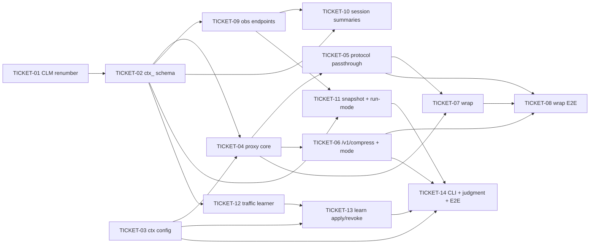

# Tasks — Context Orchestrator (CTX) v1.11

> **STATUS:** `sliced` (2026-10-09)

> Sliced from `.skillgrid/specs/2026-10-08-context-orchestrator/blueprint.md`.
> Vertical tracer-bullet tickets, dependency-ordered, sized for one fresh agent context window.

## Epic Summary

Adds the CTX v1.11 delta to the `mnemonic` binary: a transparent loopback LLM proxy (token/cache/passthrough), a two-tier `ctx wrap` agent launcher, four read-only observability endpoints folded into the existing `mnemonic serve` mux, a zero-LLM rule-based traffic learner, a local-model judgment layer (truncate-only), and a `config.d`-pattern `ctx:` config block. Six new `ctx_*` tables (migrations 056–061), plus the CLM absorption renumber (050/051/052 → 053/054/055). No new binary, no `go.work` change, no new 3rd-party dep (stdlib `net/http` + `httputil.ReverseProxy`; `/metrics` hand-emitted). Per ADR-0033 (ctx-as-mnemonic-subcommand), ADR-0034 (local-Ollama judgment), ADR-0035 (config.d), ADR-0036 (config.d convention).

## Delivery Strategy

| Field | Value |
|-------|-------|
| Estimated changed lines | ~3200–4200 |
| 400-line budget risk | High |
| Chained PRs recommended | Yes |
| Suggested split | PR 1 (foundation) → PR 2 (proxy core) → PR 3 (wrap) → PR 4 (observability) → PR 5 (traffic + judgment + CLI) |
| Delivery strategy | ask-on-risk |
| Chain strategy | feature-branch-chain |

Decision needed before apply: Yes
Chained PRs recommended: Yes
Chain strategy: feature-branch-chain
400-line budget risk: High

### Suggested Work Units

| Unit | Goal | Likely PR | Focused test command | Runtime harness | Rollback boundary |
|------|------|-----------|----------------------|-----------------|-------------------|
| 1 | Foundation: CLM renumber + 6 ctx_ tables + ctx: config block | PR 1 (base = main) | `cd mnemonic && go test ./internal/ctx/store/... ./internal/ctx/config/... ./internal/store/...` | go test (in-process SQLite via store open) | 053–061 migrations + `internal/ctx/{store,config}` |
| 2 | Proxy core: token/cache/passthrough + /v1/compress + mode-switch + fail-open | PR 2 (base = PR 1) | `cd mnemonic && go test ./internal/ctx/proxy/...` | real httptest upstream + proxy on 127.0.0.1 ephemeral | `internal/ctx/proxy` + `cmd/mnemonic/ctx_proxy.go` |
| 3 | Wrap: `ctx wrap <agent>` launcher (10 agents, backup-before-write, idempotent) | PR 3 (base = PR 2) | `cd mnemonic && go test ./internal/ctx/wrap/...` | real subprocess launch of a stub agent on PATH | `internal/ctx/wrap` + `cmd/mnemonic/ctx_wrap.go` |
| 4 | Observability: 4 read-only endpoints + session aggregation + durable snapshot | PR 4 (base = PR 3) | `cd mnemonic && go test ./internal/ctx/observability/... ./internal/http/...` | real `mnemonic serve` + curl on loopback | `internal/ctx/observability` + `internal/http/ctx.go` |
| 5 | Traffic learner + judgment layer + CLI wiring + E2E acceptance sweep | PR 5 (base = PR 4) | `cd mnemonic && go test ./internal/ctx/traffic/... ./internal/ctx/judgment/... ./...` | real proxy + agent + store round-trip | `internal/ctx/{traffic,judgment}` + `cmd/mnemonic/ctx_{learn,search,purge,metrics,traffic,checkpoint}.go` |

> The four plain-text guard lines above are the **contract** — `skillgrid:subagent-execution` matches them literally. If risk is High, `Chained PRs recommended` MUST be `Yes` and every work unit MUST name a focused test, a runtime harness (or `N/A` + reason), and a rollback boundary.

> Per ADR-0013 (repo is source of truth): each work-unit commit carries a `[skillgrid-context]` block naming its ticket + change id so the task → commit → diff chain is recoverable from git alone.

## Tickets

### TICKET-01 — CLM absorption: renumber CLM migrations 050/051/052 → 053/054/055

- **Scope:** Rename the three CLM migration files (050_tool_outputs, 051_indexed_files, 052_context_revisions) to 053/054/055; ensure the migration runner applies them in order and no file is numbered 050/051/052. Pure file rename + any hard-coded path refs. No schema change (CLM tables already exist from the CLM change).
- **Acceptance:** `ls mnemonic/internal/store/migrations/` shows 053/054/055 for tool_outputs/indexed_files/context_revisions, none at 050/051/052; `go test ./internal/store/...` green (migrations apply cleanly in order); existing CLM rows intact after re-apply.
- **SATISFIES:** clm-renumber
- **Files:** `mnemonic/internal/store/migrations/05{0,1,2}_*` → `05{3,4,5}_*`, any `internal/store/migrate*` refs
- **Size:** ~80 (S)
- **Blocks:** TICKET-02
- **Blocked by:** none
- **Reversibility:** one-way   # migration file renames; a wrong rename re-applies the wrong DDL
- **Precondition:** CLM spec (2026-10-06-context-harness-clm) migrations 050/051/052 exist on disk
- **Fails-when:** `go test ./internal/store/...` exit != 0 OR any file matches `05[0-2]_`

### TICKET-02 — ctx_ schema: migrations 056–061 (6 tables) + store package

- **Scope:** Create `mnemonic/internal/ctx/store/` and six migrations 056–061: `ctx_proxy_mode_history`, `ctx_proxy_stats`, `ctx_stats_history`, `ctx_session_summaries`, `ctx_traffic_memories`, `ctx_judgment_cache`. Provide the store accessors (open via shared SQLite handle, no 2nd DB — per ADR-0033) with typed CRUD + the aggregate rollup query.
- **Acceptance:** `go build ./...` green; `go test ./internal/ctx/store/...` green: each table created on a fresh store, each typed insert+query round-trips, no table lacks the `ctx_` prefix; opening the store takes no handle of its own (assert via shared-handle fixture).
- **SATISFIES:** ctx-module-builds
- **Files:** `mnemonic/internal/store/migrations/05{6..9}_,060_,061_*`, `mnemonic/internal/ctx/store/{store,tables,rollup}.go`
- **Size:** ~700 (M)
- **Blocks:** TICKET-03, TICKET-05, TICKET-07, TICKET-10, TICKET-11
- **Blocked by:** TICKET-01
- **Reversibility:** one-way   # additive migrations on the shared store
- **Precondition:** TICKET-01 done (053/054/055 present) so 056+ apply after them
- **Fails-when:** `go test ./internal/ctx/store/...` exit != 0 OR any created table name lacks `ctx_` prefix

### TICKET-03 — ctx: config block via ADR-0036 config.d

- **Scope:** Create `mnemonic/internal/ctx/config/` that loads a `ctx:` block using the ADR-0036 config.d convention (builtin → `~/.skillgrid/config.d/ctx.yaml` → first-found walking up), reusing the `findConfigD` shape from `internal/config/pricing.go`. Defaults for all keys; per-key merge with repo-local winning. The `clm:` block is still read from `.skillgrid/config.yaml` (unchanged).
- **Acceptance:** `go test ./internal/ctx/config/...` green: repo-local key wins over machine-local over builtin; absent repo-local falls to machine-local; neither present → defaults; `clm` block still resolves from `.skillgrid/config.yaml` (assert a sentinel value).
- **SATISFIES:** ctx-config-precedence
- **Files:** `mnemonic/internal/ctx/config/{config,load}.go`, test fixtures
- **Size:** ~450 (S)
- **Blocks:** TICKET-05, TICKET-07, TICKET-13
- **Blocked by:** none
- **Fails-when:** `go test ./internal/ctx/config/...` exit != 0 OR precedence assertion fails

### TICKET-04 — proxy core: token/cache/passthrough modes + savings headers + fail-open

- **Scope:** `mnemonic/internal/ctx/proxy/` — a `net/http` + `httputil.ReverseProxy` loopback proxy bound to 127.0.0.1:8787. Three modes (token, cache default, passthrough). Forwards Anthropic- and OpenAI-compatible requests, computes `X-CTX-Savings` accurately, adds savings headers, fails open to passthrough on any compression fault mid-request. Provider retry with `provider_retry_backoff_ms`; after final retry returns the provider error verbatim.
- **Acceptance:** `go test ./internal/ctx/proxy/...` green: an Anthropic-compat + an OpenAI-compat request through the proxy complete with accurate `X-CTX-Savings` and savings headers; a fault mid-compression still completes in passthrough; upstream timeout retries with configured backoff then returns the error verbatim.
- **SATISFIES:** proxy-three-modes, proxy-fail-open-provider-timeout
- **Files:** `mnemonic/internal/ctx/proxy/{proxy,modes,savings,retry}.go`, `cmd/mnemonic/ctx_proxy.go` (serve entry)
- **Size:** ~800 (M)
- **Blocks:** TICKET-05, TICKET-06, TICKET-07
- **Blocked by:** TICKET-02, TICKET-03
- **Fails-when:** `go test ./internal/ctx/proxy/...` exit != 0 OR `X-CTX-Savings` inaccurate on the fixture

### TICKET-05 — proxy protocol passthrough (HTTP/1.1, HTTP/2, SSE, WebSocket)

- **Scope:** Ensure the proxy passes through HTTP/1.1, HTTP/2, SSE (chunked streaming), and WebSocket frames intact (no body buffering that breaks streaming). Wire the serve entry to enable the needed features (h2, upgrade).
- **Acceptance:** `go test ./internal/ctx/proxy/...` green: SSE stream chunks arrive in order and complete; a WebSocket handshake upgrades and a ping/pong round-trips; an HTTP/2 request completes; no stream is truncated by the proxy.
- **SATISFIES:** proxy-protocol-passthrough
- **Files:** `mnemonic/internal/ctx/proxy/{stream,ws}.go`, serve entry in `cmd/mnemonic/ctx_proxy.go`
- **Size:** ~550 (M)
- **Blocks:** TICKET-08
- **Blocked by:** TICKET-04
- **Fails-when:** `go test ./internal/ctx/proxy/...` exit != 0 OR any stream truncated in the fixture

### TICKET-06 — /v1/compress endpoint (loopback-only) + mode-switch runtime

- **Scope:** Add `POST /v1/compress` (compresses a message list, no upstream completion) — loopback-only: returns 404 (not 403) from a non-loopback origin. Add runtime mode switch (writes `ctx_proxy_mode_history` old+new, emits `proxy-mode-changed`, exposes current mode in `GET /stats`). Support `CTX_PROXY_MODE` env + restart-to-mode.
- **Acceptance:** `go test ./internal/ctx/proxy/...` green: loopback POST returns a compressed list with no upstream call; non-loopback POST returns 404 (assert not 403); switching cache→token writes a history row + emits event + `GET /stats` shows `token`; setting `CTX_PROXY_MODE` + restart starts in that mode.
- **SATISFIES:** compress-endpoint-loopback, mode-switch-emitted
- **Files:** `mnemonic/internal/ctx/proxy/{compress,mode}.go`
- **Size:** ~600 (M)
- **Blocks:** TICKET-08, TICKET-13
- **Blocked by:** TICKET-04
- **Fails-when:** `go test ./internal/ctx/proxy/...` exit != 0 OR non-loopback /v1/compress != 404

### TICKET-07 — wrap: `ctx wrap <agent>` launcher (core-4 + opt-in)

- **Scope:** `mnemonic/internal/ctx/wrap/` — launch a named agent through the proxy. Starts the proxy, injects the agent's config to point at the proxy, backs up the previous config before writing, launches the agent (subprocess). Core-4 (claude + others) always available; opt-in agents (e.g. aider) honored from wrap config. Idempotent (re-running does not double-inject or re-backup). Agent code is never modified.
- **Acceptance:** `go test ./internal/ctx/wrap/...` green: `wrap claude` starts the proxy, injects config, writes a backup, launches the stub; the agent's turn through the proxy completes with savings headers; re-running `wrap` is idempotent; opt-in `wrap aider` works when aider is in config; a non-opt-in agent is rejected with a clear error.
- **SATISFIES:** wrap-core4-launches, wrap-optin-agent
- **Files:** `mnemonic/internal/ctx/wrap/{wrap,agents,config-inject,backup}.go`, `cmd/mnemonic/ctx_wrap.go`
- **Size:** ~750 (M)
- **Blocks:** TICKET-14
- **Blocked by:** TICKET-04, TICKET-05
- **Fails-when:** `go test ./internal/ctx/wrap/...` exit != 0 OR no backup written before config write

### TICKET-08 — wrap E2E: agent turn through proxy with savings

- **Scope:** End-to-end: a wrapped agent completes a full turn through the proxy and the savings headers are present end-to-end (not just unit-level). Verifies the launcher + proxy + store path together.
- **Acceptance:** `go test ./internal/ctx/wrap/...` (E2E test) green: the wrapped agent's turn reaches the proxy, completes, and `X-CTX-Savings` is present on the response; the agent's source tree is byte-identical to before the launch.
- **SATISFIES:** wrap-core4-launches (end-to-end Then clause)
- **Files:** `mnemonic/internal/ctx/wrap/e2e_test.go`
- **Size:** ~300 (S)
- **Blocks:** none
- **Blocked by:** TICKET-05, TICKET-06, TICKET-07
- **Fails-when:** E2E test exit != 0 OR savings header absent on the turn response

### TICKET-09 — observability endpoints: /stats, /stats-history, /metrics (serve mux)

- **Scope:** `mnemonic/internal/ctx/observability/` + `mnemonic/internal/http/ctx.go` (new, folded into `registerRoutes()` in `server.go:105` using the `withProjectHandle` + `writeJSON` fail-open pattern from `clm.go`). `GET /stats` (live session metrics JSON), `GET /stats-history` (hourly/daily/weekly/monthly rollups from `ctx_stats_history`), `GET /metrics` (hand-emitted Prometheus text format). Read-only.
- **Acceptance:** `go test ./internal/http/... ./internal/ctx/observability/...` green: `GET /stats` returns JSON with a live session; `GET /stats-history` returns all four rollups and they survive a server restart (persisted to `ctx_stats_history`); `GET /metrics` returns Prometheus-parseable text (assert label/`# HELP`/`# TYPE` shape).
- **SATISFIES:** observability-endpoints
- **Files:** `mnemonic/internal/ctx/observability/{stats,history,metrics}.go`, `mnemonic/internal/http/ctx.go`, `server.go` route registration
- **Size:** ~650 (M)
- **Blocks:** TICKET-10, TICKET-13
- **Blocked by:** TICKET-02
- **Fails-when:** `go test ./internal/http/... ./internal/ctx/observability/...` exit != 0 OR /metrics lacks `# TYPE`

### TICKET-10 — /api/session-summaries + session-end aggregation job

- **Scope:** `GET /api/session-summaries` (paginated per-session wide events). On session end, enqueue a `session_summary_aggregate` job that writes exactly one row to `ctx_session_summaries` with counts matching the session's events; the SessionEnd hook completes within budget and the agent is not blocked by aggregation (async).
- **Acceptance:** `go test ./internal/ctx/observability/...` green: `/api/session-summaries` returns paginated per-session events; after a session with N tool events + M proxy savings ends, exactly one `ctx_session_summaries` row exists with matching counts; the aggregate job runs async (assert the session-end hook returns before the row is flushed).
- **SATISFIES:** session-summary-aggregated
- **Files:** `mnemonic/internal/ctx/observability/{summaries,aggregate}.go`
- **Size:** ~600 (M)
- **Blocks:** none
- **Blocked by:** TICKET-02, TICKET-09
- **Fails-when:** `go test ./internal/ctx/observability/...` exit != 0 OR more than one summary row per session

### TICKET-11 — durable history snapshot + run-mode as observability signal

- **Scope:** Write `.skillgrid/ctx/stats_history.json` matching `ctx_stats_history` DB rollups; the snapshot survives re-indexing (not wiped). Expose the current proxy mode in `GET /stats` and the Live view header so a mode change is reflected.
- **Acceptance:** `go test ./internal/ctx/observability/...` green: after a snapshot write, the JSON file equals the DB rollups; after a simulated re-index the file is intact and still matches; `GET /stats` shows the current mode and reflects a mode change.
- **SATISFIES:** history-snapshot-durable, run-mode-is-observability-signal
- **Files:** `mnemonic/internal/ctx/observability/snapshot.go`, Live-view header ref
- **Size:** ~400 (S)
- **Blocks:** TICKET-14
- **Blocked by:** TICKET-02, TICKET-09
- **Fails-when:** `go test ./internal/ctx/observability/...` exit != 0 OR snapshot != DB rollups

### TICKET-12 — traffic learner: zero-LLM extraction (4 categories) + evidence + eviction

- **Scope:** `mnemonic/internal/ctx/traffic/` — rule-based (no LLM) extractor over the session-event stream producing `ctx_traffic_memories` in four categories (error_recovery, environment, preference, architecture). Rules in `traffic/rules.yaml`. Each memory carries `evidence_json`; `min_confidence` bound (below → not stored); `max_memories` bound with oldest-low-confidence-first eviction.
- **Acceptance:** `go test ./internal/ctx/traffic/...` green: a fail-then-retry event stores an `error_recovery` memory with `evidence_json` and makes no LLM call (assert zero model invocations); all four categories extract from the fixture sessions; a below-`min_confidence` memory is not stored; when the store is full the oldest low-confidence memory is evicted first.
- **SATISFIES:** traffic-learner-extracts, traffic-learner-four-categories
- **Files:** `mnemonic/internal/ctx/traffic/{learner,rules,evict}.go`, `traffic/rules.yaml`
- **Size:** ~850 (M)
- **Blocks:** TICKET-13
- **Blocked by:** TICKET-02
- **Fails-when:** `go test ./internal/ctx/traffic/...` exit != 0 OR an LLM call is observed OR a sub-min_confidence memory is stored

### TICKET-13 — traffic promotion human-gate: `ctx learn apply|revoke`

- **Scope:** Wire `mnemonic ctx learn apply <rule-id>` and `mnemonic ctx learn revoke <rule-id>`. A traffic memory is never applied as a rule without a human promotion; applying activates the rule; revoking removes it; a traffic memory never contradicts the offline `ctx learn` loop (offline loop wins on conflict).
- **Acceptance:** `go test ./internal/ctx/traffic/...` + CLI test green: a high-confidence traffic memory is NOT applied until `ctx learn apply`; after apply the rule is active; after revoke it is removed; on conflict the offline loop's rule prevails.
- **SATISFIES:** traffic-promotion-human-gate
- **Files:** `mnemonic/internal/ctx/traffic/promote.go`, `cmd/mnemonic/ctx_learn.go`
- **Size:** ~450 (S)
- **Blocks:** TICKET-14
- **Blocked by:** TICKET-12, TICKET-03
- **Fails-when:** `go test ./internal/ctx/traffic/...` exit != 0 OR a memory auto-applies without `learn apply`

### TICKET-14 — CLI verbs + judgment layer + E2E acceptance sweep

- **Scope:** Complete the `runCtx` verb group in `cmd/mnemonic/ctx.go` (proxy, wrap, stats, search, index, purge, metrics, traffic, learn, judge, checkpoint) and the `ctx stats` unified surface (distinct from per-agent `mnemonic stats`; includes CLM `tool_outputs`/`indexed_files` row-count sub-slices). Add the judgment layer (`internal/ctx/judgment/`, ADR-0034 local Ollama): truncate-only decisions, fingerprint cache (no re-call for a judged unit), fail-open (Ollama down → deterministic pre-filter runs, nothing blocks, unit not dropped). Final E2E: run the full 23-scenario acceptance sweep.
- **Acceptance:** `go test ./...` green (workspace): `mnemonic ctx --help` lists all 11 verbs; `mnemonic ctx stats` returns the unified surface + CLM sub-slice while `mnemonic stats` is unchanged; a unit above the judgment threshold is truncated (not deleted/rewritten); a re-presented unit is served from the fingerprint cache with no model call; with Ollama down the pre-filter still runs and the unit is not dropped; the 23-scenario acceptance sweep is green.
- **SATISFIES:** ctx-subcommand-group, ctx-stats-includes-clm-row-counts, clm-stats-subslice, judgment-truncate-only, judgment-fingerprint-cached, judgment-fail-open
- **Files:** `mnemonic/cmd/mnemonic/ctx.go`, `cmd/mnemonic/ctx_{stats,search,index,purge,metrics,traffic,judge,checkpoint}.go`, `mnemonic/internal/ctx/judgment/{judge,cache,failopen}.go`, acceptance runner wiring
- **Size:** ~1100 (M/L)
- **Blocks:** none
- **Blocked by:** TICKET-03, TICKET-06, TICKET-11, TICKET-13
- **Fails-when:** `go test ./...` exit != 0 OR any of the 23 acceptance scenarios red OR `mnemonic stats` (per-agent) changed

## Dependency Graph

## Execution Order

- **Wave 1 (parallel):** TICKET-01, TICKET-03
- **Wave 2:** TICKET-02 (after T01)
- **Wave 3 (parallel):** TICKET-04 (after T02+T03), TICKET-09 (after T02), TICKET-12 (after T02)
- **Wave 4 (parallel):** TICKET-05 (after T04), TICKET-06 (after T04), TICKET-07 (after T04+T05), TICKET-10 (after T02+T09), TICKET-11 (after T02+T09), TICKET-13 (after T12+T03)
- **Wave 5:** TICKET-08 (after T05+T06+T07)
- **Wave 6:** TICKET-14 (after T03+T06+T11+T13)

> **Acceptance-first (BDD is always on):** a ticket's failing acceptance scenario (its `SATISFIES` scenario) is written and confirmed RED *before* the implementation that makes it green. Each ticket above names its scenario; the executor writes the RED test first.

## Slicing Notes

- **Build shape = extend** (3rd Go module surface under the `mnemonic` binary, no new binary, no `go.work` change, no new 3rd-party dep — per ADR-0033/0034/0035/0036). The "tracer thread" for the first wave is the **foundation** (migrations + config) because every later layer depends on the store and config; there is no UI to shell out, so the thinnest usable whole is the proxy core (Wave 3).
- **Split decisions:**
  - *Proxy core (T04) split from protocol passthrough (T05) and compress/mode (T06):* the mode-switch + loopback 404 semantics are a distinct trust boundary (loopback-only `/v1/compress`) from the forwarding core, and protocol passthrough (SSE/WS/h2) is a separate streaming concern — splitting keeps each ≤ ~850 lines.
  - *Wrap split from wrap-E2E (T07/T08):* T07 is the launcher mechanics (backup/inject/launch, idempotency); T08 is the full agent-turn-through-proxy E2E that needs T05+T06+T07. Keeping E2E separate means the launcher can be reviewed without the integration harness.
  - *CLI + judgment grouped (T14):* the judgment layer has no other consumer before the CLI `ctx judge` verb, and the final E2E sweep must run the whole verb group — both share the `cmd/mnemonic/ctx.go` surface, so one ticket owns the CLI wiring + judgment + acceptance sweep. Sized M/L; if it exceeds one context window during execution, split the judgment layer out first (its scenarios are self-contained).
- **Assumed decision:** `blueprint.md` carries `**Status:** PROPOSED` (not ASSUMED) — no per-ticket `Note: assumed decision` debt line required.
- **File-boundary assumptions:** new packages under `mnemonic/internal/ctx/{config,proxy,wrap,observability,traffic,judgment,store}`; HTTP seam is a new `mnemonic/internal/http/ctx.go` registered in `registerRoutes()` (`server.go:105`) using the `withProjectHandle` + `writeJSON` fail-open pattern from `clm.go`; CLI extends `runCtx` in `mnemonic/cmd/mnemonic/ctx.go`. Shared SQLite handle (no 2nd DB) per ADR-0033.
- **One-way doors:** T01 (migration renames) and T02 (additive migrations on the shared store) are marked `one-way` with a human checkpoint — they insert DDL into the shared store that later waves build on.
- **ADR cites (not restated):** module/subcommand shape per `.skillgrid/artifacts/04-adr-0033-*.md`; local-Ollama judgment per `04-adr-0034-*.md`; `ctx:` config block per `04-adr-0035-*.md`; config.d convention per `04-adr-0036-*.md`; fail-open load-bearing per ADR-0016/0021; repo-is-source-of-truth commit block per ADR-0013.
