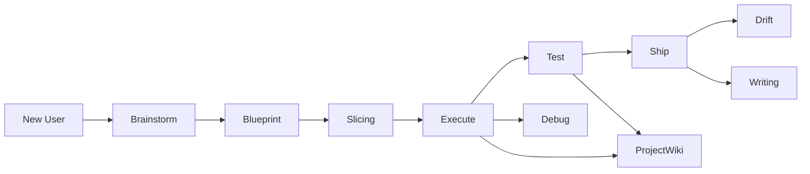
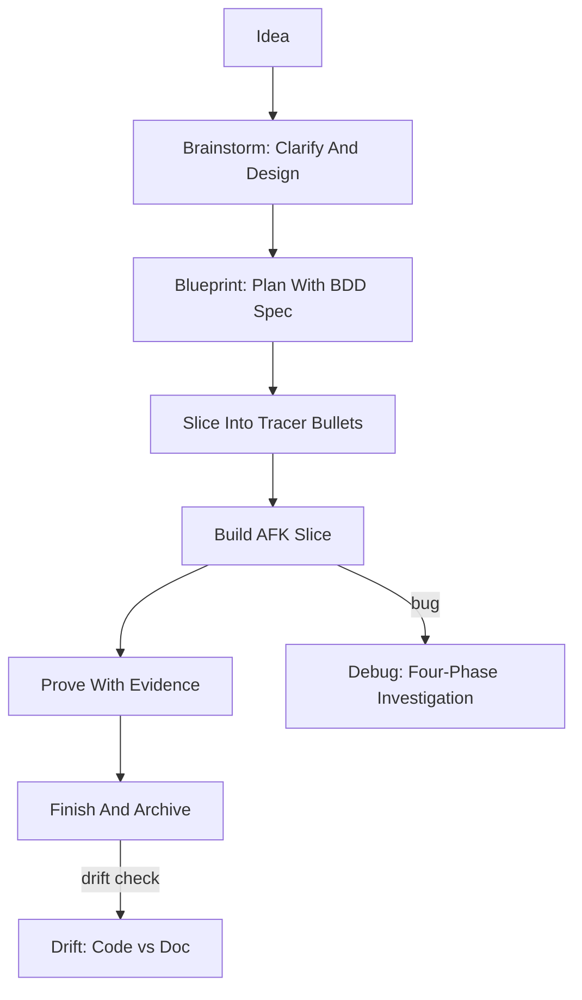

# Start Here

Skillgrid is a pipeline of skills that takes a software idea to a shipped program. Each phase is a skill; the skills compose via `related_skills` adjacency and `skillgrid:{name}` cross-references.

The point is simple: agent work should not disappear into a chat transcript. It should leave a clear plan, visible state, reviewable files, verification evidence, and a next step that another human or agent can continue.

## Why This Exists

Most AI coding setups start with a capable model and a few prompts. That works for small one-off tasks, but it gets fragile when the work spans days, agents, IDEs, requirements, tests, research, and review. Context is lost. Decisions are repeated. Subagents duplicate each other. The user has to remember what happened.

Skillgrid solves that by packaging the whole operating system around the model:

- Skills define how the agent should perform specialized tasks.
- A fixed phase order keeps work moving from idea to shipped code.
- Durable artifacts (blueprint.md, tasks.md, verdicts, projectwiki pages) make the work resumable and searchable.
- Scripts carry the deterministic logic so the agent's context stays focused on judgment.
- A curation lifecycle keeps the skill library from rotting.

That makes Skillgrid stronger than a loose folder of prompts. It is a full pipeline, not a single trick.

## The Advantage

Skillgrid is built for teams and serious solo developers who want the speed of AI without giving up engineering discipline.

It gives you:

- A portable pipeline across supported agents and IDEs.
- A local-first artifact model that does not require a hosted runtime.
- A fixed phase order that turns vague chat into named stages.
- A multi-agent model where subagents produce bounded reports instead of noisy side quests.
- A path from idea to implementation to validation to finish.

The result is less prompt babysitting and more deliberate progress. Agents can move faster because the boundaries are clearer.

## Manifesto

**The goal is a controllable agentic pipeline.** Workflows you design: phases, checkpoints, explicit human-in-the-loop gates, and user validation at the points that matter. Agents accelerate execution; you retain authority over scope, quality bar, and when something is done enough to merge or release.

**Specs guide the AI.** Requirements and design artifacts are not paperwork; they are the steering signal. Spec-driven development gives the model something stable to implement against and something reviewers can verify against. Chat alone drifts; files and specs anchor the work.

**Harness engineering.** A model in isolation is not a process. A harness is skills, rules, scripts, memory, and artifacts that bound what agents do, when they stop, and what evidence they must produce. Skillgrid is that harness.

**Humans stay in the loop.** Automation without validation is debt. Validation is not a failure mode; it is the mechanism that makes agentic pipelines trustworthy in real teams.

**Small context beats heroic context.** Large windows help retrieval, but coding judgment still degrades when a session carries too much stale chat, compacted history, or unrelated work. Skillgrid keeps agents in the smart zone with vertical slices, fresh subagents, durable artifacts, and context-budgeted handoffs.

**Feedback loops set the ceiling.** Tests, type checks, linters, security scans, code review, and human QA are not optional ceremony. They are how agents see whether their work is correct.

## Core Concepts

| Concept | Meaning here |
|--------|----------------|
| **Vertical slices** | Break work into thin, testable increments that cross the necessary layers and produce feedback early. Avoid long horizontal phases that only build one layer. |
| **TDD loop** | Behavioral implementation should use RED/GREEN/refactor: write a failing test, make it pass with minimal code, then clean up. |
| **Smart zone** | Keep implementation and review units small enough to fit in a fresh, focused context. |
| **Context rot** | Accuracy drops when a session carries too much stale chat, compacted history, or unrelated work. Skillgrid fights this with slices, artifacts, and fresh subagents. |
| **Spec-driven development** | Intent lives in specs and change artifacts before and during code. AI implements toward those specs; verification traces back to them. |
| **Agentic pipeline** | A sequence of phases (brainstorm, blueprint, slicing, execute, test, ship) with tools and skills attached, not one long autonomous chat. |
| **Harness** | The configured layer around the model: rules, skills, scripts, memory, and artifacts so behavior is repeatable and auditable. |
| **Artifacts over transcripts** | Blueprints, tasks, verdicts, and projectwiki pages are the system of record; chat is ephemeral. |
| **Curation lifecycle** | Skills are alive: they are used, they rot, they are archived. Usage telemetry and a never-delete archive policy keep the library honest. |

If a single idea ties this together: **AI assists; you validate; specs and harnesses keep both honest.**

## How The Pieces Fit

## Reading Order

Read the files in this folder in numeric order:

1. `00-start-here.md` explains the whole solution and why it matters.
2. `01-skills.md` explains the skill inventory, categories, and what each skill provides.
3. `02-pipeline.md` explains the phase order, composition graph, and how skills compose.
4. `03-tools.md` explains the executable scripts, external tools, and MCP servers.
5. `04-lifecycle.md` explains skill provenance, usage telemetry, and curation.
6. `05-commands.md` explains the workflow commands and how to invoke the pipeline.
7. `06-concepts.md` is the synthesis — every named seam (gates, tiers, clarity gate, depth tree, review discipline) in one screen of reference.

## First Mental Model

Think of Skillgrid as a guided path:

Every phase has a purpose. Every important decision should land in a durable place. Every handoff should be readable by the next agent. The agent should ask until the shared understanding is strong, split implementation into smart-zone vertical slices, prove each slice with feedback loops, and stop when human judgment is required.
