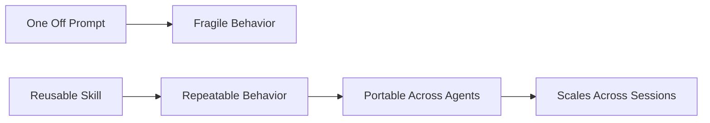

# Skills

Skills are reusable operating procedures for agents. They tell an agent how to perform a specialized task well: brainstorming, planning, slicing, executing, testing, shipping, debugging, detecting drift, refactoring, designing UI, writing documentation, maintaining a knowledge vault, or creating new skills.

The skill answers "how should the agent do this kind of work?" The pipeline phase answers "what are we doing now?"

## What A Skill Provides

A good skill gives the agent:

- A clear trigger (the `description` field).
- A specific role or method.
- A process to follow (the spine sections).
- Tools or evidence to prefer (scripts with exit-code contracts).
- Guardrails and stop conditions (Decision Gates, Red Flags).
- Output expectations (Output Contract).
- Lifecycle metadata (`created_by`, `related_skills`, version).

This is better than repeating long instructions in every prompt. The skill carries the discipline.

## Skill Categories

### Pipeline Skills

These manage the Skillgrid-specific workflow from idea to shipped code:

- `brainstorm` — turn a raw idea into an approved design and spec.
- `blueprint` — turn a spec into a buildable implementation plan with BDD acceptance spec.
- `slicing` — break a blueprint into vertical tracer-bullet tickets with dependency edges.
- `execute` — execute a plan: isolated workspace, mode selection, wave execution, QA handoff.
- `test` — intent, functional, code-quality, and security testing; four-state verdict.
- `ship` — terminal phase: reflect, environment retro, documentation, commit, PR, archive.

These are the backbone of the pipeline. They keep product intent, technical tasks, verification evidence, and documentation connected.

### Cross-Cutting Skills

These are reachable from any pipeline phase:

- `debug` — four-phase bug investigation with hypothesis trail and three-state verdict.
- `drift` — detect code-vs-doc divergence after execute or ship; report-only.
- `refactor` — codebase health via jscpd: duplicated, dead, and complex files.
- `ui-design` — product/application UI design with Operate-mode bias.
- `writing` — human-facing text: guides, READMEs, RFCs, PR feedback, changelog, release notes.
- `projectwiki` — durable knowledge vault: OKF pages, FTS index, query/cite/lint engine.
- `test-driven-development` — the TDD discipline (Iron Law, RED/VERIFY/GREEN/REFACTOR, triangulation, TDD Evidence); canon in `_shared/references/strict-tdd.md`.
- `youtube-transcript` — extract transcripts from YouTube videos for research.

These are the skills that keep the work honest, visible, and durable. A solution is not complete just because code changed.

### Meta Skills

These operate on the skill library itself:

- `skill-creator` — create, audit, and iterate skills; 10-rule audit; lifecycle curation.
- `skillgrid` — top-level router: take an idea to a shipped program end-to-end.
- `_shared` — shared references (not a skill): skill anatomy, craft rules, threat matrix, ADR records, commit contract.

The meta skills keep the library from drifting. They are the difference between a folder of prompts and a maintained operating system.

## Invocation Model

Skills have two invocation classes:

- **Model-invoked** (the default): the agent can reach for the skill autonomously based on its `description`. The description is the only thing the model sees before loading the body.
- **User-invoked** (`disable-model-invocation: true`): only the human can invoke the skill by name. The description is a one-line human summary, not a trigger.

The set of user-invoked skills is the pipeline's human gates: `brainstorm` (design approval) and `_shared` (reference bundle). Adding a skill to this set is a deliberate act — it removes the skill from the model's reach.

A skill can never invoke a user-invoked skill. Only the human can.

## The Format

Every skill conforms to the canonical format defined in `_shared/craft/skill-anatomy.md`. The fixed section order is:

```markdown
# {Skill Title}
**Announce at start:** "I'm using the skillgrid:{name} skill to {purpose}."
## Overview
## When to Use
## [Core Process / The Workflow]
## [skill-specific sections]
## Common Rationalizations
## Red Flags
## Verification
## References
```

The spine sections (Input Contract, Decision Gates, Output Contract, Anti-Patterns) are present in operational skills where they earn their place. The line budget is 400 lines for `SKILL.md`; reference material lives in `references/` and loads on demand.

## Why Skills Matter

Skills turn tribal knowledge into reusable agent behavior.

Without skills, every session depends on the user remembering the perfect instruction. With skills, the operating pattern travels with the project.



That is a key advantage of Skillgrid: it does not only provide prompts. It provides a library of operating procedures that help agents behave like careful engineering partners.

## Skill Inventory

| Skill | Version | Invocation | Purpose |
|---|---|---|---|
| `_shared` | 2.4 | user-invoked | Shared references: skill anatomy, craft rules, threat matrix, ADR records, commit contract |
| `brainstorm` | 2.0 | user-invoked | Turn a raw idea into an approved design and spec; gate on explicit approval |
| `blueprint` | 2.3 | model-invoked | Turn a spec into a buildable implementation plan with BDD acceptance spec |
| `slicing` | 2.2 | model-invoked | Break a blueprint into vertical tracer-bullet tickets with dependency edges |
| `execute` | 2.2 | model-invoked | Execute a plan: isolated workspace, mode selection, wave execution, QA handoff |
| `test` | 2.1 | model-invoked | Intent, functional, code-quality, and security testing; four-state verdict |
| `ship` | 2.2 | model-invoked | Terminal phase: reflect, environment retro, documentation, commit, PR, archive |
| `debug` | 2.1 | model-invoked | Four-phase bug investigation with hypothesis trail and three-state verdict |
| `drift` | 1.1 | model-invoked | Detect code-vs-doc divergence; report-only |
| `refactor` | 2.2 | model-invoked | Codebase health via jscpd: duplicated, dead, and complex files |
| `ui-design` | 2.2 | model-invoked | Product/application UI design with Operate-mode bias |
| `writing` | 1.2 | model-invoked | Human-facing text: guides, READMEs, RFCs, PR feedback, changelog, postmortems |
| `projectwiki` | 1.7 | model-invoked | Durable knowledge vault: OKF pages, FTS index, query/cite/lint engine |
| `test-driven-development` | 2.0 | model-invoked | The TDD discipline: Iron Law, RED/VERIFY/GREEN/REFACTOR, triangulation, TDD Evidence (canon: `_shared/references/strict-tdd.md`) |
| `youtube-transcript` | 2.1 | model-invoked | Extract transcripts from YouTube videos |
| `skill-creator` | 2.4 | model-invoked | Create, audit, and iterate skills; 10-rule audit; lifecycle curation |
| `skillgrid` | 2.2 | model-invoked | Top-level router: take an idea to a shipped program end-to-end |

## Agent Personas

Skills define *how* a task is done; personas define *who does the subagent's part*. The pipeline's fresh-context subagents (implementers, reviewers, scouts, red-teamers) are dispatched by **persona brief** from `.agents/agents/` — the dispatch prompt names the persona file and the dispatch template carries the process. A persona owns identity, stance, and boundaries; it does not restate the process, and the template does not restate the identity. Each persona also has a thin omp subagent reference in `omp/agents/` (per `intent-driven-template`'s shared-layout convention): the reference names the persona and points the subagent at the shared brief — edit the brief, not the reference.

| Persona | File | Dispatched by | Stance |
|---|---|---|---|
| `senior-dev` | `senior-dev.md` | `execute` (subagent mode) | Test-first implementer; `Owns:`-scoped |
| `senior-qa` | `senior-qa.md` | `execute` (acceptance-test tickets) | Authors Gherkin/step definitions; never guesses the stack |
| `adversarial-author` | `adversarial-author.md` | `adversarial-authoring` | Draft writer; read-only; punts no decision |
| `adversarial-reviewer` | `adversarial-reviewer.md` | `adversarial-authoring` | Draft critic; read-only; names defects, never rewrites |
| `implementer` | `implementer.md` | `execute` (subagent + fan-out) | Lazy-ladder, TDD, 4-pass loop, no subagents |
| `task-reviewer` | `task-reviewer.md` | `execute` (per-task gate) | Skeptical; two verdicts (spec + quality); diff-only |
| `re-reviewer` | `re-reviewer.md` | `execute` (fix loop) | Verdicts each finding; watches the fix for breakage |
| `scout` | `scout.md` | `blueprint` research, `codebase-details` REVIEW, `projectwiki` mapping, `execute` scoping | Zero-inference mapper; JSON out; `None` is data |
| `security-sentinel` | `security-sentinel.md` | `test` (Security area + lens) | Match ≠ vulnerability; reachability + blast radius first |
| `wiki-keeper` | `wiki-keeper.md` | `projectwiki` (Maintain), task-end bookend | One atomic insight per page; same-edit rule |
| `red-team-skeptic` | `red-team-skeptic.md` | `research` (red-team pass), `refactor` Step 4 | Zero-context bear-case hunter; conclusion + budget only |
| `decomposer` | `decomposer.md` | `refactor` Step 3 (design-it-twice) | One radically different decomposition, no hedging |
| `project-manager-backlog` | `project-manager-backlog.md` | `slicing` Part 2, `execute` ticket lifecycle (`ticketing.type: backlogmd`) | Atomic, testable, dependency-ordered tasks; CLI-only, never hand-edited |

The Goldfish review lenses (fresh-context document reviewers under the R36 freshness STOP / R37 isolation contract) are a separate system: the lens briefs live in `.agents/agents/goldfish.md` and the protocol (R36/R37/R38) in `.agents/skills/_shared/craft/goldfish-protocol.md` — they review *artifacts* (briefings, blueprints) rather than executing work, and are dispatched under the four-part isolation contract, not the persona template pattern.
