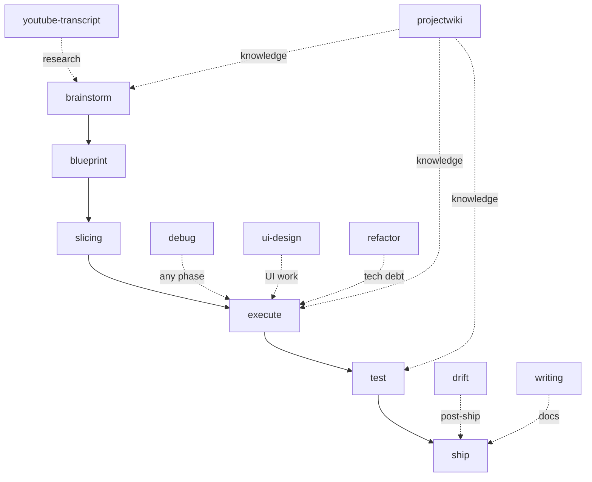
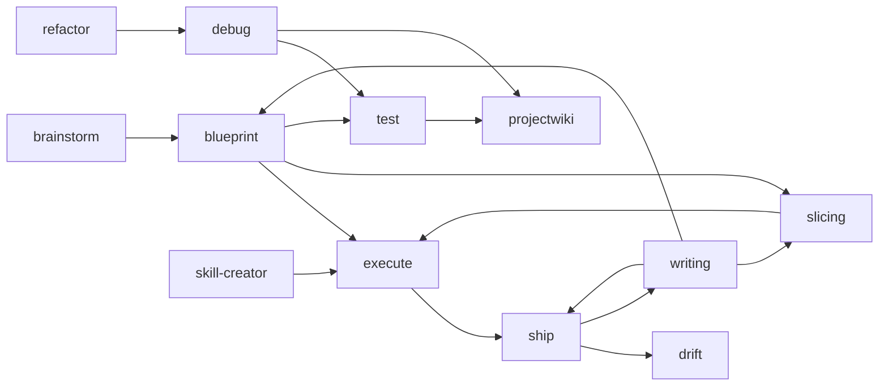
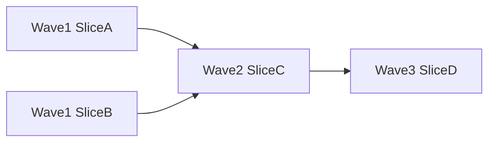

# Pipeline

The Skillgrid pipeline is a fixed phase order from idea to shipped code. Each phase is a skill. The phases compose via `related_skills` adjacency and `skillgrid:{name}` cross-references in the skill bodies.

The core habit is simple: choose the skill that matches the phase, let it create or update artifacts, then use the artifacts to decide the next skill.

## Phase Order

Solid edges are the happy-path pipeline. Dashed edges are cross-cutting skills reachable from any phase.

## The Happy Path

### 1. Brainstorm

Turn a raw idea into an approved design and spec. The agent questions the user until goal, scope, constraints, and tradeoffs are shared understanding. The interview converges on a **three-question test**: before declaring done, the agent writes the three questions it would ask next and predicts the answers — predictable all three means converged; the unpredictable one is the next question. Gates on explicit user approval before any implementation, at which point the briefing's intent sections are frozen (per `_shared/craft/review-ledger.md` § Frozen intent).

**When to use:** before any creative work — creating features, building components, adding functionality, or modifying behavior.

**Artifact:** an approved design spec.

### 2. Blueprint

Turn the spec into a buildable implementation plan (`blueprint.md`) through gated phases: research, intent-driven tests, prototype (optional), and a BDD acceptance spec.

**When to use:** you have a spec or requirements for a multi-step task, before touching code.

**Artifacts:** `blueprint.md`, BDD acceptance spec (`.feature` file), optional prototype.

### 3. Slicing

Break the blueprint into vertical tracer-bullet tickets with dependency edges and execution waves. Publish tickets to the configured tracker (GitHub, GitLab, Jira, Backlog.md, Hermes Kanban).

**When to use:** after writing a blueprint, before execution.

**Artifacts:** `tasks.md`, tracker records (issues/MR/epics), dependency wave map.

### 4. Execute

Set up an isolated workspace, pick the execution mode (subagent-driven per ticket, inline, or parallel fan-out for independent domains), run the waves in order, drive ticket status, and hand off to QA and review.

**When to use:** executing an implementation plan or sliced `tasks.md`.

**Artifacts:** implemented code, test evidence, task briefs, implementer reports, review package.

### 5. Test

Run the areas the change warrants, in order: intent testing (does it satisfy the stated requirement), functional testing (does the behavior actually run), code quality (duplication and complexity via jscpd), and security (trivy, nuclei, wapiti, akca, owasp). Renders a four-state verdict: PASS / CONCERNS / FAIL / WAIVED.

**When to use:** a change needs testing beyond the implementation.

**Artifacts:** test evidence, security scan results, four-state verdict.

The **review + fix loop** is part of this phase (the "review" area of the test skill): a topology-driven code review runs fresh, blind lens subagents over the diff, the coordinator re-grades each finding by consumer consequence (a reviewer's self-assigned severity is dropped — information asymmetry), and triage routes by **root cause**: code → fix now / defer / human look / noise; spec → amend the spec and re-derive the code; human intent → HALT (the briefing's frozen block was renegotiated — only the human edits it). Every deferred finding lands in the per-change `review-ledger.md` (disposition `parked`) and a `DW-<n>` entry in the project's cross-change `.skillgrid/deferred-work.md`.

**Deferred work** is the cross-change memory for "real, but not now": an append-only ledger (`.skillgrid/deferred-work.md`) that review triage writes into, that `test` surfaces at the start of every new change, and that `ship` sweeps on close-out — verifying each open entry against the current code ("probably fixed" is not evidence; a file:line or commit is) and partitioning it into resolved / bundle / blocked / skip / decision. Per `_shared/craft/deferred-work.md`.

### 6. Ship

The terminal phase. Reflect into projectwiki, environment retro, documentation, commit, PR, and archive. One pass closes the change end to end.

**When to use:** a change has passed QA and review and needs to be closed out.

**Artifacts:** projectwiki pages, commit, PR, archive.

## Cross-Cutting Skills

These are not in the happy path; they are reachable from any phase:

| Skill | When | What it produces |
|---|---|---|
| `debug` | any bug, test failure, build failure, performance problem | hypothesis trail, root cause, three-state verdict (FIXED / EXPLAINED / ESCALATED) |
| `drift` | after execute or ship | drift report (code vs doc divergence), or "No drift detected" |
| `refactor` | tech debt cleanup, before a major change | refactored code, before/after jscpd delta |
| `ui-design` | building or redesigning app UI | UI design spec, component decisions |
| `writing` | docs, PR body, changelog, release note, postmortem | human-facing Markdown (from the real diff, never memory) |
| `projectwiki` | maintaining the knowledge vault | OKF pages, FTS index, citations |
| `youtube-transcript` | research, design reference | transcript text |

## Composition Graph

The `related_skills` edges (in-repo only). The graph is unidirectional in form (A lists B) but bidirectional in effect (the neighborhood is what matters).

### Edge Semantics

| Edge | Meaning |
|---|---|
| `brainstorm → blueprint` | brainstorm's approved spec is blueprint's input |
| `blueprint → execute` | blueprint's plan is what execute runs |
| `blueprint → slicing` | blueprint's plan is what slicing breaks into tickets |
| `blueprint → test` | blueprint's acceptance spec is what test verifies against |
| `execute → ship` | execute's completed change is what ship closes out |
| `slicing → execute` | slicing's tasks.md is what execute picks up |
| `debug → test` | debug's root-cause hypothesis is what test confirms |
| `debug → projectwiki` | debug's findings feed the knowledge vault |
| `test → projectwiki` | test's verdicts and evidence feed the knowledge vault |
| `ship → drift` | ship triggers a drift check on the closed change |
| `ship → writing` | ship's documentation step uses writing's modes |
| `writing → blueprint/ship/slicing` | writing's record mode documents these phases' outputs |
| `refactor → debug` | refactor's dead-code findings may trigger a debug investigation |
| `skill-creator → execute` | skill-creator's evals run via execute's subagent mechanism |

## Multi-Agent Execution

The `execute` skill supports three modes:

- **Inline:** the agent implements tasks in the current session. Good for small, sequential plans.
- **Subagent-driven:** each task gets a fresh subagent with a bounded context packet. Good for larger plans where context rot would degrade quality.
- **Parallel fan-out:** independent tickets run in parallel (separate worktrees or non-overlapping file ownership). Good for independent domains.

The rule: **delegate work, not responsibility.** The parent session owns workflow state, decisions, handoff updates, and final verification. Subagents provide fresh-context work products.

Dependency waves are how parallelism stays safe: a wave is a group of independent tasks that can run at the same time because they have no unresolved blockers and do not edit overlapping files.

## Verification And Review

Delegated implementation must pass a double review gate before the parent marks the task complete:

1. **Spec compliance review:** verify traceability to the blueprint, acceptance criteria, and task boundaries.
2. **Code quality review:** verify correctness, maintainability, architecture, security, performance, tests, and local conventions.

Ordering matters. Do not accept code quality review before spec compliance passes.

## When To Stop

The pipeline stops for human judgment when:

- scope is unclear or the spec needs revision;
- a security, credential, or destructive-action risk is unresolved;
- the four-state verdict is FAIL or CONCERNS;
- a drift report shows material divergence;
- the user needs to approve a design decision.

Every stop should land in a durable place: a handoff note, a tracker status, or a projectwiki page.
