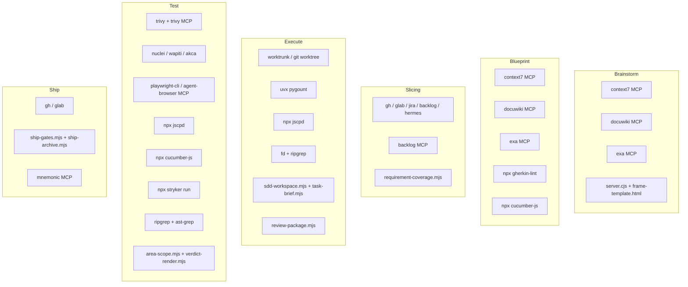

# Tools

Skillgrid skills invoke three kinds of tools: executable scripts shipped with the skills, external CLI binaries, and MCP servers. This document lists all of them and where they are used.

## Skill Scripts

Executable scripts shipped with skills. Each `.mjs` script has a documented exit-code contract. Scripts don't consume context — they're executed, not read into the model's window. A 200-line script costs zero tokens at load time.

### Exit-Code Convention

All `.mjs` scripts follow the same contract:

| Exit code | Meaning |
|---|---|
| `0` | Success / no issue found |
| `1` | Issue found (details on stdout) |
| `2` | Usage or parse error |

`.py` scripts use standard Python exit codes (0 = ok, nonzero = error).

### Script Inventory

| Skill | Script | Purpose |
|---|---|---|
| `debug` | `scripts/trail.mjs` | Hypothesis-trail state machine: add/advance/close hypotheses, emit trail status |
| `execute` | `scripts/sdd-workspace.mjs` | Resolve and ensure the working-tree directory for one plan's artifacts (briefs, reports) |
| `execute` | `scripts/task-brief.mjs` | Extract one task's full text from a plan into a file the implementer reads in one call |
| `execute` | `scripts/review-package.mjs` | Generate a review package: commit list, stat summary, net diff with extended context |
| `ship` | `scripts/ship-gates.mjs` | Pre-mutation gate reader: one call returns the machine verdict of all ship gates |
| `ship` | `scripts/ship-archive.mjs` | Mechanical archive move (ship Step 7): move the change dir to the archive |
| `slicing` | `scripts/requirement-coverage.mjs` | Plan-check coverage gate: verify every requirement in the spec has a corresponding ticket |
| `test` | `scripts/area-scope.mjs` | Emit the area-selection table: which of the five test areas to run, which are N/A, and why |
| `test` | `scripts/verdict-render.mjs` | Four-state gate: render the PASS / CONCERNS / FAIL / WAIVED verdict from test results |
| `skill-creator` | `scripts/check-frontmatter.mjs` | Validate SKILL.md frontmatter: field set, order, name=dir, description ≤ 1024, quoted semver |
| `skill-creator` | `scripts/skill-size-budget.mjs` | Check every skill's byte size against its tier ceiling (standard/large/xl/external) |
| `youtube-transcript` | `scripts/get_transcript.py` | Extract a YouTube transcript via the `uv`-managed Python runtime |
| `brainstorm` | `scripts/server.cjs` | Local preview server for the brainstorm frame template |
| `brainstorm` | `scripts/start-server.sh` | Start the brainstorm preview server |
| `brainstorm` | `scripts/stop-server.sh` | Stop the brainstorm preview server |
| `brainstorm` | `scripts/helper.js` | Browser-side helper for the frame template |
| `brainstorm` | `scripts/frame-template.html` | Fill-in HTML frame for the brainstorm design artifact |

### Script Design Rules

The scripts follow the conventions defined in `skill-creator` (§3c):

- ESM (`.mjs`), Node 18+, no dependencies (use `node:fs`, `node:path`, `node:child_process`).
- Print a one-line verdict to stdout (e.g. `DRIFT: none`, `PASS: 36/36`).
- Print details to stdout when the verdict is non-zero.
- Accept the project root as the first arg (default `.`).
- One contract per script: one job, one exit-code contract, one stdout format.

## External CLI Tools

Tools the skills invoke that you need installed. "Optional" means only when the corresponding tracker/feature is configured in `.skillgrid/config.yaml` or a live target is available.

### Install (binary/CLI)

| Tool | Used by | Purpose |
|---|---|---|
| `worktrunk` (`wt`) | execute, ship | Git worktree manager for parallel agents: `wt switch --create` / `wt merge` / `wt remove --reap`. Preferred-when-present — the skills fall back to `git worktree add` when absent. |
| `trivy` | test | Static security scanning: deps, secrets, IaC, containers, SBOM. Always for the security gate. |
| `nuclei` | test | Broad DAST at a running target, CVE templates. Optional — needs a live target. |
| `wapiti` | test | Lightweight DAST fuzzer. Optional — needs a live target. |
| `akca` | test | Deep evidence-backed DAST, browser-backed. Optional — needs Go 1.25+ and Chrome/Chromium. |
| `playwright-cli` | test | Browser automation for functional testing. Install with `npm install -g @playwright/cli@latest`. |
| `gh` | slicing, ship | GitHub CLI for issues / PRs / labels. Optional — when `ticketing.type: gh`. |
| `glab` | slicing, ship | GitLab CLI for issues / MRs / labels. Optional — when `ticketing.type: glab`. |
| `jira` | slicing | Jira CLI for epics / tasks. Optional — when `ticketing.type: jira`. |
| `backlog` | slicing, ship | Backlog.md CLI for file-based tickets. Optional — when `ticketing.type: backlogmd`. |
| `hermes` | slicing | Hermes Kanban CLI for ticket tracking. Optional — when `ticketing.type: hermes-kanban`. |
| `ast-grep` | debug, test, refactor | Structural code search (syntax-aware, not text). `ast-grep run -p '<pattern>'` for pattern-based find/replace across files. |
| `fd` | execute, debug | Fast file finder. Replaces `find` for locating files by name/glob pattern. |
| `ripgrep` (`rg`) | debug, test, refactor, execute | Fast text search across codebases. `rg -t <type> '<pattern>'` for type-filtered grep. |

### MCP Servers (install + wire in the agent's MCP config)

| Server | Command | Used by | Purpose |
|---|---|---|---|
| `mnemonic` | `mnemonic mcp` | projectwiki, ship | Exposes `mem_*` + `projectwiki_*` tools. Also a CLI (`mnemonic init`, `mnemonic projectwiki ...`). Optional — only when `mnemonic.enabled: true`. Needs an embedder: ollama / external / onnx. |
| `agent-browser` | `agent-browser mcp --tools all` | test | Browser automation with stable element refs. Preferred driver for the functional browser pass. |
| `trivy` | `trivy mcp` | test | `findings_list`/`findings_get` to read scan results as structured data. The scan itself still runs via the CLI. |
| `backlog` | `backlog mcp start` | slicing | Structured create/read/update that avoids shell-quoting footguns. |
| `codescene` | `npx @codescene/codehealth-mcp` | refactor | Code Health score (different metric than jscpd) for before/after refactoring deltas. |

### MCP Servers (remote, no install — just enabled in the agent's MCP config)

| Server | Tools | Used by | Purpose |
|---|---|---|---|
| `context7` | `resolve-library-id`, fetch doc page | blueprint | Current library/framework API docs for research + prototype. |
| `docuwiki` | `docuwiki_search` | blueprint | Search documentation across wiki/doc sites for research. |
| `exa` | `web_search_exa`, `web_fetch_exa` | blueprint | Web search (find the page) + web fetch (read it) for research. |

### Run via npx (no install needed, fetched per run)

| Command | Used by | Purpose |
|---|---|---|
| `npx jscpd` | test, refactor, execute | Duplication / dead-code / complexity scanning. |
| `npx cucumber-js` | blueprint, execute | BDD acceptance test runner. `@cucumber/cucumber` as project devDependency. |
| `npx gherkin-lint` | blueprint | Gherkin spec linting. |
| `npx stryker run` | test | Mutation testing. Optional — only if `stryker.config.js` is present. |
| `npx playwright cli` | test | Fallback install for `playwright-cli`. |

### Run via uvx/uv (no install needed, fetched per run)

| Command | Used by | Purpose |
|---|---|---|
| `uvx pygount` | execute | LOC / codebase sizing for brownfield baseline. |
| `uv run scripts/get_transcript.py` | youtube-transcript | YouTube transcript extraction. Uses `youtube-transcript-api`. |

### Test Runners (per project, installed by the project itself)

| Tool | Used by | Purpose |
|---|---|---|
| `pytest` | blueprint, test | Python test runner. |

## Tool Dependency Map

Which tools each pipeline phase needs:

## Configuration

Tool selection is driven by `.skillgrid/config.yaml`:

- `ticketing.type` — which tracker CLI/MCP to use (`gh`, `glab`, `jira`, `backlogmd`, `hermes-kanban`).
- `mnemonic.enabled` — whether the mnemonic MCP server is wired.
- `test.security` — which security scanners to run (`trivy` always; `nuclei`, `wapiti`, `akca` optional).

The skills read the config at runtime and adapt. A skill that needs `gh` when `ticketing.type: glab` is a skill that is reading the wrong config key.
