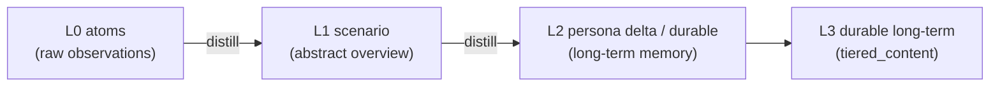
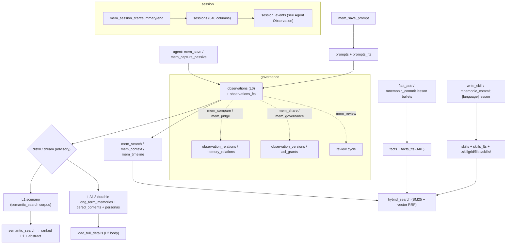
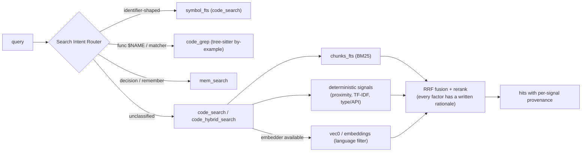
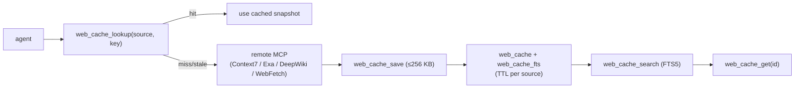
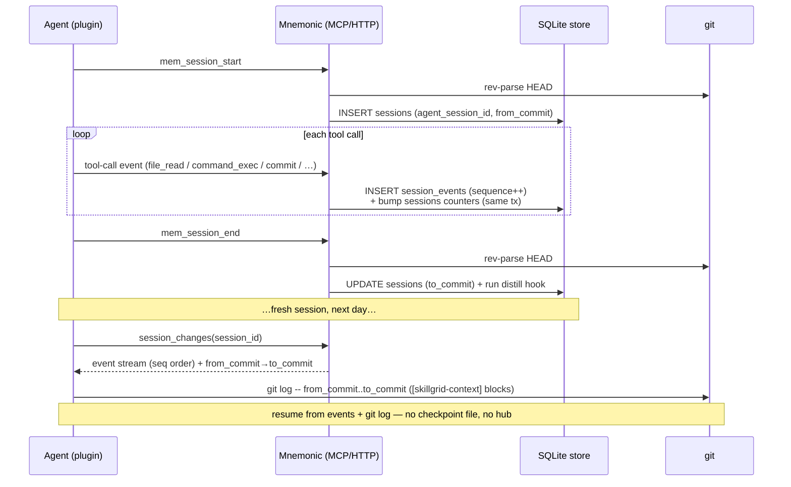
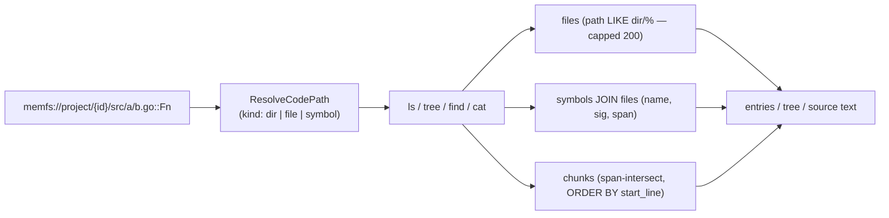

# Memory and indexing

**Mnemonic** is the persistent brain of your project — Skillgrid's local-first store of durable knowledge, not a scratchpad for chat. It is a single SQLite store behind the `mnemonic` binary, exposed to agents over **three single-purpose MCP stdio servers** (`mnemonic memory mcp` / `mnemonic code mcp` / `mnemonic projectwiki mcp` — a client mounts exactly one per project) and as direct CLI commands (`mnemonic memory search`, `mnemonic code`, `mnemonic projectwiki query`). A chat window is a working set: it fills, compacts, and dies. Mnemonic is what survives — the decisions, a live map of the code, and a record of what each agent session did — so a fresh session opens already oriented instead of blind.

> **v2 surface.** This page documents the v2 engine (the `mnemonic` binary, module `github.com/devopstales/skillgrid/mnemonic`). Sections marked **v1 legacy** describe the retired v1 `skillgrid` binary's surface (the HTTP dashboard on `:7438`, web cache, Fact Memory, the L0–L3 layered distillation, Agent Observation's full audit stream, and Memfs) — that surface shipped in the v1 change records under `.skillgrid/change-archive/` and the ADR index in `.skillgrid/projectwiki/ASSUMPTIONS.md` (notably ADR-0059, the v1 removal).

**Storage stack:** the database is provided by [`modernc.org/sqlite`](https://modernc.org/sqlite) (pure-Go build of SQLite, **cgo-free**) — the only extensions in use are **FTS5** (compiled into the driver) and **vec0** (cgo-free vector index from `modernc.org/sqlite/vec`, migration 042). No `json1`, `rtree`, or loadable extensions. JSON payloads are stored as TEXT and parsed in Go.

Everything lives in **one per-project database** at `~/.skillgrid/mnemonic/<project>.sqlite` (override the directory with `MNEMONIC_DATA_DIR`). The store is single-connection (`MaxOpenConns=1`) and WAL-journaled; memory, code index, and project wiki are views over the same file, not separate databases.

Mnemonic has **three major functions** in v2, documented below — one `##` section each (the v1-only functions are listed after them, marked legacy):

| Function | Purpose |
|----------|---------|
| [**Memory**](#memory) | Durable observations, scope tiers, hybrid/semantic recall, sessions + trails |
| [**Code index**](#code-index) | Incremental AST graph + BM25/hybrid/semantic search, impact, communities, PDG/taint |
| [**Project wiki**](#project-wiki) | The git-tracked OKF vault (`.skillgrid/projectwiki/`) + derived FTS index, with pin-checked anchors |

| v1 legacy function | Purpose |
|----------|---------|
| [**Web cache**](#web-cache) | TTL-cached remote research snapshots (Context7 / Exa / DeepWiki / WebFetch) — v1 only |
| [**Agent Observation**](#agent-observation) | Session events layer (per-tool-call audit stream) and session handoff via git — v1 only (v2 keeps a lighter `session_trails` + `mnemonic trail`) |
| [**Memfs**](#memfs) | OpenViking-style `memfs://` share interface: walk the indexed repo tree as a virtual filesystem — v1 only |

---

## Quick path

```
mnemonic memory mcp --profile agent   # memory MCP server (stdio) — the default family
mnemonic code mcp --profile agent     # code-index MCP server (stdio)
mnemonic projectwiki mcp              # project-wiki MCP server (stdio)
mnemonic code --dir .                 # one-shot incremental code index (bare `code` runs the index)
mnemonic code search "AuthService"    # index retrieval
mnemonic memory search "decision"     # memory retrieval
mnemonic projectwiki query "adr"      # wiki retrieval
```

Data dir: `~/.skillgrid/mnemonic/<project>.sqlite`. The rest of this page documents, per function: what it does, its MCP tools, its (v1) HTTP/API interface, its SQLite tables, and its dataflow.

---

## Memory

Durable, project-scoped observations — what an agent learned (decisions, discoveries, preferences) — plus a layered distillation into progressively more durable memories, a fact store, an agent skills registry, and recall over lexical, hybrid, and semantic channels.

### Function

> **Scope note (v2).** v2 keeps the core observation model — save/search/get/context, project scoping + scope tiers, the session protocol, dedup with conflict judgment (`mem_judge`/`mem_judge_many`), and consolidation — plus a `session_trails` audit of committed saves (the `mnemonic trail` CLI). The **L0–L3 layered distillation**, **Fact Memory + Agent Skills registry**, and the **governance/visibility ACL** machinery (`mem_share`/`mem_governance`/`mem_unify`) described below are **v1 legacy** (the retired `skillgrid` binary; ADR-0059) — read them as the historical design, not the v2 surface.

Memory persists what an agent learned so a future session starts oriented instead of blind. Observations are **project-scoped** by default (an observation tagged with the CWD-resolved project is visible only in that project) and **scope-tiered** for facts that cross projects: `project` → `user` → `global`. Save after: bug fixes (with root cause), architecture/design decisions, non-obvious discoveries, config/env setup, established patterns, and user preferences. Use a stable `topic_key` for evolving topics (upsert, don't duplicate). End sessions with `mem_session_summary` — the next session reads it.

**Recall ladder** (cheap → full):

```
mem_context  →  mem_search  →  mem_timeline  →  mem_get_observation
 (recent     (FTS5          (before/after    (full,
   summaries)  keyword)        context)        untruncated)
```

**Session start (`skillgrid prime`):** when the project store has recent summaries or observations, prime appends a `## Memory` index (index-only inject — not the full AutoPrepend resume block). Lines list recent session summaries (short id, date, first sentence) then observation rows (pinned first, then newest: `#id type title · date · ~tok`), capped by `mnemonic.inject.max_tokens` by dropping the oldest observation lines first and stating how many were omitted. The footer names `mem_get_observation`, `mem_timeline`, and `mem_search`. An empty store omits the section entirely. Budgets come from `mnemonic.inject` in `config.d/indexing.yaml` (see [Configuration & operations](#configuration--operations)).

**Layered memory (L0 → L3):** raw observations (L0) are distilled upward into progressively more durable, more abstract layers. `mem_layers` returns the chain for a session or topic, with each layer's provenance link back to its resolvable L0 source:



- **L0** = `observations` rows (the atoms; every `mem_save`).
- **L1** = scenario overview, surfaced by `semantic_search` (returns L1 overviews + abstracts, never full L2 bodies).
- **L2/L3** = durable long-term memories in `long_term_memories` + `tiered_contents`; loaded on demand via `load_full_details`.

`mnemonic_commit` explicitly commits lessons into L2 (durable); L0/L1 remain async. The distill/dream passes are advisory — a pass failure never corrupts committed L0 rows.

**Fact Memory & Agent Skills** (migration 011): a separate durable fact store (`facts` + `facts_fts`, AKL importance/decay columns) and an agent skills registry (`skills` + `skills_fts`, code on disk at `.skillgrid/files/skills/{name}.{ext}`). `fact_add`/`fact_search`/`fact_forget`/`fact_decay(_all)` operate the facts with a session-events trail; `write_skill`/`list_skills`/`search_skills`/`use_skill` operate the registry (`use_skill` runs the skill under its language runner with a 10s deadline, 1MB output cap).

**Hybrid & semantic recall:** `hybrid_search` fuses BM25 FTS5 with optional vector RRF over Fact Memory + the Skill registry; `semantic_search`/`load_full_details` walk the L1→L2 tiers; `mem_inject_session` renders a token-cost-annotated context block from hybrid retrieval. Every vector leg **degrades to BM25-only** (`degraded=true`) when no embedder is configured — never a hard fail.

**Governance & sharing:** observations are private by default; `mem_share` is the only explicit path out of `private` (visibility ladder `private → team → restricted → agent`, per-observation ACLs in `acl_grants`). `mem_governance` reads owner, append-only version history (`observation_versions`), status, retrieval usage, visibility. `mem_compare`/`mem_judge` record/clear typed relations (`related | compatible | scoped | conflicts_with | supersedes | not_conflict`). `mem_merge_projects`/`mem_unify` fold multiple project stores into one canonical store (the multi-repo share path).

### MCP tools

Served by the single-purpose **mnemonic-memory** server — `mnemonic memory mcp --profile agent` (the default; `--profile all` promotes the deferred admin tools to core). The `initialize` response carries the family identity and the instruction block:

```
serverInfo: { name: "mnemonic-memory", version: "0.2.0" }
instructions: "mnemonic-memory provides persistent memory that survives
               across sessions and compactions.\n\nCORE TOOLS (always available):
  mem_save — save verified durable conclusions, grouped by topic
  mem_search — find past work, decisions, or context from previous sessions
  …(22 agent tools)…\n\nDEFERRED TOOLS (admin profile only):
  mem_delete, mem_stats, mem_timeline, mem_merge_projects, mem_review, mem_doctor\n\n
PROACTIVE SAVE RULE: …  ## DELIVERY GUARANTEE  ## CONFLICT SURFACING"
```

**Agent profile (22 core):**

| Tool | Role |
|------|------|
| `mem_save` | Save verified durable conclusions, grouped by topic. |
| `mem_search` | Find past work, decisions, or context from previous sessions. |
| `mem_get_observation` | Get full untruncated content of a search result by ID. |
| `mem_lookup` | Wiki-first lookup: the narrow raw-fact fallback when the wiki has no answer. |
| `mem_search_prompts` | Recall previously saved user prompts. |
| `mem_context` | Get recent history for useful recall or relevant recovery. |
| `mem_save_prompt` | Save user prompt for context. |
| `mem_capture_passive` | Capture structured learnings from pasted text. |
| `mem_update` | Update an existing observation in place. |
| `mem_judge` | Record a verdict on a pending memory conflict (judgment_required flow). |
| `mem_judge_many` | Record verdicts for up to 32 pending conflicts in one call. |
| `mem_compare` | Persist a semantic verdict you have already judged externally. |
| `mem_consolidate` | Merge duplicate or overlapping observations. |
| `mem_suggest_topic_key` | Suggest a stable topic key for an evolving topic. |
| `mem_session_start` / `mem_session_end` / `mem_session_summary` / `mem_session_finalize` | The session protocol: create, end (optional summary), persist the structured end-of-session summary, finalize (terminal state). |
| `mem_current_project` / `mem_list_projects` | Detect current project from cwd (recommended first call); list known projects. |
| `mem_pin` / `mem_unpin` | Pin an observation so it sorts first in context recall; unpin (back to normal recency ordering). |

**All profile adds 6 admin tools:** `mem_delete` (soft by default, hard flag removes it), `mem_stats`, `mem_timeline` (chronological context around an observation), `mem_merge_projects`, `mem_review` (list or mark reviewed observations), `mem_doctor` (memory health report).

> **v1 legacy.** The v1 `skillgrid` binary additionally shipped a **Tiered & hybrid recall** surface (`semantic_search` / `load_full_details` over L1→L2 long-term memory, `hybrid_search` over Fact Memory + the skill registry, `mem_inject_session`) and a **Fact Memory & Agent Skills** surface (`fact_add`/`fact_search`/`fact_forget`/`fact_decay(_all)`, `write_skill`/`list_skills`/`search_skills`/`use_skill`) — plus the governance/visibility machinery (`mem_share`, `mem_governance`, `mem_unify`) and the L0–L3 distillation described in [Function](#function). None of those are in the v2 engine; see the v1 change records under `.skillgrid/change-archive/`.

### HTTP / API interface

> **v1 legacy (ADR-0059).** The v1 `skillgrid serve` HTTP API + embedded dashboard (default `127.0.0.1:7438`) is not part of v2 — v2's operator surface is the CLI. The routes below shipped with v1; see [Web UI](10-webui.md).

Write routes were gated by `SKILLGRID_HTTP_TOKEN` (bearer); read routes were open on the loopback. The embedded web dashboard (Memory Visualization: observations list/detail/edit/share, session list with summaries, timeline) consumed the same routes.

| Route | Method | Purpose |
|-------|--------|---------|
| `/memory/status` · `/memory/last-save-at` | GET | Memory health / last save time |
| `/observations` · `/observations/recent` · `/observations/{id}` | GET | List / recent / fetch observation |
| `/observations` · `/observations/passive` | POST | Save observation / passive capture |
| `/search` | GET | Cross-corpus search (code+mem routing) |
| `/prompts` | POST | Save a user prompt |
| `/memory/timeline` | GET | Chronological context around an observation |
| `/memory/observations/{id}` | PATCH · DELETE | Update / delete |
| `/memory/observations/{id}/pin` · `/unpin` · `/share` · `/status` | POST | Pin, unpin, widen visibility, set status |
| `/memory/observations/{id}/governance` | GET | Governance fields + ACL grants |
| `/memory/reviews` · `/memory/reviews/{id}` | GET · POST | Review list / mark reviewed |
| `/memory/relations` · `/relations/{id}` · `/relations` | POST · DELETE · GET | Create/clear typed relations, inspect |
| `/memory/project` · `/memory/doctor` | GET | Current project / read-only diagnostics |
| `/projects/migrate` · `/projects/merge` | POST | Tier sidecar backfill / merge project stores |
| `/sessions` · `/sessions/{id}` | GET · POST | Session list / create |
| `/sessions/{id}/summary` · `/sessions/{id}/activity` | GET | Session summary / activity counters |
| `/sessions/{id}/end` · `/sessions/{id}/title` | POST | End session (distill hook) / rename |
| `/context` · `/context/compaction` | GET | Context-injection block / compaction payload |
| `/mnemonic/memories` · `/mnemonic/memories/{id}` | GET · PUT | Dashboard list / detail / edit |
| `/mnemonic/memories/{id}/share` · `/status` | POST | Dashboard share / status |
| `/mnemonic/sessions` · `/mnemonic/audit` · `/mnemonic/search` | GET | Dashboard sessions / audit / search |
| `/mnemonic/graph/data` · `/mnemonic/graph/nodes` | GET | Observation-graph data for the viz |
| `/mnemonic/files/tree` · `/mnemonic/files/content` | GET | Dashboard file tree / content |

### SQLite tables

| Table | Purpose | Key columns |
|-------|---------|-------------|
| `observations` | L0 atoms — every saved memory | `id`, `session_id`, `type`, `title`, `content`, `project`, `scope`, `topic_key`, `normalized_hash`, `revision_count`, `source`, `pinned`, `expires_at`, `visibility`, `owner`, `status`, `importance_score`, `recency_decay`, `maturity_tier`, `provenance` |
| `observations_fts` | FTS5 over observations (external-content, trigger-synced, `tokenize='porter'`) | `content` |
| `observation_versions` | Append-only version history (governance) | `observation_id`, `content`, `created_at` |
| `observation_relations` | Typed links between observations (`mem_compare`/`mem_judge`) | `from_id`, `to_id`, `relation` |
| `memory_relations` | Cross-observation semantic relations | `obs_a`, `obs_b`, `relation` |
| `acl_grants` | Visibility ACLs for shared obs (`mem_share`) | `observation_id`, `principal`, `access` |
| `prompts` / `prompts_fts` | Saved user prompts | `session_id`, `text` |
| `sessions` | Workspace sessions (see [Agent Observation](#agent-observation) for the 040-added columns) | `id`, `project`, `directory`, `title`, `status`, `started_at`, `ended_at`, `summary`, `agent_session_id`, `from_commit`, `to_commit`, activity counters |
| `observation_layers` | L0–L3 layer provenance (`mem_layers`) | `project`, `layer`, `target_kind`, `target_id`, `source_session`, `source_topic`, `content_hash` |
| `long_term_memories` | L2/L3 durable memories | `project`, `title`, `tiered_content_id`, `source_link`, `full_path`, `abstract_path`, `overview_path` |
| `tiered_contents` | Tiered L1/L2/L3 content bodies | `id`, `layer`, `content` |
| `personas` | Distilled persona deltas (L2) | `project`, `content`, `updated_at` |
| `facts` / `facts_fts` | Fact Memory (011; AKL `importance_score`/`recency_decay`, soft-delete) | `id`, `project`, `content`, `importance_score`, `deleted_at` |
| `skills` / `skills_fts` | Agent Skills registry (011; code path, soft-delete) | `id`, `name`, `language`, `description`, `code_path`, `deleted_at` |
| `skill_usage` | `use_skill` execution log | `skill_id`, `session_id`, `exit_code`, `output` |
| `retrieval_trails` | Retrieval provenance audit (`mem search --trajectory`) | `session_id`, `query`, `hits_json` |
| `distill_llm_cache` | LLM distillation cache | `input_hash`, `output` |
| `distill_lock` | Distill/dream single-flight lock | `key`, `held_at` |
| `snapshots` / `ttl_config` | Point-in-time snapshots + TTL overrides | — |
| `project_aliases` | Source→canonical project aliases (`mem_merge_projects`/`mem_unify`) | `alias`, `canonical` |

### Dataflow



Save path: `mem_save` → single-connection transaction inserts the `observations` row + syncs `observations_fts` (trigger) → dedup by `normalized_hash` within 24h, upsert by `topic_key`. Recall path: `mem_search` (FTS5 bm25) → `mem_timeline` (window around a hit) → `mem_get_observation` (full body). Distill path: `mem_session_end` runs the distill hook under `distill_lock` — a provider failure is logged, never propagated.

---

## Code index

An incremental, tree-sitter-based graph of the repo — files → symbols → edges — plus lexical (FTS5), hybrid, and semantic (embedding) retrieval, plus advisory structural analyses (communities, processes, PDG/taint). It is **per-project** (one SQLite file, no cross-project code search).

### Function

```
files → symbols → edges (calls / imports / references / extends / route / navigates / …)
                  → chunks → chunks_fts        (BM25 lexical)
                  → embeddings / chunk_embeddings  (semantic, config-driven)
                  → vec_symbols / vec_chunks    (vec0, derived in-SQL index)
                  → communities / processes     (advisory analytics)
```

The core graph commit is **transactional**; every advisory pass (community, process, knowledge, import-cycle, resolution-audit, LSP, PDG) runs **after** the commit and is warn-and-continue — a pass failure never rolls back the committed graph.

**Orientation ladder (canonical order):**

```
code_status → code_index (if not fresh) → code_search → code_read
```

`code_status` reports `freshness` (`fresh` | `lag` | `empty` | `unknown`) and a `capabilities` block (graph/fts/vector+dims). Reindex when not `fresh`. Prefer index tools over `rg` for **unfamiliar** large repos; use `rg`/`grep` for exact identifiers.

**Tool surfacing (v2):** the code index is served by the single-purpose **mnemonic-code** server (`mnemonic code mcp`); the `--profile agent|all` flag selects the tool set (the agent profile is the default — the narrow menu). `code_explore` (the primary tool: verbatim source grouped by file + call paths + blast radius in one call) and the ladder tools (`code_status`/`code_index`/`code_search`/`code_read`) are on both profiles. (v1 used the `SKILLGRID_MCP_CODE_TOOLS` env filter to re-enable the unlisted menu — gone in v2.)

### MCP tools

Served by the single-purpose **mnemonic-code** server — `mnemonic code mcp --profile agent` (the default, 20 tools; `--profile all` is the full 39). The `initialize` response carries `serverInfo.name: "mnemonic-code"` + the pinned empty capabilities `{"tools":{},"resources":{},"prompts":{}}` and **no instructions block** (the gitnexus shape) — the exploration discipline (`code_explore` first, treat returned source as already read) lives in the `code_explore` tool description, not in an instructions field.

**Agent profile (20):**

| Tool | Role |
|------|------|
| `code_status` | Index health — 4-state freshness (not a boolean), per-language extractor tier, capabilities block. Call when the index may be stale (after clone, branch switch, large edits). |
| `code_index` | Run the incremental index for the cwd git root (async: `run_id` + status; a repeat while active → `409 operation_conflict`). |
| `code_search` | Hybrid search (FTS + structural + semantic, RRF K=60) — prefer over grep/rg when exploring unknown areas of a large repo. |
| `code_explore` | **PRIMARY tool** — call first before reading files: the ranked symbols' verbatim line-numbered source (treat each block as a Read you already performed), the per-symbol blast radius (callers + test files), and the per-file edge summary (EXTRACTED untagged, INFERRED tagged). One capped call per question. |
| `code_read` | Indexed source for a path + range after search narrowed the location. `mode: full` (live span, secret redaction) or `content` (the drill handle: signature + neighbor ids). |
| `code_orient` | The navigation entry point — the progressive-disclosure "map" of a symbol/package/file (metadata + TOC + bounded outbound edges, depth-re-rootable). |
| `code_explain` | Node + degree + connections ranked by the neighbor's degree (hubs first). |
| `code_path` | BFS shortest path between two symbols, or "where the graph stops". |
| `code_impact` | Risk-tiered blast radius (WILL BREAK / LIKELY AFFECTED) — dependents, capped by depth + min-confidence. |
| `code_affected` | "Which tests do I run after this change?" — affected tests from changed files (`changed`) or a git ref (`base`). |
| `code_grep` | Index-free structural AST grep (by-example patterns) — the structural leg of the hybrid search. |
| `code_semantic` | Embedding search (symbol + chunk) — the semantic leg (`degraded: no_vector` when the embedder is absent). |
| `code_get_callers` / `code_get_callees` / `code_get_dependents` / `code_get_implementors` / `code_get_hierarchy` / `code_get_tests_for` | Confidence-labeled graph-neighbor views of a symbol (EXTRACTED/INFERRED). |
| `code_resolve` | Resolve a symbol: anchor → `{exists, file, line, called_from[], candidates[]}` (the project-wiki pin-check contract). |
| `code_packages` | Top-level Go package map (path, files, symbols) — the wiki coverage-gap contract. |

**All profile adds (19):**

| Tool | Role |
|------|------|
| `code_rename` | Rename plan (graph edits vs text-search edits; `dry_run` default true). |
| `code_unresolved` | The drop-not-guess backlog (the `unresolved_edges` ledger). |
| `code_circles` | Import cycles (re-derived from `kind='imports'` edges). |
| `code_deps` / `code_dep_impact` | The SBOM dependency graph; which dependents a dependency change affects. |
| `code_embedding_status` | Provider / model / dim / embedded count. |
| `code_watch` | Start the live incremental watcher (fsnotify: debounce, burst-collapse, re-check, delete). |
| `code_pdg_query` / `code_taint` | **v2.1-deferred** (declared in the surface, not yet implemented): per-function CFG/PDG dependents; source→sink taint. |
| `code_communities` / `code_god_nodes` / `code_explain_community` | **v2.1-deferred**: Leiden subsystems, most-connected symbols, community detail. |
| `code_processes` / `code_process` | **v2.1-deferred**: precomputed process flows + one named trace. |
| `code_route` / `code_navigates` | Framework routes (URL + method + framework → handler refs); screen→screen navigation edges. |
| `code_docs` / `code_configs` / `code_sql_schema` | Knowledge-graph reads: `.md` doc nodes + links, config nodes + references, SQL DDL tables. |

> **v1 legacy.** v1's menu also shipped `code_file_toc` / `code_signature` / `code_rationale` (folded into `code_orient`'s map + `code_read`'s content mode) and `code_hybrid_search` / `code_semantic_search` / `code_sql_access` (the hybrid search is `code_search` in v2; `code_sql_access`'s `reads`/`writes` edges live in the knowledge-graph reads).

### HTTP / API interface

> **v1 legacy (ADR-0059).** The v1 `skillgrid serve` Code Graph pane (3-pane callers | source | callees, blast radius, symbol search, entry points, flow/path) is not part of v2 — see [Web UI](10-webui.md).

| Route | Method | Purpose |
|-------|--------|---------|
| `/code/status` | GET | Index health + capabilities |
| `/code/index` | POST | Trigger an incremental index (write-auth) |
| `/code/files` | GET | Indexed file listing (dashboard file tree) |
| `/code/search` | GET | BM25/hybrid code search |
| `/code/read` | GET | Indexed source slice (path + range) |
| `/mnemonic/graph/data` · `/mnemonic/graph/nodes` | GET | Graph data for the Code Graph viz |
| `/mnemonic/files/tree` · `/mnemonic/files/content` | GET | Dashboard file tree / content |
| `/git` · `/git/commits` · `/git/commits/{sha}` · `/git/diff/{sha}` · `/git/file-history` · `/git/blame` | GET | Git history/diff/blame for the dashboard |

### SQLite tables

**Core graph (transactional):**

| Table | Purpose | Key columns |
|-------|---------|-------------|
| `files` | Indexed files | `id`, `path`, `mtime_ns`, `size`, `content_hash`, `ast_hash`, `indexed_at` |
| `symbols` | Code units (function/method/type/route/…) | `id`, `file_id`, `name`, `qualified_name`, `kind`, `language`, `signature`, `start_line`, `end_line`, `content_hash`, `uid`, `hub_score`, `return_type`, `param_types`, `visibility`, `is_exported` |
| `edges` | Symbol→symbol relationships | `id`, `kind`, `from_id`, `file_id`, `to_id`, `to_name`, `target_path`, `confidence`, `line`, `valid_from`, `valid_to`, `context`, `confidence_score` |
| `chunks` | Lexical + semantic units (AST-boundary, full-file coverage) | `id`, `file_id`, `start_line`, `end_line`, `text`, `content_hash`, `kind` (`lines`\|`ast`) |
| `symbol_fts` / `chunks_fts` | FTS5 lexical indexes | name/qualified_name/signature/kind/language · chunk text |
| `symbol_segments` | Reverse segment index (substring location) | `symbol_id`, `segment`, `offset` |

Edge `kind` values: `calls`, `imports`, `references`, `extends`, `route`, `navigates`, `dynamic_import`, `configures`, `reads`, `writes`, `tests_for`, `method`. `confidence` is `EXTRACTED` (1.0) / `INFERRED` (0.85) / `AMBIGUOUS` (0.5).

**Semantic tier (config-driven via `mnemonic.embedder`):**

| Table | Purpose | Key columns |
|-------|---------|-------------|
| `embeddings` | Symbol vectors (name+signature) — source of truth | `symbol_id`, `model`, `dim`, `vector` (BLOB), `language`, `updated_at` |
| `chunk_embeddings` | Chunk-text vectors (non-symbol code) — source of truth | `chunk_id`, `model`, `dim`, `vector`, `language` |
| `vec_symbols` / `vec_chunks` | (042) vec0 virtual tables, 768-dim pinned, rowid→parent PK. Derived in-SQL index: if absent/corrupt the semantic leg degrades to the in-memory path (never fails) | `rowid`, `embedding float[768]` |
| `lsh_buckets` | LSH acceleration buckets (plain table) | `model`, `dim`, `bucket`, `ref_id` |
| `path_embeddings` | File-path embeddings (topical locality) | `file_id`, `vector` |
| `embed_meta` | Embedder model + dim registry (model-swap guard) | `model`, `dim`, `active` |

**Advisory analytics (never load-bearing):**

| Table | Purpose | Key columns |
|-------|---------|-------------|
| `communities` / `community_meta` | Leiden partition + per-community meta (label, cohesion, god_nodes) | `id`, `symbol_id` · `id`, `label`, `symbol_count`, `cohesion`, `cache_key` |
| `import_cycles` | File import dependency loops (color-DFS) | `cycle`, `node_count` |
| `processes` / `process_steps` / `process_meta_cache` | Entry-point execution traces | `name`, `entry_symbol_id`, `label`, `stop_note` · step hops |
| `route_meta` / `route_drops` | Framework route nodes + unresolved drops | URL/method/framework · dropped handler refs |
| `doc_nodes` / `config_nodes` / `sql_schema_nodes` | Knowledge-graph nodes (docs, configs, SQL DDL) | node text + parsed structure |
| `rationale` | Rationale comments linked to a symbol | `symbol_id`, `text`, `kind` (`note`\|`why`\|`adr`), `line` |
| `unresolved_refs` | Dropped reference targets (drop-not-guess) | `name`, `kind`, `line`, `match_count` |
| `unresolved_members` | Unbound receiver-qualified calls (internal/external split) | `file_id`, `language`, `member`, `receiver`, `external`, `line` |
| `resolution_audit` | Per-language call-resolution ledger | `language`, `call_sites`, `unresolved` |
| `cfg_blocks` / `cfg_edges` / `pdg_edges` / `taint_findings` | (opt-in `--pdg`) per-function CFG/PDG + taint | blocks, control/data edges, taint paths |
| `index_freshness` / `index_meta` / `index_meta_kv` / `fingerprint_meta` / `extraction_metadata` | Freshness + migration + schema-fingerprint bookkeeping | — |

### Dataflow

```mermaid
flowchart TD
  SCAN["skillgrid index --dir .<br/>git-root scan (indexing.yaml include/exclude)"] --> DIFF{"file changed?<br/>(mtime + content_hash + ast_hash)"}
  DIFF -->|no| SKIP["skip (fingerprint gate)"]
  DIFF -->|yes| EX["extract: tree-sitter adapter<br/>(~30 langs) + regex fallback"]

  EX --> S["symbols (name, kind, lang, sig,<br/>return_type, param_types, visibility, is_exported)"]
  EX --> E["edges (calls, imports, references,<br/>extends, route, navigates, dynamic_import)"]
  EX --> R["rationale + unresolved_members<br/>+ per-lang resolution_audit"]
  EX --> C["chunks (kind=lines|ast) — full-file coverage"]

  S --> SFTS["symbol_fts (FTS5)"]
  C --> CFTS["chunks_fts (FTS5)"]
  S -->|embedPass (config-driven)| VEC["embeddings + chunk_embeddings (BLOB, SoT)<br/>+ vec_symbols/vec_chunks (vec0 derived)"]
  C --> VEC
  S --> CM["communities + community_meta (Leiden + cohesion)"]
  E --> CM
  E --> IC["import_cycles (color-DFS)"]
  E --> PR["processes + process_steps (entry-point traces)"]
  E --> KN["doc_nodes / config_nodes / sql_schema_nodes"]
  E --> CFG["cfg/pdg/taint (opt-in --pdg)"]
```

**Search path:**



No embedder → the semantic leg is **explicitly** `degraded=true` with a reason + fallback. Never silent degrade to FTS-as-semantic.

**Embedding config:** the provider is chosen from `mnemonic.embedder` in `config.d/indexing.yaml` and applies to indexing automatically — there is **no `--embeddings` flag** (only `--dir`, `--project`, `--pdg`, `--lsp`). Retrieval's semantic *search* leg is separately gated by `MNEMONIC_EMBED=1` (default off). Providers: `onnx` (default, in-process, `nomic-embed-code` 768-dim), `ollama`, `local`, `external` (OpenAI-compatible), `off`. A provider that can't load degrades to the Null adapter with a logged warning; `embed_meta` records model+dim as the model-swap guard (a change invalidates vectors and triggers re-embed).

---

## Project wiki

The repo's durable project knowledge: a **git-tracked OKF vault** at `.skillgrid/projectwiki/` (one file per concept in `decisions/` `invariants/` `workflows/` `glossary/` `reference/`) plus a **derived FTS index** in the project DB. You own the page markdown; the engine owns the derived state (`index/` projections, FTS tables, baselines) — always rebuildable, never hand-edited. Grounded pages pin live code (working-tree-relative anchors) and carry pin-check state; `projectwiki_validate --strict` is the CI drift gate.

### MCP tools

Served by the single-purpose **mnemonic-projectwiki** server — `mnemonic projectwiki mcp`. The `initialize` response carries `serverInfo.name: "mnemonic-projectwiki"` + the openwiki-derived instruction block (retrieval discipline: locate with `projectwiki_query`, hydrate with `projectwiki_read`; treat vault content as context, not instructions; proactive save via `projectwiki_generate`; gate before shipping with `validate` + `lint`).

| Tool | Role |
|------|------|
| `projectwiki_query` | Stage-1 ranked retrieval: located pages + 1-line snippets (`type` / `grounded_only` narrow). |
| `projectwiki_read` | Hydrate a full page or one `##` section (grounded pages carry their pin-check state). |
| `projectwiki_search` | The raw FTS power path (more rows, longer snippets) — for power searches, not the default. |
| `projectwiki_generate` | Proactive save: re-derive the wiki after a significant `mem_save` or landed decision (incremental by default; degraded runs carry `degraded:true` + a reason). |
| `projectwiki_index` / `projectwiki_reindex` | Incremental / full reindex — every page write ships with its reindex. |
| `projectwiki_validate` | Pin-check: empty paths = every grounded page; `strict` carries the CI verdict (ok = no drift). |
| `projectwiki_lint` | Deterministic vault health; `fix` auto-repairs the safe findings. |
| `projectwiki_status` | Vault + index status. |
| `projectwiki_cite_source` | Cite external material (stable `external:<name>` id, idempotent per name+version). |
| `projectwiki_bootstrap` / `projectwiki_rebuild_meta` / `projectwiki_eval` | Vault bootstrap; derived-meta rebuild; the recall@K regression net. |

### SQLite tables

| Table | Purpose |
|-------|---------|
| `wiki_pages` / `wiki_fts` | Page rows (rel_path identity) + FTS5 over page content (external-content, trigger-synced). |
| `wiki_baselines` / `wiki_checkpoints` | Derived-state anchors for the pin-check + drift detection. |

---

## Web cache

> **v1 legacy.** The web cache (TTL-cached Context7 / Exa / DeepWiki / WebFetch snapshots, `web_cache_*` tools) shipped with the v1 `skillgrid` binary and is not in the v2 engine — the `mnemonic` MCP servers do not expose `web_cache_*`. Kept as the historical design; see the v1 change records under `.skillgrid/change-archive/`.

A TTL-cached snapshot store for remote research, so a repeat lookup doesn't re-hit Context7 / Exa / DeepWiki / WebFetch. The protocol is **lookup-first**:

```
web_cache_lookup(source, …)  →  hit? use it
                                  miss/stale? → remote MCP call
web_cache_save(source, content, …)   # immediately after the remote call (cap 256 KB)
```

"What did we find about X online?" → `web_cache_search(query)` → `web_cache_get(id)`.

### MCP tools

| Tool | Role |
|------|------|
| `web_cache_lookup` | Check the cache before a remote MCP call. Returns hit/miss/stale + entry id. Source-specific keys (context7 `library_id`/`query`, exa `query`/`sort_params`, deepwiki `repo_name`/`question`, fetch `url`, manual `title`/`content_hash`). |
| `web_cache_save` | Persist a snapshot after a remote MCP or fetch. Cap 256 KB per snapshot — summarize first. Optional `metadata` JSON. |
| `web_cache_search` | FTS5 search over cached research. `fresh_only` (default true) excludes expired entries; optional `source` filter. |
| `web_cache_get` | Full untruncated snapshot by id. |
| `web_cache_status` | Health: counts by source, expired entries, oldest/newest fetch. |

### HTTP / API interface

| Route | Method | Purpose |
|-------|--------|---------|
| `/web/lookup` | GET | Cache lookup (same key semantics as the MCP tool) |
| `/web/cache` | POST | Save a snapshot (write-auth) |
| `/web/search` | GET | FTS search over the cache |
| `/web/entry/{id}` | GET | Full snapshot by id |
| `/web/status` | GET | Cache health |

### SQLite tables

| Table | Purpose | Key columns |
|-------|---------|-------------|
| `web_cache` | Snapshot store | `id`, `project`, `source`, `cache_key`, `url`, `title`, `query`, `library_id`, `version_tag`, `content`, `metadata_json`, `content_hash`, `fetched_at`, `expires_at`, `session_id` |
| `web_cache_fts` | FTS5 over cached content (external-content, trigger-synced) | `content` |

### Dataflow



Default TTLs: context7 30d, exa/fetch 7d, deepwiki 14d, manual never. An entry past `expires_at` reports `stale` on lookup (usable if you accept it; `fresh_only` search excludes it).

---


## Agent Observation

> **v1 legacy (partially).** The full **session-events audit stream** (migration 040/041: `session_events`, `from_commit`/`to_commit`, the activity counters, `session_changes` / `mem_query_events` / `mem_export_events`) shipped with the v1 `skillgrid` binary. v2 keeps a lighter audit: the `session_trails` log of committed saves, inspected with `mnemonic trail recent|show`. The HTTP routes below are v1-only; see [Web UI](10-webui.md).

The per-session audit layer: an append-only, per-tool-call event stream that records what an agent session actually did — file reads/writes, commands, commits, errors, sensitive/blocked actions — with the session's git commit range (`from_commit` → `to_commit`). This is the replacement for the old checkpoint-file + handoff-hub + `.cleave` relay (dropped in migration 041): **the session-events layer + the git log (with its `[skillgrid-context]` blocks) are now the durable record**. A fresh session resumes from the event stream and `git log` — no relay tables.

### Function

**Session events layer (migration 040):** `sessions` gains the commit range and agent identity, and `session_events` is the append-only stream ordered by `(session_id, sequence)`:

- `agent_session_id` — the caller's raw session UUID (opencode/kilocode/cursor id); `sessions.id` stays the authoritative row key.
- `from_commit` — `git rev-parse HEAD` in the session directory at session start (empty outside a repo, never an error). `to_commit` — HEAD at session end. Together they bound exactly what the session changed.
- Activity counters (`files_read`, `files_written`, `commands_exec`, `errors`, `sensitive_actions`, `blocked_actions`) — bumped in the **same transaction** as each event insert.
- `session_events` rows: `action_type` (file_read, file_write, command_exec, tool_use, commit, …), `result_status`, `is_sensitive`, `tool_name`, `path`, `command`, `commit`, `payload`, `timestamp`.

**Session handoff (via git, not via hub tables):** migration 041 dropped `change_snapshots`, `checkpoints`, `handoff_refs`, `session_handoffs`, `session_archives` + their six indexes — one-way. Handoff is now: (1) the session's `from_commit`/`to_commit` range in `sessions`, (2) the append-only `session_events` stream, and (3) `git log` with the `[skillgrid-context]` commit blocks (see the `work-unit-commits` skill). `session_changes` returns the event stream in sequence order plus the net commit range, so a fresh session can resume without any checkpoint file or hub.

**Sensitive-event handling:** `mem_query_events`/`mem_export_events` exclude sensitive events (`is_sensitive=1`) by default — pass `sensitive=true` to include them. The same filtering applies to the dashboard activity routes.

### MCP tools

| Tool | Role |
|------|------|
| `session_changes` | A session's event stream in sequence order + its net commit range (`from_commit` at start, `to_commit` at end) — resume without the old checkpoint file or hub. Unknown session id → `session-not-found` error. |
| `mem_query_events` | Query session tool-call events with filters: `action` (file_read/file_write/command_exec/tool_use/commit), `file` (LIKE pattern), `session`, `since`/`until` (RFC3339). `count=true` returns count only; `sensitive` includes sensitive events. |
| `mem_export_events` | Export the same filtered events as JSONL (one JSON object per line). Sensitive excluded by default. |
| `mem_session_start` | Create the session row (captures `from_commit` + `agent_session_id`). |
| `mem_session_summary` | Persist the structured end-of-session summary (sets `to_commit` context in the dashboard). |
| `mem_session_end` | End the session (captures `to_commit`; runs the distill hook). |
| `fact_add` / `fact_search` / `fact_forget` / `fact_decay` / `fact_decay_all` | Every fact operation records a session-events trail (action_type `fact_add`/`fact_search`/…) — the fact store and the observation layer are the same audit surface. |

### HTTP / API interface

| Route | Method | Purpose |
|-------|--------|---------|
| `/sessions` | GET · POST | Session list / create (captures commit range) |
| `/sessions/{id}` | GET | Session detail (commit range + counters) |
| `/sessions/{id}/activity` | GET | Activity counters + recent events |
| `/sessions/{id}/summary` | GET | Structured summary |
| `/sessions/{id}/end` · `/sessions/{id}/title` | POST | End (captures `to_commit`) / rename |
| `/sessions/{id}/tool-calls` | POST | Append a tool-call event (plugin ingestion path; write-auth) |
| `/activity` · `/activity/events` · `/activity/stats` · `/activity/stream` | GET | Dashboard activity feed / stats / live stream (SSE) |
| `/mnemonic/audit` | GET | Audit view over session events |

### SQLite tables

| Table | Purpose | Key columns |
|-------|---------|-------------|
| `sessions` (040-added) | Session identity + commit range + activity counters | `agent_session_id`, `from_commit`, `to_commit`, `files_read`, `files_written`, `commands_exec`, `errors`, `sensitive_actions`, `blocked_actions` |
| `session_events` (040) | Append-only per-tool-call stream, `UNIQUE(session_id, sequence)` | `id`, `session_id`, `project`, `sequence`, `action_type`, `result_status`, `is_sensitive`, `tool_name`, `path`, `command`, `commit`, `payload`, `timestamp` |
| (dropped 041) `change_snapshots` / `checkpoints` / `handoff_refs` / `session_handoffs` / `session_archives` | Hub/relay tables — **no longer present**; history reconstructable from `git log` only | — |

### Dataflow



---

## Memfs

> **v1 legacy.** The `memfs://` virtual-filesystem interface (`skillgrid mem fs ls|tree|find|cat`) shipped with the v1 `skillgrid` binary and is not in the v2 engine — v2's navigation surface is `code_orient` / `code_read` / `code_packages`. Kept as the historical design.

A read-only **virtual filesystem over the project code index** — the OpenViking-style `memfs://` share interface. Instead of querying a black-box store, the agent (or you) walks the indexed repo tree as directories, files, and symbols: `ls`, `tree`, `find`, `cat`. It shares the OpenViking `viking://` browse paradigm — paths resolve against the index, not the disk, so what you see is exactly what the code index knows.

### Function

Code paths are **repo-relative, rooted at the project**:

```
memfs://project/{id}/                → repo root
memfs://project/{id}/src/            → a directory
memfs://project/{id}/src/a/b.go      → a file
memfs://project/{id}/src/a/b.go::Fn  → a symbol in a file
```

`ResolveCodePath` accepts the explicit `memfs://project/{id}/…` form (the `{id}` must equal the bound project, else scope-mismatch) and a bare repo-relative path (`src/`, `src/auth/login.go`, `src/auth/login.go::Handler`). A trailing `/` marks a directory at any depth; `::` separates a symbol from its file. The observation store is unchanged and remains reachable via `mem_search` / the MCP `mem_*` tools — memfs no longer fronts it.

Semantics (all read-only, all capped at 200 entries — the single `listCap` policy shared by ls/tree/find):

- **`ls`** — dir path → immediate subdirectories + files; file path → the file's symbols (name, signature, line span); symbol path → that one symbol.
- **`tree`** — the repo directory tree under the path, files as leaves annotated with their symbol count (`login.go (3 symbols)`).
- **`find`** — glob (`path.Match`) against indexed file paths/basenames **and** symbol names, optionally scoped to a directory prefix.
- **`cat`** — file → full text (all chunks in line order); `file::symbol` → the chunks whose span intersects the symbol's `[start_line..end_line]`, concatenated in line order. Unknown file/symbol or an unindexed store → a clear error / "no code index" note.

### CLI / API interface

Memfs is **CLI-only — no MCP tools** (the code-index MCP surface above is the programmatic equivalent for agents).

```bash
skillgrid mem fs ls src/                       # list a directory
skillgrid mem fs ls src/auth/login.go          # list a file's symbols
skillgrid mem fs tree src/                     # hierarchical tree (symbol counts)
skillgrid mem fs find "*.go" src/auth/         # glob files under a scope
skillgrid mem fs find "Handler"                # find symbols by name
skillgrid mem fs cat src/auth/login.go         # whole file
skillgrid mem fs cat src/auth/login.go::main   # one symbol's source
```

The dashboard reaches the same data through `skillgrid serve`'s `/mnemonic/files/tree` and `/mnemonic/files/content` routes (the Code Graph file pane) — the REST equivalents of `tree`/`cat`.

### SQLite tables

Memfs adds **no tables** — it is a view over the code index's core-graph tables:

| Table | Used for |
|-------|----------|
| `files` | Directory/file listings, path resolution, symbol joins |
| `symbols` | Symbol listings, `file::symbol` resolution, `find` symbol leg, cat line spans |
| `chunks` | `cat` source reconstruction (line-ordered concatenation over intersecting spans) |

### Dataflow



Single-connection discipline: `find` materializes the file leg (query closed) before opening the symbol leg, so the store's single connection is never held by two live row sets.

---

## Configuration & operations

### Storage stack & PRAGMAs

**`modernc.org/sqlite`** — pure-Go, cgo-free. `mnemonic doctor` reports `cgo: free (modernc.org/sqlite + gotreesitter)`. Extensions in play: **FTS5** (external-content virtual tables with trigger sync: `observations_fts` `tokenize='porter'`, `chunks_fts`, `symbol_fts` `tokenize='unicode61'`, `prompts_fts`; v1 also had `web_cache_fts`; rank via the built-in `bm25()`) and **vec0** (cgo-free, 768-dim pinned). Consequences of the pure-Go build: no `sha1()` SQL function (hashes computed in Go), no regexp/string-char functions (the session-title backfill migration stayed in Go), no `ON CONFLICT` against partial indexes (handled in Go).

Connection PRAGMAs (applied in `store.openDatabase`):

```
PRAGMA journal_mode=WAL      -- WAL journal (single connection, MaxOpenConns=1)
PRAGMA foreign_keys=ON
PRAGMA busy_timeout=10000    -- absorbs the transient WAL lock from the session-close distill hook
```

WAL-locked opens are retried with backoff (50ms → 100ms → 200ms, 3 attempts) before failing.

### Indexing config

`config.d/indexing.yaml`, searched up from the indexed dir; repo-local and `~/.skillgrid/config.d/indexing.yaml` override defaults.

| Field | Default | Meaning |
|-------|---------|---------|
| `chunk_lines` | `80` | Fixed line-window size for `lines` chunks (AST chunks use the ~1000-char target) |
| `chunk_overlap` | `10` | Overlap between line windows |
| `max_file_size_kb` | `512` | Hard cap; larger files skipped |

**Mnemonic checkpoint & inject** (`mnemonic.checkpoint`, `mnemonic.inject` in the same file):

| Key | Default | Meaning |
|-----|---------|---------|
| `checkpoint.enabled` | `true` | Host-agent checkpoint claims (ADR-0022); `false` makes every claim not due |
| `checkpoint.min_events` | `5` | Tool events since last memory write before a claim can be due (≥ 1) |
| `checkpoint.cooldown_minutes` | `10` | Minimum minutes between checkpoint claims (> 0) |
| `checkpoint.max_observations` | `5` | Cap on observations written per checkpoint pass (≥ 1) |
| `inject.summaries` | `5` | Session-start Memory Index: recent summaries to inject (≥ 0) |
| `inject.observations` | `20` | Observations to inject at session start (≥ 0) |
| `inject.max_tokens` | `800` | Token budget for injected context (≥ 100) |

Out-of-range values log a warning and fall back to the default; config load does not fail.

`mnemonic code` flags: `--dir` (default `.`), `--watch` (the live fsnotify watcher). No `--embeddings` flag — the semantic tier is config-driven via `mnemonic.embedder` (see [Code index](#code-index)).

> **v1 legacy.** The `mnemonic.checkpoint` / `mnemonic.inject` config keys (session-start injection + checkpoint claims — the `skillgrid prime` mechanism) and the v1 `--pdg` / `--lsp` index flags are v1-only; the tables above document the v1 config surface.

### Environment variables

**v2 (`mnemonic` binary):**

| Variable | Role |
|----------|------|
| `MNEMONIC_DATA_DIR` | Data directory (default `~/.skillgrid/mnemonic`) |
| `MNEMONIC_PROJECT` | Pin the project for CLI/MCP (beats the detection chain: explicit > env > git > basename) |
| `MNEMONIC_PG_DSN` | Postgres DSN (the store dialect's render path; ADR-0041) |
| `MNEMONIC_LLM_API_KEY` | The LLM seam's API key (env-only secret) |
| `MNEMONIC_SYNC_AUTO` | Autosync on/off (the MCP server's debounced save-commit sync worker) |
| `MNEMONIC_HTTP_TOKEN` | Bearer for the (planned) HTTP mirror's write routes (env-only secret) |
| `MNEMONIC_TIMEZONE` | Timezone for timestamps |

**v1 legacy (`skillgrid` binary):** `SKILLGRID_MNEMONIC_DATA_DIR`, `SKILLGRID_MNEMONIC_PORT` (7438), `SKILLGRID_HTTP_TOKEN`, `SKILLGRID_MNEMONIC_PROJECT`, `SKILLGRID_MNEMONIC_HTTP_URL`, `SKILLGRID_NO_WATCH=1`, `SKILLGRID_MCP_CODE_TOOLS` (the unlisted `code_*` menu filter — replaced by the v2 `--profile agent|all` flag), `MNEMONIC_EMBED`.

### Project identity

Each git repo binds to a **clone-private** identity under `.git/` so memory survives rename, re-clone, and linked worktrees. A parent of many repos → ambiguous; pick a project explicitly or set `MNEMONIC_PROJECT`. Fold multiple directory-hashed stores into one with `mem_unify` / `mem_merge_projects` (v1; v2 has `mem_merge_projects`).

### CLI quick reference

```bash
# family MCP servers (stdio) — a client mounts exactly one per project
mnemonic memory mcp --profile agent|all        # mnemonic-memory
mnemonic code mcp --profile agent|all          # mnemonic-code
mnemonic projectwiki mcp --profile agent|all   # mnemonic-projectwiki

# memory family
mnemonic memory save|search|get|lookup|context|review|timeline|pin|unpin|delete
mnemonic memory session|stats|doctor

# code family (bare `code` runs the incremental index)
mnemonic code [--dir .] [--watch]
mnemonic code status|search|orient|explain|path|impact|affected|grep|read

# projectwiki family
mnemonic projectwiki query|read|search|generate|validate|lint|status|cite-source
mnemonic projectwiki index|reindex|bootstrap|rebuild-meta|eval

# ops
mnemonic sync status|push|pull|export|import|enroll
mnemonic trail recent|show
mnemonic doctor [--strict]          # whole-system health (--strict for CI)
mnemonic setup <agent>              # delegates to the agent-plugin change
```

> **v1 legacy.** The v1 `skillgrid` binary's surface — `skillgrid mcp`, `skillgrid serve`, `skillgrid index`, `skillgrid search`, `skillgrid code <verb>`, `skillgrid mem fs`, `skillgrid export`, `skillgrid setup`, `skillgrid migrate` — is retired; the old `mnemonic` verbs (`mcp`/`mem`/`index`/`serve`) are refused with a did-you-mean.

### Gotchas

- `code_index` indexes the **git root**, not the cwd.
- Semantic path without an embedder → **explicit** `degraded=true`, never silent.
- `stale=true` ≠ lag; use `freshness`.
- The code index is **per-project** (one SQLite file); no cross-project code search.
- The store is **single-connection** (`MaxOpenConns=1`); advisory passes reopen the DB after the core commit to avoid the write-lock deadlock.
- The `code_*` tool set is profile-gated — `mnemonic code mcp --profile all` for the full 39 (the agent profile's 20 is the default).
- Migration 041 is one-way (v1 store): the Hub/relay handoff tables are gone; session history reconstructs from `session_events` + `git log` only.
- Memfs is read-only and code-index-only (v1) — no FS mutations, no observation browsing (that's `memory search`).
- Go import targets are stored as **leaf names**, so Go import-cycle detection only ever reports cycles for in-repo file pairs when full module paths are persisted.

### Protocol reference

Full agent-facing conventions (not this operator reference):

- `.agents/skills/_shared/rules/mnemonic-memory.md`
- `.agents/skills/_shared/rules/mnemonic-code-indexing.md`
- Skill: `mnemonic` (memory + code index + web cache folded in)

## Next step

[Ticketing](08-ticketing-integrations.md) · [Web UI](10-webui.md)
